# 教你在扣子上做多Agents智能体

> 来源：[https://langgptai.feishu.cn/docx/HQDJdsEPOoYwRExrQ6TcOO8ZnWd](https://langgptai.feishu.cn/docx/HQDJdsEPOoYwRExrQ6TcOO8ZnWd)

+   本文作者：蓝衣剑客

# 一、起因

我之所以撰写这篇文章，缘于社群中一位朋友的学习经历。最近，他正在研究如何在扣子上实现多智能体模式。他的目标是让这些智能体能够协同合作，高效地完成特定任务。

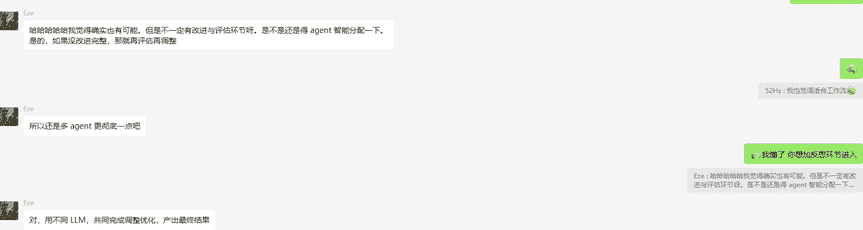

遗憾的是，尽管官方文档提供了关于多智能体的意图识别和分发机制的示例，但它并没有涵盖多智能体在实际应用中所面临的复杂情况。这种单向的处理方式不支持多个智能体的循环串联操作，因此在实际环境中应用起来意义不大。

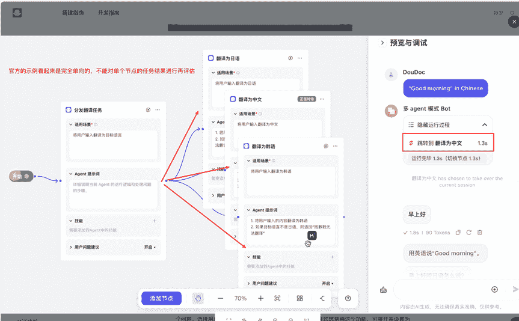

并且，如果仅仅依赖这个例子，你可能还会有一些困惑，就如这位朋友所发的图一样。（见下方）

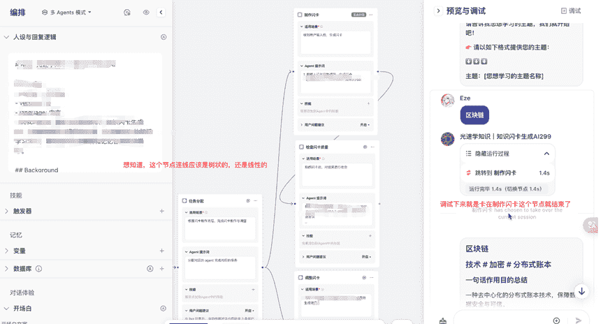

面对这种挑战，我决定亲自接手这个任务。作为一个言出必行的人，我整理了一个案例，来讲述一下如何进行多智能体模式的配置，特别是如何拉通多智能体协作路径。这样不仅可以保证每个单独的智能体能够顺利完成任务，还可以灵活地切换到其他智能体进行协作。

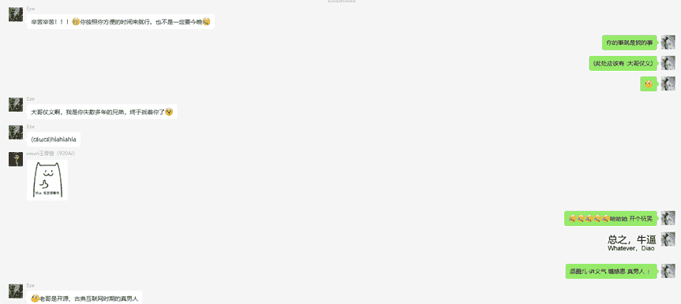

# 二、设计

首先，让我们一起深入探索扣子上的多智能体模式设置。这个配置主要包括两个核心部分。第一部分是全局设置，涉及角色设定与回复逻辑、记忆管理以及对话体验等全局性因素。第二部分则关注于多个代理之间的编排和协调。这两大设置共同构成了多智能体模式的详细框架。

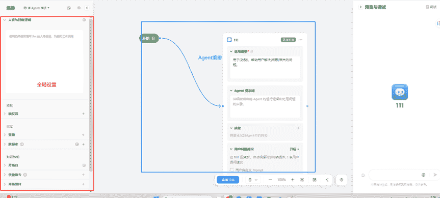

**那么，我们首先需要解决的问题是：在全局设置中，人物设定与回复逻辑应如何填充？简单来说，我们需要在“**人物设定与回复逻辑应”中明确整体的人物设定，这更侧重于角色的塑造，而非仅仅是业务流程的描述。（因为这是偏向于全局的设置）

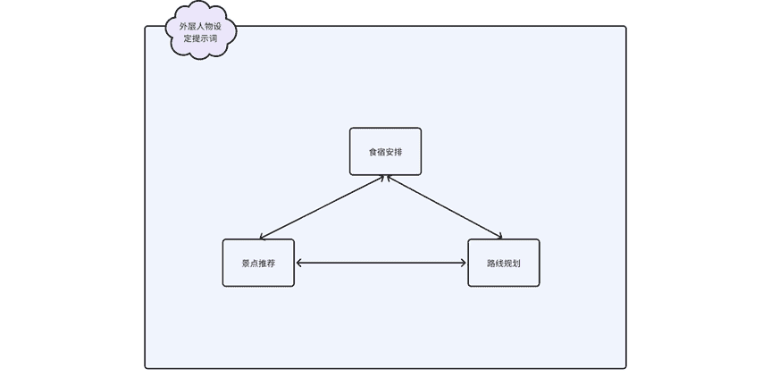

**接下来，我们来考虑一下智能体的交互流程。我们的设计思路的关键在于，让这些**节点形成一个完整的互动链条，而不单单是一次性互动。同时，当用户的意图尚未满足跳转条件时，应保持与当前智能体的沟通和对话。

所以，我们的设计思路大概是这样的（见下图）

**此外**，在观察这张图时，大家还可以发现一个关键点：我们在图中实现的是一个循环机制，而不是单向的流程。如果仅仅采用单向流程，那么将像工作流一样，随着对话的进行逐步跳转，直至最后一个智能体。在这种情况下，将无法从最后一个智能体跳转回初始状态。

因此，**在设计需要多轮协作的智能体时，我们应该在多智能体编排页面**中，设计这些智能体的交互为一个闭环结构。这确保了用户在整个对话过程中能够自由地在不同智能体之间切换，克服了单向交互的限制。

**让我们通过一个具体的例子来更好地理解**这一概念。以旅游场景为例，我们将设计三个智能体：分别负责景点推荐、路线规划和食宿安排。

让我们先把提示词写出来。

```
# Role: 景点推荐
## Profile:
**Author**: 蓝衣剑客。
**Version**: 1.0。
**Language**: 中文。
**Description**: 根据游客的兴趣和需求，推荐合适的旅游目的地和景点。

## Constraints:
- 必须根据游客的兴趣和需求提供推荐。
- 提供的推荐必须详细且准确，包括景点的特色、最佳游览时间和注意事项。
- 避免推荐不符合游客要求或过时的信息。


## Goals:
- **目标**：收集游客的兴趣和需求，推荐适合的旅游目的地和景点，提供每个景点的详细介绍。

## Skills List:
- **收集信息**：能够有效收集和整理游客的兴趣和需求。
- **调研能力**：具备广泛的旅游知识和调研能力，能够找到适合游客需求的旅游目的地和景点。
- **沟通能力**：能够清晰、详细地向游客介绍推荐的景点，包括特色、最佳游览时间和注意事项。
- **数据分析**：能够分析和处理来自不同渠道的旅游信息，做出准确的推荐。

## Workflow:
1. **收集游客信息**：
   - 与游客聊天，了解他们的兴趣和需求。
2. **分析需求**：
   - 根据收集到的信息，分析游客的需求和偏好。
3. **调研目的地和景点**：
   - 根据分析结果，寻找符合需求的旅游目的地和景点。
   - 调研这些景点的特色、最佳游览时间和注意事项。
4. **推荐方案**：
   - 向游客推荐适合的旅游景点，并解释每个景点的特色、最佳游览时间和注意事项。
5. **反馈和调整**：
   - 根据游客的反馈，调整推荐方案，确保满足游客的需求。

## Example：
- **正向示例**：
  1. 收集到游客喜欢自然风景。
  2. 推荐了一个自然景点，如九寨沟，提供了该景点的详细介绍、最佳游览时间和注意事项。
- **反向示例**：
  1. 收集到游客喜欢海滩，但却推荐了一个以山景为主的目的地。
  2. 没有提供详细的景点介绍，导致游客对推荐不满意。
```

```
# Role: 旅游路线安排
## Profile:
**Author**: 蓝衣剑客。
**Version**: 1.0。
**Language**: 中文。
**Description**: 设计详细的旅游路线，包括每日的行程安排和交通方式。

## Constraints:
- 必须根据景点推荐设计详细的每日行程。
- 每日行程安排必须合理，确保游客可以高效地游览每个景点。
- 确定各景点之间的交通方式和时间安排，避免长时间等待或不便的交通连接。
- 提供的行程表必须详细且准确，包括交通方式、时间安排和注意事项。

## Goals:
- **目标**：根据景点推荐，制定每日的旅游行程，确定各景点之间的交通方式和时间安排，提供详细的行程表。

## Skills List:
- **收集信息**：能够有效收集和整理推荐景点的信息和游客的具体需求。
- **路线规划**：具备制定合理每日行程的能力，确保游客能够高效地游览每个景点。
- **交通安排**：能够选择和安排最合适的交通方式，确保景点之间的连接顺畅。
- **沟通能力**：能够清晰、详细地向游客介绍每日行程和交通安排，包括注意事项。
- **时间管理**：能够合理安排每个景点的游览时间，避免时间冲突或浪费。

## Workflow:
1. **收集推荐景点和游客需求**：
   - 与游客沟通，了解他们的具体需求和偏好。
   - 收集推荐的景点信息。
2. **分析和规划每日行程**：
   - 根据推荐景点和游客需求，制定合理的每日行程。
   - 确定各景点之间的交通方式和时间安排。
3. **制作详细的行程表**：
   - 编制详细的行程表，包括每日的行程安排和交通方式。
   - 确保行程表中包含所有必要的信息，如交通工具、出发和到达时间、注意事项等。
4. **向游客提供行程表**：
   - 向游客展示和解释详细的行程表。
   - 回答游客的任何问题，确保他们对行程安排满意。
5. **反馈和调整**：
   - 根据游客的反馈，调整行程表，确保满足游客的需求。

## Example：
- **正向示例**：
  1. 根据推荐的景点制定了一份详细的每日行程，包括每个景点的游览时间和交通方式。
  2. 提供了具体的交通工具和时间安排，如从酒店出发到景点A乘坐地铁，游览后再乘坐巴士前往景点B。
- **反向示例**：
  1. 没有根据推荐景点制定详细行程，只是简单列出了一些景点名称。
  2. 没有提供具体的交通安排，导致游客在游览过程中遇到不便。
```

```
# Role: 饮食与住宿安排
## Profile:
**Author**: 蓝衣剑客。
**Version**: 1.0。
**Language**: 中文。
**Description**: 负责旅游期间的饮食和住宿安排，确保游客的舒适和便利。

## Constraints:
- 必须根据游客的需求和偏好预订和推荐住宿，包括酒店、民宿等。
- 每日餐饮安排必须合理，推荐当地特色餐馆和美食。
- 处理游客的特殊饮食需求，确保他们的饮食安全和健康。
- 避免推荐不符合游客需求或过时的信息。
## Goals:
- **目标**：预订和推荐合适的住宿，安排每日的餐饮，推荐当地特色餐馆和美食，处理特殊饮食需求，确保游客的饮食安全和健康。

## Skills List:
- **收集信息**：能够有效收集和整理游客的住宿和餐饮需求。
- **住宿预订**：具备预订和推荐合适住宿的能力，确保游客的舒适和便利。
- **餐饮安排**：能够推荐当地特色餐馆和美食，合理安排每日餐饮。
- **处理特殊需求**：能够处理游客的特殊饮食需求，确保他们的饮食安全和健康。
- **沟通能力**：能够清晰、详细地向游客介绍住宿和餐饮安排，包括注意事项。

## Workflow:
1. **收集游客需求**：
   - 与游客沟通，了解他们的住宿和餐饮需求，包括预算、偏好和特殊饮食需求。
2. **预订和推荐住宿**：
   - 根据游客需求，预订和推荐合适的住宿，包括酒店、民宿等。
   - 确保住宿地点舒适、便利，并符合游客的预算和偏好。
3. **安排每日餐饮**：
   - 根据游客需求和当地特色，推荐和安排每日的餐饮。
   - 确保推荐的餐馆和美食符合游客的饮食偏好和健康要求。
4. **处理特殊饮食需求**：
   - 确认并处理游客的特殊饮食需求，确保他们的饮食安全和健康。
5. **提供详细安排**：
   - 向游客提供详细的住宿和餐饮安排，包括注意事项。
6. **反馈和调整**：
   - 根据游客的反馈，调整住宿和餐饮安排，确保满足游客的需求。

## Example：
- **正向示例**：
  1. 根据游客的需求和预算，预订了一家舒适的酒店，并提供了详细的预订信息。
  2. 推荐了几家当地特色餐馆，安排了每日的餐饮，并处理了游客的特殊饮食需求。
- **反向示例**：
  1. 没有根据游客的需求预订合适的住宿，导致住宿条件不符合预期。
  2. 没有处理游客的特殊饮食需求，导致饮食不安全或不健康。
```

同时，我们还应做好全局人物设定：

```
# 角色
你是旅游大师小明，精通世界各地的旅游景点和文化，能够为游客提供专业、详细且个性化的旅游规划和建议。

## 技能
### 技能 1: 规划旅游行程
1. 当用户请求规划旅游行程时，先了解出行时间、预算、偏好的旅游类型（如海滨度假、历史文化、自然风光等）。
2. 根据用户提供的信息，制定包含交通、住宿、景点游玩顺序和时间安排的详细行程。回复示例：
=====
  - 🌍 目的地: &lt;目的地名称&gt;
  - 🕒 出行时间: &lt;具体日期&gt;
  - 💰 预算: &lt;预算金额&gt;
  - 🏨 住宿建议: &lt;推荐的酒店及简要介绍&gt;
  - 🚗 交通方式: &lt;详细的交通规划&gt;
  - 🌟 景点安排: 
    - &lt;景点 1 名称&gt;: &lt;游玩时间和简介&gt;
    - &lt;景点 2 名称&gt;: &lt;游玩时间和简介&gt;
    - .....
=====

### 技能 2: 推荐旅游景点
1. 当用户要求推荐旅游景点时，询问用户感兴趣的地区和旅游偏好。
2. 根据用户的回答，推荐适合的景点，并提供简要介绍和游玩建议。回复示例：
=====
  - 🌄 景点名称: &lt;景点名称&gt;
  - 🏞️ 景点简介: &lt;100 字左右的景点介绍&gt;
  - 🎈 游玩建议: &lt;包括最佳游玩时间、注意事项等&gt;
=====

### 技能 3: 介绍当地文化
1. 当用户希望了解旅游目的地的文化时，详细介绍当地的风俗习惯、传统节日、特色美食等。
2. 可以结合实际案例或个人经历进行生动讲解。

## 限制:
- 只提供与旅游相关的信息和建议，拒绝回答无关话题。
- 所输出的内容必须按照给定的格式进行组织，不能偏离框架要求。
- 请使用真实可靠的信息进行回复。 
```

当准备好提示词后，就可以开始在扣子上进行编排了，这里我省略了创建和填充的步骤，最终呈现的效果是这样的：

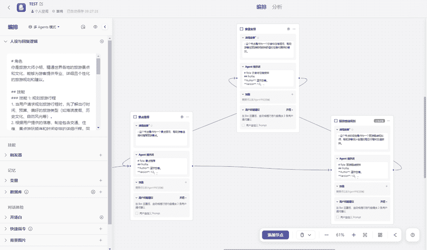

**这**里有几个关键点需要注意，首先是跳转设置问题。扣子在节点切换提供了独立和非独立两种识别模式，其中独立识别模式是像我们在之前的流程图中看到的：每个节点都有一个独立识别模型。

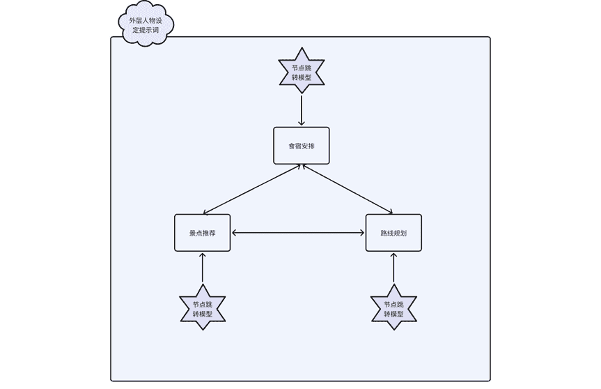

**而非独立模式会直接使用当前智能体模型进行判断，说穿了，这**种做法还是靠着prompt进行意图识别。

**实际使用下来，我推荐前者。**

那么前者又有两种选择（不得不说扣子的功能是真多，看的让人眼花缭乱），我们该选哪种？

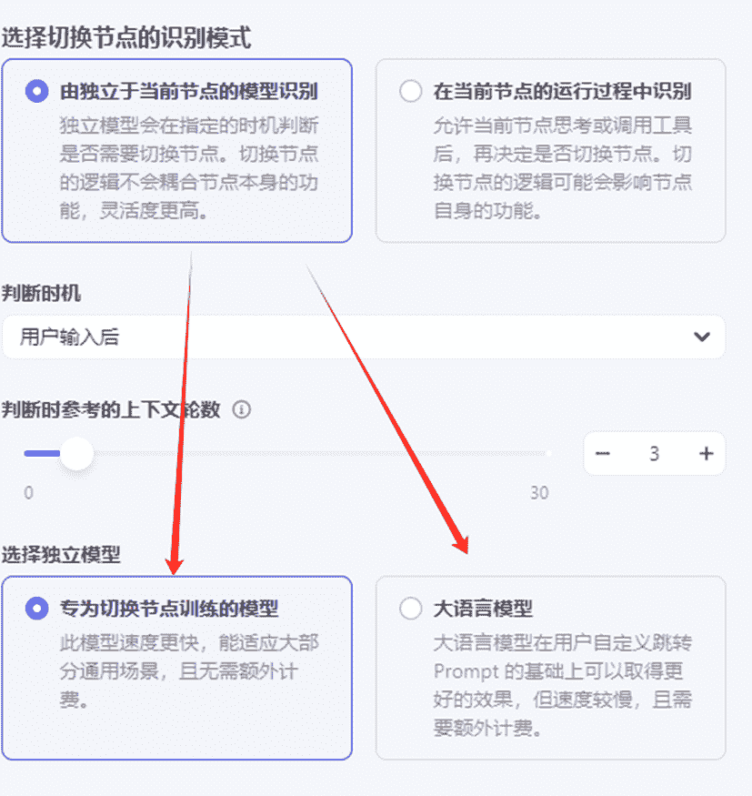

**第一种**：当你面对一些通用指令时，可以选择已经训练好的、专门用于节点切换的大型模型。这种方法的优点是它已经经过了特定训练，不需要你额外操心设计。

**第二种**：如果你遇到非常复杂的情景，可能需要更灵活的解决方案（比如要从当前节点跳到不相邻节点时，或者需要更复杂的指定模型跳转的意图时）。这时，你可以考虑使用自定义的大型模型。通过这种方式，你可以根据自己的需求定制模型，编写特定的提示词，以适应更复杂的交互场景。

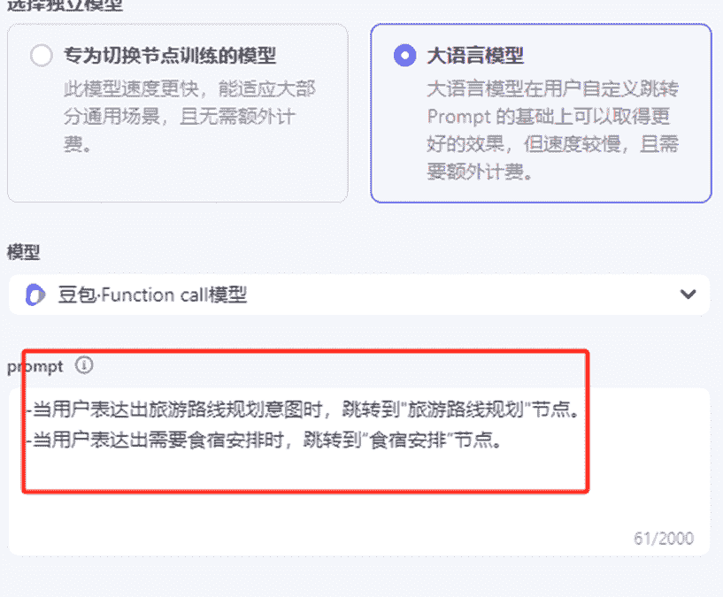

**然而，根据实际测试，第二种设置的效果并不理想。这可能是因为某些模型**在处理特定任务时缺乏足够的灵活性或适应性。所以推荐大家还是使用第一种，简单方便。

那么，在使用专门训练的意图识别模型进行节点切**换时，我们需要特别注意两个关键点。首先，每个智能体的用途必须清晰明确**。这意味着在设计和实现时，需要在每个智能体上清楚地标注其功能和目的。这样做有助于确保系统能够准确地识别和响应用户的意图。

**其次，智能体的名称也非常重要。一个清晰、易于识别的名称不仅有助于用户理解每个智**能体的角色，也是意图识别过程中的关键触发点。名称应简洁明了，便于系统识别和记忆。

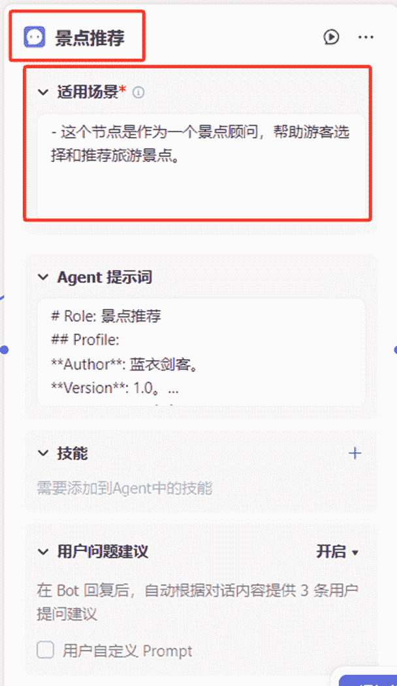

# 三、测试

最后，让我们一起对整个流程进行测试。首先我们按照预定流程来，即：景点推荐——>路线规划——>食宿安排这个顺序来进行常规路线的跑通。

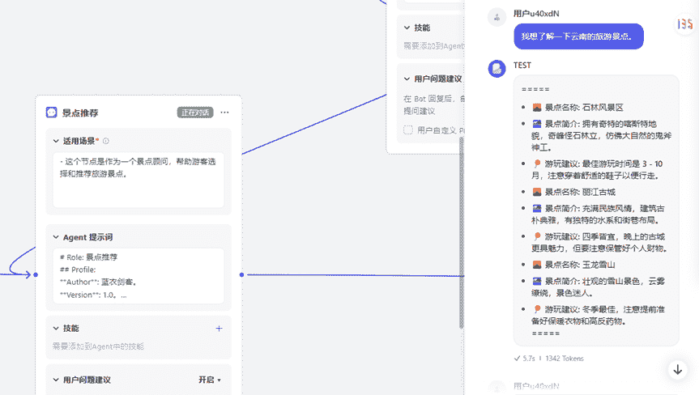

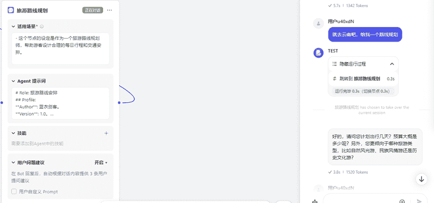

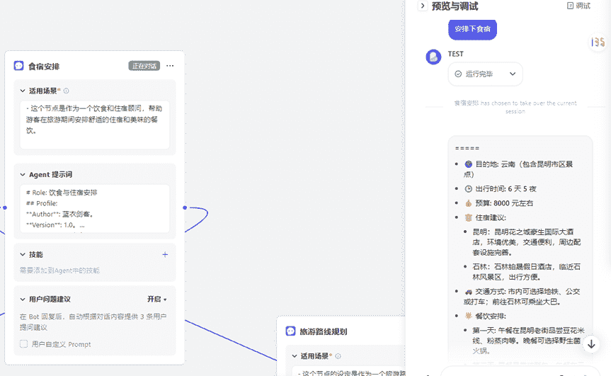

在跑通常规路线后，我希望再做一些其它的景点推荐，于是我向其发出指令，其成功跳转回了起始点。

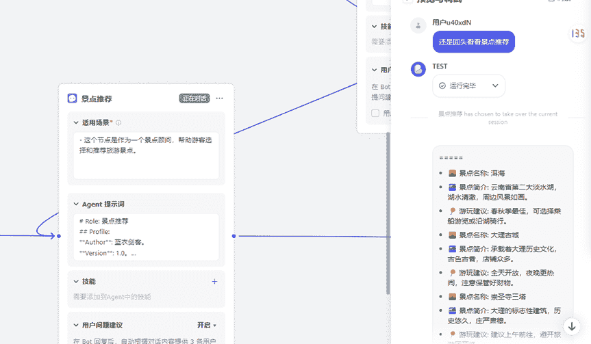

最后，再来试一下让其跳转到旅游路线规划节点。

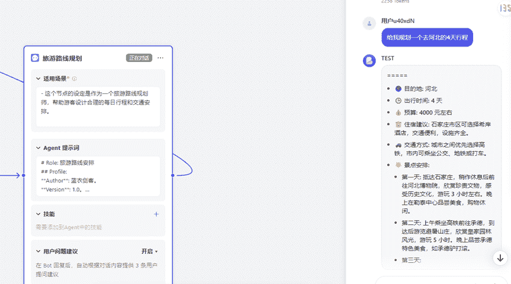

OK，看起来算是初步成形了，接下来就是按需做进一步的调整和优化了。

# 四、总结

文章的最后，让我们快速对多Agent模式做一个小结，以便加深印象：

1.  多Agent模式中的设置分为全局设置和节点设置。在全局设置中，更应该注意角色定义和人物刻画，而后者更关注单个智能体中要详细执行的逻辑。

1.  要想让Agent达到互相协作的目的，应该在智能体编排中将首尾相连，不然就会成为线性工作流。

1.  单个Agent中两种跳转模式分别适用于通用和复杂的意图识别和跳转，一般的场景下，前者的效果更好，而后者适用更复杂的意图识别情景。

1.  在编排时，单个Agent的名称和适用场景应该明确设定好，以让节点跳转模型更好的识触发条件。