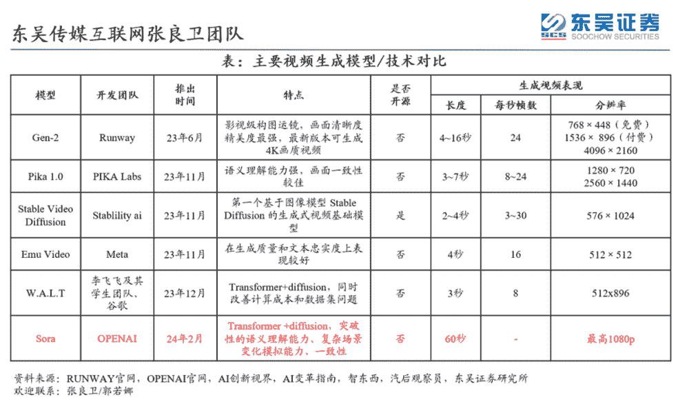
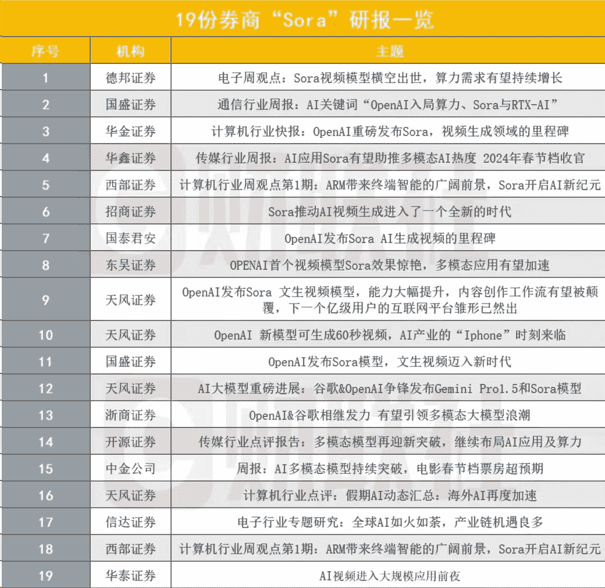
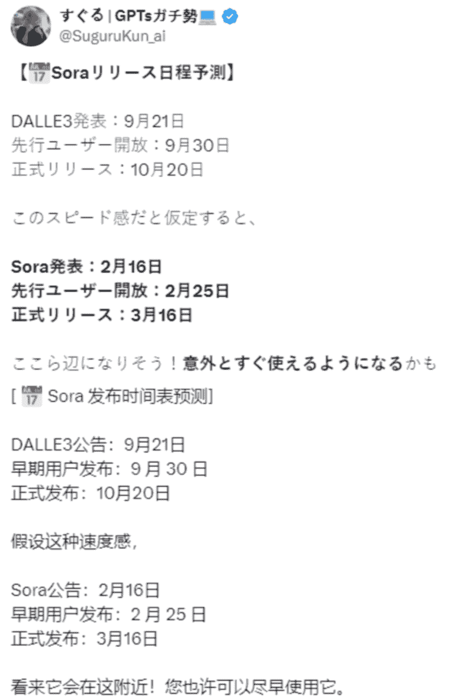
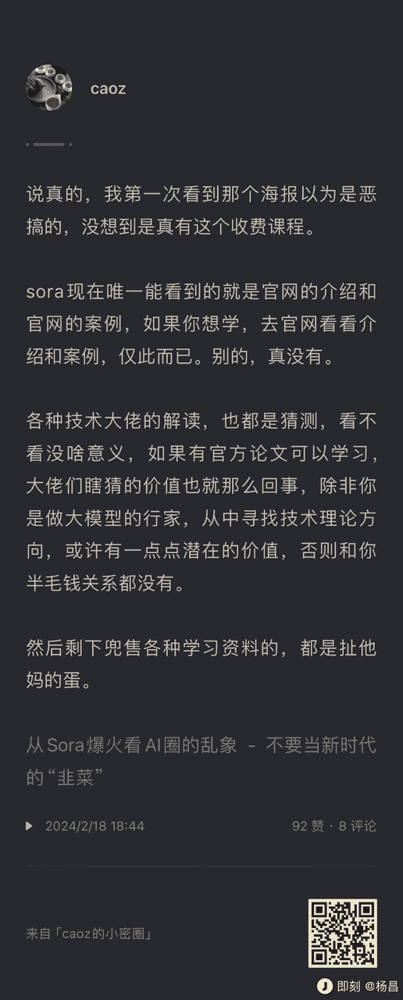
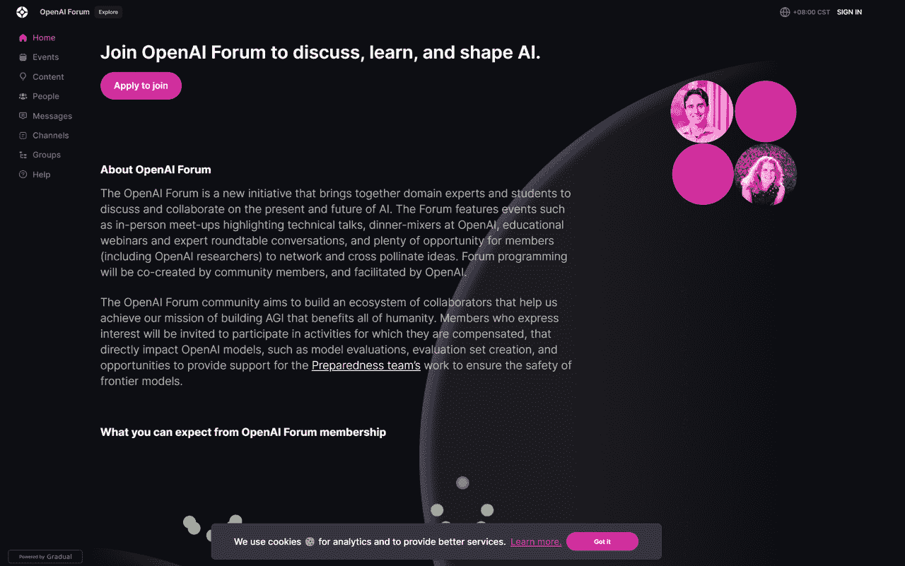

# Sora 体系内容

> 来源：[https://langgptai.feishu.cn/docx/NhoXdIh1RoaAGtxXvt4chdaUned](https://langgptai.feishu.cn/docx/NhoXdIh1RoaAGtxXvt4chdaUned)

必须提醒一下各位，警惕新型诈骗！

现在是2024年2月18日，OpenAI 的 Sora 模型还未向公众开放！

**目**前OpenAI也就画了个 Sora的大饼而已，在 Sora 正式发布前打着 Sora旗号卖课的都是诈骗！

LangGPT 社区持续关注 Sora， 同时提供高质量开放内容，欢迎关注~

## 内容列表

> 目前 OpenAI 官网上 Sora 生成的视频 demo，效果逼真。

> **官方网站：**https://openai.com/sora?open_in_browser=true

>

## Sora 原理解读

### Sora官方原理解读

[1. Sora 官方文档翻译解读](https://langgptai.feishu.cn/wiki/G0M5w39zBiDbC2kymxzc1BXHncc)

### Sora 原理解读--小学生版本

https://mp.weixin.qq.com/s/E7fcLUkE_ihJ_2eaiSyGqw

### Sora 原理解读--中学生版本

https://mp.weixin.qq.com/s/KUnXlDlg-Rs_6D5RFpQbnQ

## Sora 和主要的视频生成模型对比

##

## Sora 的 6 大优势

《每日经济新闻》记者经过对官方技术报告的梳理，总结出了 Sora 的 6 大优势：

**（1）准确性和多样性：**Sora 的显著特征之一是能够准确解释长达 135 个单词的长提示。它可以准确地解释用户提供的文本输入，并生成具有各种场景和人物的高质量视频剪辑。这一新工具可将简短的文本描述转化成长达 1 分钟的高清视频。它涵盖了广泛的主题，从人物和动物到郁郁葱葱的风景、城市场景、花园，甚至是水下的纽约市，可根据用户的要求提供多样化的内容。

**（2）强大的语言理解：**OpenAI 利用 Dall-E 模型的 re-captioning（重述要点）技术，生成视觉训练数据的描述性字幕，不仅能提高文本的准确性，还能提升视频的整体质量。此外，与 DALL·E 3 类似，OpenAI 还利用 GPT 技术将简短的用户提示转换为更长的详细转译，并将其发送到视频模型。这使 Sora 能够精确地按照用户提示生成高质量的视频。

**（3）以图/视频生成视频：**Sora 除了可以将文本转化为视频，还能接受其他类型的输入提示，如已经存在的图像或视频。这使 Sora 能够执行广泛的图像和视频编辑任务，如创建完美的循环视频、将静态图像转化为动画、向前或向后扩展视频等。OpenAI 在报告中展示了基于 DALL·E 2 和 DALL·E 3 的图像生成的 demo 视频。这不仅证明了 Sora 的强大功能，还展示了它在图像和视频编辑领域的无限潜力。

**（4）视频扩展功能：**由于可接受多样化的输入提示，用户可以根据图像创建视频或补充现有视频。作为基于 Transformer 的扩散模型，Sora 还能沿时间线向前或向后扩展视频。从 OpenAI 提供的 4 个 demo 视频看，都从同一个视频片段开始，向时间线的过去进行延伸。因此，尽管开头不同，但视频结局都是相同的。

**（5）优异的设备适配性：**Sora 具备出色的采样能力，从宽屏的 1920x1080p 到竖屏的 1080x1920，两者之间的任何视频尺寸都能轻松应对。这意味着 Sora 能够为各种设备生成与其原始纵横比完美匹配的内容。而在生成高分辨率内容之前，Sora 还能以小尺寸迅速创建内容原型。

（6）场景和物体的一致性和连续性：Sora 可以生成带有动态视角变化的视频，人物和场景元素在三维空间中的移动会显得更加自然。Sora 能够很好地处理遮挡问题。现有模型的一个问题是，当物体离开视野时，它们可能无法对其进行追踪。而通过一次性提供多帧预测，Sora 可确保画面主体即使暂时离开视野也能保持不变。

## Sora 券商研报

[8.行业研报](https://langgptai.feishu.cn/wiki/Ck88wrjpTiRVfSkHiqCciSdVn1d)

[至少14家券商发布19份Sora研报 AI视频进入大应用前](https://finance.eastmoney.com/a/202402182987652710.html)夜 算力有望成投资新热门 _ 东方财富网

## 可能正式发布时间

## 相关报道

### 腾讯sora解读--OpenAI王炸模型引爆科技圈

https://mp.weixin.qq.com/s/gSvxvOVqYtGcKw0ueDGbFA

### 阿里云sora解读--复刻Sora有多难？

https://mp.weixin.qq.com/s/xP46EocNg1x7IlTN_iF8kw

### 清华大学

https://mp.weixin.qq.com/s/OQVLA6p9sXnivY6BQaaLTQ

### 央视

https://mp.weixin.qq.com/s/PS_WfoOX35XoScgoQJJVcA

### CSDN

https://mp.weixin.qq.com/s/1iqYtq13DniEJxTLBwTJmg

## Sora 诞生普通人赚钱机会

1、售卖Sora账号或者邀请码

2、使用Sora生成视频，起号做自媒体

3、知识付费，制作Sora相关的使用教程

4、用Sora做小说视频推文

5、直播带货，推广Sora相关的付费产品

6、制作套壳的Sora工具和网站

7、做电商，围绕Sora的搜索词

8、Sora生成的视频上传到素材网站

9、代制作生成视频

10、售卖高质量的视频生成prompt

11、套壳

## 如何看待现有 Sora 资料（在 Sora 正式向公众开放使用前）

## Sora 提前体验渠道

渠道一：

目前只有红队测试成员才能体验 Sora，目前 Red Team 开始公开招募，要求比较高 。Sam之前说过，如果进入到红队，可以有Sora的内测机会（机会比较小，不过聊胜于无吧）

申请链接: https://openai.com/form/red-teaming-network

渠道二：

https://forum.openai.com

OpenAl 的官方论坛，加入论坛有机会得到内测机会（机会比较小，不过聊胜于无吧）

## Sora 交流群

**入群方法: **

1.  添加江树🛰️ zephyr_ai (若无法添加，可添加甲木🛰️ zuiyn_soul )

1.  私发**正经的**自我介绍（应该都会叭，不会的请参照面试标准）

1.  江树邀请进群

1.  进群后自我介绍。

若 1,2 步骤无误，未被邀请进群，请戳戳江树，也许是他忘记了，绝非🛰️系统原因，谢谢！