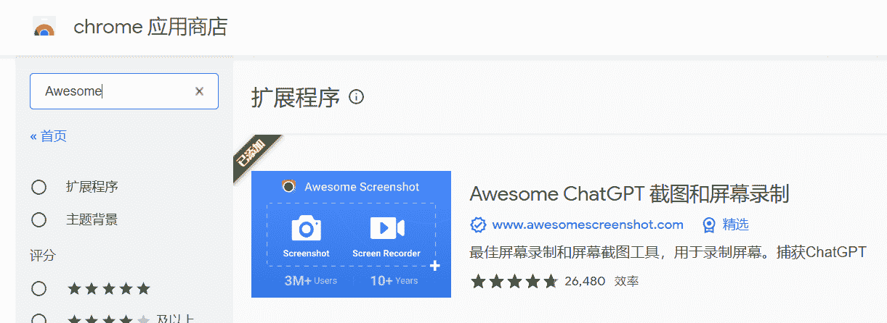
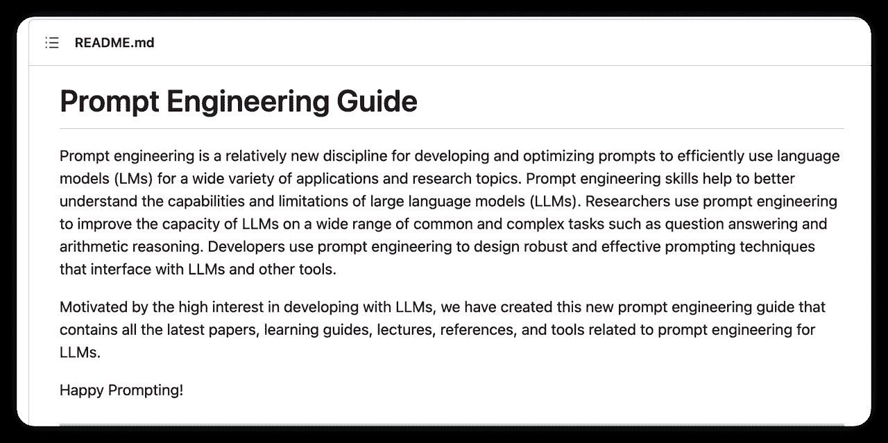
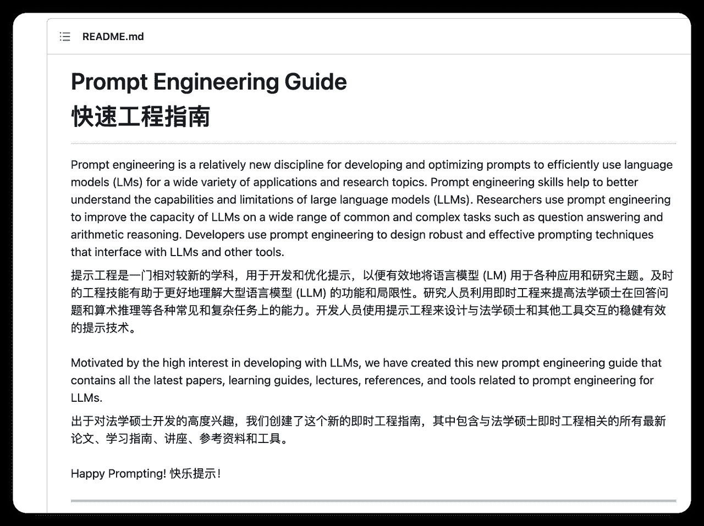
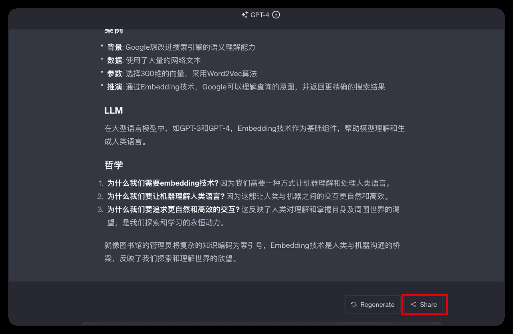
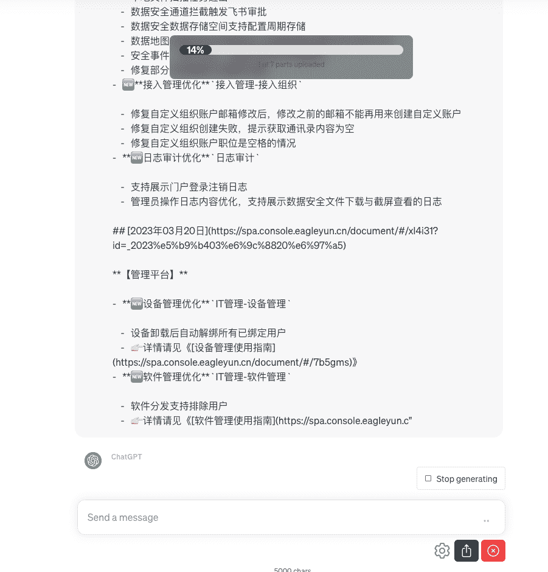

# 小工具

> 来源：[https://langgptai.feishu.cn/docx/Fz2Vdeyxwo0COFxDpoacpssznBd](https://langgptai.feishu.cn/docx/Fz2Vdeyxwo0COFxDpoacpssznBd)

## token数查询

> GPT-3.0查询工具

> 3.5&4.0查询工具（感谢小七姐推荐）

## GPT上下文截屏工具

> chrome和edge都能搜到

## 英文翻译神器

> 看外文网页、文献必备工具，沉浸式的中英混合排版，让你不会再排斥英文阅读。

## shareGPT

> 可以把 chatgpt 的对话记录，分享给其他人（即使其他人没有魔法，也能查看），非常好用的一个插件

## 大文件上传插件 -  ChatGPT File Uploader Extended

> 可以将一个文件上传给ChatGPT，TXT, JS, PY, HTML, CSS, JSON, CSV, MD, TS, TSX, JSX等格式文件。智能自动提取机制，可从PDF、Word、Excel和Image文件中提取文本内容

> 本质上是一个巧妙的Prompts，让ChatGPT能快速接受分段内容。

