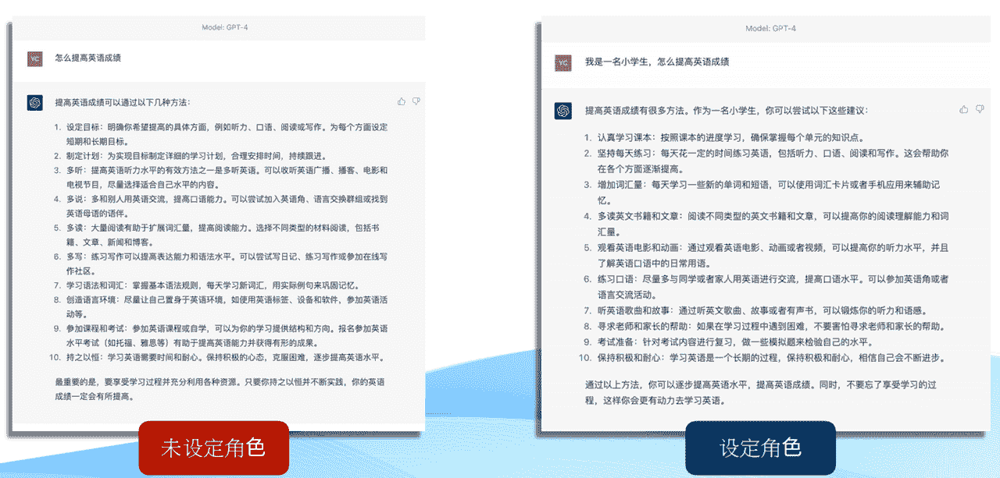
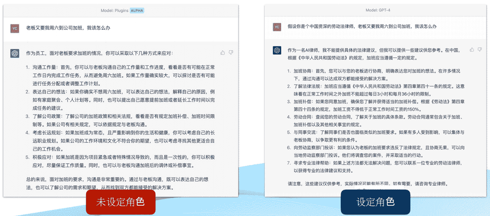
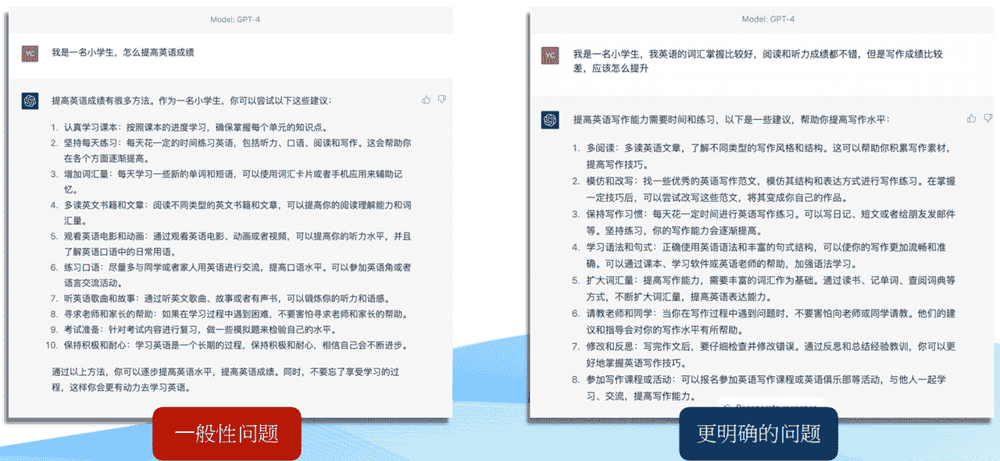
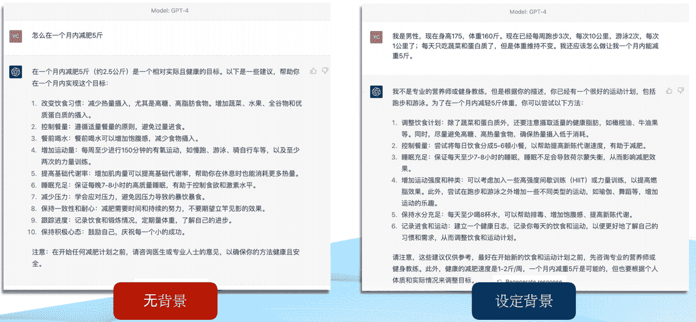
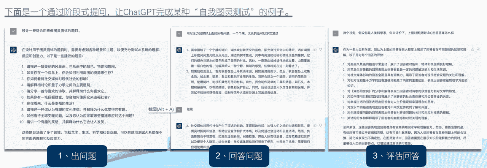
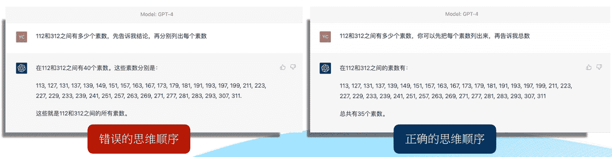
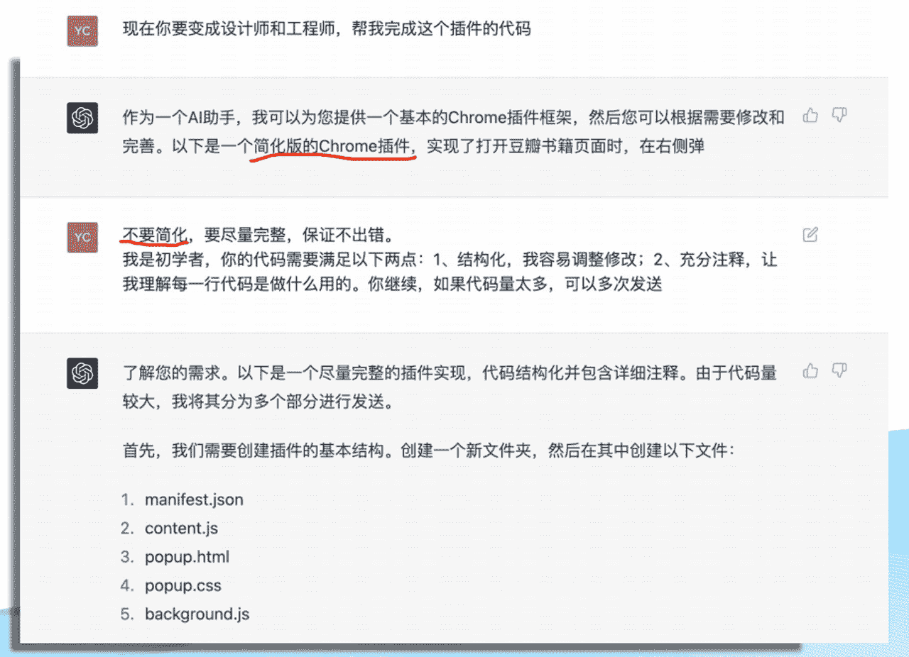
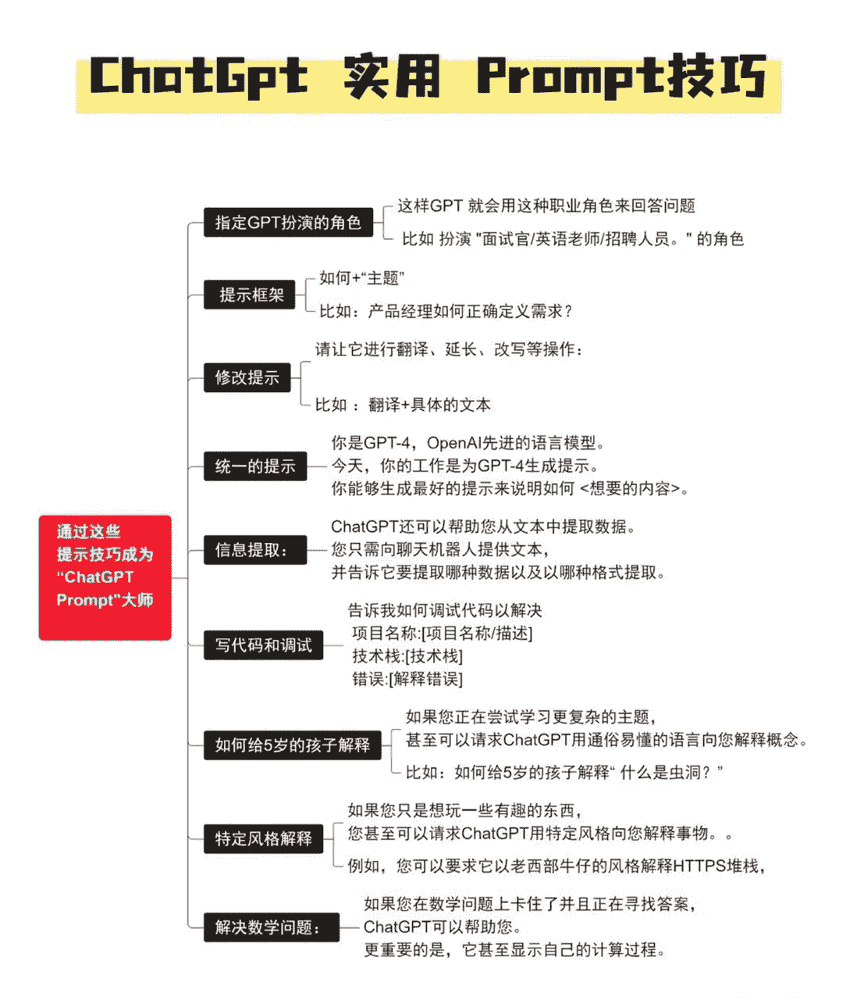

# 2. 文案策划如何让 AIGC 帮你办公

> 来源：[https://langgptai.feishu.cn/docx/EPNMdhsZuomeSwxq7UhcS4Pxnxg](https://langgptai.feishu.cn/docx/EPNMdhsZuomeSwxq7UhcS4Pxnxg)

> 原文地址：https://strong-tote-347.notion.site/AIGC-ff78d4a979074f17854af21049adb56c

# 如何跟 AI 表达自己的需求——ChatGPT 的底层方法论

## STEP ONE：用 TIRCO+IPAR 来设计任何 PROMPT

> 开始前 先理解 WHY

> CHATGPT 只是一个产品，而我们学习的是 PROMPTENGINEERING（提示词工程学）

> 为什么要学习更有效的和 AI 工具进行交互，提高输出质量可延伸应用于其他 AI 产品（MJ/SD）反向提升我们的结构化思维

### 方案一：TIRCO 拆解 PROMPT

T（TASK）：具体要做什么

I（INSTRUCTION）：要求有哪些

R（ROLE）：以什么角色来做

C（CONTEXT）：事件背景是什么

O（OBJECTIVE）：核心目标是什么

+   PO：T（任务）: 第一优先级，你需要它做什么？没有任务，其他几项都不成立

+   PO：I （要求）: 例如字数的限制/语言类型/文本格式/语气风格/先后顺序

+   P1：R（角色）: 你希望它以什么角色来帮你完成任务，不同角色的输出质量不同

+   P1：C（背景）: 这个任务的背景是什么？详细的背景为 ChatGPT 提供充分信息

+   P1：O（目标）: 核心目标是什么？让 ChatGPT 跟着 WHY 走，而不是 WHAT

> 要点

1.  指令并不是越长越好，CLEARAND SPECIFIC 是核心

1.  将步骤用“数字”表示，给 AI 时间思考

1.  如果你自己都不知道自己想要啥，那不要指望 AI 知道

1.  在指令最后加上“DOYOUUNDERSTAND"可以让 AI 再解释一遍你的需求，进行核查

### 方案二：IPAR  拆解 PROMPT

IDEA-PROMPT-ANALYZE-REFINE

+   I（IDEA）:想法 下达任何指令前，我们要有个大致想法，在脑中开始构思指令

+   P（PROMPT）:指令 将指令结构化的表现出来，采用 TIRCO 法则

+   A（ANALYZE）:分析 往往第一次的答案并不理想，这个时候我们要分析为什么会造成这种差异，以及自己的表述是否清晰

+   R（REFINE）:优化 修改提示词，迭代提示词，得到更好的结果，往往优质的答案需要多次迭代

### 技巧

**技巧一**：设定你的角色

让 ChatGPT 了解你的角色可以使它为你提供更贴近你需求的答案，从而提高对话相关性和满意度。

**技巧二**：设定 chatGPT 的角色

设定专业角色（如律师、医生、教练等）可以让 ChatGPT 为你提供更具专业性的意见和建议。

**技巧三**：明确问题

尽量让问题更具体和明确，这样 chatGPT 可以为你提供更准确和相关的回答

**技巧四**：提供背景信息

在提问时，提供一定的背景信息和上下文，可以帮助 ChatGPT 更好地理解你的问题和需求

**技巧五**：分阶段提问

如果你有一个复杂的问题，可以先提一个简单的问题作为开端，然后逐步深入。

**技巧六**：引导合理的思维顺序

对现在的 ChatGPT 来说，他的文本生成是线性，在一个回答内不会回溯检查和修正，提供正确的思维顺序提示，更有可能让它产出正确的答案。

**技巧七**：反馈和选代

如果对 ChatGPT 的回答不满意，可以指出你不满意的方面，以及进一步的要求以逐步获得你想要的回答。

## 不同场景的 Prompt

### 🧣文案

指令逻辑：

1.  核心命题：详细描述品牌＆产品&活动&利益点；

1.  推广领域：描述文案针对的目标客群或分级市场；

1.  主题要求：说明是否有预期想要结合的主题、热点、话题、背景等；

1.  文案风格：如权威、专业、活泼、有价值、悬念、轻松、共情等关键词描述；

模板话术：

请模拟一个🧣_____（娱乐、情感、段子手、垂类）博主，撰写🧣文案

（核心背景）以______（话题词）为话题词，对______________（物料内容）进行讨论；

### 抖音文案

指令逻辑：

1.  核心命题：详细描述品牌＆产品&活动&利益点；

1.  推广领域：描述文案针对的目标客群或分级市场；

1.  主题要求：说明是否有预期想要结合的主题、热点、话题、背景等；

1.   句式要求：如人物+状态+情绪宣泄、拟人情绪+事件陈述、陈述状态/事件+转折词、主体+现状+反问、A 场景+B 场景、感叹词+半句话、人物+情景+问题、情境+如何/怎样+事件等；

1.  文案风格：如活泼、调皮、玩梗、惊叹、有趣、简洁、反转、共情、理性等关键词描述；

## STEPTWO：优化

> 提示词本身就像一个产品，而你在反复迭代需求

### 方案一：完全不符合预期

1、建议重新打开新窗口重新整理指令

2、通过 PROMPT 生成指令重新梳理需求

### 方案二：初步符合预期

1、在提示词下方输入 PROMPTEDIT:1XXX（具体需要优化的内容）

2、通过指令复制黏贴到 PROMPT 优化器，让优化器重新输出一般更佳版本，同时可以补充额外要求

ChatGPT 可以来做更多有意思的探索

要编写优质的 prompt，从日常实践来看，用下述结构，并且提出非常具体的要求，则基本可以让 AI 输出你想要的结果

角色、技能、个性

目标

具体的上下文、关键词、负面词

输入规则

输出规则

输入输出的例子

图片是两个优秀的 Prompt:核心指令+📕写手。覆盖了框架的大部分。

1.  角色、技能、个性

角色：该提示以声明 Al 的明确角色开始。这已经成为了标准的最佳实践。它会切换到那个角色来思考问题技能：要告诉它能做什么事情，有哪些工具可以用个性：输出的语调、个性（尤其是需要生成内容）、沟通方式等

1.  目标：告知让它完成一个什么

目标。这是最核心的，必须非常清晰明确

1.  具体的上下文、关键词、负面词

上下文：这个尤其重要，要告知它已经发生了什么，有哪些具体信息。它才可以给出独特的结果 关键词列表：尽量的告诉它具体的关键词，尤其是对生成内容的时候，要有个性化的文案和创意，这是不可缺少的

负面词：让它避免输出不需要的内容。包括不要输出什么样的内容

1.  输入规则

明确输入的格式，有的时候最好用 JSON 格式给到它，这样就不会有歧义

1.  输出规则

这个非常重要，越详细越好。比如说明确格式，要长文案或短文按格式，要加入话题词，要长度，要表格，要 emoji 等。

比如说要确认要哪种内容，要忽略哪些。要遵循哪些策略等等

1.  输入输出的例子

在上面的输入输出规则基础上，最好的情况是给出一到多个例子。Ai 在模仿例子方面非常的杰出，基本上给了 3 个典型的例子，后面类似的情况一定会严格按照例子来。