# 6. 生成式 AI 相关产品和开源项目调研文档

> 来源：[https://langgptai.feishu.cn/docx/YC39dgkyRo1MKexM9qXcrrmUnXg](https://langgptai.feishu.cn/docx/YC39dgkyRo1MKexM9qXcrrmUnXg)

> **本文由来自提示**工程师之家的群友 @Scarlett🌙 投稿，版权归提示工程师之家所有，欢迎转发。

# 简介

## 目的

调研目前市面上具备用户热度的生成式AI 相关产品，总结功能特性和应用场景，为后续插件和应用的开发提供参考和讨论的空间。

## 概述

本文调研了目前市场上具有用户热度的生成式AI相关产品，并总结了它们的功能特性和应用场景。对于开源项目，我们爬取了Github上相关项目的数据指标，并进行了数据分析。对于商业产品，也采取了相应的策略进行分析。

本次爬取到的商业产品数据组样本量为374，除去无效数据（在Similar Web上无法找到对应信息的产品）后，实际样本量为157。在374组商业产品数据中，写作和图像生成产品均超过70件大关。其他产品均未超过30件。除去写作和图像生成产品外，SEO相关产品是第三大产品类别，数量接近30件。写作和图像生成均为现阶段AI浪潮中，GAI（Generative Artificial Intelligence，生成式人工智能）呈现的主要两大基础能力，即文字生成和图像生成。

## 方法

### 定量调研（数据分析）

针对开源项目，本次调研中将会爬取 Github 上的相关项目和对应的各项数据指标，最后汇总到一张 Pandas 输出的 CSV 表格上进行数据分析。对于商业产品，本次调研也会采取相应的策略进行分析。

本次爬取到的商业产品数据组样本量为374，除去无效数据（在 Similar Web 上无法找到对应信息的产品）后，实际样本量为157。

### 定向调研（单个开源项目或产品进行深入分析）

本次调研中会着重抽取一些热度较高、或者实现功能较为具有代表性的商业产品或者开源项目进行功能拆解和深度调研。

# 商业产品

## 发现

1.  在 374 组商业产品数据中，写作和图像生成产品均超过 70件大关。其他产品均未超过 30 件。除去写作和图像生成产品外，SEO 相关产品是第三大产品类别，数量接近 30 件。

1.  写作和图像生成均为现阶段 AI 浪潮中，GAI（Generative Artificial Intelligence，生成式人工智能） 呈现的主要两大基础能力，即文字生成和图像生成。

1.  在其他类别的产品当中，其能力均需要结合目前的 GAI 技术和传统的软件开发能力。实现方法较写作和图像生成来说更为复杂，需要更深度的设计和应用。

1.  **参与度和收入：**网站访问量与收入之间的强正相关表明，吸引更多访客到网站可以对收入产生直接积极影响。因此，增加网站流量的策略是提高收益的重要途径。根据[3]和[5]等研究文献，一些有效的策略包括优化搜索引擎排名、使用社交媒体推广、提供免费试用或优惠券等。

1.  **质量和用户体验：**跳出率与平均访问时长之间的强负相关表明，提高网站质量和用户体验是降低跳出率和增加用户停留时间的关键因素。根据[5]和[6]等研究文献，一些有效的方法包括提供高质量和有价值的内容、提高网站速度和可用性、设计简洁和一致的界面、使用清晰和有吸引力的标题和图片等。

1.  **互动性和用户忠诚度：**每次访问浏览页面数与平均访问时长之间的强正相关表明，提高互动性可以增加用户对内容的兴趣和参与度，从而提高用户忠诚度。根据[7]和[8]等研究文献，一些有效的方式包括使用多媒体元素、提供个性化推荐、设置在线聊天或反馈功能、建立社区或论坛等。

1.  员工数量可能在市场营销方面会起到一定作用，目前还没有发现为什么员工数量和收入会产生强正向关联。

## 定量调研

### 关联性（Correlations）

根据 60 个具备收入信息的数据来看：

#### 访问量与收入之间的强正相关（Corr ~= abs 0.9）：

访问量与收入之间的强正相关表明，随着访问量的增加，收入也有很强的增加趋势。这说明收入与其吸引的访客数量密切相关。

#### 跳出率与平均访问时长之间的强负相关（Corr > abs 0.5）：

跳出率与平均访问时长之间的强负相关意味着，随着跳出率的增加（更多访客只浏览一个产品页面就离开），平均访问时长也会减少。这表明跳出的访客往往在产品上花费的时间较少，也说明他们没有找到感兴趣或相关的内容。

#### 每次访问浏览页面数与平均访问时长之间的强正相关（Corr > abs 0.5）：

每次访问浏览页面数与平均访问时长之间的强正相关表明，浏览更多页面的访客往往在产品上花费更多时间。这说明有吸引力的内容或导航功能可以鼓励访客在访问期间浏览更多页面。

#### 员工数量与总访问量之间的强正相关（Corr > abs 0.5）：

员工数量与总访问量之间的强正相关表明，随着员工数量的增加，总访问量也有增加的趋势。这可能意味着更大的劳动力可能与更有效的营销或客户参与活动有关。

注：

1.  相关性采用皮尔逊方法进行计算。

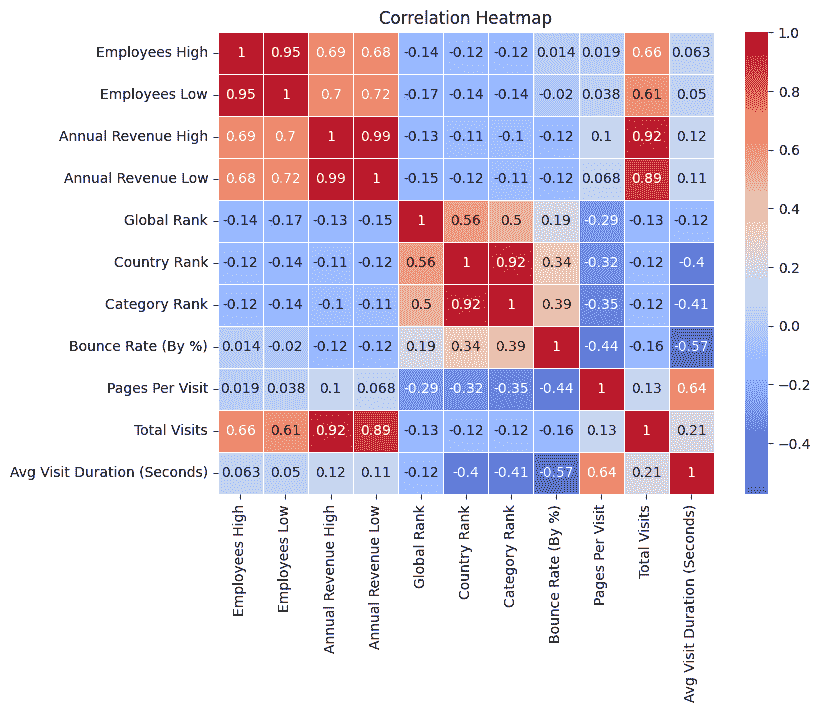

### 产品功能分布图

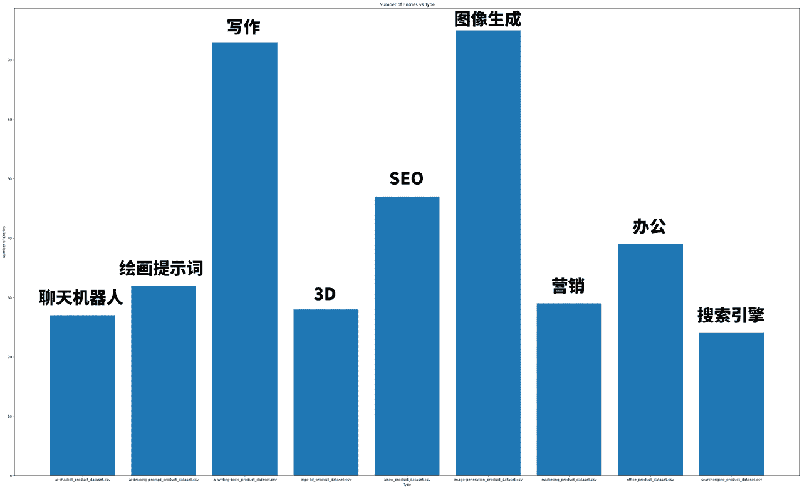

## 定向调研

### 业务相关产品功能抽取

利用向量搜索技术，我们通过“本地生活服务”相关的词语来检索 20 个最相关的生成式 AI 产品服务，并按照上述总结的衡量标准进行排名。总体来说，功能点集中于：结合生成式 AI 的新搜索服务、SEO 优化、市场营销内容生成SaaS、团队协作软件以及 CRM。

### 新搜索服务

新搜索服务是指结合生成式 AI 技术的信息搜集服务。

#### 新搜索服务的 ToB 使用场景

+   公司网站搜索

+   内部资料搜索

+   电商平台搜索

+   以及网络搜索等

#### 新搜索服务目前有两条路线

+   通过大语言模型对搜索结果进行整合处理，输出给用户作为搜索结果

+   通过向量数据库检索关联文字，作为搜索结果返回给用户。

#### 要点总结

+   向量搜索随着机器学习和嵌入的兴起而流行,实现了语义搜索,而不仅仅是关键词搜索。但它是关键词搜索的互补,而不是替代。[11]

+   关键词搜索(倒排索引)和向量搜索(语义搜索)各有优势和劣势。 将两者结合可利用各自的优势。

+   关键词搜索适用于查找名称、数字、短语等精确匹配。向量搜索适用于语义,即使术语不同。

+   关键词搜索具有快速索引/查询、精确匹配的完美精度/召回率,对关键词很高效。向量搜索具有良好的语义召回率,可以捕捉语义,但较慢且不太精确。

+   在数十亿文档和用户中扩展搜索规模很困难。关键词和向量搜索在这方面面临相同的挑战。

+   搜索引擎不仅仅是核心索引。许多其他组件如解析、拼写纠正等也很重要。扩展的解决方案对两者也相似。

+   通过组合关键词和向量搜索，可以获得精确度、速度、扩展性以及语义理解——两全其美。

### SEO 优化

+   SEO的全称是Search Engine Optimization,意思是搜索引擎优化。它的目标是提高网站在搜索引擎中的排名。

+   SEO的主要好处有:增加网站流量、获取更多客户、建立品牌信誉度。它可以让你的营销投资回报率更高。

+   SEO主要可以分为三种类型:网站内部SEO、外链建设、技术SEO。

+   谷歌使用复杂的算法来对页面进行排名,根据诸如内容质量、关键词、外链、网站速度等多种因素。

+   网站内部SEO的主要因素:

+   内容

+   关键词

+   标题

+   元数据

+   图片

+   内链

+   外链建设的主要因素:

+   外链

+   社交分享

+   品牌提及

+   技术SEO的主要因素:

+   网站速度

+   移动端优化

+   安全性

+   网站结构

#### ToB 使用场景

+   新建网站用户

+   老网站SEO优化

#### 要点总结

SEO需要时间积累,优质有用的内容最重要。其他因素包括：关键词研究、获取外链、以及优化技术因素。

大型语言模型如GPT-3.5-Turbo等可以通过多种方式提高SEO效果:关键词研究、自动内容生成、元数据创建、竞争对手分析、外链获取、网站优化、SEO报告生成等。

# 开源项目

## 定量调研

本次调研的开源项目包括之前历来搜集到的开源项目。以下是和插件功能较为接近的产品合集，共计 12 件。

## 定向调研

### AgentGPT

#### 功能

基于 AutoGPT 概念研发的应用。可以让 GPT 模型自行拆解用户提出的任务，进行规划，最后执行并完成。目前 AgentGPT 在初步的测试当中可以实现文章撰写和旅游路线规划等操作。内置一些可以完成特定任务的 Agent，可以直接上手使用。

#### 实现原理

根据 AgentGPT 作者在项目当中的 docs 文件夹的内容[1]，AgentGPT 通过内置“Plan and Solving”提示词工程技术[2]对用户输入进行拆解，并让 GPT 对自己拆解好的任务进行逐步的执行，最后得到结果。

在实现这个功能的过程当中，大语言模型因为上下文长度的限制（实际测试当中采用 8K 上下文长度），使得本身无法记住自己之前生成的任务列表以及已经执行过的任务。在 AgentGPT 当中采取的办法是通过向量数据库来给大语言模型挂载一个记忆库，执行任务当中会从这个记忆库当中进行调用。AgentGPT 当中采用的向量数据库为Weaviate。

截止至调研文档撰写的日期，AgentGPT 还内置了一系列的外部工具可供 GPT 模型进行调用。其中包括：Google 搜索，代码撰写和审核，图像生成以及接入其他个人数据（如，个人笔记本应用Notions 和网盘应用 Google Drive 等）。

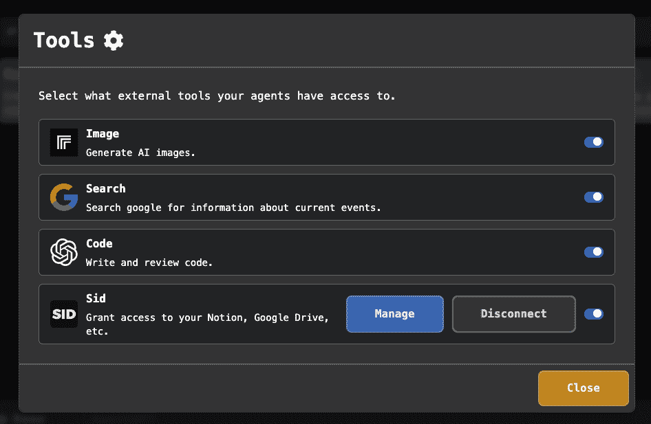

#### 实现效果

没有OpenAI API 的情况下，AgentGPT 只提供 5 轮的试用。但是一般任务执行到第五轮都是完成不了的，所以目前得到的测试结果均为 AgentGPT 完成子任务的能力展示。

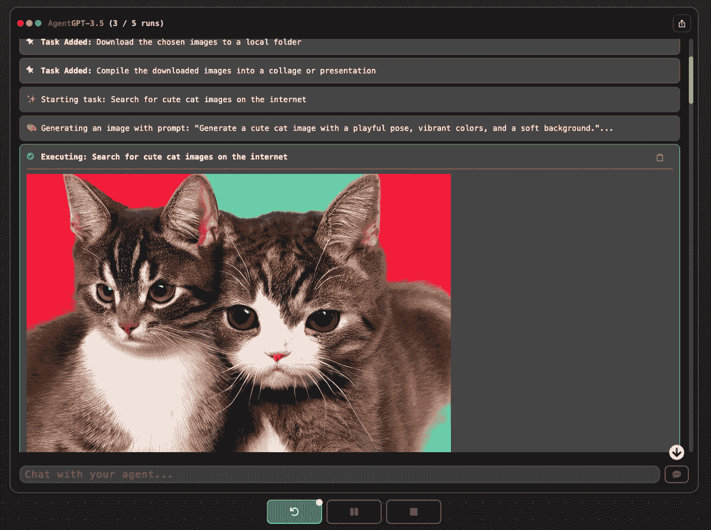

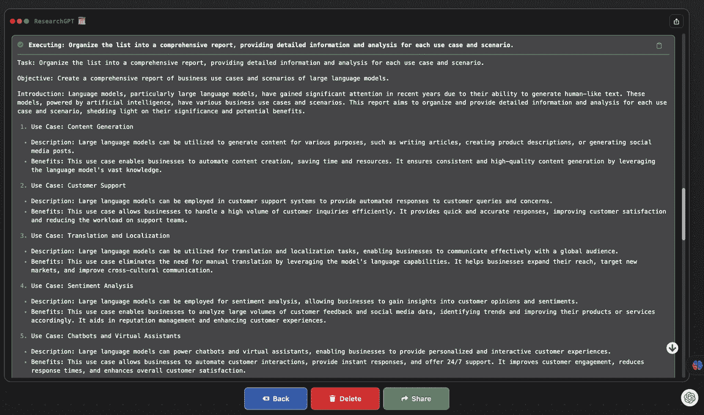

AgentGPT撰写的引言部分简要介绍了大型语言模型的概念和重要性，以及本报告的目的和范围。这是一个合适的开头，但是有进一步改进的空间。比如，可以在引言部分提供一些背景信息，例如大型语言模型的定义、发展历程、主要特征和优势等。其次，也可以在引言部分明确指出本报告的研究问题、研究方法、研究贡献和研究结构等。这样可以让读者对本报告有一个清晰的预期和理解。

用例部分列举了大型语言模型在不同领域的应用场景和效益。改进的方向有：可以将用例部分按照行业或功能进行分类和组织，例如技术、金融、教育等。这样可以让读者更容易找到自己感兴趣的用例，并且可以进行横向和纵向的比较和分析。其次，也可以在用例部分提供一些具体的案例或数据，例如使用大型语言模型的公司、平台或产品名称，以及使用大型语言模型带来的具体效果或指标等。这样可以让读者更直观地感受到大型语言模型的实际价值和影响。

但是，以上列出的改进空间需要更为深入的信息爬取能力。目前 AgentGPT 能够做到的撰写能力，主要是给用户提供一个组织好的框架。用户可以自行填入数据或者对 AgentGPT 的输出进行修改。辅助作用更大。

# 结论

## 生成式 AI 产品集中喷涌，大家都在探索

在本次调研的数据集合当中，多数产品在 2022 年，也就是 ChatGPT 推出的时间点上发布，甚至是公司创立。主要产品品类集中在写作和图像生成上，其性质和大语言模型和图像生成模型高度重合。在开发层面上来说属于直接应用。

另外一些较为深度的应用如 Notion（项目任务管理以及记事本），Algolia（B 端搜索服务），以及 Rewind （个人办事助理和搜索引擎）等，则针对生成式 AI 其他的应用可能性做了探索，集成的难度更高，但也更有价值。

## 使用成本高昂，需要考虑降低使用成本

由于生成式 AI 在算力上有前所未有的要求，一般用户无法负担这样的资源消耗。除此之外，生成式 AI 本身仍处于早期发展阶段，很多应用尚未具备传统 APP 的那种“点开即用”的能力，使得普通用户的门槛进一步上升。而在这样的基础之上，用户需要有一定的语言表达能力才能有效地操控生成式 AI 进行内容产出。比如，ChatGPT 这样的大语言模型有一整套提示词撰写教程，Stable Diffusion 系列开源模型有专门的交流社区等。

而大语言模型应用开发就是在专业领域，通过提前封装好模型的提示词、应用办法以及搭建好算力基础设施，给用户提供“点开即用”的生成式 AI 应用。一些比较优秀的产品，如搜索领域的 Perplexity，则是将大语言模型所需要的搜索工具和提示词提前封装在应用里面，使用户可以直接调用；如开源项目中的闻达，上面集合了多种文本处理的功能和对应的提示词，后端采用 ChatGLM2-6B和开源向量计算模型，使得普通用户也可以用上大语言模型进行报告、脑图以及知识库问答等功能；如图像生成提供商GetImg，直接提供用户多种图像生成模型可供直接生成图片，前端做了操作优化，减少了使用 Stable Diffusion 生成图片的成本。

## 生成式 AI 产品需要回答的关键问题

生成式 AI 生成的内容质量是关键。在针对生成式 AI 产品的流量调研当中，我们发现，产品的用户黏性直接预测了最后的收入，最高指标可以达到 90% 左右的关联性。另外，图像生成用户社区 CivitAI 在各个访问量指标上表现优异，甚至超过了老牌分享社区 Github。这意味着，生成式 AI 浪潮中，如何用生成式 AI 大批量地生产高质量内容是一个重要的成功因素。CiviAI 并没有自己做图像生成，但是凭借集合用户的输出，如分享模型、生成的图片以及教程等，创造了成功的生态。

总的来说，生成式 AI 产品需要回答的问题是：“我们需要为用户自动生成什么内容？”

## 开源社区产品目前趋向于玩具化，少部分工具实用

在本次调研和之前的相关调研中所接触到的开源社区生成式 AI 工具当中，如 AgentGPT，ChatDev，和MetaGPT 等，目前虽然打出了“自动开发”和“AI 公司”等旗号，但是生成的结果仍然无法作为生产力工具使用。下图当中展示的是 ChatDev 虚拟构建员工，最后生成的中医网页页面。可以看见的是，这样生成的网页和直接用 ChatGPT 生成的网页本质上没有太大的区别。

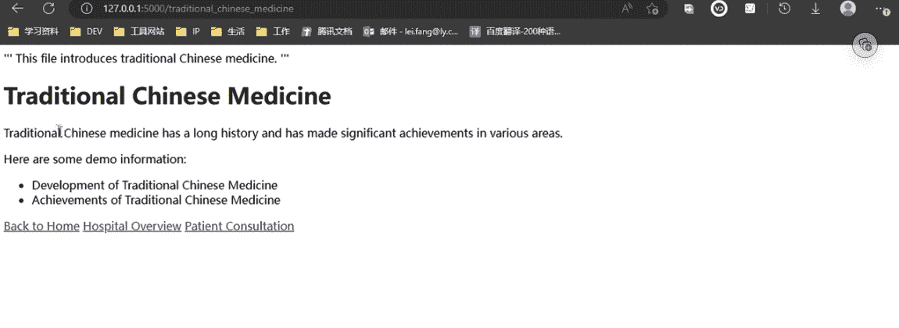

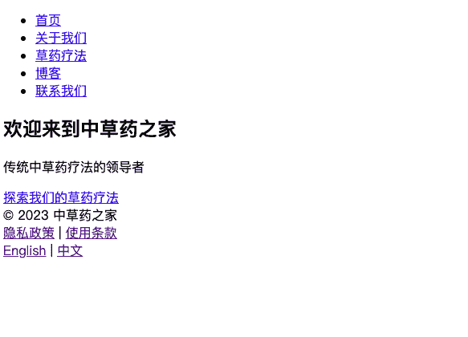

但是仍然有少部分的开源项目目前可以带来实用的功能，比如基于 ChatGLM2-6B 的闻达，和可以调研多个大语言模型作为模型的 GPT Academic。两个项目均可以帮助用户在文章撰写、文献搜集和整理以及文章阅读理解等方面提供实质性的帮助，并且 GPT Academic 还可以帮助用户解读项目的文件结构。

# 参考文献

1.  R. Rezaei, "AgentGPT," GitHub repository, [Online]. Available: https://github.com/reworkd/AgentGPT. [Accessed: Sep 15, 2023].

1.   L. Wang, W. Xu, Y. Lan, Z. Hu, Y. Lan, R. K.-W. Lee, and E. P. Lim, "Plan-and-Solve Prompting: Improving Zero-Shot Chain-of-Thought Reasoning by Large Language Models," arXiv preprint arXiv:2305.04091, 2023.

1.  Chaffey D, Ellis-Chadwick F. Digital marketing: strategy, implementation and practice. Pearson UK, 2019.

1.  Ryan D. Understanding digital marketing: marketing strategies for engaging the digital generation. Kogan Page Publishers, 2019.

1.  Bhattacherjee A. Understanding information systems continuance: an expectation-confirmation model. MIS quarterly, 2001, pp. 351-370.

1.  Lee Y, Kozar KA. Investigating the effect of website quality on e-business success: An analytic hierarchy process (AHP) approach. Decision support systems, 2006, 42(3): 1383-1401.

1.  Liu Y, Shrum LJ. What is interactivity and is it always such a good thing? Implications of definition, person, and situation for the influence of interactivity on advertising effectiveness. Journal of advertising, 2002, 31(4): 53-64.

1.  Srinivasan SS, Anderson R, Ponnavolu K. Customer loyalty in e-commerce: an exploration of its antecedents and consequences. Journal of retailing, 2002, 78(1): 41-50.

1.  Barney JB. Firm resources and sustained competitive advantage. Journal of management, 1991, 17(1): 99-120.

1.  Teece DJ. Explicating dynamic capabilities: the nature and microfoundations of (sustainable) enterprise performance. Strategic management journal, 2007, 28(13): 1319-1350.

1.  W. Garbe, "Vector [S](https://seekstorm.com/blog/vector-search-vs-keyword-search1/)earch vs Keyword Search," SeekStorm Blog, 04 Nov 2021. https://seekstorm.com/blog/vector-search-vs-keyword-search1/ (accessed 21 Sep 2023).

# 数据集

全 370 多个产品数据集，已经分好分类：

[数据集_按照分类.zip](https://internal-api-drive-stream.feishu.cn/space/api/box/stream/download/all/MPZKb8N9eoOe3Bxq1Kjc833rnGd)

具备完整数据的产品合集：

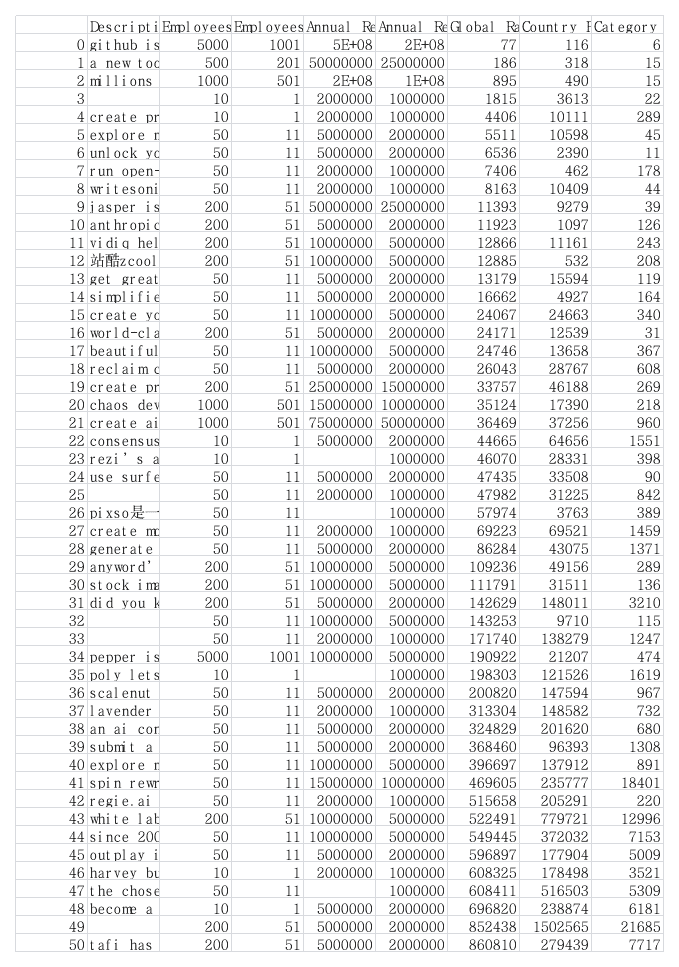

[matched.csv](https://internal-api-drive-stream.feishu.cn/space/api/box/stream/download/all/OrJFb4fZAoI8RyxwVtEc1IuNnRb)

156 个可以搜集到产品数据的产品数据集：

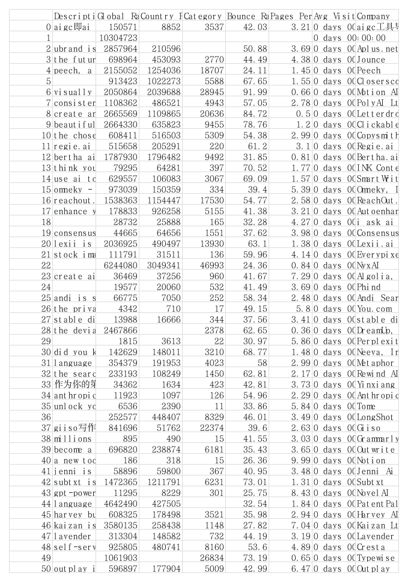

[master.csv](https://internal-api-drive-stream.feishu.cn/space/api/box/stream/download/all/GS5QbSHHaoPS5wxf52pcKsyPnYc)

各个因素的关联性分析数据集（对应上文中的关联性热度图）：

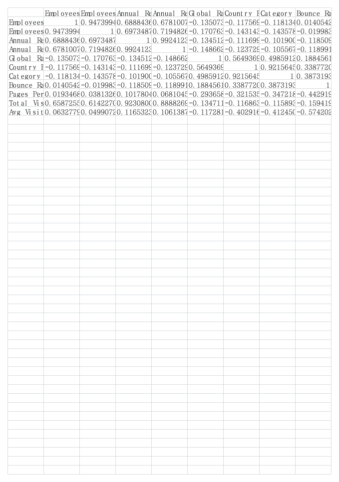

[matched_corr.csv](https://internal-api-drive-stream.feishu.cn/space/api/box/stream/download/all/UDoybsg0wo5X3hx2SPecScolnag)

根据公司业务关键词“本地生活服务”，用向量关联性匹配到的相关产品：

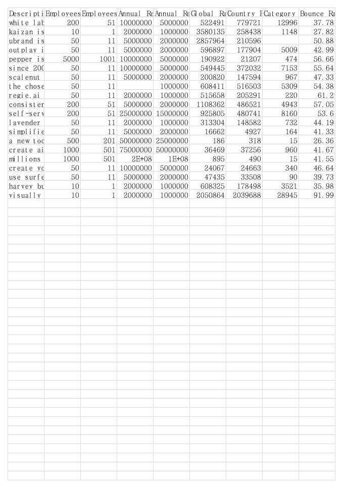

[matched_embedded.csv](https://internal-api-drive-stream.feishu.cn/space/api/box/stream/download/all/A8LDb5HAWo6XVsxn0UXcTjaGnKh)

---