# 7.手机AI新时代：轻松运行小型模型

> 来源：[https://langgptai.feishu.cn/docx/ARJRdJXueo54WwxMGRMc4NUunse](https://langgptai.feishu.cn/docx/ARJRdJXueo54WwxMGRMc4NUunse)

最近微软发布Phi-3 Mini：性能媲美GPT-3.5，都宣传说可以塞进手机。那到底如何塞进手机里面呢？

近期作者研究一系列的各种方案，踩各种坑，最终研究出小白都能将phi-3、llama3-8B等模型轻松运行在手机中。

人的注意力只有十分钟，十分钟内实操完成，废话不多说，我们就开始实践操作整个过程。

温馨提示：整个操作过程尽量使用**魔法，**下载速度会快很多。

### AnLinux 安装

什么是AnLinux？

AnLinux就像是一个魔法盒子，它能让你的安卓手机或平板电脑变身为一台小型的Linux电脑。AnLinux就是一个让安卓设备变得更加多才多艺的工具，可以随身携带的多功能电脑（模型）。

有条件自行下载termux，软件地址https://github.com/EXALAB/AnLinux-App，也可以选择以下安装包自行安装，以下安装包是经过验证可行。


[app-release.apk](https://internal-api-drive-stream.feishu.cn/space/api/box/stream/download/all/WI6TbuD5ooYQe7xLDrUcAwuJnke)

### termux安装

什么是termux？

termux 是一款基于 Android 平台的开源 终端模拟器，使用进行软件包的管理。可以使用手机操作相关命令，使得能正常跑通大模型。

有条件自行下载termux，软件地址 https://termux.dev/en/ ，也可以选择以下安装包自行安装，以下安装包是经过验证可行。


[termux-app_v0.118.0+github-debug_arm64-v8a.apk](https://internal-api-drive-stream.feishu.cn/space/api/box/stream/download/all/ZcsMbCy8Lo1VQvxFWHDco9NLnGh)

## 安装系统过程

1.  自行termux与Anlinux安装完成，同时给必要的权限。

1.  打开termux软件，执行  pkg update && pkg upgrade 命令，安装过程中需要enter键确认。


1.  安装wget 命令 pkg install wget

1.  打开Anlinux软件，准备安装操作系统环境。同时复制下载操作系统命令。

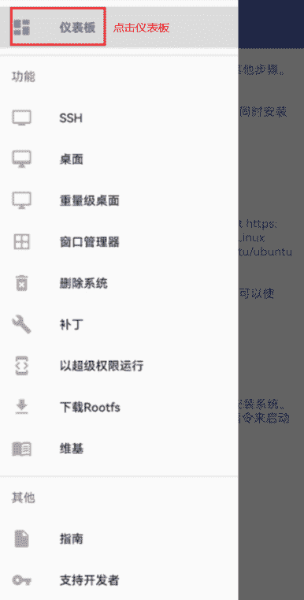

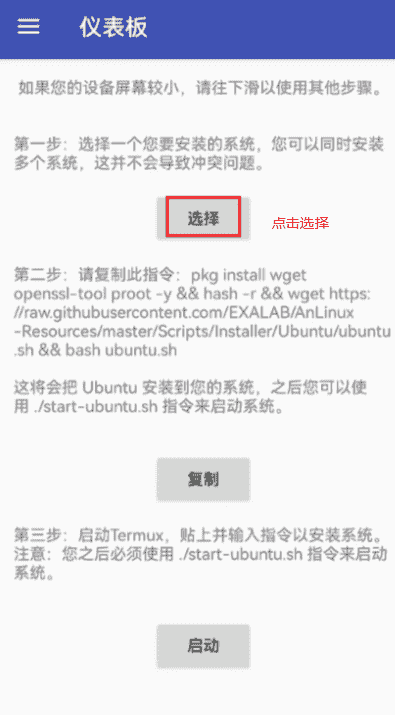

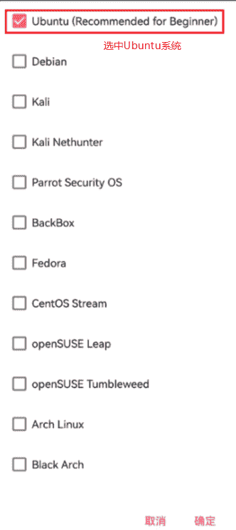

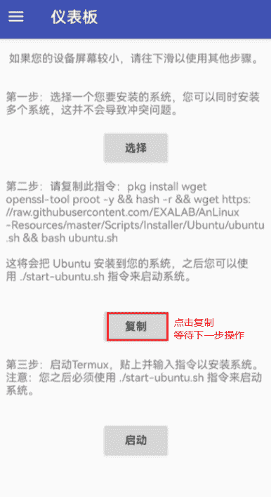

1.  AnLinux 复制下来的安装命令，termux软件中执行。（温馨提示：安装过程中需要enter键确认）

1.  termux软件中执行命令 ./start-ubuntu.sh

1.  启动完成后如下图所示，有 root@localhost:~#    说明启动成功。

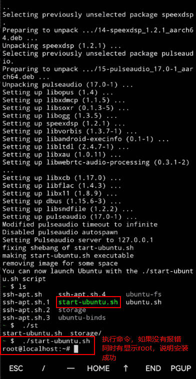

### 命令集合

```
pkg update &amp;&amp; pkg upgrade
pkg install wget
AnLinux软件 复制命令到termux软件执行下载
./start-ubuntu.sh
```

## ollama

### Ollama是什么？

Ollama 是一个开源框架，专为在本地机器上便捷部署和运行大型语言模型（LLM）而设计。 以下是其主要特点和功能概述： 简化部署大型语言模型的过程，使得非专业用户也能方便地管理和运行复杂的模型。

官方网站：https://ollama.com/

### 避坑操作

以下操作都在termux软件进行操作

1.  termux软件中执行命令 ** ****apt-get update**

1.  安装curl命令，apt install curl -y

1.  安装ollama命令，**curl -fsSL ****https**://ollama.com/install.sh | sh

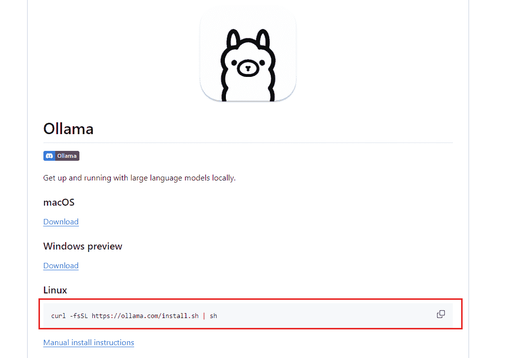

1.  图一 ollama安装过程； 图二 ollama安装完成

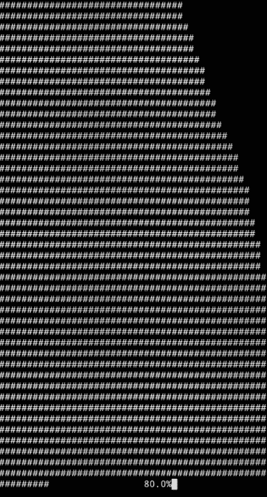

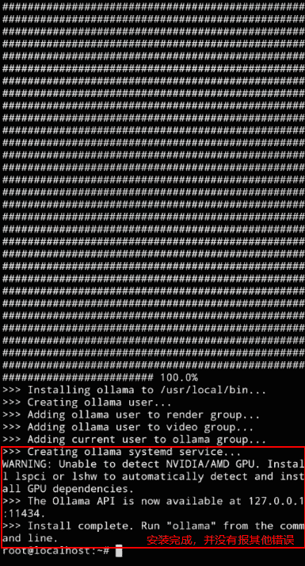

1.  termux软件中执行命令   **ollama serve**

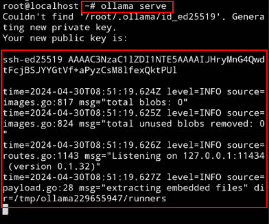

1.  后台运行termux软件（正常返回到手机桌面即可）

1.  **返回桌面长按termux**软件图标，选择 New session，重新启动一个新termux连接

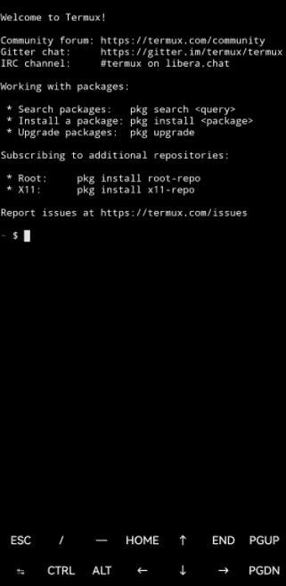

1.  新termux连接中执行命令 ./start-ubuntu.sh

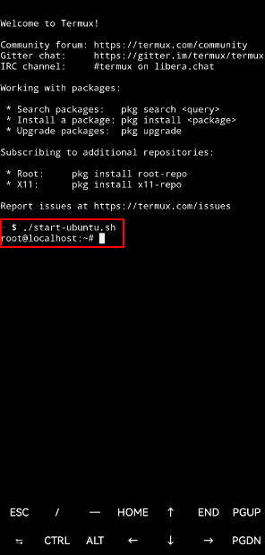

#### 命令集合

```
 apt-get update
 apt install curl -y
 curl -fsSL https://ollama.com/install.sh | sh
 ollama serve
 ./start-ubuntu.sh
```

### 启动模型

我使用phi3模型来做演示

1.  termux软件中执行命令 **ollama run phi3**

1.  等待下载完成phi3模型，请耐心等待

1.  启动正常，可以正常使用**phi3模型**

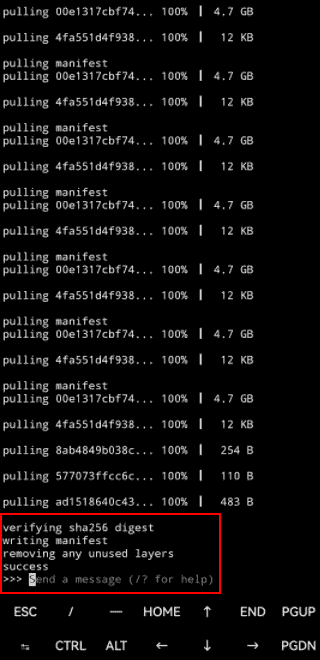

#### 命令集合

```
ollama run phi3
```

当然ollama 还有很多其他模型，如有需要请ollama 官网自行查看命令与下载。

## 简单结果输出

问题一：你相信AGI的到来吗？

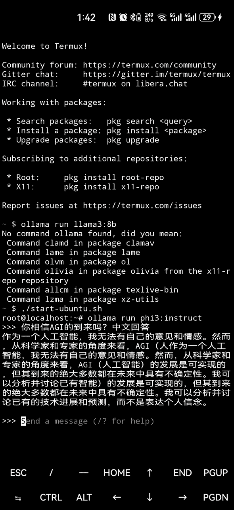

问题二：使用python写出冒泡代码。使用最简洁写出来。

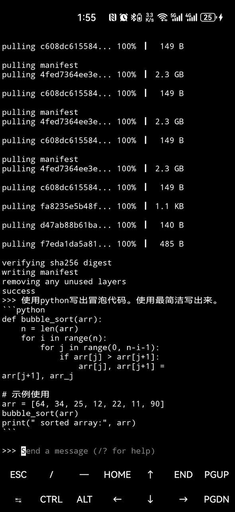

作者个人简介，如有问题可以直接连接作者。或者社区里面直接联系盘盘，也是可以。

[Welcome to P. | 盘盘个人杂志](https://g10npwhy4nv.feishu.cn/docx/U1Iqduc3mox5F8xmbUzcCC6qnof)