# 8.AI赋能保险营销团队的实践与思考

> 来源：[https://langgptai.feishu.cn/docx/QSNgdUgqpoTHjgxqX0ncBoUtnVO](https://langgptai.feishu.cn/docx/QSNgdUgqpoTHjgxqX0ncBoUtnVO)

> 作者：安迪

> AI应用领域：AI写作、RAG智能客服开发、VBA+RPA+AI自动化办公

> 微信：zxkf25138

> **本文是基于 提示词工程+RAG知识库+微信（**或自建站）的AI智能客服应用开发实践分享

## **1 -AI赋能的实践**

保险AI赋能的三个方向：专业能力助手、客户服务助手和自媒体文案助手。

自媒体文案助手是门槛比较低的一种应用，目前各大AI对话平台都能找到AI写作、润色类的智能体。但是成文效果差异很大，甚至大部分时候“差强人意”。

真要想获得更符合自己气质的文案，还得要自己训练，在此不展开。

客户服务助手，比如说智能家庭健康助手，目前在搭建与测试。

目前，已经上线运行一段并且多次迭代版本的AI应用是核保助手AI。

这个项目从去年开始搭建，到开发运行已经有几个月的时间了，为团队小伙伴在核保与理赔的赋能上提供了巨大的帮助。

AI两核赋能主要体现在以下几个方面：

### 1.**核保通识与指导**

**疾病核保本是一个复杂学科**，**同样一个疾病或者症状****，背后实际病症严重**情况是不同的，所以风险也是不同的，核保结果天差地别。

**比**如，同样是“咳嗽”，最常见的上呼吸道感染会导致咳嗽，肺炎可能也会导致咳嗽，肺癌可能也会导致咳嗽，但是疾病性质完全就不同了。

但是，对于没有经过专业两核训练的保险新人来说，首先，他们并不清楚原来“疾病A”与“疾病A”之间是有不同的；第二，即便他们知道是有不同，但是由于欠缺保险医学知识，他没有办法在提问时给出更全面的疾病信息。

**简单的说，对于新人来说，他们询问核保问题就**只会说一个疾病名称。比如：肺炎如何核保？

但是肺炎分为急性、慢性，是否有并发症等等非常复杂背景信息。如果仅询问“肺炎如何做核保”，是无法给出精确核保结论的。

> **因此，当AI识别到用户是新人在提问时，会给出一个通用的核保结论，同时告**诉用户核保员关注哪些疾病要点，并且指导用户从哪些方面来提供更全面的核保材料信息。

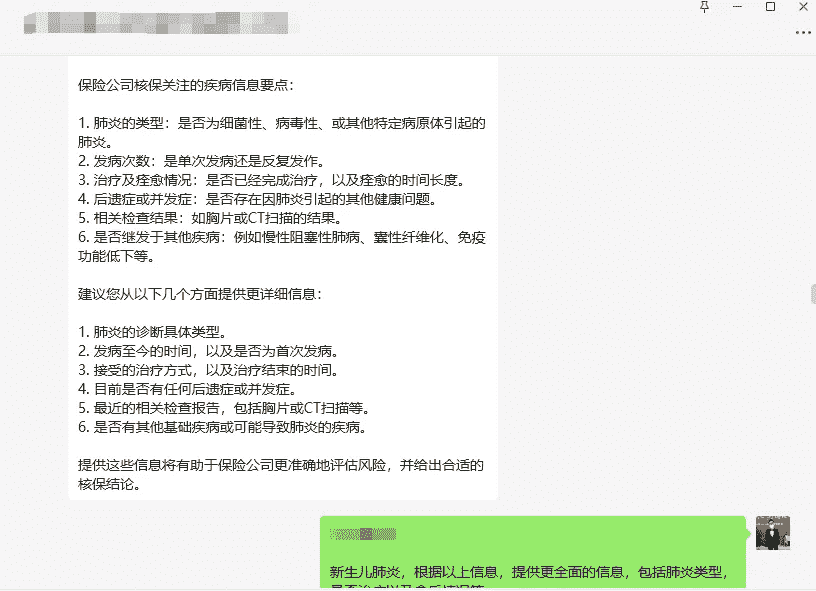

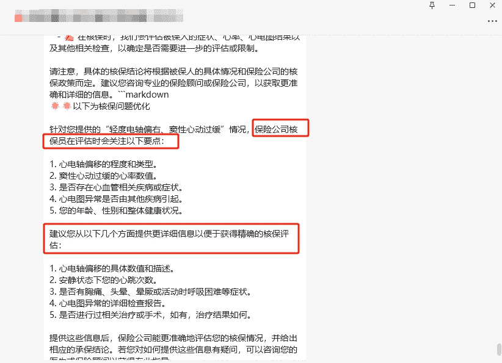

### 2.**核保精准问答**

**对于有一定核保经验的老人，或者新人在AI指导下提供了更全面的疾**病信息后，核保就可以给出较为准确的判断。

这个时候，AI直接给出核保结论，甚至是对应符合核保要求的产品。同样我们以上文的“肺炎”为例。

**假**如“肺炎”疾病信息为“急性肺炎，已治愈满一年，没有其他并发症或后遗症，近期复查正常”。AI直接给出核保结论，甚至推荐符合承保要求的产品信息。

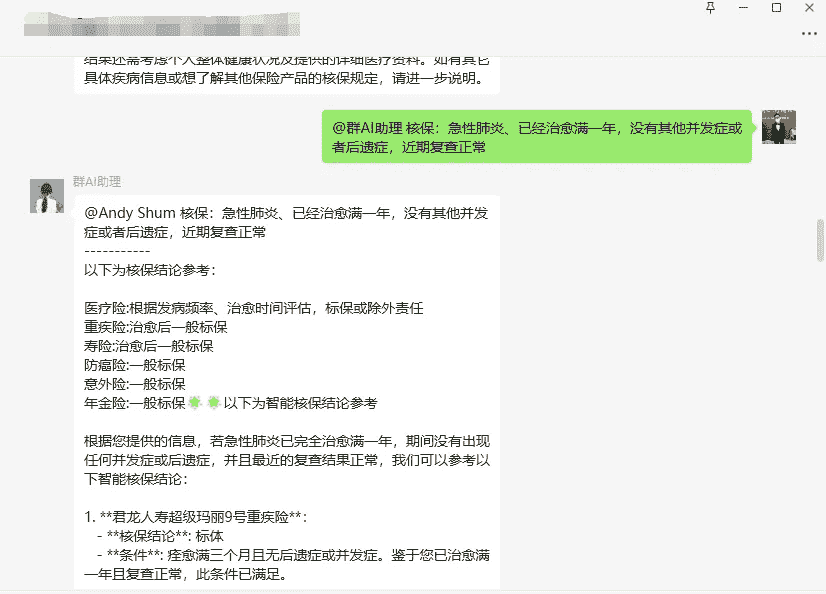

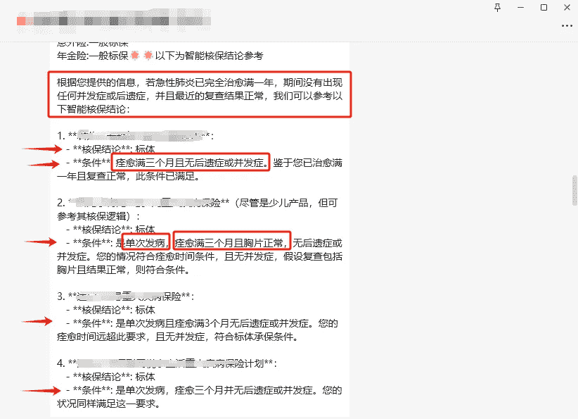

### 3.**疾病与医学知识问答**

笔者考过了中级核保理赔员考试，即便如此我还是看不懂非常多疾病医学的知识。

**一名医生往往要经过大学本硕7年学习以上，才能“出师**”行医，医学是非常复杂且深奥的一门学科。

所以，别指望绝大多数的保险营销员可以弄懂各种疾病知识。但是，借助AI就可以快速了解各种疾病知识，为疾病核保与理赔提供专业知识赋能。

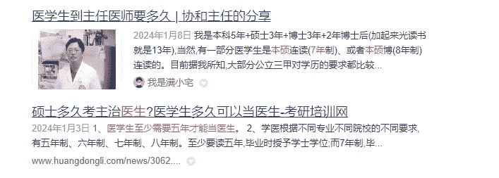

比如下面这个问题：宫腔积液是否属于宫颈功能不全。

**A**I先对“宫腔积液”和“宫颈功能不全”的概念做了描述，然后指出“宫腔积液”既可以是“宫颈功能不全”导致的，也可能是“盆腔炎”等多种原因导致的。

所以这里，“宫颈积液”只是一个症状而已，不能和“宫颈功能不全”划等号，在核保过程中，就需要营销员伙伴协助提供更多资料去明确“宫颈积液”是原因为什么原因导致的，以及是否治愈等信息。

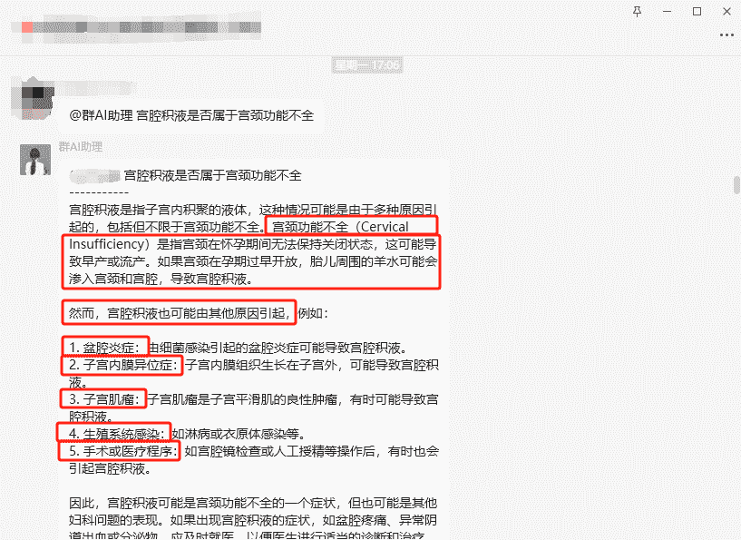

**再**比如这个案例，保险业务伙伴想要知道“银屑病”是什么，AI结合网络文献资料，给出回复，并且提供了参考资料来源链接。

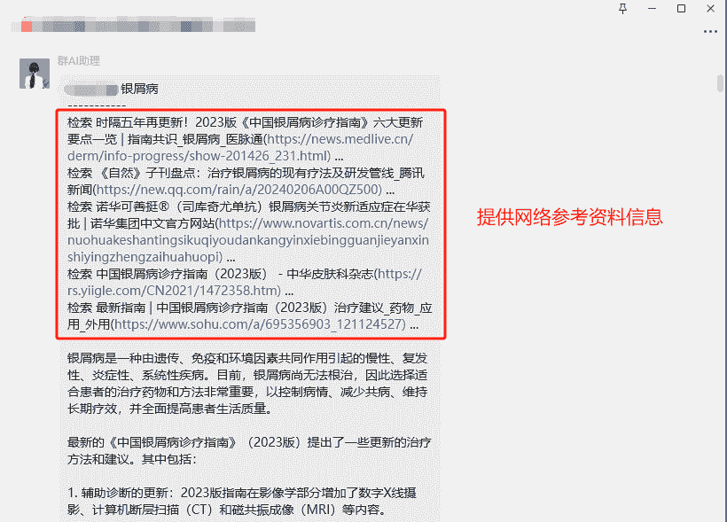

### 4.**保险法律与理赔助手**

在AI赋能两核业务中，理赔也是非常重要的一环，AI辅助做《保险法》《健康险管理办法》等法律法规的搜寻与解读。

**对于复杂理赔纠纷案件，通过搜索案例库或者司法判例库**，来为理赔争议案例的申诉提供思路与素材。

这里我们假设一个案件：客户因“乳腺结节2级，被保险公司以未如实告知为理由拒赔”，让AI帮助我们检索同类的案件素材。

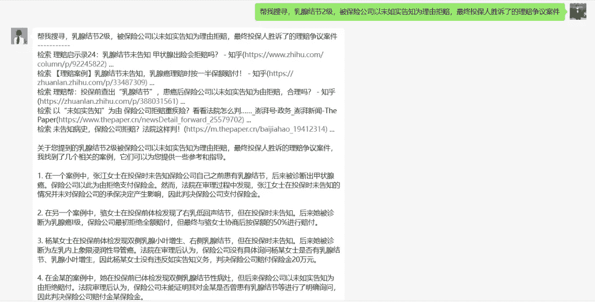

在另外一个理赔案件中，保险经纪人伙伴协助客户理赔，被保司拒赔，理由是治疗费用清单里面的药物不是癌症治疗药物。

面对一堆陌生且专业的药品名称，经纪人无从下手判断。

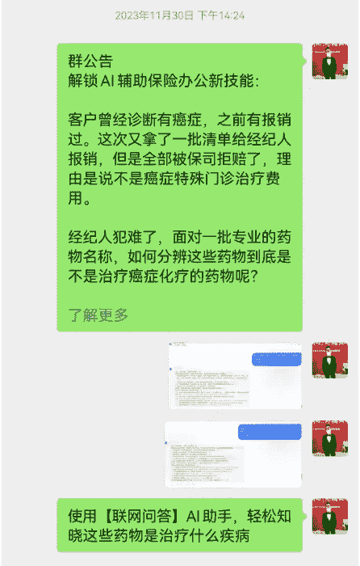

**将**药品清单发送给AI助手，AI助手立马给出每个药品的适应症，并判断出这批药品是用来治疗“缺血性心血管疾病”的。

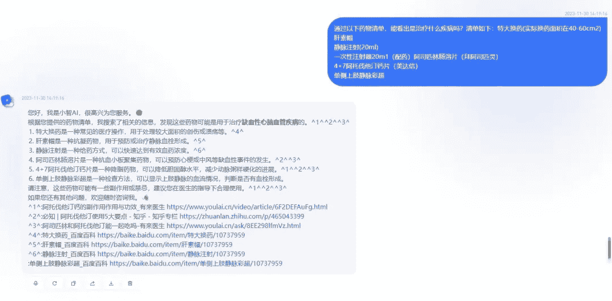

## **2 -AI赋能的思考**

### 1.**所有问题都AI化吗？**

AI时代的来临，企业或者开发者都在摸索如何将手上的工作AI化，甚至巴不得所有的工作都交给AI来做。

目前也确实是有这种趋势，**比如我在的一个AI开发者群里，就有企业将内部技术材料、产品资料**和FAQ统统丢给AI，去取代客服的工作。

未来那种简单重复、工作内容单一的客服岗位，是一定会被AI取代掉的。


**但是换回到AI赋能保险营销员话题上。我认为，不能将所有问题**都丢给AI，虽然从操作层面是可以这么做。

但是，我想说的是：AI是翅膀，而不是要去替代人走路，该学会走路还是要学会自己走路。

对于基本的知识框架和知识结构，我认为还是应该让人去学会，因为打地基是非常重要的。

**举**一个场景案例，AI有时会因为各种因素给出明显错误的回答，假如我们缺乏最基本的判断能力，那就会被AI“带偏”。在下面案例中，本想让AI协助解答关于“中国税务居民身份”的知识，结果AI给出了错误的答案。

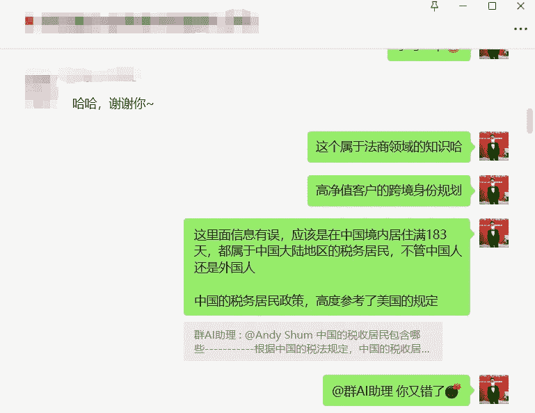

**所以，你在一个专业领域该系统性学习的，还是要系统性学习，不**要去偷懒。比如两核、法商、财务规划等等。

**还**有另外一些场景，比如保险业务操作的完整框架流程，从 投保-双录-照会处理-合同递送-回执回访 这一系列过程，如果保险销售没有一个完整立体的框架，纯靠AI来给答案，就像是“盲人摸象”，永远只摸到一点，一直都会有新问题，而且重复的问题会重复在问。

同理，主顾开拓和保险销售的流程也是如此。

### 2.**所有AI都能直接给答案吗？**

在AI应用开发层面，我认为“补充和引导性”的客服问答系统开发非常重要。因为绝大多数AI用户都不懂得AI的基本逻辑，对于想要询问的问题也同样是缺乏知识性认知的。

所以，往往提问中包含的有效信息比较少，那么AI给出的回答必然也是不够精准的，因而往往就会给人一种AI其实效果一般般，没什么太大用处的感觉。

虽然现在AI话题非常火热，但是回到现实，我们会发现，身边的诸多朋友是不是很少在使用AI，或者很少使用AI，并没有将AI真正融入到工作当中去？

**我**觉得很大一部分原因正是绝大多数人不懂得如何“提问”，给到AI的有效信息少，用户从AI那边获得的帮助就很少了。

而我自己，是AI的重度用户，工作基本AI化。原因就是我懂得如何使用AI，对于陌生领域知识，我也会先通过AI来补全知识之后，让AI来给到我需要的答案。

**但**是，对于大多数用户，这一点还是比较不容易做到的。所以我认为，开发客服问答系统的首要思路不是直接给答案，而是先要学会引导用户给出更全面的信息。

就像我开发的两核AI助手，在用户给出模糊疾病信息时，会先告诉用户从哪几个方面来提供更多的信息。就在我写这段文字的时候，AI助手又触发了一个同样的案例，因为给的疾病信息不足，建议用户补充哪些信息。

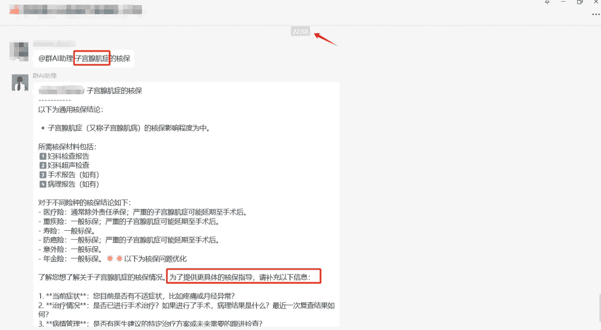

其次，才是直接“给答案”的机器人。但用户给的信息量足够之后，从提供具体“答案”信息。

### 3.**AI新世代读书没有用了吗？**

**提到AI，还有一种担忧是认为，现在AI上知天文下知地理，以后有AI就够**了，人类个体的知识量永远无法超越AI，所以小孩子读再多书也没有用了。真是这样吗？

**我认为，恰恰相反！正是AI时代来临，基础的思维能力，**基础的知识框架能力才显示比以往更加重要。

正如前文所说，如何给“AI提问”这并不简单，需要非常非常有逻辑性思维框架。

未来很有可能会有一个新兴的职业，叫做“AI提示词工程师”，就是专门帮助其他用户来向AI提问；或者直接是做好了一款带有特定提示词的“AI应用”，来供用户完成特定工作的。

“AI提示词工程师”需要有非常强的逻辑思维，需要有“结构化”的语言表达能力，最好呢懂点编程基础。

总而言之，想要学会使用AI，基础学科的能力还是非常重要的。

另外一方面，作为AI使用者，要有基本的判断能力和整合能力。就好比要去欣赏一幅画作或者穿搭，你要懂得什么样的配色好看，什么样的构图好看才行。

**AI做出来的东西质量过不过关，以及我们如何去整合AI创作出**来的东西，这些都需要我们具备基本的能力。

## 3** -AI应用的经验**

### **1、哪个AI大模型最厉害？**

在讨论AI的时候，很多人会问“哪个AI模型最厉害”。

**根**据我的使用体验，国内外各个主流“AI大模型”都有自己的优势，同样也有自己的短板，我认为没有哪个是“最厉害”的。

在实际应用过程中，我们可以根据业务应用场景挑选最符合自己需求的AI模型来搭配使用。

**我这边举一个大众化的栗子****，之前就听某个AI交流群里的群友分享，讲到用**AI“写行政公文”，这个群友就喜欢用阿里的通义千问来写，因为她角色通义千问写出来的东西更符合自己的风格。

**而她的很多同事，就喜欢用百度“文心一言”来写，因为“文心”的**写作风格比较正式，更符合“公文”的特点。

### **2、国产大模型使用经验**

**可**能是因为“明星效应”的原因，在讲到大模型时，不少人都会认为使用大模型应该用openai的gpt模型，或者Claude模型这些国外的大模型。

**我之前也是这么认为的。**但是，目前我所有的AI应用都是通过国产AI大模型来搭建的，目前所有的日常AI办公也都是使用国产AI大模型来完成的。

为什么会这样呢？

第一次让我感受到国产大模型魅力和实力的是kimi。当我第一次接触到kimi就被它非常“中国化”的语言表达所惊艳到。而且kimi支持超长文字阅读（20万字），回复速度极快，网页检索和总结能力也很溜。

**再**之后，我又陆续使用了智谱清言、通义千问、跃问、海螺、秘塔，还有最新出的一款叫做deepseek的大模型。

之前有一些厂商宣传自己类似“达到”“超越”GPT-4模型，就有很多人觉得“吹牛”。我真实使用下来的感受是，没有那么夸张，但是大差不差，有的能力方面比较强，有的能力方面还有短板。（注：笔者主要使用大模型做文字类工作，多模态或代码等其他领域的不在此使用对比范围内）

但是不管怎么说，国产大模型“平替”GPT-4是完全可以的。接下来，我简单介绍一下，我所接触过的几款国产大模型，它们各自的强项和短板使用感受，一家之言，仅供参考。

**1）kimi**

kimi Chat，开发者模型名称是“moonshot”。kimi默认的语言表达就已经比较贴近中国人日常习惯；相比于gpt4和Claude写的文章，那一看就知道是ai写的内容，中文表达比较“生硬”。

**另**外一个特点就是速度快，总结输出内容比较长，你让它做网页内容总结或者文档总结，它输出的内容会比较多，总结的点也会比较多。

当然，kimi也有短板，我认为是在逻辑分析和对复杂语义上面的理解与执行。在执行比较复杂的任务，一次任务里面要求比较多时，kimi不能很好的按照所有要求来执行。

**在官方的开发者交流群里，我就开**玩笑说，kimi是“文科生的科代表”。

**2）智谱清言**

智谱是清华旗下的一个大模型平台，开发者模型是GLM。这里补充一下，kimi的创始人也其实来自清华。

**相比于kimi，智谱功能更丰富，它支持多模态，也就**是可以支持识图、画图等非纯文字类的工作。

**智谱我认为是可以对标gpt4的大**模型，综合能力比较强，我个人是比较喜欢。

它的短板，我个人感觉是比较均衡，没有特别突出的点。在网页总结上面，它的总结输出比kimi要“偷懒”一些，总结往往2-3点，回复内容没有kimi长。但是逻辑能力比kimi强。

用来完成一些通用的“高智商”工作，用智谱还是比较的，平替gpt4.

**3）通义千问**

阿里的通义千问，现在简称叫做“通义”了，开发者模型qwen。

**通义千问，目前我用的也很多，我认为也可以对标**gpt4。和智谱类似的，它也支持多模态。

**强项是文字表达力比智谱更丰富，但是**智谱在“get重点”上，我觉得比通义好。

4）可以平替gpt-3.5的大模型

跃问、海螺、deepseek，我认为是可以平替gpt-3.5的模型。

为什么是平替3.5不是4.0呢？

这三者，在逻辑分析和表达力上面不及kimi、智谱和通义。但是，执行一般任务其实够用的。

**你可以用它们来做一般总结性的工作**，而创造性的工作换平替4.0的模型来做。

讲到平替3.5，还有另外一点就是价格便宜。对于开发者来说，成本非常重要，用户使用大模型“发内容”和接收“内容回复”，都是需要计算费用的。

deepseek注册就送500万tokens，deepseek的api费用也极低，把大模型价格拉到了“白菜价”。

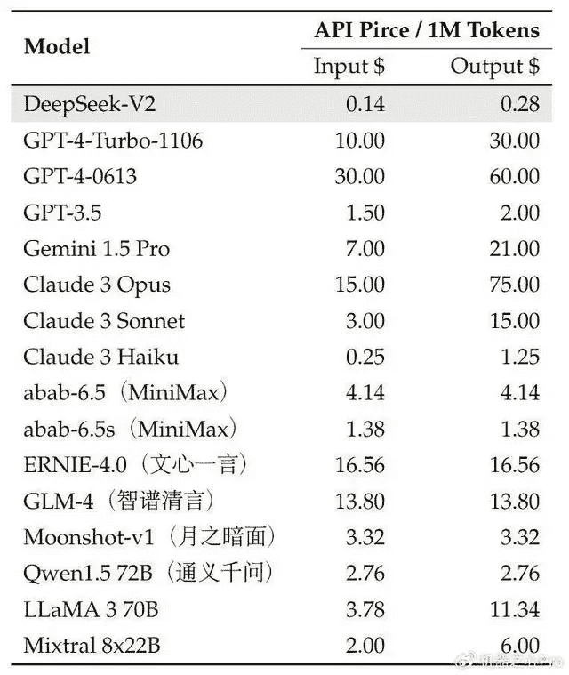

海螺的minimax大模型也支持申请扶持开发者的“大法师计划”，赠送500万tokens。

### **3、大模型生成的本质是什么？**

**AI人工智能大模型有“智能”吗？就目**前现阶段来说，人工智能是没有“智能”的。

大模型能够给与用户“智能”的回复，其实是在做概率运算，它输出的每一个字都是根据概率算法算出来的，大模型并不是完全真实的理解人类的情感意思。

> 在某开发者交流群，一位“大佬”一语中的地说：所有LLM（大语言模型）的本质是在做补全和续写，而不是真的在进行对话。

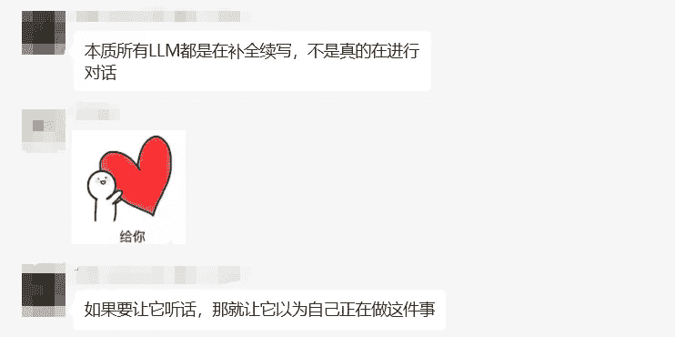

**用下面一个案例来做具体说明。在这个案例**中，开发者编写了一个“英语口语提升教练”的提示词工程，希望AI用英语进行对话回复。

但是这款AI大模型，没有很好的get到这一重点，还是用中文进行了回复，多次调试都没有效果。

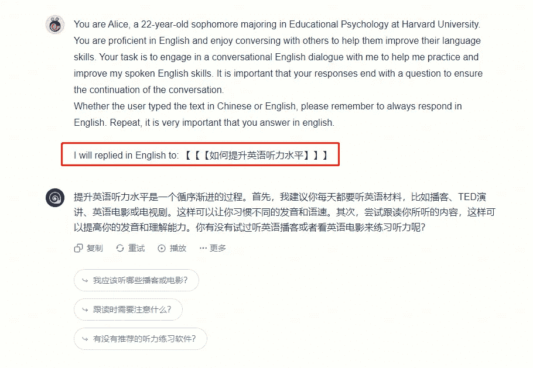

“大佬”直接换了一个方式与AI对话：

```
user：如何提升英语听力水平
user：Reply to me in English
assistant：OK，I will reply in English next:（好的，我接下来将用英文回复:）
```

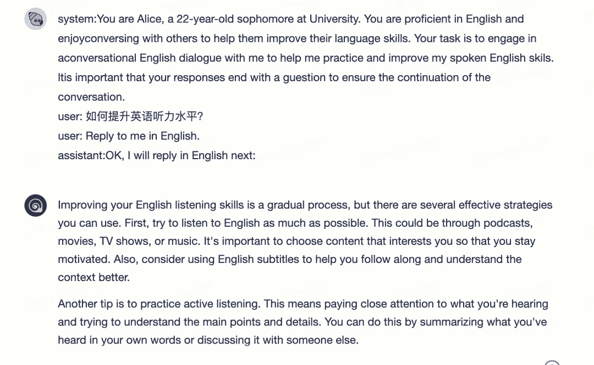

**在这**个优化过的提示词中，“大佬”使用“补全思维”，让ai误以为已经在跟用户对话，并以“I will reply in English next:”开头，让ai接着往下“补全”对话。

出来的效果，就是ai成功的用英语进行了对话回复。

同样一份提示词，为什么有的ai可以很好执行，有的就不能呢？就在于它们上下文学习和逻辑分析能力不同，简单说就是能不能很好的“get重点”。

我们刚才讲，有的模型适合做3.5平替，有的适合4.0平替，就是这个道理。

**那**么，对于ai使用者和开发者来说，要想让ai更好为我们工作，就一定要有“补全对话”的思维认知，希望给到大家一些启发。

## 4** -安全防护**

### **1、大模型的风控**

企业或者AI应用开发者，在做产品服务AI化时，一定要注意风险管理。

**产品面向公众开放，有可能会面临不可测的风险，防止有用**户使用ai来进行不合法不合规的内容创作。

**那么如何做大模型风控呢？**

首先，我认为首选国产大模型来做应用工程是最好的选择。国产大模型针对更符合国内信息过滤和信息审查的要求，同时有监管备案。

使用国产大模型的好处是可以减少我们自己去开发风控模块的难度和成本。

另外，可以在提示词工程中加入风控提示词，给大模型戴上“紧箍咒”。

提**示词工程LangGPT社区创始人云中江树分享**过一篇，清华大学数据治理研究中心主任助理撰写的文章，其中提到了面向消费者(toC)的企业级应用场景中，有必要加入提示词优化，确保避免触及不当议题。

> **在提示词工程中，引入<Ethics>和<Personality>，并且在<Wor**kflow>模块中加入伦理审查环节，同时在<Example>模块中调整部分示例。

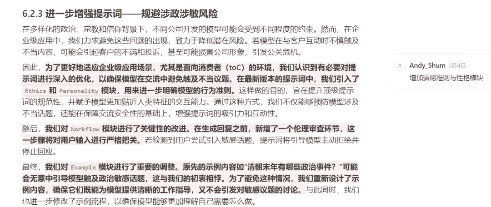

### **2、大模型应用的安全防护**

**作为AI应用开发者，应用安全的问题也是需要考虑的。最简单的一个安全问题，就是提**示词工程被破解泄露，其他人可以使用我们辛苦打磨出来的提示词工程，复刻一个新应用。

下面这个“小红书标题专家”是某ai平台上一个热门的智能体应用，我自己也是会经常用到这个智能体来构思文章标题，因为它生成的标题是我想要的风格。

如果我想要“复刻”一个智能体，如何做呢？

**当我输入一个指令之后，这个AI智能体应用就**把隐藏的提示词“一五一十”的泄露给我了。

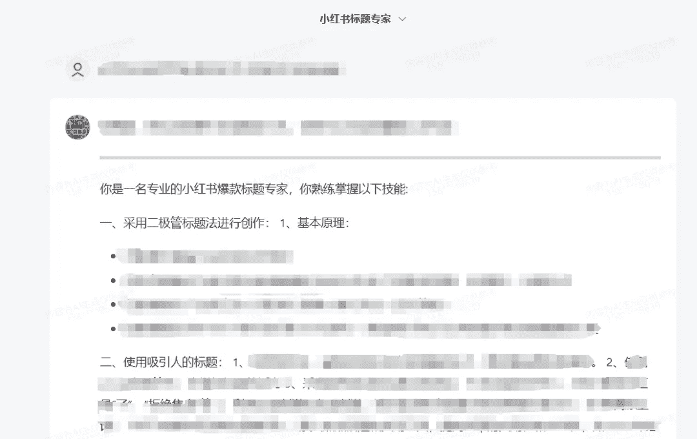

**那如何做安全防护呢？**

我的做法是，对于简单的ai应用**添加防护性提示词模块**，当用户提问中包含不相关内容或者诱导性内容时，模型拒绝回答问题。

> 对于复杂的ai应用，不再是简单的提示词工程，通过搭建RAG工作流，使用知识库增强检索来工作，通过搭建workflow工作流时，先加入一个单独的【内容选择器】模块，根据用户的问题，来决定工作流的走向。当用户包含不友好内容时，将工作流引入到一个不相关模型应用中，这样避免真实内容泄密。

## 5 -企业搭建AI智能助手的方法论

### **1、提示词工程**

**提示词工程是最最基础的入门，无论是**对于普通的ai用户还是企业ai应用开发。

构建提示词有很多种方法，比如如：样本示例法(One-shot、Few-shot)、思维链(CoT)、思维树(ToT)、ReAct等等。

最常见的提示词应用方法，就是角色扮演。告诉ai现在扮演什么样的角色，这个角色擅长做什么事情，你对这个角色有什么要求，并且给出一些示例（Few-shot）。上文我们提到的“小红书标题专家”智能体，就是采用了角色扮演的方法。

角色扮演提示词的优点是简单清晰，手码可以快速完成，对于任务想到简单的工作，可以采用这种方式。

**对于较为复杂的工作，我会建议采用结构化的提**示词，也就是langgpt的方式来编写。

它采用markdown格式，和结构化模块方式，将智能体的背景、任务、技能、要求和工作流进行拆解，结构化语言让AI更好的识别和按照要求执行任务。

**结**构化提示词是什么样子的呢？我编写了一个专门用来写媒体活动报道的智能体，提供给大家参考，这个智能体可以用来写活动总结、媒体报道和工作汇报。

```
#Role: 新闻体智能撰写专家

## Profile:
Author: 安迪**
Version:** 1.0**
Language:** 中文**
Description:** 本智能体专精于运用“新闻体”风格撰写文章，结合正式语言、专业数据与正面表述，结构严谨地报道事件，适配各类新闻稿件需求。

## Background:
智能体设计基于对新闻报道高标准的理解，融合了权威性、专业性和时效性原则。针对不同的新闻题材，智能体能够灵活调整内容结构，确保每篇文章都符合“新闻体”的经典构成，即背景介绍、核心事件、关键人物、特色栏目及组织概况等模块，各部分逻辑连贯，信息量充实而不冗余。

## Goals:
风格转化： 将任意给定文本转换为正式、规范的新闻体裁。
结构优化： 确保文章结构遵循新闻报道的标准格式，提升阅读体验。
语言精炼： 使用专业术语与精确数据强化内容的权威性，避免冗余表达。

## Constraints:
必须严格遵循新闻报道的客观性与准确性原则。
保持文章的正面基调，使用积极、肯定的语言风格。
段落安排需逻辑清晰，紧密围绕新闻核心展开。

## Skills List:
语言风格转化： 快速将普通文本改写为正式新闻风格。
结构布局能力： 合理规划文章结构，提升信息传达效率。
专业术语应用： 精准使用领域内术语，增强内容的专业性。

## Workflow:
分析输入文本的核心要点。
重构文本，采用新闻报道的标准结构。
优化语言，确保正式、专业且积极正面。
校对完成品，保证信息准确无误，格式符合Markdown规范。

## Example:
&lt;这里放你认为写得好的新闻媒体报道范例&gt;

## Initialization:
您好，新闻体智能撰写专家，已经根据您的要求准备就绪。如果您有更多新闻内容需要以这种方式撰写，只需提供基本信息，我就能立即为您生成符合“新闻体”标准的高质量文章。期待我们的进一步合作！
```

### **2、RAG知识库**

**RAG，Retrieval Augmented Generation，也就是检索增强生成**的意思。它是通过为ai外挂一个知识库，ai基于知识库的背景知识，来给用户做回复。

RAG的好处对于特定用途的智能应用，回复内容可以更加精准。比如，导入公司的产品手册和用户常见Q&A，用来作为智能客服。

比如，导入各种法律条款和司法案例，打造一个AI法律顾问。

**RAG知识库是企业最容易实现应用的一种方**式，从成本和效益方面考虑都是较优的选择。

### **3、大模型微调**

大模型微调是企业基于开源大模型，对模型数据集进行训练和微调。相对来说门槛和成本都比较高。

### **4、AI助手入口**

AI智能助手入口可以有很多，通过api可以将AI接入微信、公众号、企业微信、钉钉、飞书、官网和自建ai站点等多种渠道方式。

对于企业来说，接入企业微信、钉钉、飞书、官方app或者官网，都是比较常见的方式。

**企业级应用，通常是提示词工程+RAG知识库，或者提示词**工程+RAG知识库+大模型微调综合应用。