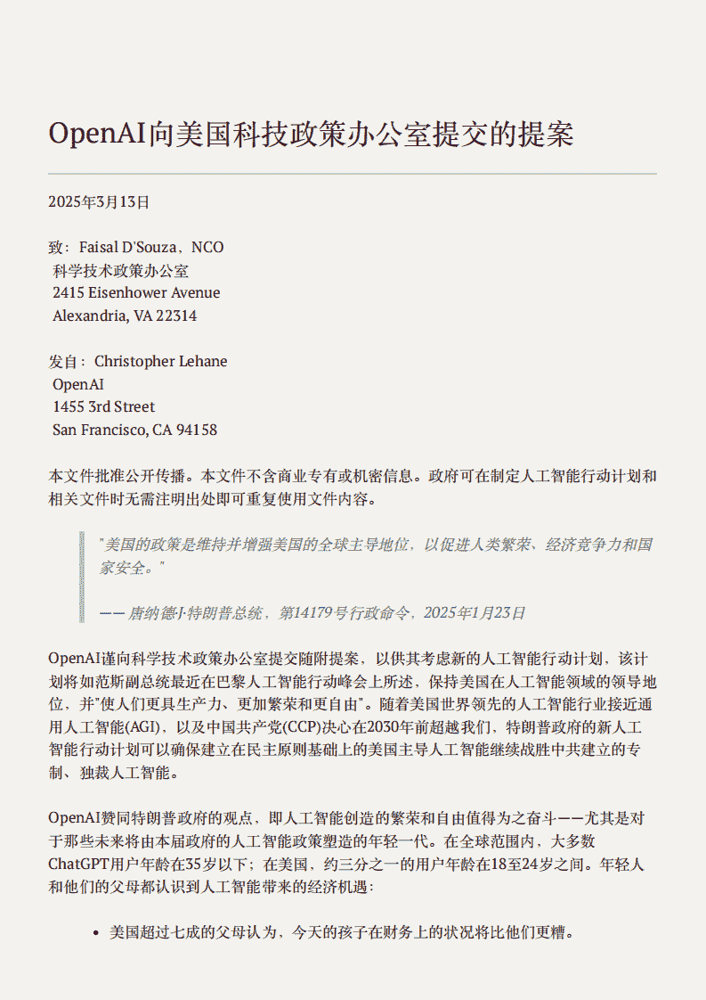
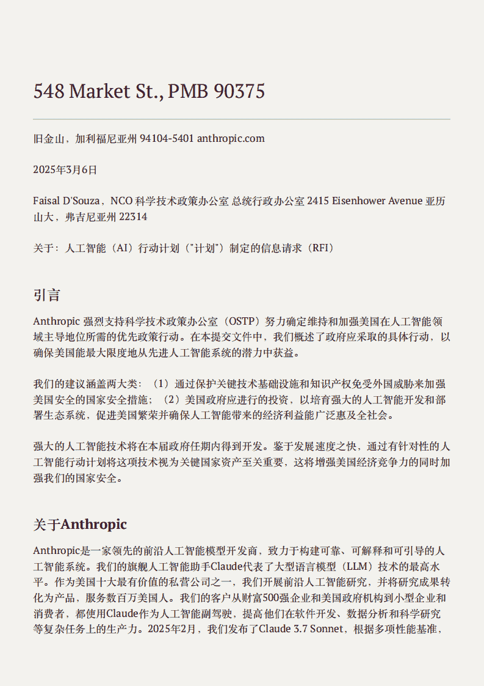
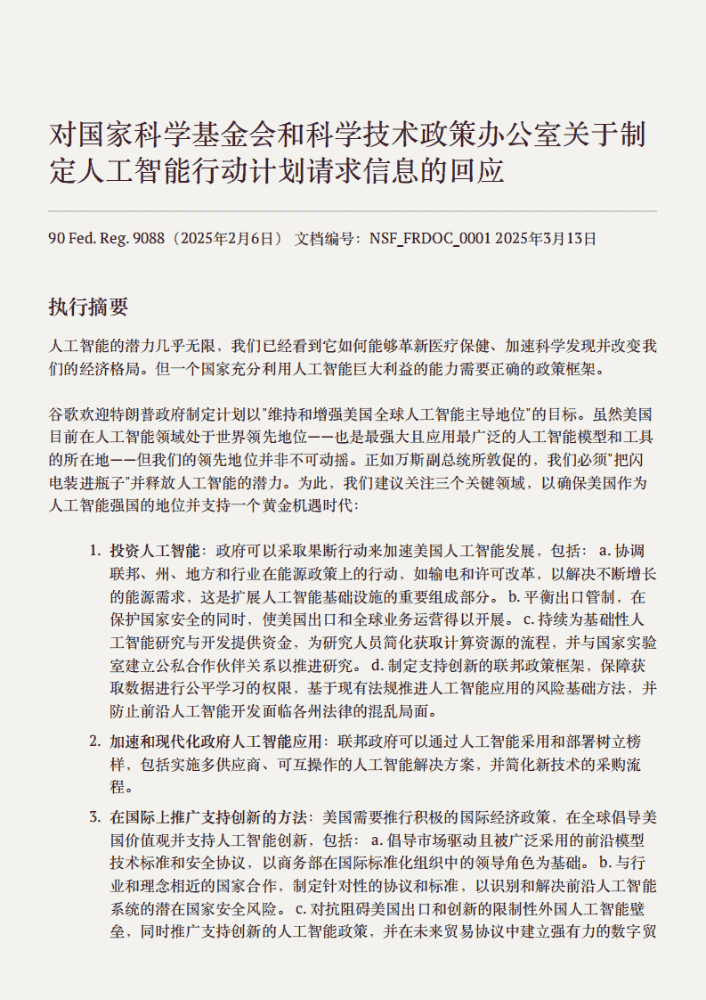

# AI行动建议

> 来源：[https://langgptai.feishu.cn/docx/Tgx9ddJ3sobrFvxjFBZcgYdbnRe](https://langgptai.feishu.cn/docx/Tgx9ddJ3sobrFvxjFBZcgYdbnRe)

美国政府关于《AI行动建议》向各大公司征求意见，OpenAI、Anthropic、Google 等公司提案的中文翻译版

源文件：https://www.nitrd.gov/coordination-areas/ai/90-fr-9088-responses/

👸号：云中江树

🛰️👸号文章：

翻译版 PDF 如下:

[OpenAI向美国科技政策办公室提交的提案.pdf](https://internal-api-drive-stream.feishu.cn/space/api/box/stream/download/all/Sza0bwsIfoM7nWxSENFchdfrnKd)

[Claude提案.pdf](https://internal-api-drive-stream.feishu.cn/space/api/box/stream/download/all/HP5PbbHMmo8DiixJdIGcWzF8nyd)

[谷歌.pdf](https://internal-api-drive-stream.feishu.cn/space/api/box/stream/download/all/WIWbbiDDWoAl3sxcgGOcvqFrnhd)