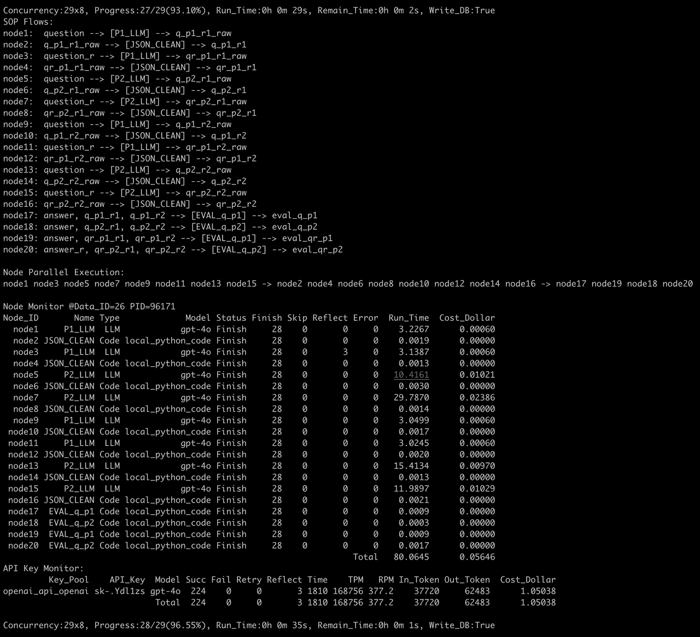
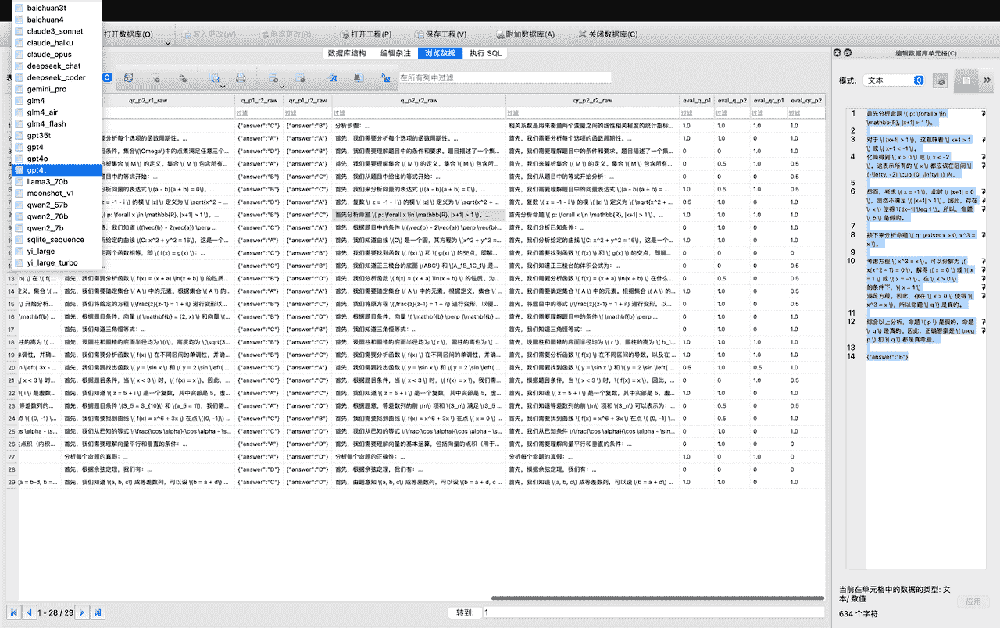
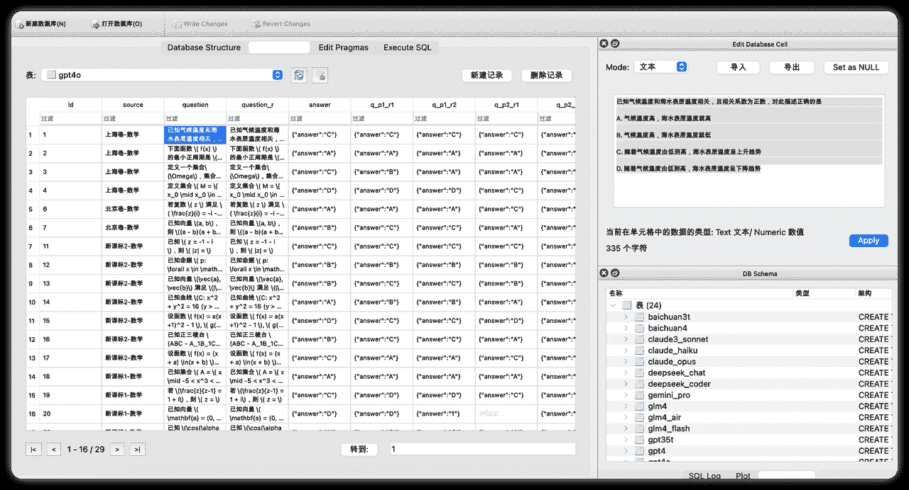
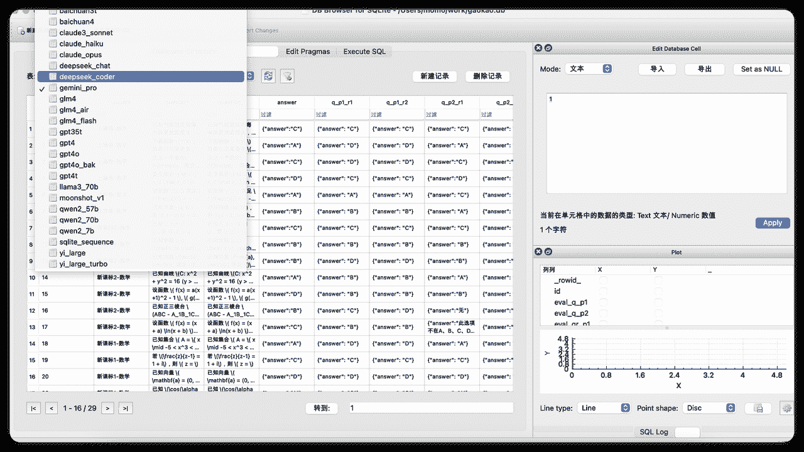
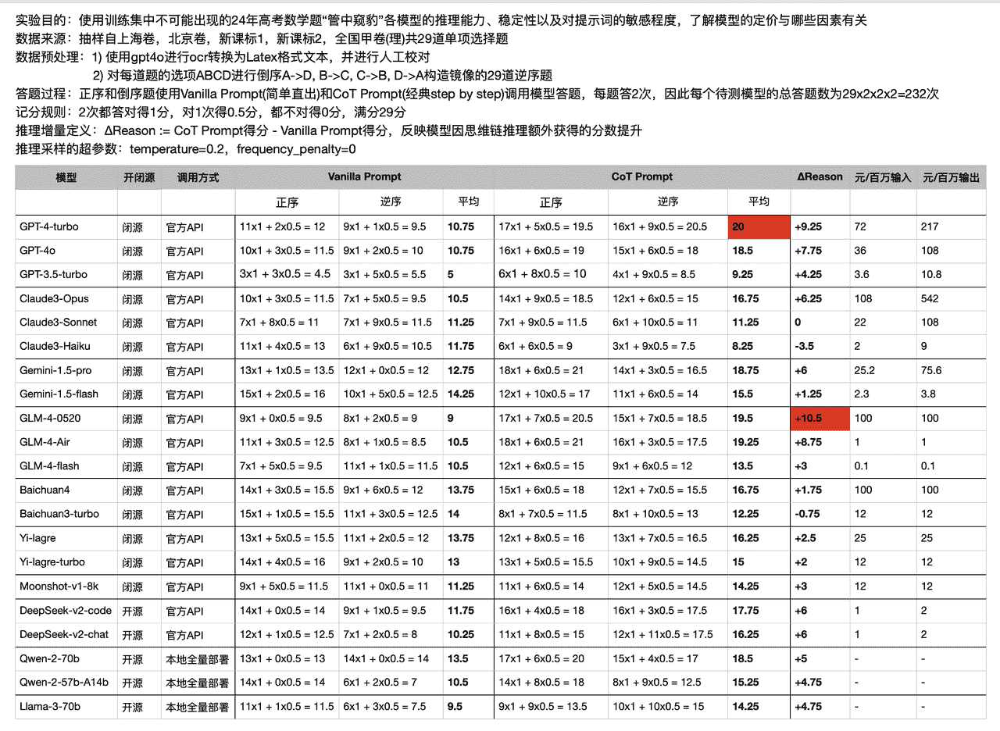
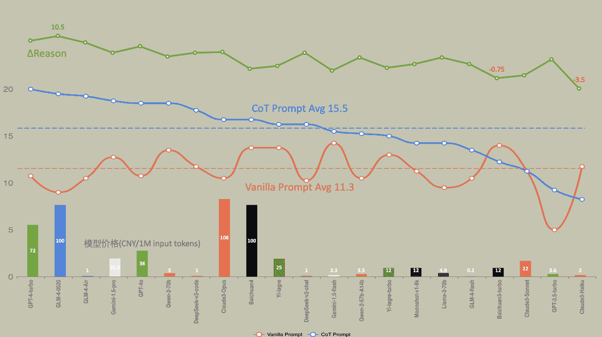

# 2024高考数学: 大模型解题能力几何？

> 来源：[https://langgptai.feishu.cn/docx/Nj17dGnBWoElW7xHQWQcYXsBnjy](https://langgptai.feishu.cn/docx/Nj17dGnBWoElW7xHQWQcYXsBnjy)

## 一、背景

LangGPT社区代码诗人群核心成员“陆游博士”花费了五个深夜的时间测评了国内外大模型的数学能力，使用训练集中不可能出现的24年高考数学题“管中窥豹”（自谦了哈）各模型的推理能力、稳定性以及对提示词的敏感程度，了解模型的定价与哪些因素有关~

## 二、数据相关

### 1、数据来源

抽样自上海卷、北京卷、新课标1、新课标2，全国甲卷（理）共29道单项选择题。

### 2、数据预处理

+   使用gpt4o进行ocr转换为Latex格式文本，并进行人工校对

+   对每道题的选项ABCD进行倒序A->D,B->C,C->B,D->A构造镜像的29道逆序题

### 3、答题过程

正序和倒序题使用vanila Prompt(简单直出)和CoT Prompt(经典step bystep)调用模型答题，每题答2次，因此每个待测模型的总答题数为29x2x2x2=232次

> Vanilla Prompt（"Vanilla Prompt"一词是最基本或最简单形式的指令或请求，它没有复杂的条件、特定的风格或详细的描述，而是直接、明了地描述了所需的任务或要求）

### 4、记分规则

2次都答对得1分，对1次得0.5分，都不对得0分，满分29分

### 5、推理增量定义

ΔReason:= CoTPrompt得分-Vanila Prompt得分，反映模型因思维链推理额外获得的分数提升

### 6、推理采样的超参数

temperature=0.2，frequency_penalty=0

## 三、实验过程（TODO 待补充、后续细化）

## 四、推理结果

## 五、结论

废话不多说，直接抛砖引玉一些可能不正确的观点：

**1**）目前大模型能力已经达到独立做高考数学题的水准，使用未精调的CoT Prompt，旗舰模型可以做对约70%的单选题

2）国产旗舰模型在这个测试场景下已经非常接近国外旗舰模型

**3）模型升级后并不能一致性的提高Vanilla **Prompt和CoT Prompt的得分

**4**）模型升级其实是模型上限的提升，而这上限需要Prompt去激发，否则会发生贵1000倍的模型比不上便宜1000倍模型的极端情况

**5）同厂商发布的不同模型的定价不仅与CoT Prompt得分而且与Δ**Reason高度正相关，ΔReason越高的模型说明模型靠推理获得的泛化能力越强

**6）Vanilla Prompt**得分甚至与模型定价(能力)有负相关的倾向

7）正序题和逆序题答对数的方差越大说明模型对输入的敏感程度越高

8）得0.5分的情况越多说明模型decode输出的空间越发散

9）所有的评测都难免存在技术上的片面和主观上的偏见，这个评测也不例外

致谢(排名不分先后)：

四郎哥提供的API key和精美排版制图，代码诗人群算力天花板王维总提供的本地部署算力，以及LangGPT社群小伙伴们的各种支持[Party]