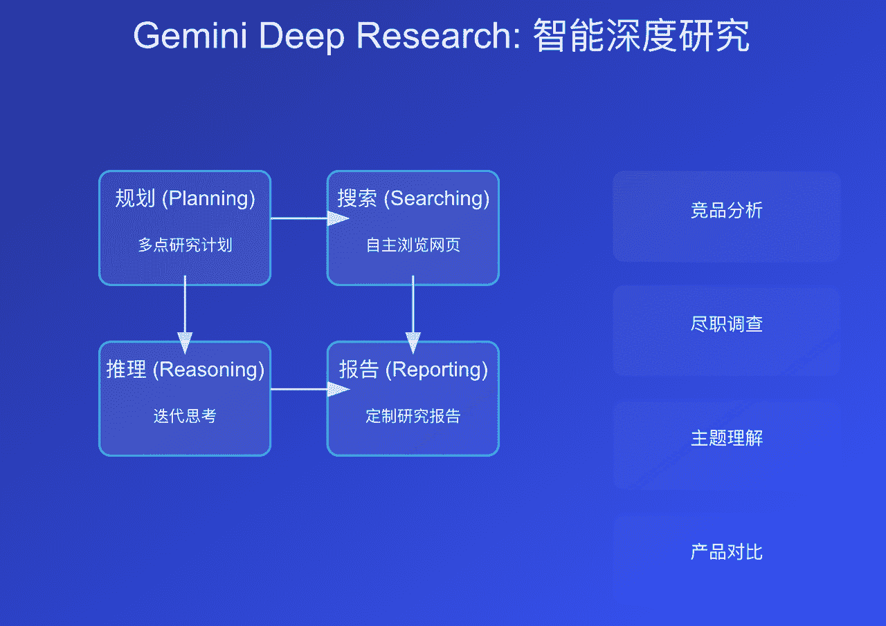
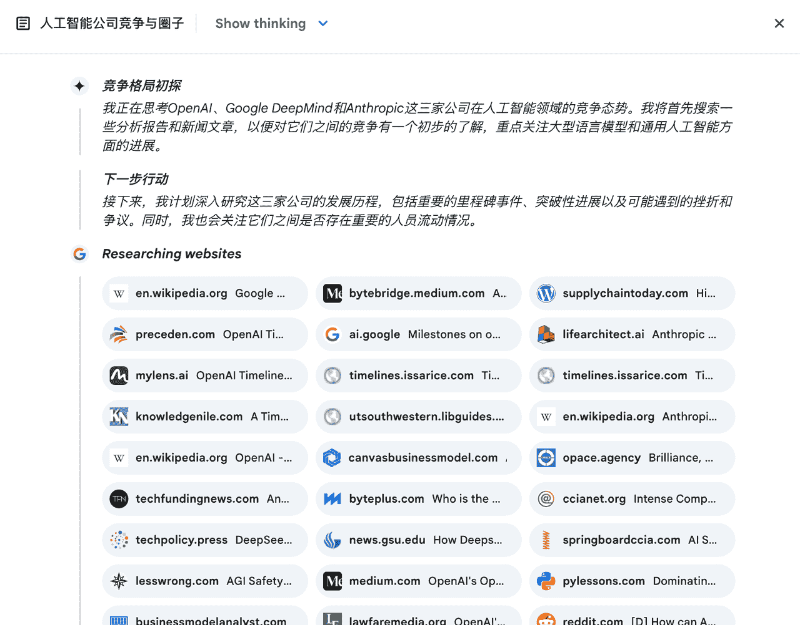
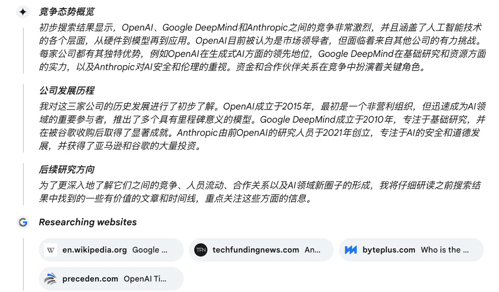
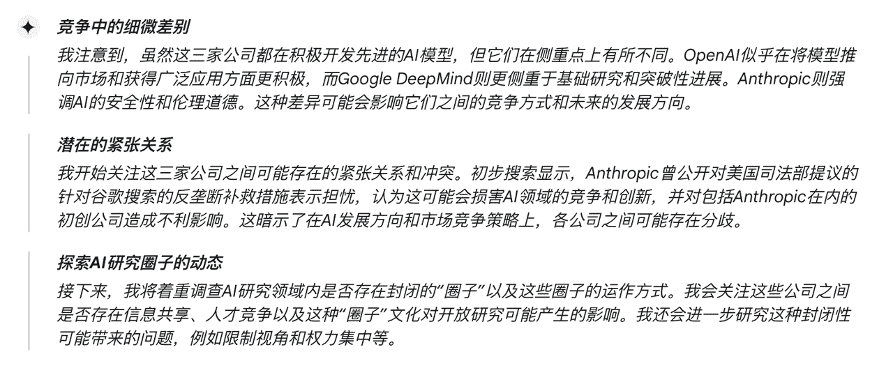
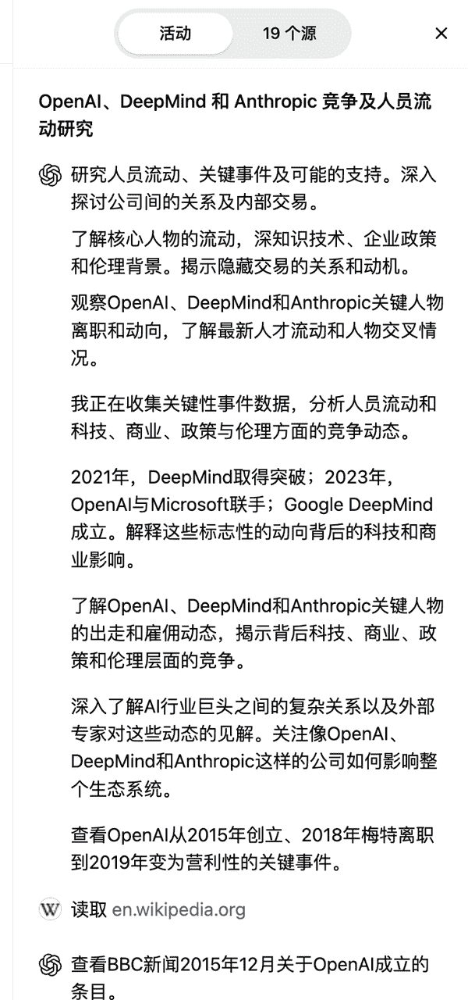
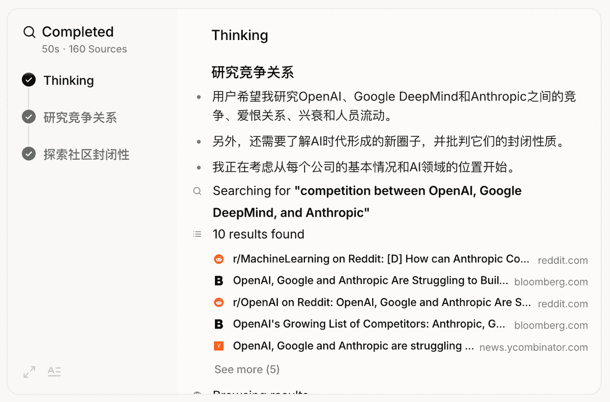
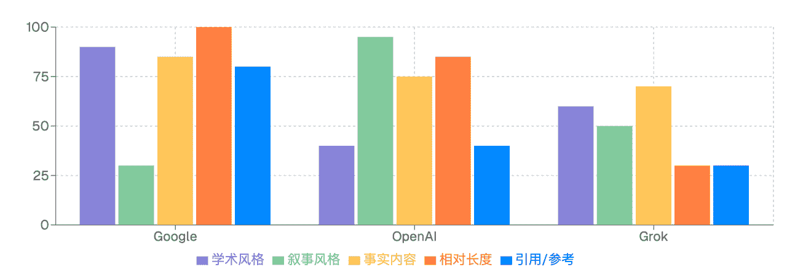
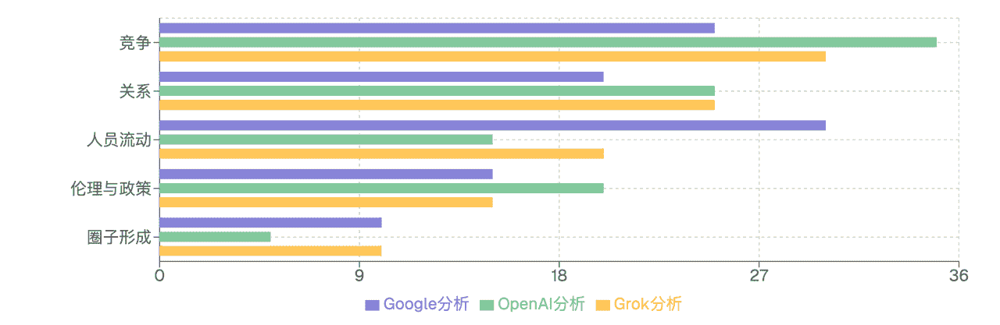

# DeepSearch的爸爸终于出手了，免费又巨好用，不愧是Google！

> 来源：[https://langgptai.feishu.cn/docx/H093dBBWfoTK4Dx26L7cPa4Xnqh](https://langgptai.feishu.cn/docx/H093dBBWfoTK4Dx26L7cPa4Xnqh)

昨天Google鸽了很久的图片生成功能正式在体验服上线..

今天Google又对全员上免费的DeepResearch，成为了免费的DeepSearch联盟的第10+成员。

我想Google大概是心在滴血，泪在飘，咬咬牙，跟上大节奏，感谢Manus、Groks，让Google不得不迎头赶上，免费版本的DeepResearch真的 Advance时代更好用。

赶紧来：


作为搜索领域的唯一真神，谷歌的DeepResearch的核心特性有这些：



实际体验是还蛮不错，不过我更加关注多家对比的结果，因此今天就花点时间，评测下OpenAI、Gemini、以及Grok3这三只当红炸子鸡。

问题是：“我想研究下OpenAI公司、Google DeepMind公司以及Anthropic的竞争，爱恨兴衰，以及人员流动以及关系，并产生 AI时代的新圈子，旨在抨击圈子的封闭。”

## **中文思维链探究**

### Gemini Deep Research







### OpenAI Deep Research



### **Grok DeepSearch**



+   • Gemini的设计风格上我喜欢，任务窗口比其他友商更大，更容易看到任务的进展，内容更加精炼，相比Grok3零零碎碎的自问自答，Google的思维链以及具体的Action更加精炼，体感更好。

+   • OpenAI的工作流则比较精细，是一个网页一个网页的进行，而Google 与 xAI的工作流则是量大管饱，一次性给更多网页，然后从里面RAG更多内容。

每一家都有自己的设计方法，打开看看其实蛮有意思的，但是从工作方法来看：

+   • OpenAI会更加有深度，会逐步展开工作，缺点就是慢。

+   • Google则按照拆解的任务流执行，并未按照P-D-C-A的工作方法进行工作，效果上是无法保障的，只能搜索到哪儿就是哪儿。

+   • Grok3会自行基于当前收集的结果积极调整方案，但结果比较糟糕，后续迭代可以持续关注下Grok3。

---

详细展开来看下，在**工具思维链（Chain of Thought）**的的不同。

> Deep Search类产品是对网页内容深度检索的通用代理，对**于“AI**代理（Agent）”型工具而言，输出质量并不仅仅取决于最终写就的文章，还和“它在背后是如何搜索、如何筛选、如何调整思路”息息相关。

+   • 如果思维链能够**有条理地拆解任务**、**回顾检验**并**迭代优化**，往往能产出更深入的研究结果；

+   • 如果思维链仅**机械式地搜集**或**浅尝则止**，可能导致文章缺乏系统性、深度或准确性。

### Google Gemini的思维链

```
竞争格局初探
我正在思考OpenAI、Google DeepMind和Anthropic这三家公司在人工智能领域的竞争态势。我将首先搜索一些分析报告和新闻文章，以便对它们之间的竞争有一个初步的了解... 
下一步行动
接下来，我计划深入研究这三家公司的发展历程，包括重要的里程碑事件、突破性进展以及可能遇到的挫折和争议...
Researching websites
en.wikipedia.org
Google DeepMind - Wikipedia
...
supplychaintoday.com
History of Google DeepMind Artificial Intelligence. (UPDATED) - Supply Chain Today
preceden.com
OpenAI Timeline | Preceden
...
竞争态势概览
初步搜索结果显示，OpenAI、Google DeepMind和Anthropic之间的竞争非常激烈...
公司发展历程
我对这三家公司的历史发展进行了初步了解...
后续研究方向
...
人员流动与合作
...
未来行动计划
接下来，我计划更深入地搜索关于OpenAI、Google DeepMind和Anthropic之间的人员流动情况...
...
```

**很明显，Google D**eepResearch使用采用“Step by Step”式的方法进行拆解：先“竞争格局初探”，再“公司发展历程”，接着“人员流动与合作”，最后再挖掘其它信息。

并且典型“**分段**”执行：完成一个搜索后，进入下一阶段，很少有反复“回头看”或“自省”环节，因此:

+   • 信息覆盖面极广：能从“历史”“融资”“人员流向”“封闭圈子”等多维度获取数据；

+   **• 每个**阶**段都有明**确任务，产出的文章往往结构清晰、条理分明。

+   • 缺乏深度“迭代反思”，一旦某一环节检索结束，就不再自动质疑或跨章节调用更多信息；

+   • 有时更像流水线执行：“搜索到哪儿就是哪儿”，没有强烈的 PDCA（计划-执行-检查-行动）循环。

---

### **OpenAI**

```
OpenAI、DeepMind 和 Anthropic 竞争及人员流动研究
ChatGPT
研究人员流动、关键事件及可能的支持。深入探讨公司间的关系及内部交易。
...
观察OpenAI、DeepMind和Anthropic关键人物离职和动向，了解最新人才流动和人物交叉情况。
...
尝试打开参考资料时，发现它打开了维基锚点。或许可以直接跳到页面底部的参考资料。
...
我在搜索BBC新闻标题，参考其参考标题和原始出处。
...
在拿到若干事件后，往往回头检视“是否还有关键冲突点没深挖？” 
...
我正在组织内容，确保全面。
Research completed in 11m· 19 个源
```

OpenAI呈现了较强的“**深入挖掘**”**倾向：如**多次提**及马斯克**与Op**enAI的冲**突、董**事会风波**等，体现了Deep的含义，更深更Deep，不断进行“新的问题”→“重新检索”→“发现更多内容”→“再次扩写”的过程。

+   • 多次回头看前面是否缺少了关键信息，并尝试联结技术突破、商业资本、人员冲突、政策监管各方面；

+   • 成文的视角更丰富，大多从“2015～2025”的时间线串起，信息量和可读性都有所提升。

+   • **耗时较长**：因为反复检查、持续深挖，速度相对慢；

---

### **Grok3**

```
Thinking
研究竞争关系
用户希望我研究OpenAI、Google DeepMind和Anthropic之间的竞争...我正在考虑从每个公司的基本情况和AI领域的位置开始。
Searching for &quot;competition between OpenAI, Google DeepMind, and Anthropic&quot;
...
我发现Anthropic由前OpenAI员工创立，这说明人员流动已经发生。接下来，我会深入研究这些公司之间的爱恨关系和人员变动。
...
Searching for &quot;personnel movements between OpenAI, Google DeepMind, and Anthropic&quot;
...
人员流动显示这是一个人才竞争激烈的领域...
...
目前讨论主要集中在人才流动上，但除了Dario Amodei外，具体名字不明显。
...
我在整合信息，为用户提供全面的分析和批判。
```

和OpenAI一样，Grok3搜索过程虽也会调整方向，如：“发现Anthropic由**前OpenAI员工创立 → **立即关注人员离职话题”； 但搜索深度不够连续，大多是表层获取结论后便迅速换关键字。

+   **• 在短**时间内能获得核心脉络：竞争关系、人员流动、爱恨纠葛等，对快速产出有好处。

+   • 缺乏系统性：并没有形成“**全景式**”或“**学术式**”的深入，还可能出现“仓促收尾”现象；

+   • 优秀的“Pivot”能力并未发挥到最大，因为并没有后续“深度跟进”或“反复校验”。

所以Grok3 叫DeepSearch ：）

### **三家工具思维链**

通过对三家工具的**思维链原文**进行对比，可以明确看出：

1.  Google更倾向于线性、分步骤执行，缺乏明显的反思循环；

1.  OpenAI则展现出多轮迭代、持续深挖的特点，文章深度好但效率一般；

1.  Grok3版呈现出一定的灵活“Pivot”倾向，却没有统一的宏观结构，导致信息整合度和深度较弱;

**在研究**型**任务中**，**这些“**幕后思维链”差异会直接决定最终成果的全面性、细腻度和可读性。

+   • 如果不缺钱的尊贵的OpenAI Pro 会员用户，首选OpenAI。

+   • 如果没有什么钱想白嫖的用户，Google Gemini仍然算是一个不差的选择，而且对中国人也相对友好了。

+   • 如果没事找事，若只需概要速览或初步判断，Grok3也能快速提供结论。

## **素材引用来看**

你永远可以相信谷歌真身的搜索能力啊喂，Google Gemini 足足检索了165个网页，但是仅仅只有20-30网页引用到整体报告。

Grok3则阅读了90网页，但是引用了9个网页。

OpenAI使用19个源，并引用了其中9个网页。

从最终结果来看，阅读大量的网页未必会对输出结果产生根本性的影响，因为很多内容可能都是无效内容。

## **生成质量来看**

OpenAI的分析的叙事性最强、在战略洞察、技术与商业视角获得最高评分。它成功地将复杂的行业关系编织成吸引人的故事，同时提供了深刻的战略分析和历史背景。（因为他问我面向什么读者的时候，我说要给普通人看热闹用的，其他模型没有反问，我就不管了）

Google的分析凭借其严谨的学术方法、全面的数据支持和对伦理问题的深入探讨获得第二名。它的人员流动表格和对AI圈子排他性的批判性思考提供了独特价值，但学术风格可能降低了普通读者的可读性，篇幅也比较短，很多章节内容没有得到有效的扩充。

Grok虽然在在有限篇幅内提供了关键信息，并特别关注了合作机制和多样性挑战，但在深度和广度上不及其他两种分析，基本上可以不作为主要工具选择了。

下面是更加详细的展开：

### **详细评分比较**

### **内容风格对比**



+   • Google分析风格，高度学术化和结构化方法，广泛使用表格和数据，拥有正式的章节和小节，使用大量引用和参考。

+   • OpenAI分析风格，强烈的叙事和讲故事风格，通过戏剧性框架事件与适度使用引用，提供一篇好的研究报告，强调商业战略和竞争，中立性较差（因为我引导了...)

+   • Grok分析风格，在学术和叙事之间的平衡，太简洁、面向总结，引用较少但仍然事实性强，内容最中立。

### **关注领域差异**



+   • **Google**更加强调人员流动和公司间的人才迁移，对AI圈子排他性最为批判

+   • **OpenAI**更关注竞争动态和商业战略，使用叙事方法描述"三方竞争"

+   • **Grok**在各主题上分布更加平衡，对关系和合作给予稍多关注

## **报告**

报告篇幅比较长，我把他发布到POE中，给大家。

https://poe.com/Article11j

整体来看，AI搜索作为AGI在上网浏览场景最重要的分支，竞争烈度只会持续上升，不下场的终会下场，原来的生态也会迎来巨变。 OpenAI作为DeepResearch的先发者之一，仍然拥有着其他友商无法比拟的优势，之前某大佬用OpenAI DeepReseach 成功挖到漏洞了。

> 本文使用AI工具如下：

v0：对比数据整理与可视化呈现

v0：制作🛰️头图

OpenAI O1：思维链与文章内容比对参考

Poe：发布一个简单的网页。