# 郭美青 | 从Demo到商用— 构建企业级提示词工程，加速AI应用商用落地

> 来源：[https://langgptai.feishu.cn/docx/Q7jQdZffBoRShnxwX5Vc2A7bnOb](https://langgptai.feishu.cn/docx/Q7jQdZffBoRShnxwX5Vc2A7bnOb)

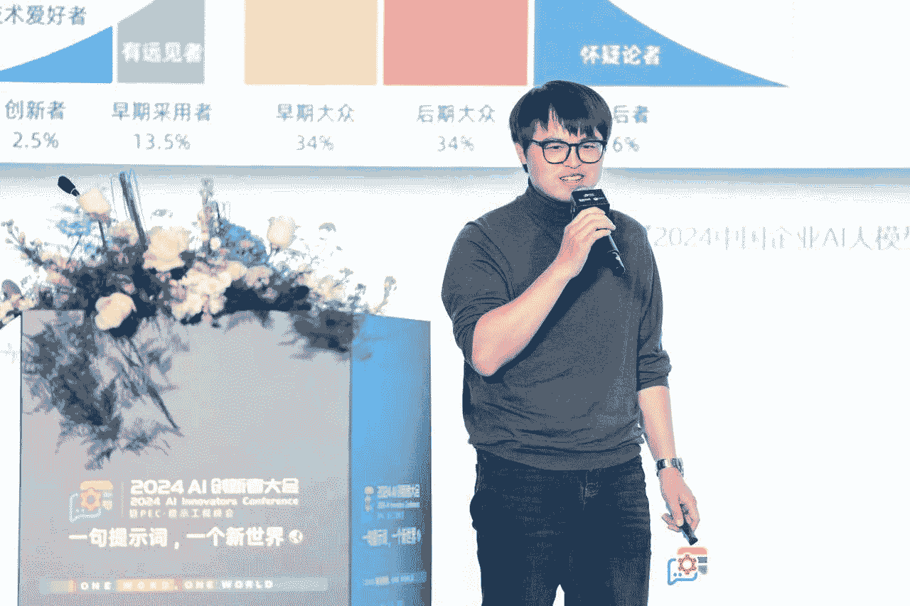

我叫郭美青，目前在百川智能商业化团队工作，主要负责Agent平台和工具链开发，以及企业AI应用落地的赋能工作。接下来，我想和大家分享一下企业在AI应用落地过程中的一些思考。

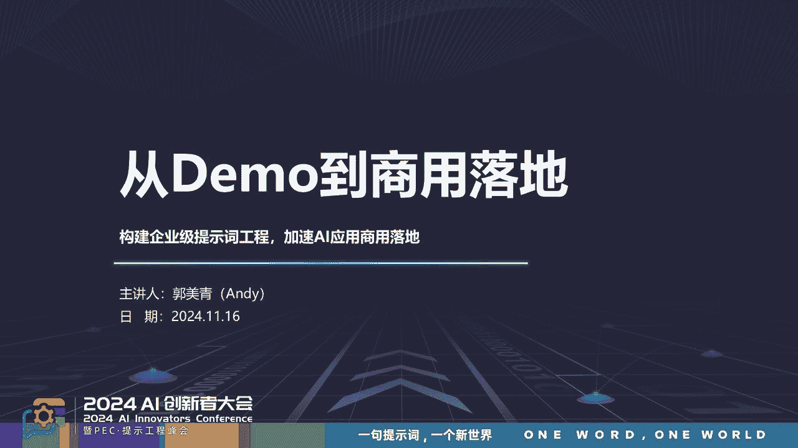

内容主要分为三部分：生成式AI的“冰”与”火“之歌、商用落地的“困”与“破”、企业级提示工程（Enterprise Prompt Engineering，EPE）的"知"与"行"。

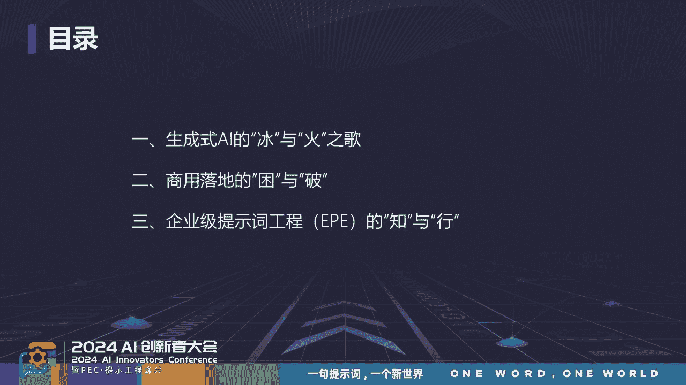

自从ChatGPT发布以来，生成式AI的火爆，相信大家都有体感，甚至有一些专家惊呼第四次工业革命要来了。当然，也有很多人对AI抱有很大的质疑。

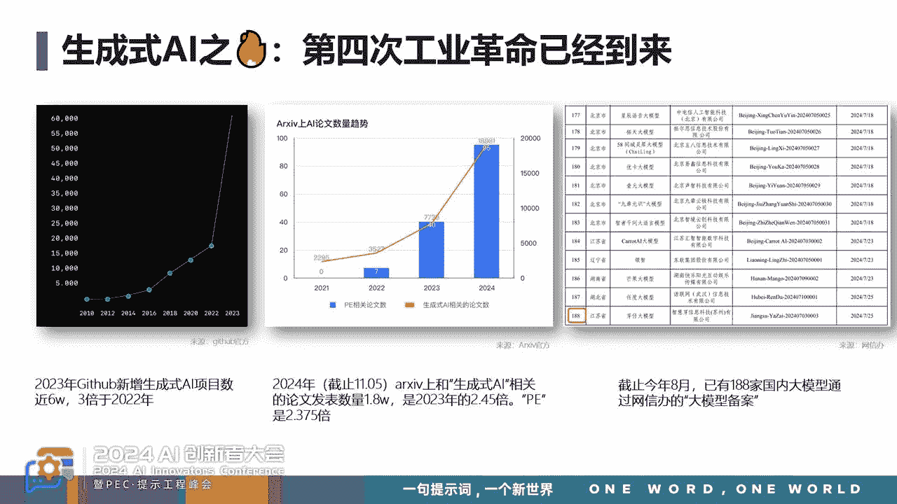

我们来看三组数据。第一组数据：2023年Github官方在年底发布的统计数据，2023年新增的生成式AI项目数接近6万，是2022年的3倍，这是一个非常大的增长。第二组数据：截至2024年11月5日，生成式AI相关论文达到1.8万篇，是2023年的2.45倍。按照目前趋势，预计到年底将达到2023年的3倍，提示工程（Prompt Engineering，PE）的增长幅度和它是相似的。第三组数据：网信办生成式大模型备案清单，截止到今年8月份有188家国内大模型通过了备案。

从主观感受和客观数据都可以看出，生成式AI正在以惊人的速度发展。

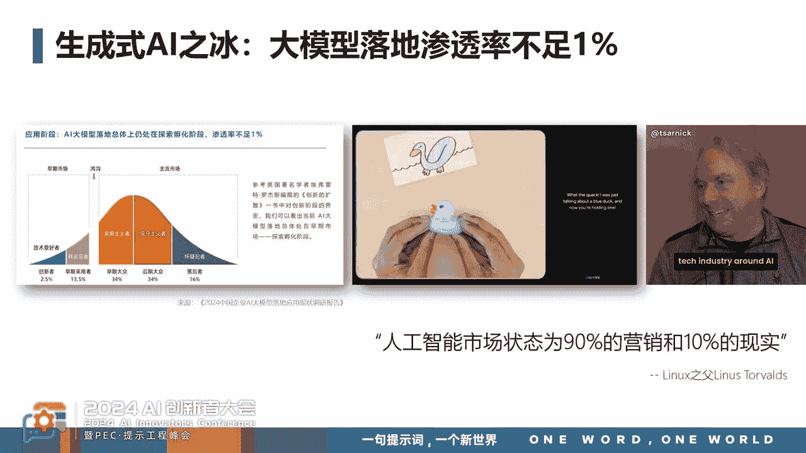

**与生**成式AI的火爆相对应，产业界也有不少理性的声音。今年8月，一家调研机构对国内140多位企业CIO进行调研后发现，AI大模型在商用落地方面仍处于早期孵化和探索阶段，渗透率不足1%。这个结论与我们在一线企业合作探索过程中的体会是相符的。大家应该都记得谷歌全模态模型的demo视频，作为OpenAI之后最具爆炸性的演示，这个demo确实带来了巨大震撼。但后来被揭露是造假的，谷歌官方也承认每个视频片段都是通过单独编写提示词，再用后期剪辑拼接而成。最近谷歌在社交媒体上又出现类似争议，其 AI Coding 覆盖率数据被自家员工揭露不实。正如 Linux 之父在社交媒体上所说：人工智能的市场状态是90%的营销和10%的现实。

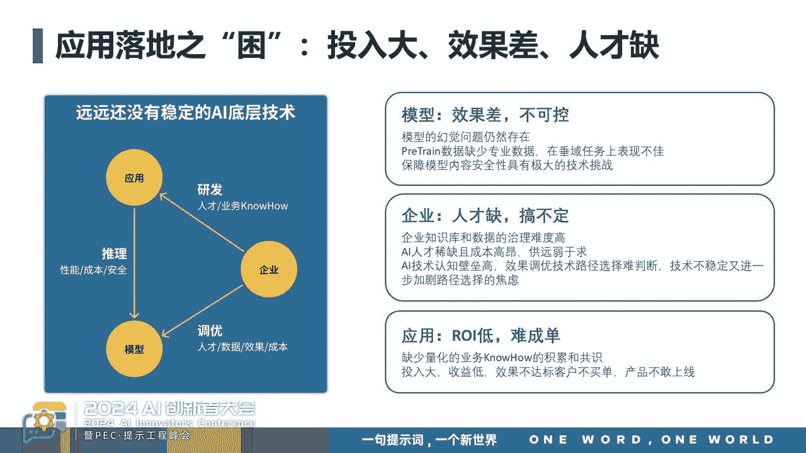

**目前生成式大模型在落地过程中确实遇到了困难。这些困难**可以概括为三点：投入大、效果差、人才缺。

要深入理解生成式AI应用的落地问题，我们需要从企业、模型和应用这三个核心要素来分析。

从模型层面来看，目前仍然存在几个关键问题。首先是模型的幻觉问题，这是由于技术原理本身的限制导致的。尽管有观点认为这个问题已经得到基本解决，但了解大模型原理的专业人士都清楚，这个问题无法被完全消除，就如同人与人之间的交流也会存在理解偏差一样。其次，由于数据壁垒的存在，预训练数据缺乏专业领域数据，导致模型在垂直领域的表现欠佳。此外，模型应用的内容安全保障仍然面临重大挑战。

从企业层面来看，最突出的问题是人才短缺。通过与众多企业的合作与交流，我们发现企业在数据治理和知识治理方面的积累严重不足。这个问题可以追溯到移动互联网时代的信息化建设不够完善。同时，真正能够解决AI相关问题的高素质人才不仅稀缺，而且成本极高。目前的教育体系，包括高等教育和专业培训，尚未形成完整的人才培养机制。另外，大模型底层AI技术的不断演进，新技术、新理念、新范式的持续涌现，也加剧了企业在技术路径选择上的焦虑。

从应用层面来看，企业在产品和业务开发中面临着提炼核心业务认知的挑战。这种认知包括关键原则和规则的确立，这是一项极其困难的工作，而目前无论是企业还是人才都缺乏这方面的能力积累。

最终的结果是，尽管企业投入了大量资源，购置了众多硬件设备，但由于上述种种问题的存在，应用效果往往不尽如人意：客户反馈不佳，产品因安全问题和模型不可控而无法顺利上线。这就是当前生成式大模型落地面临的现实困境。

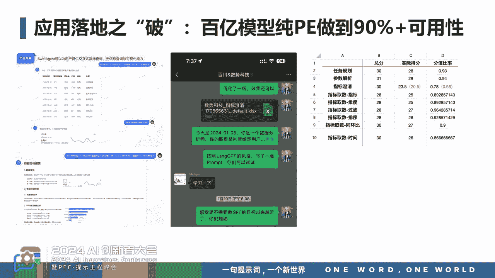

**那**是不是说在这样一个情况下，今天结合国产大模型在应用落地的时候，这个事情仍然言之过早，也不是。我来分享一个积极案例。

有一家从事大数据BI的公司，在ChatGPT发布后积极寻求创新。他们希望通过OpenAI接口开发一款面向企业的数据分析Copilot。这个产品很快获得了企业销售主管和高管们的青睐。在此之前，获取一个数据分析结论往往需要跨部门协作，耗时两到三天。而现在，用户可以通过自然语言直接提问，快速获取数据报表，甚至可以直接进行问题归因分析，这是一个显著的进步。

在这个竞争激烈的细分市场中，主流技术路径是将自然语言直接转换为数据查询（NL to SQL）。而这家公司别出心裁，采用了"NL to MQL"的方式，在中间搭建了指标平台。这个平台巧妙地连接了业务语言和技术语言，将行业黑话、业务指标等专业术语与技术实现对接起来，有效消除了两者之间的差异。系统只需将自然语言转换为所需的指标计算和统计需求即可。

去年下半年，他们使用GPT-4进行优化，将可用性提升到了90%左右，达到了产品发布标准。但在产品即将上线时，他们必须转向国产模型。这个转换带来了明显的性能损失，可用性从90%骤降至60%，某些指令的表现甚至下降到20-30%。到了11月份，我们与该公司展开合作，在百川 33B 尺寸模型上进行提示工程（PE）优化。通过纯PE调优，我们将整体指令的可用性重新提升到90%左右。年底，这个产品成功实现了规模化商用交付。

**这个案例很好地说明，只要找到正确的方法，再加上高**质量的提示词设计，商业化落地并非遥不可及

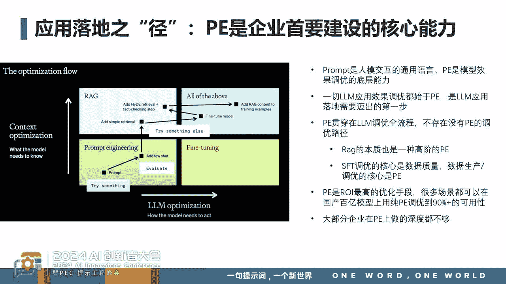

**这**就引出今天要分享的第一个观点：虽然现在很多企业在讨论各种技术路径（如RAG等），但我认为PE（Prompt Engineering）才是企业首先要建设的核心能力。

为什么这么说？首先，Prompt是当今人机交互的通用语言，PE则是一项基础能力。所有大语言模型应用的效果都源于PE，不存在完全脱离PE的技术路径。以RAG为例，它本质上是一个高阶的Prompt应用——从向量数据库检索相关知识后，仍需将其拼接到Prompt中。如何设计这个Prompt，如何确保模型准确响应，这些都属于PE的范畴。

同样，在有监督微调（Supervised Fine-tuning , SFT ）过程中，训练数据就是由问答对构成，其中的问题包含着系统级提示词(System Prompt)。在生产数据过程中，我们也需要通过PE来完成。现今许多生成数据的方法都是基于Prompt实现的。可以说，PE贯穿于大模型调优的全过程。

值得注意的是，PE实际上是投资回报率最高的优化手段。在许多场景中，仅通过纯PE就能在国产百亿规模模型上实现90%的效果。然而，我们观察到许多企业往往浅尝辄止，未能深入研究就草率得出"大模型效果不好"的结论。这种情况的出现，很大程度上源于将国产模型的初始输出与OpenAI的GPT-4进行简单直接的对比。

但我要强调的是，**国产大模型同样可以实现良好效果。实现这一目标的关键在于将思维从PE（Prompt Engineer**ing 提示工程）转向EPE（Enterprise Prompt Engineering 企业级提示工程）这一全新理念。

让我们来看看，从PE到EPE在目标与思维上的转变。

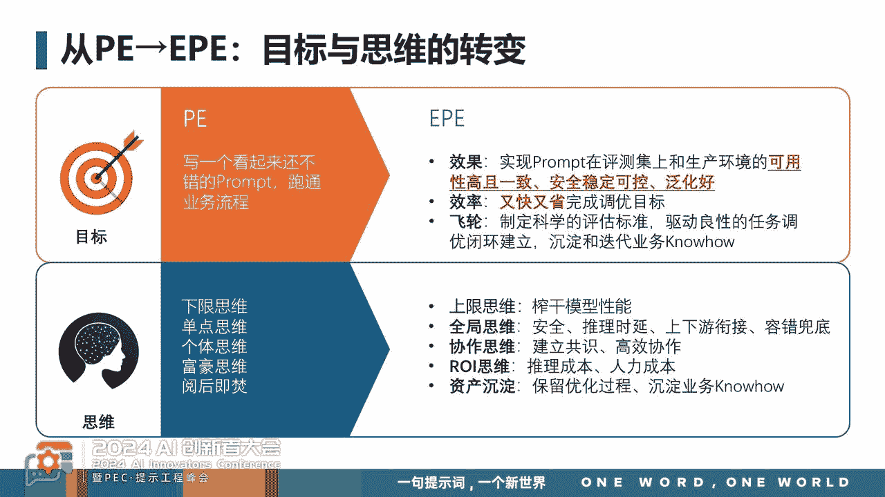

PE与EPE在目标上的区别：

传统的PE是一个相对简单的概念，其目标是通过编写合适的Prompt来确保业务流程的顺畅运行，完成demo展示和基础验证。而EPE的目标则完全不同。从效果层面来看，EPE要求Prompt在评测环境和生产环境中都保持高度一致的可用性，同时确保安全性、稳定性和可靠性。更重要的是，它还需要具备良好的泛化能力，即便面对新的数据集也能保持优秀的表现。此外，EPE还强调效率，要求在调优过程中既快速又经济。特别强调的是飞轮效应。在PE过程中，需要建立科学的评估标准，明确定义什么是"好"以及为什么称之为"好"，这个评估标准就像一座灯塔，能够引导整个PE调优或模型调优进入良性循环。在这个过程中，最关键的是要把业务Know-how压缩为高质量的prompt。

从PE到EPE思维上的转变：

第一是"下限思维"到"上限思维"的转变。传统PE往往停留在下限思维层面，仅通过反复调试几个版本的Prompt来验证模型的基本能力。而EPE则追求上限思维，从道、法、术、器四个层面系统性地挖掘模型潜能，以寻找最具价值的突破点。

第二是"单点思维"到"全局思维"的转变。传统PE通常局限于对特定内容的优化，忽视了整体环境的考量。相比之下，EPE强调全局思考：既要确保内容安全无漏洞，又要权衡推理时延，比如需要评估1万字和100字Prompt在效率上的显著差异。同时还需要考虑上下游衔接问题，包括输出格式如何与程序结合、文本匹配等细节，并建立必要的容错机制。

第三是"个体思维"到"协作思维"的转变。个体思维往往倾向于独立完成任务，但这种方式并不适用于现代企业环境。当今企业普遍实行高度分工与协作。一个Prompt任务通常服务于产品的某个具体功能，而产品本身又面向客户，需要运营、销售等多个岗位参与使用和推广。仅仅依靠产品和技术人员共同编写Prompt并将评测指标调至99%是远远不够的，因为如果没有与各方标准达成一致，即便技术上达标的成果也可能无法满足实际需求。

第四是"富豪思维"到"ROI思维"的转变。许多开发者在编写Prompt时不注重提示词的长度，忽视了token成本。EPE倡导ROI思维，致力于用更精简的提示词实现更优的效果，同时追求最小化人力投入。

第五是"阅后即焚"到“资产沉淀”的转变。个人开发者或初学者在Prompt调优过程中往往采用"阅后即焚"的方式，他们虽然在调试过程中获得诸多启发和亮点，最终却只保留了最终版本的Prompt，而没有沉淀中间过程中的宝贵经验。相比之下，EPE特别强调要将整个优化过程中的资产沉淀下来，包括业务认知和专业知识等重要经验。

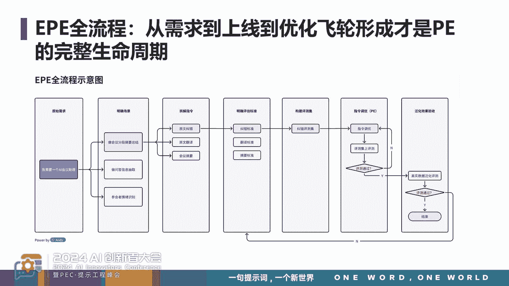

**E**PE的完整流程包含从需求提出到上线，以及优化飞轮的形成的全过程。只有经过这完整的生命周期，才算是一个完整的PE流程。

以一个具体场景为例：上市公司财报会议的总结。这个原始需求首先要进行拆解：做会议纪要分段总结、做问答信息抽取、参会者情绪识别等。

接下来是拆解指令。在企业场景中，一个会议摘要总结的需求并不是写个提示词就能搞定的，因为情况很复杂。上市公司的财报会议通常是电话会议，中间涉及语音识别环节，会存在识别准确率的问题。再加上有中英文投资者的情况，所以整个处理过程要分步骤：先对原文进行纠错，处理那些识别错得很离谱的部分，然后进行翻译，最后才是总结。

在指令拆解完成后，下一步也是核心步骤：明确评估标准。这个标准一定要明确定义出来，然后基于这个标准去构建评测集。之后就进入指令调优阶段。每一个版本调试完成后，都要进行评测。评测结果有两种：通过或不通过。如果不通过就继续迭代，通过则进入上线泛化和验收流程。

在泛化验收流程中，同样会面临通过或不通过的结果。如果通过，整个流程就算完成了。如果不通过，可能需要反过来修改评估标准。因为在线上泛化过程中，你可能会发现自己对业务的理解存在偏差。这时就需要反过来优化评估标准，甚至优化评测集，然后再去优化Prompt。

通过这样反复几轮的优化，就形成了我们所说的EPE完整流程。

EPE与PE相比，每个环节都更加严谨。我们这个表里列举了两者在几乎所有环节的行为特征对比，我就不一一念了，重点说几个典型的差异。

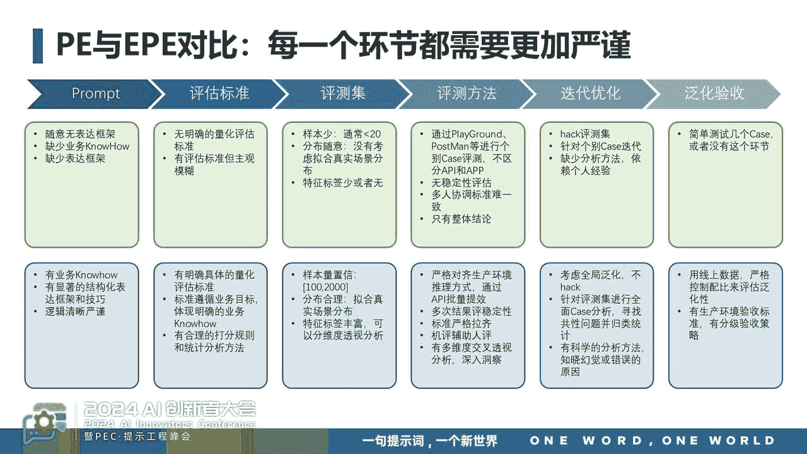

比如说评测方法，很多个人开发者在做PE的时候，都是通过大模型公司提供的C端产品来调优，比如豆包或者千问聊天的Chat界面，也有通过API去做评测。但是，PE一般不会区分这件事情，不太关注背后的差异。而且，PE基本不做Prompt稳定性评估。我们经常发现，一个Prompt在同样的参数、同样的模型下执行三遍，很可能三遍结果都不一样，哪怕只是客观题也会答错，所以这中间必须要有稳定性评估。另外，PE在个人协同的标准上也不一致，而且只有一个整体的评测方法和结论，比如说"80%的可用性"，但这个80%要怎么继续优化，就不清楚了。

而EPE就不一样了。首先，EPE要求严格对齐生产环境的推理方式，评测和生产环境的推理方式必须完全对等。而且为了提高效率，一定要通过API去做测试，因为只用C端UI的Chat界面去调优，评测效率太低了。对于多次评估的结果，EPE一定会去评估其稳定性。同时，评测标准要严格拉齐，在有了结果之后，还要基于评测集去做多维度的交叉透视分析，并且进行深度洞察。

接下来是EPE过程中核心的环节——评估标准。我们认为，一个合理的评估标准是PE成功的关键。我们通过一个儿童寓言故事的案例来对比三种不同的评估标准情况。

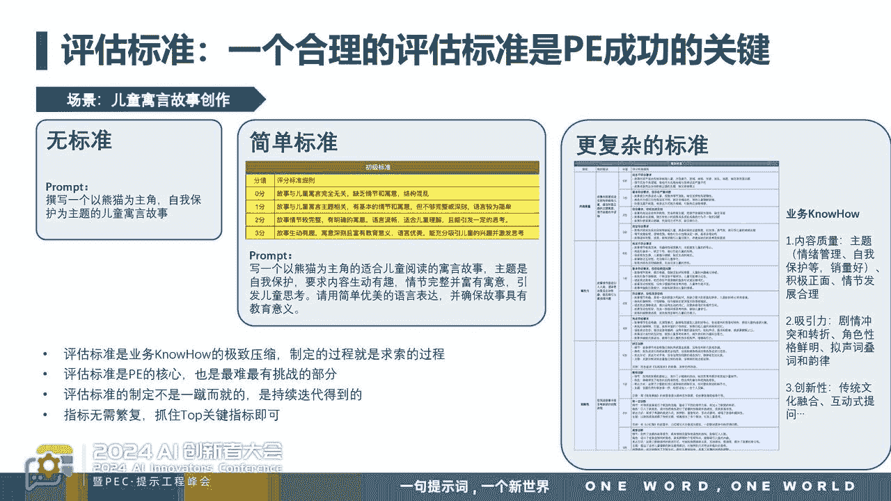

+   第一种是没有标准。当你想写一个故事却没有具体标准时，即使写了一个简单的提示词，比如"撰写一个以熊猫为主角，自我保护为主题的儿童寓言故事"，最终的结果也一定不会是你脑子里想象的那样。原因很简单，你没有把你的标准写进Prompt里去。

+   第二种是有一个简单的标准。比如定义了一个0-3分的评估打分标准，要求故事要有教育意义、生动有趣、情节完整、能引发思考，用词优美。但这样的标准依然不够，因为里面很多标准即使是人看了也会有很大歧义。既然人都看不清楚，给模型做评判效果就更差了。不过这已经比没有标准要强了。

+   第三种是更复杂的标准。我们抽取了几个核心指标：内容质量、吸引力和创新性。在内容质量方面，核心是要把握主题。这来自于业务上的发现：我们观察到学龄前儿童的图书市场上，情绪管理类的书特别畅销，很多家长都会给孩子购买这类书籍。这其实反映了一个重要的业务认知 - 这类主题非常符合儿童的成长需求。所以在内容主题的选择上，我们会倾向于情绪管理、自我保护这些已经被市场验证过的方向。在吸引力方面，我们要求故事要有剧情冲突和转折，角色性格要鲜明，要运用拟声词，注意语言的韵律感。这些都是深入的业务认知，把它们融入评估标准中，就能指导出更好的Prompt。

所以说，评估标准其实是业务Know-how的极致压缩。最近大家经常提到"压缩"这个词，而制定标准的过程就是一个业务认知求索的过程。评估标准是PE的核心，是一个灯塔，但也是最难的部分。

我们在和企业合作时会引导他们一开始就建立这样的评估标准，但确实非常困难。这种极致的压缩，就像找到那几颗关键的星星一样难。不过我们发现，一旦定出来这个标准，就能很快进入收敛过程，找到最佳的Prompt。

虽然有挑战，但这确实是核心。需要说明的是，标准定义不是一次性的工作，不用一开始就追求完美，而是一个持续迭代的过程。比如这个例子里可能就是三个指标，每个指标都有相应的打分标准和描述。我们发现有些会定5、6个甚至更多指标，但指标太多反而不好，抓住关键点就够了。

评估标准确立后，构建精良的评测集至关重要。近年来，我们经常看到大模型在各类榜单上的竞争表现。然而，需要认识到benchmark并非仅服务于大模型训练，而是具有分层特性。

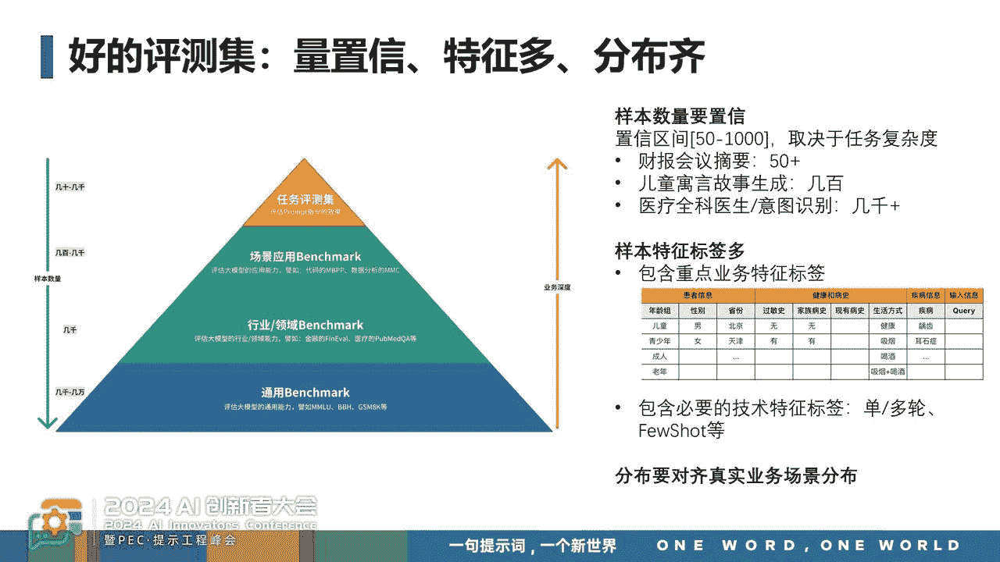

从分层架构来看，最基础层是通用benchmark，用于评估模型的知识问答、对话、逻辑推理等基础能力，样本量一般在千到万级。其上是行业和领域benchmark，如针对金融领域的评测集，样本量在几千到上万不等。再上一层是面向具体应用场景的benchmark，如智能客服或代码copilot，样本量在几百到几千之间。最上层是任务级评测，针对具体场景中的每个Prompt进行评估，样本量从几十到几千不等。可以看出，随着层级提升，对业务场景的深入程度也随之增加。

优质评测集应具备三个核心特征：量要置信、特征要多、分布要齐。

第一，样本数量要具备统计置信度。不同任务类型需要不同规模的样本量：财报会议摘要类任务约需50-100个样本；儿童寓言故事因涉及多样主题，适合采用几百样本；而医疗全科问诊或智能助手因场景繁多，则需要几千量级的样本。

第二，评测集应包含丰富的特征维度。除基本的问答对外，还需要包含业务特征标签。以医疗领域为例，需要考虑科室分类、病种类型、地域差异、患者病史等特征。同时还要包含技术特征标签，如对话轮次、Prompt形式等要素。

第三，样本分布应与真实场景保持一致。例如在医疗全科评测集中，内科病例占比自然高于肿瘤科，这与实际就医情况相符。我们主张评测集的分布应当反映真实环境中的场景比例。

当我们有评测标准、评测级，也有Prompt之后，接下来要评估。AI应用落地的速度很大程度上取决于评估闭环的效率。在AI发展的早期阶段，基础设施往往不够健全。许多开发者通过Postman中的request代码来进行PE调优，每调试一个case需要30秒，这样的效率显然难以接受。

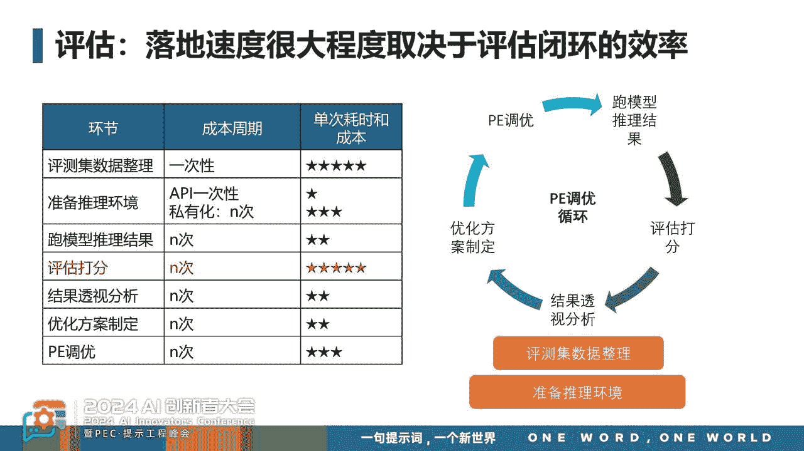

从技术架构来看，首先需要搭建推理环境，整理规范的评测级数据供程序读取，而不是简单地进行手动测试。在完成这些一次性工作后，就进入了PE调优循环：运行模型获取推理结果，进行评估打分，对结果进行透视分析，最后制定优化方案。这个过程会反复多次，对EPE能力要求较高。

从成本和周期来看，单次评测级数据的整理成本高。以AI医疗全科医生为例，构建几千条高质量的评测级数据可能需要多人团队耗时数周。推理环境的搭建，如果使用API方式则只需一次性投入。我们已开发程序可以调用各类模型API。但在私有化部署场景下，特别是在为企业客户现场搭建环境时，可能需要重复多次。

在循环过程中，评估打分环节的成本最高，直接影响着AI应用的落地效率。为此，我们可以采取多种加速方案。对于客观题（如意图识别和分类等确定性答案的任务），可以使用更强大的裁判模型进行打分，显著提升效率。

对于主观题，虽然严格来说目前仍依赖人工评估，但行业内也在尝试使用裁判模型。这需要大量精调才能获得可信结果。裁判模型可以给出建议得分及评分理由，既能加速人工评估过程（评估者只需关注解读），又能解决多人评估时的认知差异问题。在评测数据量较大需要多人评估时，机器评分能够帮助统一评估标准。因此，对主观题采用"机评+人评"的方式更为理想。

所有环节都需要重点建设自动化工具能力，这直接关系到AI应用的落地速度。在当前环境下，纯粹的技术壁垒可能在半年内就被打破。真正的竞争优势在于时间壁垒——比竞争对手更早推出产品，在后续的循环迭代中始终保持领先，这才是最大的竞争壁垒。

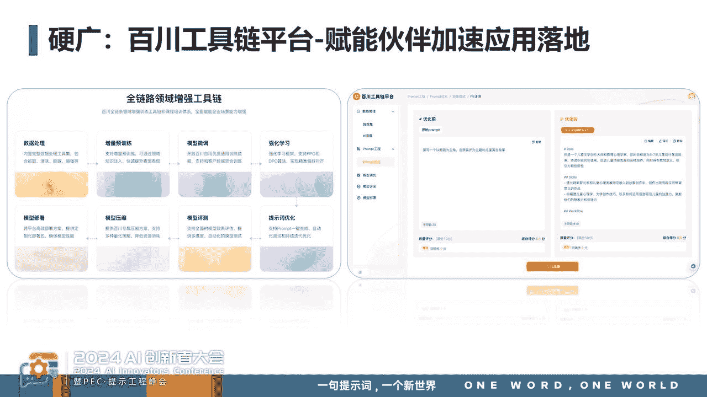

最后，让我简单介绍一下百川。百川成立于2023年4月，虽然仅有一年半的发展历程，但我们始终践行着今天所分享的理念和方法，将其融入日常工作中。

作为商业化团队的一员，我们与国内千行百业的众多企业保持密切合作与交流，共同探索AI应用的创新与优化。在这个过程中，我们积累的宝贵认知和经验都被系统地沉淀在自研的工具链平台上。我们希望通过这个平台，能够赋能合作伙伴，加速他们在AI应用场景中的落地速度，提升实施效率和应用效果。

今天的分享就到这里，感谢大家！