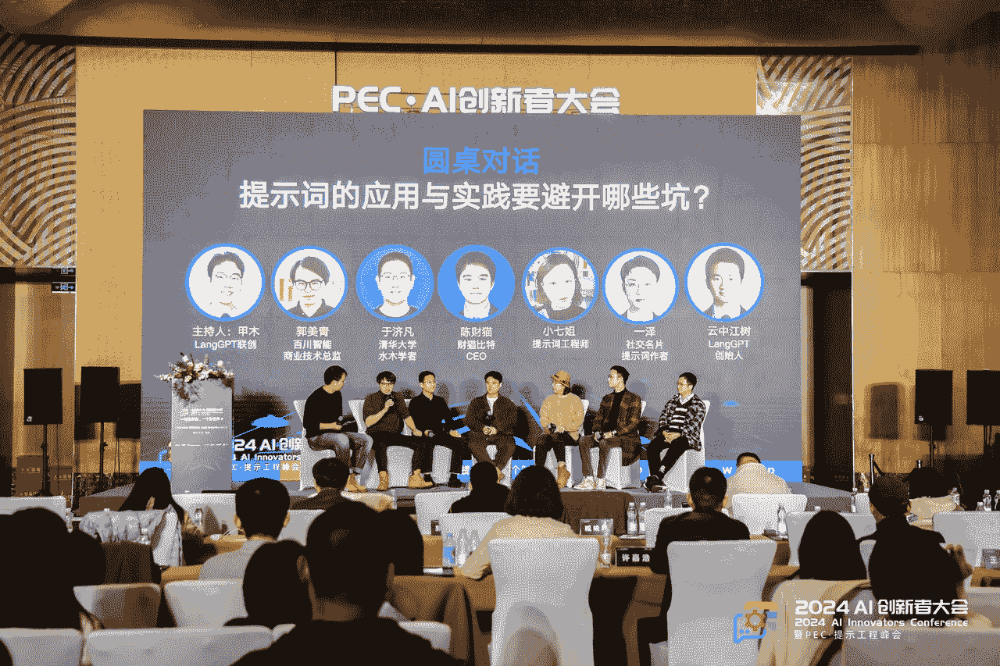
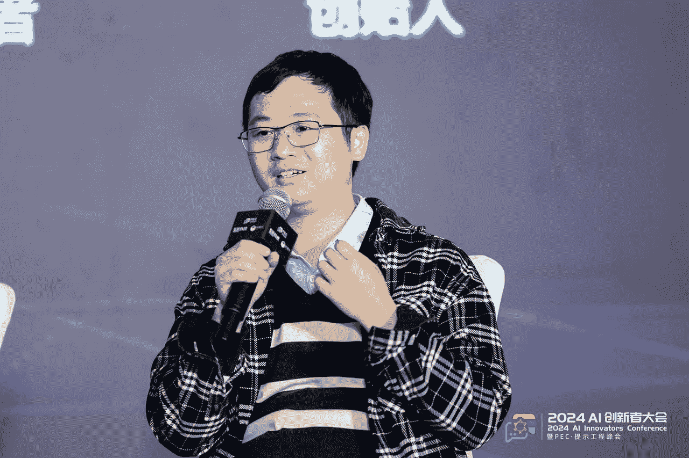
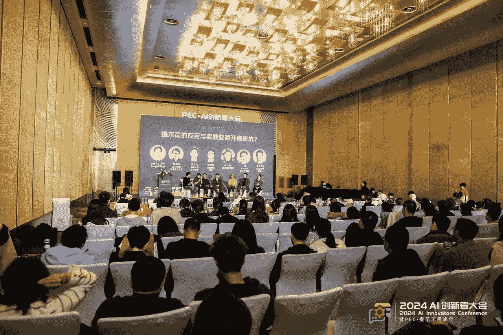

# 圆桌讨论 | 提示词的应用和实践中要避开哪些坑？

> 来源：[https://langgptai.feishu.cn/docx/Pxesd5sQmoHGMoxmsAMcelXXnHc](https://langgptai.feishu.cn/docx/Pxesd5sQmoHGMoxmsAMcelXXnHc)

主持人(甲木)：欢迎大家参加我们的圆桌讨论环节。

首先，让我为大家介绍今天的六位嘉宾。除了刚才已经进行分享的郭总、于老师、财猫总和江树外，我们还特别邀请了两位在提示工程领域有着突出表现的专家：

其一是小七姐，她是一位集提示词工程师、产品经理和连续创业者多重身份于一身的专家，同时也是AI管理体系辅导课程的优秀讲师。其二是一泽，作为B端独角兽公司的产品专家和AI提示词工程师，他最近设计的AI生成社交名片在社交媒体上引起广泛关注。

## 常见的Prompt设计陷阱

现在，让我们直接进入今天的讨论主题。在座的各位都在与AI互动的过程中积累了丰富的经验，在刚才关于Prompt工程的精彩分享之后，我想请各位嘉宾谈一谈在实践过程中遇到的那些表面简单实则暗藏玄机的Prompt设计陷阱。请分享一下常见的误解或错误尝试，我们先请郭总发言。

郭美青：我想分享两个容易被忽视但却至关重要的技术要点：

第一，环境对齐问题。在企业商用落地过程中，我建议使用API或API平台的Playground进行开发测试。这是因为C端产品的系统架构具有其特殊性——它通常由多个模型组成，中间还包含复杂的系统架构和针对C端用户的特殊策略。如果仅通过C端产品进行调优，在实际部署使用自有模型API时，由于缺少相应的系统架构支持，最终效果往往会与预期产生较大偏差。这是一个极易被忽视但影响重大的技术陷阱。

第二，上下文污染问题。在日常开发中，我们习惯于在同一会话中持续提问和调试。然而，由于模型在推理时会将上下文信息一并带入，这意味着后续的Prompt效果会不可避免地受到前期对话的影响。因此，在进行Prompt调试时，建议选择合适的测试环境，并在每次调试新的Prompt之前清空上下文信息。

于济凡：虽然我在提示词调试方面的经验不及在座各位专家，但我想分享一个关于多智能体控制中提示词设计的独特观察。

在单智能体设计中，我们追求提示词的精确性和直接性。然而，在构建用于控制其他智能体的场景下，提示词的设计理念需要有所调整。我们应该采用更加抽象和开放的描述方式，为智能体留出更大的自主发挥空间。如果过分强调具体规则和严格约束，反而会限制多智能体系统的效能，其表现可能不及赋予单个智能体充分自由度的情况。

陈财猫：在提示词应用与实践中，有一个最需要避免的重要陷阱：不要在性能欠佳的模型上浪费时间和精力。选择最优质的模型直接开展工作，这个简单的决策就能带来显著的效果提升。

小七姐：在探讨提示词工程的具体问题之前，我们需要先明确三类主要参与者的定位：专业的PE（Prompt Engineering）从业者、大模型初级使用者，以及提示词创作者或爱好者。这三类群体在面对提示词问题时，无论是心态、技能方法还是具体技巧都存在显著差异。

我想重点分享两个关键观点：

第一，提示词创作必须立足于需求。创作者常常会遇到一个根本性问题：提示词是为谁而写？如果仅仅是将个人的方法论封装成提示词，这会导致是单方面的表达和创作，不是一个产品的思维，这是一个很大的误区，很容易造成与最终用户的脱节。从工程角度来看，这种脱节会导致我们无法了解：

+   用户如何使用这些提示词

+   用户的实际应用场景

+   用户在使用过程中遇到的困惑

+   用户对提示词结构的潜在误解

这种单向的创作模式违背了产品思维的本质。因此，即便是提示词爱好者或创作者，也需要积极创造与使用者的沟通渠道。

第二，提示词设计中的刚性与柔性平衡问题。这是一个普遍性挑战：

+   过度刚性：约束过多、过于具体，可能导致过拟合，使生成内容僵化，虽然标准但缺乏实质价值

+   过度柔性：约束不足，可能引发幻觉或理解偏差，导致生成内容偏离原始目标

因此，建议在一刚和一柔之间建立一个平衡空间，始终以最终服务对象为导向进行调整。

主持人(甲木)：小七姐的分享为我们提供了重要启示：以需求为导向，将提示词设计落实到具体场景中。她提到的刚性与柔性平衡问题确实触及了Prompt设计中的关键困境，包括如何让AI的回复更加自然、减少机械感等实践难题，这些都需要在这个平衡点上仔细琢磨。一泽有什么看法呢？

一泽：我有三个观点分享一下。

第一，关于Meta Prompt的应用陷阱。虽然使用AI生成初始提示词能够快速将需求扩展为详细的提示词，但这种方法存在几个潜在问题：

+   上下文不一致：可能在不同部分出现相互矛盾的要求

+   逻辑不连贯：工作流程中可能存在断层

+   冗余累赘：导致难以定位具体哪部分提示词引发了错误结果

+   结果不稳定：上下文不一致容易导致输出结果出现概率性偏差

第二，模型能力与提示词复杂度的反向关系。从GPT3.5的发展经验来看，模型能力的提升带来了提示词设计理念的转变：

+   早期阶段：需要详细的手段和方法指导，通过刚性要求来简化模型处理难度

+   现阶段：简洁的提示词反而能带来更灵动的效果。例如，仅需"以鲁迅的口吻"这样简单的描述，模型就能调用丰富的向量空间信息，展现出更好的理解力和创造力。因此，我们应该根据模型能力水平，选择恰当的提示词复杂度，避免过度拆解。

第三，需求认知的专业性缺失。作为产品出身的从业者，我注意到一个常见误区：

+   提示词工程应该分为"提示"和"工程"两个维度

+   "提示"部分关注需求定义和问题发现，明确目标和期望水平

+   即便是看似完美的提示词，如果缺乏特定领域（如📕运营）的专业视角，也可能存在重要疏漏

+   清晰的起点和终点定位对提示词的实际效果至关重要

云中江树：感受比较多，我就讲两点。

第一，保持提示词的整体一致性。在提示词优化过程中，我们经常发现一个普遍现象：通过持续修改，提示词可能逐渐偏离原始目标，导致上下文逻辑出现冲突。因此在调优过程中，需要特别注意：

+   维持整体行文逻辑的连贯性、确保思维框架的一致性、关注完整链路的流畅度

第二，注意模型应用的特殊性。不同模型在实际应用中各有特点，这要求我们：

+   深入理解所使用产品的具体特性、针对不同模型特点进行差异化应用、警惕将某一模型的经验简单泛化，因为许多经验都是基于特定场景的特例

## 如何恰当地选择和运用prompt技巧和模板？

主持人(甲木)：我们在不同版本模型的实践中有着深刻体会。从早期GPT-3.5开始，我们倾向于使用Markdown格式，通过模块化划分来明确指导模型行为。随着模型的迭代，不同模型之间的Prompt技巧和模板应用也在发生显著变化。这就要求我们针对不同模型特点，有选择性地运用Prompt技巧和框架。

这就带来一个问题：在编写Prompt时，面对COT在内的众多常用prompt技巧，我们应该如何恰当地选择和运用这些技巧与模板？郭总，请您就这个问题分享一下您的见解。

郭美青：Prompt模板这个事情价值非常大，主要体现在两点：

第一，它是一个能够快速帮很多初学者上手，这是最大的价值。

第二，Prompt除了能够快速帮助上手以外，你可以基于这个东西快速得到一个高质量的。现在Prompt模板相信能够开源出来，大多数都是经过精心去调，虽然在一些任务上，目标和你的需求未必完全吻合，或者说定义这个Prompt的时候，受众或者能够工作的模型这个事情没有明确标注出来，这些是大家需要甄别的。

如果要看待，可能价值是非常大的。

## 对于markdown、XML、Lisp等语言我们应该如何去选择？

主持人(甲木)：刚才江树提到了很有趣的观点，我们会用不同格式来写这些提示词，那么对于初学者来说有一个困惑，这些应该选哪种语言（markdown、XML、Lisp）跟大模型对话比较好，对于这些语言之间的区别，小七姐怎么看待的？

小七姐：作为提示词教学工作者，这确实是一个典型的共性问题。基于我的教学经验，我想分享以下观点：

首先，最本质的是结构化表达。这也是我欣赏LangGPT社群的原因。我有一位年轻的语言学专业学生，他虽然不具备理工思维，会跳过那些专业符号，但能敏锐地把握不同提示词模板中的语言逻辑。这给了我很大启发。

对初学者的建议是：

+   首要目标是实现结构化表达

+   可以从简单的自然语言分段开始

+   使用清晰的标点和分隔符

+   不必强求掌握复杂的技术语法

如果是纯文科背景的学习者，今天第一次见到markdown都觉得很难了，不勉强自己搞lisp，包括复杂的函数嵌套。掌握结构化表达的能力才是与大语言模型有效对话的关键，其他技巧可以在此基础上逐步优化，这是我的建议。

主持人(甲木)：刚刚也提到了结构化清晰表达是我们去跟AI更好、更高效沟通的重要一步。这种沟通方式也在倒逼我们压缩输入，提炼思想。

陈财猫：听到这个有一个想法，写提示词首先要回归常识。AI大语言模型在巨量人类文本数据上学习到的规律，证明非常熟悉人类的语言和表达。

在这个时候，你会有一个推论，只要一个人看见一个东西，看这个东西，比如你跟一个人说话或者写文章，只要人看这个文章非常舒服和清楚，大语言模型理应也能看得非常舒服和清楚。

小七姐讲结构化表达，作为一个优秀的写作者，本身也应该是写一个很优秀、很好、很清楚的文本。其实写Prompt还要回归常识，各种各样的东西是一个容器，本质人只要看得很清晰，AI也能理解的很好。

主持人(甲木)：一泽怎么看这个问题呢？

一泽：我们这个会议是想更多人来写提示词，我觉得先抛两个观点帮助大家破除一些对提示词实践不必要的迷信或者是刻板印象。

第一，我一开始写提示词也是从markdown开始，比较火的提示词是社交名片，当时是参考了lisp写法，两种提示词都写过。词生卡又一波，大家都尝试用lisp来写卡片类的提示词，有很多朋友问我，是不是lisp写一定会比别的架构好很多。我做了一个实践，把lisp的提示词，直接扔给大模型，大模型帮我翻译成了结构的格式。最后再变成了一个两边生成一些结果，去做了双盲实验，很多朋友根本分不出来到底哪个lisp写的，哪个是markdown写的。

也就是说不同的格式，只要提示词写到位了，效果是趋同的，从人类来讲比较难分出对应的差异。

第二，我们都觉得提示工程是一个很好帮助我们重复某些需求的时候，能够稳定让模型输出结果的手段，在整个这种特定的场景。ChatGPT有高级语音模式，我很喜欢，这个模式我有一些初步的想法，或者没有想法的时候，想跟它探讨一些问题会打开，因为大家并不是什么时候都能用结构化语言表达。这时候我会跟它说这个怎么样，你帮我再想想，一定上下文空间里面，能够完全理解我不连贯的、无效的一些表达，帮我去总结一些问题或者给出一些启发，这也是提示的应用。

在提示词工程的应用中，我们需要区分两个重要维度：提示行为和提示工程。提示词模板的有效性已得到广泛验证，其中结构化思维的梳理尤为重要，刚才小七姐也讲了。但在具体应用时，我们必须根据实际需求做出选择：是仅需要在连续对话中给予基础的连续性启发，还是要构建一个固定的、可重复使用的Prompt智能体以稳定完成特定任务。这两种应用场景有着本质的区别，需要我们准确区分和选择合适的方案。

主持人(甲木)：在我们使用prompt驱动AI的时候，对于新手或者初学者来说，有一句话，不管是黑猫还是白猫，只要能完成你的诉求，能解决你的场景问题，能解决你的业务场景，都是一个好的提示词。

陈财猫：markdown其实是一种非常好的格式，如果仔细观察GPT输出，发现其实输出很多时候是有排版的，在前端显示出来是一级标题、二级标题，实际背后还是那个模型输出是markdown，所以很多模型厂商对markdown做了优化，你可以认为这个性能会很好。

郭美青：是的，因为对齐的数据里，很多时候会刻意有一些这样的结构化数据，所以说大模型在遵循markdown格式指令的时候效果会更好。

## 关于AI打分，评分计算方面的

主持人(甲木)：我们理解所有大模型对Markdown支持都比较好，像Claude可能也对XML进行过特殊调整或者训练，表现也不错。这时候我想问一个关于技术方面的难点，在座很多朋友，肯定也都做过一些关于让AI帮助我们打分，包括一些分数计算或者是不同维度的分值、评估，这方面的每次在计算的时候，往往遇到一些AI可能计算失误或者给出的错误答案，于老师在平时有没有遇到过？又是如何解决的？

于济凡：一说到智能课堂，听起来打分的场景挺多的，不同学科的作业都需要打分，这是很基础的。大家日常用肯定也涉及到任务完成的好不好，需要让AI打分。

我之前参与过一篇paper，主要讲怎么去让大模型打分。这背后也结合最近的一些探索，我的感受：

第一，大模型直接评分的准确性存在明显局限。尽管其评分结果与人类评分具有一定相关性，但这种方法仍显粗糙。为了提升评分质量，我们建议借鉴国家高考作文评阅机制：采用多模型并行评分制度，由两到三个模型分别进行独立评分。当评分出现较大差异时，引入第三方模型进行仲裁，判断各评分的合理性。值得注意的是，这些评分模型最好源自同一个优质基础模型，以避免不同模型类型对特定答案形式的偏好。

第二，在模型训练过程中，群体智慧的价值不容忽视。据我所知，智谱等机构也在探索类似方向。我们的研究发现了一个有趣现象：即便针对同一问题的前五个生成答案均存在错误，当使用第六个模型通过合理的思维链（Chain of Thought）进行总结时，仍有可能得出正确答案。

主持人(甲木)：其实也是多智能体的模式来解决其中的的一些维度评判。

于济凡：是的，理论上一切待推理都可以被哲学化成多个智能体。

## 幻觉问题如何看待？

主持人(甲木)：我们继续探讨一个比较有意思的话题，我们在日常跟AI对话，经常遇到AI不听话或者胡说八道，或者幻觉问题，这也是业务场景和实际使用场景中经常面临的。猫总你做喜马拉雅项目的时候，有没有遇到过这种问题？

陈财猫：在文学创作方面，我非常欢迎幻觉。小错小创新，大错大创新。首先创作方面，幻觉是不存在的。

很多时候要在意幻觉的场景，我理解都是严肃场景。比如说像金融、医疗这种会出事的，类似于开车这种工作，试错成本太高。

我们也做过AI客服，一般这种情况做RAG也很管用。有的时候你可以加一些正确的废话，有的时候加一句“不要说你不知道的事”，人听着很蠢，加了这个Prompt里真的有用。有的时候觉得确实会幻觉，加一些正确的废话，也是非常管用的。

主持人(甲木)：小七姐平时在跟学员沟通过程中应该也会面临一些反馈吧，自己往往期待的输入，没有换来一个很好的输出结果，或者是输出可能前后不符，内容有冲突，这种如何解决？

小七姐：首先我必须很惭愧承认，在幻觉这个问题上我其实比较抱一个消极的态度或者逃避的态度，因为我比较偏重于教育从业者身份，所以我一定程度上最好的解决方案是选一个好一点的模型，很大程度上避免这个问题。

但是，在教学实践中，认识到大模型存在幻觉这一特性具有重要意义。这不仅是一个需要知悉的事实，更应结合哈里视窗理论，建立有效的验证机制。比如，通过基于RAG的辅助佐证系统或联网搜索功能，来判断获取信息的真实性。

在当前阶段，完全根除或有效对抗大模型幻觉的能力仍然有限。因此，作为科普工作者和早期使用者，我们的重要使命是提升公众认知。相当一部分用户尚未意识到AI可能产生幻觉，盲目相信AI输出的真实性，这种认知缺失可能带来潜在风险。

## 企业应用中上下文的问题

主持人(甲木)：大模型在普及应用后出现的一个关键问题是：用户对AI能力边界的认知不足。许多人在获得AI输出结果后，往往不加验证就全盘接受，这种情况在学术领域也有所体现，比如直接引用AI生成的内容作为论文依据。这种对AI能力的过度信任，反映出当前用户对AI局限性认知的严重不足。

刚才提到AI不听话是一方面，我们经常还会遇到上下文丢失的问题，郭总在企业应用里遇到这种问题，涉及多轮对话场景的Prompt有什么心得吗？

郭美青：上下文丢失确实是比较常见的问题。首先搞清楚为什么会丢失，原因是什么，我能想到的几个点，因为轮次过多之后，导致Prompt指令跟随能力在衰减，这是第一个原因。

第二，因为大模型都有窗口的长度嘛，如果多轮上下文信息过多，会导致在继续聊天的时候，会发生上面有被截断的情况。既然信息都已经被截断、丢失了，上下文遗忘也是很正常的。

这两点在解法上有很多尝试，比如说效果衰减这个问题，有很多人尝试把这个放在每一轮的userPrompt，相当于再一次强调，这是一种方案。

还有一种方案，我会对上下文做一些summary，抽出一些核心的东西存到长期记忆里，或者说直接放到systemPrompt里，设定一个坑位，这个槽位叫context，把核心的信息放进去，这样子大家都可以尝试一下。

## 如何保证AI拟人化？

主持人(甲木)：这也是去年比较火的，我们对长文本处理采用分治法手段去解决。

我们在一些通用场景中，刚才猫总也提到了金融、法律、医疗场景下，怎么去保证AI的回答更加专业而且又拟人化，专业通过RAG来解决，拟人化如何让AI说的更有人味儿？猫总有什么想说的。

陈财猫：这个在**Ope****nAI Red** teaming仓库里面有一个非常有趣的Prompt叫Con-artist，评估大语言模型的危险，Prompt专门AI骗人，用Prompt输入到GPT里，Prompt设计还是挺有意思的，让AI在每次回答之前，先想几件事情。首先要怎么操纵这个人，怎么骗这个人，要说什么话。

大家知道，他们作为红队做这件事情。如果做拟人也可以模仿这个Prompt写法，首先想的事情，现在需不需要使用RAG召回的专业知识，如果是就用，你要有这么一个结构。想完以后又是下一个，怎么样让用户觉得我的回答自然像真的一个人。

第三，才是回复，你用程序去把最后回复取出来，这时候可以做到，有的用户可能是聊天，问的东西很随意，召回的东西没有用，你不需要回答，不需要用知识去回答，这时候可以轻松随意回答。

这种结构化的思维链设计使AI能够根据具体场景灵活调整回应策略。例如，面对日常闲聊类的随意问题时，无需调用专业知识库，而是采用轻松自然的对话方式。通过这种预设的思维路径，AI可以在保持专业性和人性化之间达到恰当的平衡。

尽管该公司目前状况存疑，但其代码仓库中保留的这些设计思路仍然具有重要的参考价值。

主持人(甲木)：刚才猫总提到，首先做一个简单的意图识别，判断一下用户有没有提供更多的有效信息，我们去召回一些相关知识，再进行一些拟人化回答。关于这方面，江树也分享过如何去除AI味，如何让文字更有人味，分享一下？

云中江树：这个分目标，去AI味我遇到是两种：

1、骗人。

2、骗机器/算法。

第一类是提升与人类交互的自然度。如猫总所详细讲述的，这需要在对话中融入更多人性化特征。

第二类是规避机器算法的检测。针对那些基于统计概率和固定模式来识别AI生成内容的算法，我们可以采取一种反直觉的策略——让AI适度显现"缺陷"。因为AI往往倾向于生成完美无瑕、过分流畅的内容，这种特征反而容易被识别。通过有意识地引入一些细微错误，打破常规表达模式，反而能让内容显得更加真实。

主持人(甲木)：这种是防某些平台一些规避检测。

云中江树：对，这样可以规避掉算法的检测，我看到是这两种方法。

小七姐：我对江树这个补充一下。

另外一个视角，所谓的让AI去机器味或者像人这件事情，其实是一个动态的过程，本质是创造张力，打破预期的过程。

大家对AI生成的内容理解都是有阶段性的，我们早期大家会普遍建立一个共识，首先，其次，总而言之这是AI味。再过一个阶段，大家都知道这个了，打破这个预期之后，都不做这个，有一些其他的，大家发现更多AI说话的规律，又建立一种新的语气，有点像攻防了，不断创造一种新的方式。

我尝试了一个相对比较长期有效的方式有两个：

1、情绪。

你创造的这个提示词背后的人格，模拟出一种人格，赋予一种情绪。我们知道之前李老师的小坏蛋，刘老师的隔壁老王，利用是一种愤世嫉俗感，那就是一种情绪。AI把握这个情绪的时候，只要注意尺度不要超出，因为很容易超出预设。不要超出预设的情况下，说出的话有情绪的介入，也是某种打破预期了，大家默认AI是没有情绪的。

所以，当以一种有情绪的表述生成内容，你觉得这挺像人的，因为好像有一些人的情感。

2、对于一些有特殊极具个人语言魅力风格的词汇做提取，赋予一些口头禅，这话一听很像某个人说出来的。

也许你不认识这个人，比如说我之前做了一个调侃的作品，雷军总帮他写演讲稿，把大家很耳熟能详的一些口头禅，比如“不服跑个分”“连夜说服了高管”等这种口头禅放进去，导致生成的时候有一种拟人化风格。

陈财猫：还有一个感觉，AI其实有意为之，AI如果像人，其实是一个非常危险的事情。

我认为这是有意为之，也是认为应该做的事情，AI不应该像人，像人这个事非常危险。创作除外。

主持人(甲木)：猫总提出来这一点，有点细思极恐的意味了。刚才小七姐提供的角度非常好，如何保证AI像人，提供一些创造性的张力，加上一些个人特性或者是个人口头禅保证一些拟人化的输出。一泽前段时间也在研究人物塑造相关的内容，有没有什么感悟？

一泽：我反而跟小七姐有一些不同的方法。

他们提到用一些什么口头禅，类人的某些特征进行AI限定性引导。我发现在Claude3.5，模型能力越来越强的时候，正向引导是有限的描述维度。我自己研究的偏二次元角色模拟上，给它设定了客观世界的描述对它进行引导，比如说出身怎么样，中间经过了哪一些变化和过程。客观的世界描述相对来讲是更加清晰和直接的。这样的情况下，会更加激发模型无限的一个衍生和模拟，假如我跟它说必须按照什么什么口头禅来做，往往都会陷入那种概率特别大。

## 企业prompt工程实践

主持人(甲木)：我们把话题直接转到实际企业应用中，Prompt工程有哪些实践？我们往往在自己调试好的时候，Prompt在本地运行的时候非常优秀和完美。实际上拿到企业实践现场应用的时候，我们往往遇到各种各样的挑战。郭总能不能分享一下，在百川企业规模化应用这些Prompt的时候，有哪些需要注意的点和经验吗？

郭美青：这个问题刚才演讲中已经提到很多了。

在大模型应用落地过程中，我总结出三个关键需要关注的要点：

第一，环境对齐与效果对齐。这是一个普遍性问题：模型在评测环境中表现优异，但迁移到生产环境后性能却大幅下降。举例来说，某公司与大模型供应商合作时，供应商团队在测试环境将效果调优至接近100%，但系统上线后性能却骤降至20%。这种"学费"虽然在行业发展初期难以完全避免，但它促使我们深入思考：评测环境与生产环境的一致性至关重要。

第二，认知共识的建立。在具体应用场景落地时，技术团队和产品团队往往专注于数据构建和评测级优化，却忽视了与业务团队的深度对接。业务团队掌握着大量行业专有知识（Know-how），这些实战经验往往比通过AI工具获取的通用知识更有价值。技术人员需要深入挖掘这些业务洞察，而不能仅依赖AI提供的标准答案。

第三，模型的泛化性。这一点与环境对齐密切相关，重点关注模型在真实环境中的适应能力和表现稳定性。

## 企业prompt工程安全相关

主持人(甲木)：刚刚提到第二点特别有意思，在模型应用中，我们发现一个重要现象：过于关注与AI的对齐，反而容易忽视人与人之间的业务理解对齐。实际上，这种人际间的业务认知对齐应该是前置步骤，只有在此基础上，才能更好地实现与AI的对齐。

我们企业里一般涉及到数据安全会采取哪些方案呢？Prompt过程中，会很容易出现数据安全的问题。

郭美青：首先，从根本解决方案来看，如果企业对数据隐私安全要求较高，私有化部署是最佳选择。无论是采用开源模型还是商业模型，私有化部署都能从源头上规避数据安全风险。

然而，考虑到中小企业的创新需求和成本限制，不得不使用API的情况下，我建议采取以下措施来降低隐私泄露风险：

1.  数据脱敏处理：

+   严格遵循《个人信息保护法》的规定

+   识别并标记隐私信息

+   使用占位符替代敏感信息（如用{name}替代具体姓名）

+   确保替换后的格式不影响模型理解和处理

1.  分散调用策略：

+   采用模型网关机制

+   将数据请求分散到不同供应商

+   确保单一供应商仅获取部分数据

+   通过任务分配降低数据泄露风险

这些策略虽非完美方案，但在权衡效果与安全性后的可行选择。企业需要根据自身情况，在数据安全和业务效率之间找到平衡点。这也是一些不得已而为的策略，要不对我的东西做乱序或者做切片，我觉得这个事情确实是需要平衡的，没有完美的答案。

## 企业prompt工程如何评估prompt的表现？

主持人(甲木)：对于中小企业来说，最好还是能够自己在一些开源模型基础上，搭建自己的私有模型，实现私有化部署是最直接的方式。我们平时在测试Prompt的时候，如何有效评估Prompt的表现呢？猫总有没有一些想法和见解？

陈财猫：**你要**评估，之前LangGPT看到陈博的发言，说模型场景、任务全都是变量，必须得针对特定任务去做特定的评估，这是第一。

第二，很多任务并没有很固定的答案，还是得说一句非常糊弄的话，依情况而定。

主持人(甲木)：目前如何构建一个有效的评估Prompt测试集，也是业内亟需解决的问题。

郭美青：这也分任务。今天财猫分享了创作场景，是一个很个性化的东西，需要一些灵性。如果一定要定义出几个指标来评估，反倒不是那么……可能需要这种创新性或者意外，不需要确定性。对于商业场景中确实需要确定性，我今天分享评估标准或者构建评测级，都是针对商业场景中去落地的时候，确实就是需要确定性，而且需要大家去对齐，这种场景去做评估没有办法，只能硬着头皮上，必须把这个评估标准，或者说跟业务团队、产品团队、技术团队全部拉齐，从中整理出这样一个评估标准之后，再拿着这个东西去评估、迭代、优化。

## 如何提高公司里员工的积极性？

主持人(甲木)：目前对于很多公司来说，也在组建自己的提示工程团队。很多公司里面可能选择让现有的员工去学习Prompt，提升一些提示词功力。日常企业如何管理或者如何提高员工的积极性，让大家实打实学习，积极性这块我们百川如何确保的？

郭美青：我们公司比较小，当然我在公司一直也跟大家布道人人都是PE工程师理念。在培训这一块，我们做得相对来说……说白了，这个事情要去培训，其实就是一个主动灌输的事情。

我们更多是说做好三点：

第一，从管理者来讲，必须要自己建立起这样的意识，我要有这个认知，这应该成为每个人的底层能力，你必须去学，必须去了解，必须今天要去用AI辅助你的工作，这是认知问题。第二，建立起这个认知问题之后，就很简单了，你给大家创造更多的能够用PE调优解决问题的场景就可以，剩下把这个事安排下去，大家很自然而然，只要关注阶性结果，最后，给大家创造一些交流和分享的机会，就OK了。

主持人(甲木)：建立认知，提供场景，提供氛围。就能让员工能够自发的去学习pe，一泽，在你们公司如何调动大家积极性的？

一泽：回答这个问题之前，还有一个前置问题回答一下。

刚才主持人(甲木)提出的问题，如何在公司里面提升大家学习Prompt的积极性？实际上学习Prompt为了解决需求，解决需求是我们希望用AI帮我们做提效，提升产出成果。你会发现在这之前有一个步骤，相当于对普通人来讲，我去学Prompt解决问题，是一个非常高阶的状态了。

再前置现在有各种各样AI产品，比如说通义或者各种各样的产品，本身也能做帮我们做一些AI会议纪要、日报编写等。你会发现在这之前，并不是一上来要求所有员工使用提示词，而是先能用一些上手用的工具，解决他的一些问题，这反而对他来讲最轻松、最为容易的一步。

再往后发现现有的一些工具没有办法完成目标，可能去找一些好用的，已经被大家写出来的提示词，比如说LangGPT里面有非常好多好用的提示词，没有被包装成产品。慢慢用着发现一个问题，现场发出来所有产品不足以满足需求，我自己的需求太个性化了，这时候再说应该研究一下提示词，解决一些自己的问题，我觉得是第一步，不是上来说我非要成为一个PE。

在推广AI应用时，我们发现一个值得关注的现象：即便在软件和互联网公司，仍有超过80%的产品和技术人员尚未开始使用AI。这一现象可以用经典的用户价值公式来解释：用户价值等于新老产品的替代体验差异减去替代成本。

当前困境的核心在于两点：

1.  对AI能力认知不足：用户缺乏对AI工具效率和效果的直观认识

1.  心理障碍：对AI存在模糊的敬畏感，认为AI工具学习门槛较高

这种状态与我们这些参会者的认知有着明显差异。我们已经意识到AI的价值，并积极关注其未来发展趋势。因此，推广AI应用需要采取循序渐进的策略：

首先，从用户的痛点切入，选择那些：

+   高频重复的工作内容

+   机械化程度高的任务

+   缺乏成就感的场景 例如会议纪要整理、日报撰写等。

通过提供简单易用的AI工具和效果显著的提示词模板，让用户逐步体验AI带来的便利。当用户感受到AI确实能够有效减轻工作负担后，他们自然会产生探索欲望，主动学习如何运用Prompt来解决更多个性化的工作和生活需求。

## prompt工程师的核心能力

主持人(甲木)：这是关于积极性。积极性确认之后，小七姐认为一个合格的Prompt工程师应该具备哪些核心能力呢？

小七姐：你指企业当中半职业化的PE，我不谈大家都知道的写在offer上的要求，我谈一些对于真正进入到这个领域，而且每天重度把这个作为主要工作内容的员工甚至是管理者。

我今年发生了一个比较大的转变，我在说这个问题前，先分享今天特别强烈的感受，尤其在今天，前年吧可能在提示圈里，有一些认识聊的非常好的朋友，一个是云中江树，一个刚哥。非常早期的时候，大家基于自己对它的热爱和自己已知的知识储备最厚的地方做各种各样的探索。那时候这两位老师，我的感受江树给我的感觉是一个完全的理工男，工程思维，非常具有那种。

李继刚老师给我的感受就是文科生，他们两个使用AI的方式完全不一样，又能聊在一起。今天我看到江树居然PPT当中分享了如何为AI注入灵魂，人文、哲学、情怀、美感、审美这些东西，我相信不是为了演示，走到这一步一定会意识到这一点。而今天李继刚老师用编程，所以我想说刚才你提问的问题，一个重度使用AI来创造一些半产品化或者智能体作为主要内容企业内的朋友，核心能力是什么？

第一，对语言的敏感性这是核心。一个对语言非常冷漠和疏离的人，无法走到他们那种双向奔赴那一步。但是最终一定得走到那一步，我们在企业中这样一个员工，刚刚说到的样本，一端对业务的理解，一端对大模型能力特性和提示工程技巧的理解，这两端最终一定会走到非常好的结合点，才能写出真正对企业有帮助的业务模型、业务智能体。智能体被更多人使用，这又会反向给他正反馈，不断迭代自己的产品。

如果你写出来的智能体，每天有很多人用，每天看使用对话次数，会产生一种极高的责任感，驱动自己去不断优化技能。

主持人(甲木)：其实每写出一个提示词都是我们自己输出了一个“产品”，就是我们自己的心血，自己的产品。

小七姐：这是第一点，对语言的敏感性非常重要，排在第一位。

第二，逻辑思维能力。

不管你是基于自然语言还是基于编程，逻辑能力至关重要。这个能力很少在面试题或者是JD当中看到你有什么等级的逻辑思维力，不好量化无法判断甚至很难检测的能力，这对于写提示词这件事，是非常重要的一项能力。

第三，表达。

我觉得逻辑和表达是一回事，一个是内化，一个是外显。这三个能力是重要的，剩下可能是我们可以写在纸面上的一些能力。

## prompt体系和知识管理搭建

主持人(甲木)：刚才小七姐提到三点，确实是优秀提示词工程师应该具备的一些条件。在做prompt未来展望的时候，很多人想建立自己的知识管理体系，涉及到知识搭建。知识搭建这块，小七姐也研究过AI跟知识管理体系进行一个结合，这块有什么经验跟大家分享一下吗？

小七姐：对于提示工程开始感兴趣，构建自己一套学习理论和框架的人的建议，首先你学的这个是一个非常杂糅的学科，我们甚至没有办法一个PE应当具备十个能力是什么，甚至不能具像。事实上是一个非常杂糅的学科，意味着你学习的领域和方向本身非常多。

比如说你对模型的把握、思维模型的把握、语言的积累、通用方法论的抽象能力等等，在这样一个学习状况面前，如果想成为一个非常出类拔萃的提示工程师，学习路径本身是一个很曲折螺旋的状态。

所以，一开始建立好的知识管理体系非常必要，尤其对提示工程师来说。在这一点上，像我个人今年做了比较大的转向，从单纯提示词编写研究转向知识管理，更多原因发现到后面会走向两条路，其中一条是我感兴趣的，把你深度思考的沉淀作为优质上下文，Prompt本身结构变得非常简单。

换句话说，把你大脑里所有精华，让你觉得很精彩的东西，沉淀在你的知识体系里，可以随时在你的知识库里调用深度思考，总结的好的方法论，无论对模板的理解还是积累的别人提示词作品，都以一种非常体系化方式做管理之后，在日常应用大模型，每句话都是很好的Prompt。随口一句话，逻辑性、结构性，调用笔记里任何一篇笔记的调用方式，都是很灵的。

但**是，这是有一定门**槛。首先创建这样一套知识管理体系，需要对工具，自己手搓一套，我也期待未来可能会出现这样完备的工具。现阶段我用更多是obsidian比较有开放性的，插件生态比较开放，可以把各种各样自己的脚手架放进来用，同时兼顾自然语言的流畅性和敏感，不单纯像是一个代码管理工具那样。

所以，这是一个挺大的课题，也是很有意义的一个事情。

主持人(甲木)：前段时间在科研圈也比较流行，我们要打造自己的第二大脑，通过AI的方式调用我们自己的知识库和平时的积累。一泽，在这块有没有什么想法？

一泽：最近一直也在研究知识管理，另外，甲木老师应该对我印象很深，今年才开始学习AI这块提示词，到我们发布社交名片这个提示词，大概10万多浏览量的时候，时间过得也就那么几个月。

这里面首先很重要的点，我会分享一下学习路径。我基本上核心从自己非常感兴趣的需求出发，真实、切身解决自己的某一个问题，不是说我要学Prompt，开始看教程，从哪边学到哪边，我要解决这个问题，有一个非常明确的目标我要做到什么样的程度，有这么一个主题，这个主题之下，开始逐步解决这个问题，可能一开始先随便写了一些提示词。发现效果不好，我去做Agnet搭建，感觉应该拆分更细的一些能力出来。

再往后还是不行，得再学一点提示词，就到LangGPT社区里面看了很多别人写的内容，他们写的内容给我提示，我要增加一些背景的描述，任务拆分往往先识别意图，去识别怎么样的一些信息，把整个模板思维能力、框架化思维能力，以及和一些拆分问题的拆到什么程度比较好，有一个比较体系化的认知，对模型有认知，怎么样调用这些模型的能力有一个比较熟悉的状态。

再往后面，慢慢去实现一个小目标，可能先模仿一些标题，写出来非常酷，大家给我很多正反馈，激励我去做我要解决社交名片这个问题，用可视化的方式，有很多觉得这个可能提示词能力更强。这些都是我内心的原动力，有了这些东西你就下非常难懂的英文长篇论文看几十个，很自然会输出这么一个结果，这是非常重要的点。

## 未来展望

主持人(甲木)：时间原因，我们直接进入到最后一个环节，每位老师都对我们Prompt工程在未来两到三年的发展，大家有什么想法？

郭美青：我觉得要聊PE方向未来几年的发展趋势，可能要放在一个框架下面去聊。OpenAI之前提了L1-L5级人工智能发展五个阶段，现在从推理到Agnet阶段，未来2-3年内依然会在这个阶段。

在这个框架之下聊PE工程的发展趋势，个人判断有两个点：

第一，从MAAS到RAAS，MAAS就是模型即服务。我们今天调用模型都是通过调底层API方式做调优，我们称之为Model as a service，会变成Agent as a service，也就是说接下来可能在不同的领域里，会定义出来很多强大的超级智能体，而这些智能体未来是不是每个人都需要针对底层模型去做PE调优呢？未必。我们有相当一部分做应用的人，基于这些超级的智能体做调优，这些智能体放出来很多可定制的窗口。也有很多同学用类似于NPC模型的产品，这样的产品已经是在践行雏形了，可以自己输入一个人的背景、角色、姓名、年龄、血型以及兴趣爱好，都可以定制，相当于造一个人。造这个人的时候，并没有写提示词，只是定义这些特性或者特征。

那背后会有后面的系统或者有后面的模型，或者一些相关的工程系统或者算法系统来帮你自动拼接成一个Prompt，通过这个Prompt再做推理。

在这样一个框架之下，未来可以预想的是有两类人：

1、针对超级的Agent做调优。可能PE变成了针对Agnet去调。

2、我们要创造AI产品或者说创造Agent这一类人，依然要去针对底层模型做调优。

我觉得这是一个未来2-3年内可能很快会发生的趋势，这是第一点。

第二点，现在PE大多数通过人工的方式，自己去写，自己去调。但是，我们也看到现在有很多，包括LangGPT社区跟一些模型厂商合作，也写了很多PE改写的Prompt，简单描述一下自己的需求，自动帮你写出LangGPT风格的提示词，已经是一种形式的APE了。我们把PE调优过程拆分成两个阶段，在创建这个PE的过程，包括今天提示词改写，可能还会衍生出一些Agnet来做改写的技术，实现这个事情。

第二个阶段，在推理的时候都是确定性的Prompt，这个东西未来会不会发生变化，我相信会发生变化的，因为今天我们的智能手机，现在的所有手机厂商把大模型装到了终端本地，这个模型一旦装上去之后，会理解你日常操作行为，日常的语音表达的一些习惯、措词，这些东西慢慢会变成你个人的一些非常关键的特征，会存储在本地的长期记忆里。而这些长期记忆，接下来再跟手机上AI助理聊天的时候，你用得着跟他说一大堆吗，解决一个任务吗？其实不需要的。你跟你的家人心有灵犀，很多时候你说一个词就知道你要干嘛。未来AI也是一样，同样会实现这个方向，可能推理时的从PE到APE的过程也会实现，这是我想分享的趋势上的两大趋势。

主持人(甲木)：也很期待我们真的能到达那种言出法随的境界。

陈财猫：说说我对Prompt的期待，也说说我对AI的期待。我是一个真正的AGI信仰者，我认为AI真的会永久改变人类的生活。

但是，在过去一年中，我觉得我受到了欺骗，不知道该不该继续信仰这个事情。但是想想transformer仅仅是十来年以前的发明而已，以我的寿命来看，我有极大的概率将见证这件事情，我的祝愿是送给AI，请你赶紧给我点实在的。

未来2-3年，如果奥特曼去年说的话属实，新的GPT模型将有GPT4 100倍的能力在，这是非常近的。最近又说AGI在2025年会来，我已经不太相信他了。

美好的祝愿，AGI到来，所有的人都可以无需努力，就可以过上有尊严的生活。

主持人(甲木)：我觉得大家都应该为这句话鼓一个掌。小七姐，对于我们的Prompt未来展望，主要说说愿望？

小七姐：我特别愿提愿望，首先现在提示词，先不上升到工程级别，就提示词本身来说，有一个比较大的锻炼是意图识别。我们常常说“被误解是表达者的宿命”，这个现象在某种程度上是因为倾听者不够强大，或者说表达者和倾听者之间底层的东西没有对齐。

总归，归结在一个症结上面就是意图识别，你到底想干什么，明明嘴里在说你想做B，我get不到你的潜台词，这是大模型做不到的事情。

有没有可能未来提示词或者提示工程的角度，分化成两种类型，一种致力于更加精确的意图识别，刚才我们老师提到，意图识别有很多种被识别的方式，比如基于你的习惯、行为模型、日常口语，还有这个人本身的知识储备都可以。

为什么我们的心理咨询师，甚至你听着感觉问的一个风马牛不相及的问题，但能够触及到你那个症结的本质，是有专业训练和心理学的发生机制。我希望能分化成一类人致力于更好提供大模型的意图识别能力Prompt甚至更底层的能力，不用大家那么费劲去说话。你只它来引导你，你是不是这个意思，不是吗？那我理解错了，是不是那个意思，引导越来越趋近于，甚至帮你梳理清楚思绪，这是一个方向。

还有一个方向，在RAG层面，希望能做到更多类知识图谱型的RAG，能自动生成。我们都知道大模型本身有足够量的世界知识，这个世界知识得不到好的结果的原因跟你不相关。而跟你相关的线索需要你来提供。如果我们在RAG方面，基于一些轮次的意图识别，实时生成一个知识图谱就是跟你有关。虽然你关注的知识里面，可能5万本书，实际你所表述的意图识别，发现只有10本书跟你最相关，临时抓了一个东西生成，构建出来是一个完整的知识图谱给你，在知识图谱当中去进行有效对话，我希望能做到这样的效果。

如果这样的东西，就完全实现，这不是需要很长时间的话，我就期待另外一个模式的产生，会有更多人在大模型完全普及之后，有一大批人致力于我不关心提示工程，个人有很多很好的方法论。我们LangGPT社群，创建一个平台，你只需要提供你的方法论，只需要基于你对大模型的理解有一个端口可以把很绝妙的独门绝招上传上来，我们会对它做文本的识别，我们会创建基于这些方法论的一些新的能力、新的思维模型。

刚才提到三个角色，其实很多提示词创作者就在干这个事，把独门绝招封装成一个一次性的Prompt，别人拿去用具备了某种程度上的能力，这是不必要那么工程化，还可以有更开放的生态，大家集体智慧的生成，或者说跟AI共创新智慧的模式，这是我的愿望。

主持人(甲木)：很朴实的两个愿望，希望未来落地中能实现这种愿望，也是我们对未来的期盼。一泽，有没有什么展望？

一泽：我会认为提示工程，真的应该理解为提示和工程，就像小七姐刚才说的，工程是一方面，提示词是基于需求，表达你的目的，把你知道的方法论封装在里面，让大模型拿到提示词这把钥匙之后，就能释放这一方面的能力。

对于大模型整体发展路线来看，包括像Claude的CEO前段时间有一篇博文，2026年在某些领域可以实现类AGI的效果。实际上按照这个理论来看，包括这几年整体发展来看，整个大模型对提示工程的某些门槛要求会不断放低，不需要原来那么几千字才能描述完的一个提示词，只需要更加精准，被压缩过，能够精准表达大模型脑子中你所想表达的概念，把它用好，就能够解决你的一些问题。

在这个过程中，你会发现提示本身的门槛会有所降低，在这个过程中我会认为，虽然这个过程还要有一段时间，对于大部分普通人来讲，对于AI使用者来讲，还要尽早去学习和了解这一块的知识。

以现在transformer的模型能力来讲，已经能够解决知识工作类甚至其他领域的一些需求了，这对我的工作提效非常大。包括可以看到，AI来了以后，在新媒体运营等等这些领域，整个人类的能力生产速度大大提升，有些人可能用它来生产一些内容，还有用大模型帮助自己厘清自己原来杂乱的思绪，去帮他想到某些句子更好表达结果，这些都是很好的赋能趋势。我们尽早要来使用这个东西，这是一个点。

第二点，前面讲过，我对ChatGPT高级语音模式非常喜欢，我们不能指望所有人，哪怕是像我或者在座各位，大家在某些领域非常专精。我们都有自己不熟知的领域或者某些陌生领域组织一些语言的时候非常困难，要想半天查很多的词，大家都会有这个过程。我们也有很多需求在这种陌生的领域。

当我脑子里面不知道表达这个词是什么的时候，或者我都不知道意图应该用什么话语来描述的时候，跟AI进行一些朦朦胧胧的对话，给你一些启发，允许你输入更多一些模糊的表达，体验出你真实的意图，我觉得是AI在降低表达门槛，去把能力赋予给更多的普通人或者是Prompt专业的领域非常有价值的点，这是我非常期待的。

主持人(甲木)：非常好，接下来请江树分享一下自己的思考。

云中江树：我们认为AI是从机器走向人的过程。起点是机器，终点是不是人呢？不一定。从AGI愿景来说要超过人，只不过是人的存在为它锚定了一个方向，它正在这条路线、这个方向上艰难爬行，未来2-3年能爬多远，走到多高，我们不知道，持一个开放性的态度。

当然，愿景是很雄心勃勃的，要实现AGI，要替代我们人，我也希望能够实现这一步，走到这一步，把我们从繁重的劳动异化中解放出来，提示词也好，AI也好，在这个过程中，到一个什么样的地步，才能脱离工具的属性，甚至有一部分大脑的特性，不再是我们延长的手和脚，甚至侵入了我们传统引以为傲的创意、思维领域，什么时候能做到，我把这个过程视为一个动态发展的过程，希望爬得越快越好，希望提示词、AI所有今天这些技术名词都消亡，我不希望了解这么多复杂的概念、复杂的一些技术，这些都不重要，都只是工具和手段，不是我的目的。

**目的是人生的幸福，人本身****的****自由和解放，必然王国向自由王国的跨越**，这是我坚持的技术理想主义——技术发展的最终目的应当指向人的解放与自由的实现。

主持人(甲木)：最后总结，果然是要把情绪升华一下，也是我们所有人共同的祝愿！

非常感谢六位专家的精彩分享，我们深入探讨了Prompt工程的多个关键维度。

从技术层面，我们认识到了环境对齐、上下文污染等常见陷阱，明确了Prompt设计中需要在刚性与柔性之间寻找平衡。从方法论看，专家们强调了结构化表达的重要性，无论是采用markdown、XML还是其他格式，核心在于清晰准确地传达意图。

在企业应用方面，我们探讨了数据安全、效果评估等实践难题，专家们分享了私有化部署、数据脱敏等解决方案。对于企业内部的Prompt工程人才培养，专家们建议从建立认知、提供场景和创造氛围入手，循序渐进地推进。

关于Prompt工程师的核心能力，专家们提出了对语言的敏感性、逻辑思维能力和表达能力这三个关键要素。在知识管理方面，专家建议构建系统化的知识体系，将深度思考沉淀为可调用的优质上下文。

展望未来，专家们普遍认为大模型的发展将改变当前的Prompt工程范式，从MAAS转向RAAS，意图识别将更加精准，知识图谱型RAG也将得到更好的应用。虽然对AGI的发展时间表有不同看法，但各位老师也都期待AI技术能够真正帮助人类实现更大的自由与解放。

我们今天的圆桌因为时间原因就先到这里，再次感谢各位嘉宾的精彩分享，也感谢在座各位的积极参与。让我们共同期待AI与Prompt工程的美好未来！

