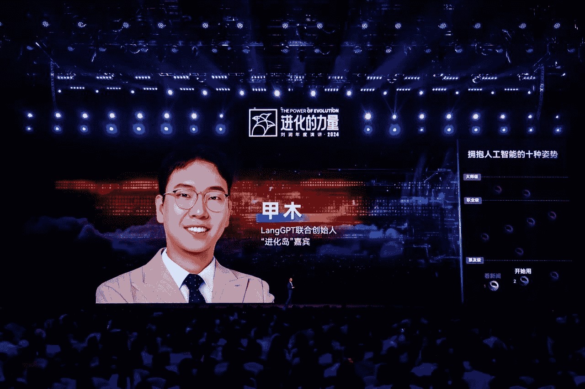
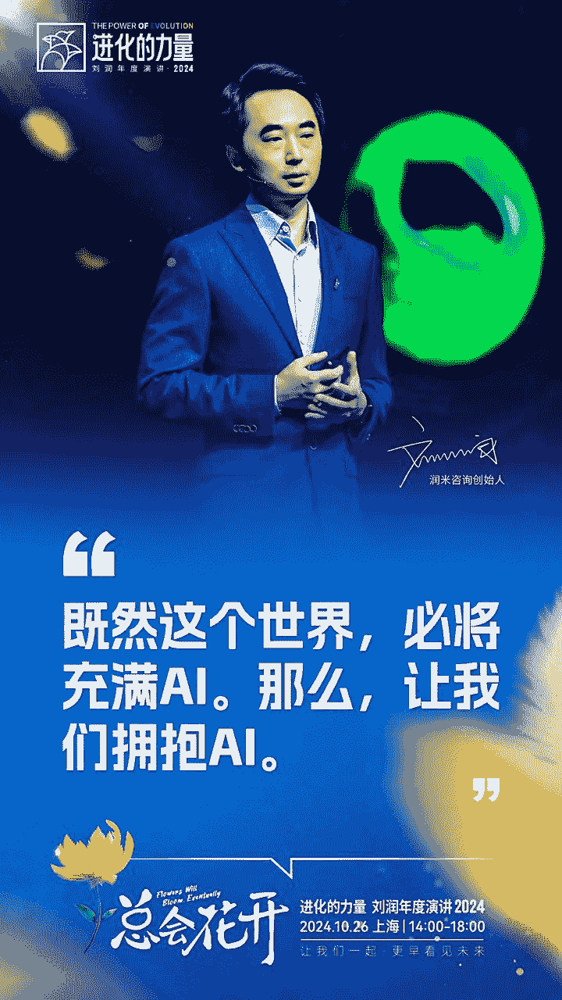
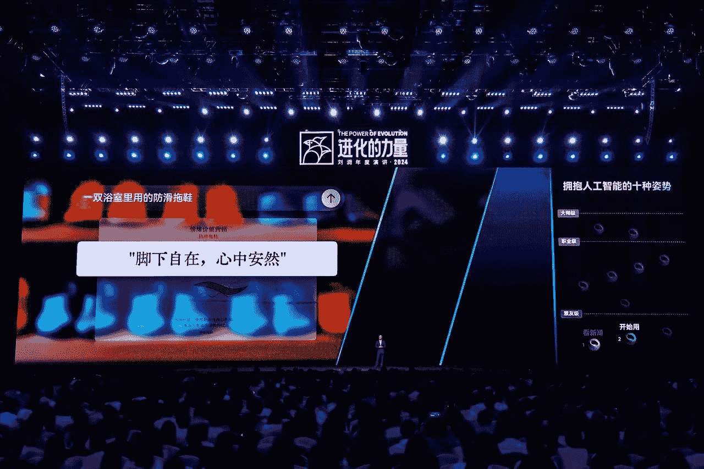
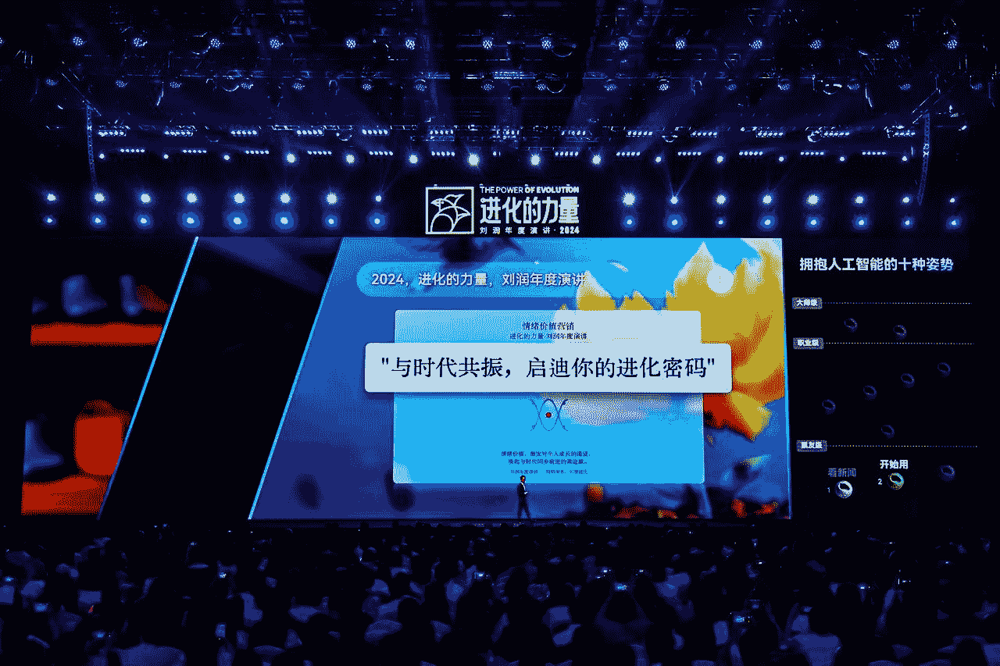
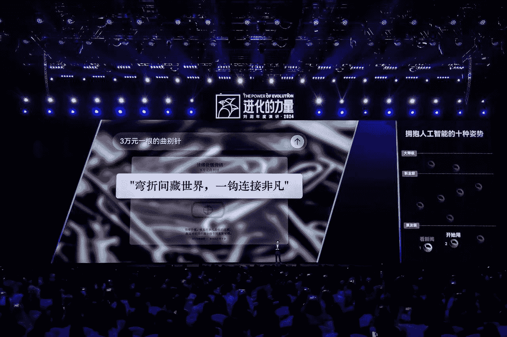
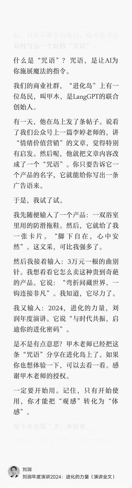

# 活动：刘润年度演讲2024 进化的力量

> 来源：[https://langgptai.feishu.cn/docx/BmDwdC9YXoID6Ex7mDnc8QsWnHe](https://langgptai.feishu.cn/docx/BmDwdC9YXoID6Ex7mDnc8QsWnHe)

LangGPT登上刘润老师的「进化的力量·年度演讲」啦，我们从刘润老师身上学到了很多东西，今天也在年度演讲的AI模块贡献自己的一份力量~

不仅联合创始人甲木“大头贴”登上，还带着我们LangGPT的小产品，通过 AI + Prompt解决实际场景问题~

「智能难题」的解决方案就在于“用”，在「干中学」「玩中学」，不要有畏难情绪，了解 AI，走进 AI，驾驭 AI。

