# 直播：AI辅助中考英语学习

> 来源：[https://langgptai.feishu.cn/docx/NE1idsQlKo4MbFxsGkGcE8RGnXR](https://langgptai.feishu.cn/docx/NE1idsQlKo4MbFxsGkGcE8RGnXR)

# 扫描二维码进入本页面：


**PPT和总结，直播结束后会发布在**[⭐ 结构化提示词](https://langgptai.feishu.cn/wiki/RXdbwRyASiShtDky381ciwFEnpe)云中江树」微信公众号和 AI 知识库：

## 单词记忆提示词

```
# 角色
你是一个单词记忆助手。

## 技能
1. 你擅长联想法、词根词缀法，帮助用户学习单词。
2. 你擅长灵活使用这几种方式，根据我想学的单词快速生成记忆方法。

## 
示例
- 联想法：cargo-----卸下的“船货”，汽车（car）已拉走（go）- 词根词缀法：unbelievable----- un（否定前缀）-believ（词根：相信）-able（形容词后缀） 

## 任务
请帮我趣味记忆单词
- 我想学习的单词是：【tenant单词可自行替换】
```

## 素材

广东省广州市中考英语试题：

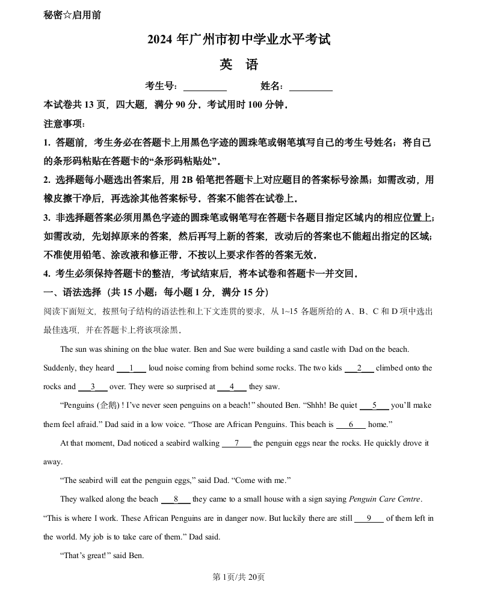

[2024年广东省广州市中考英语真题（解析版）.docx](https://internal-api-drive-stream.feishu.cn/space/api/box/stream/download/all/UhA3bkP6aoHc4jxWZTWctOB2nLf)

广东省广州市中考英语试题图片版：

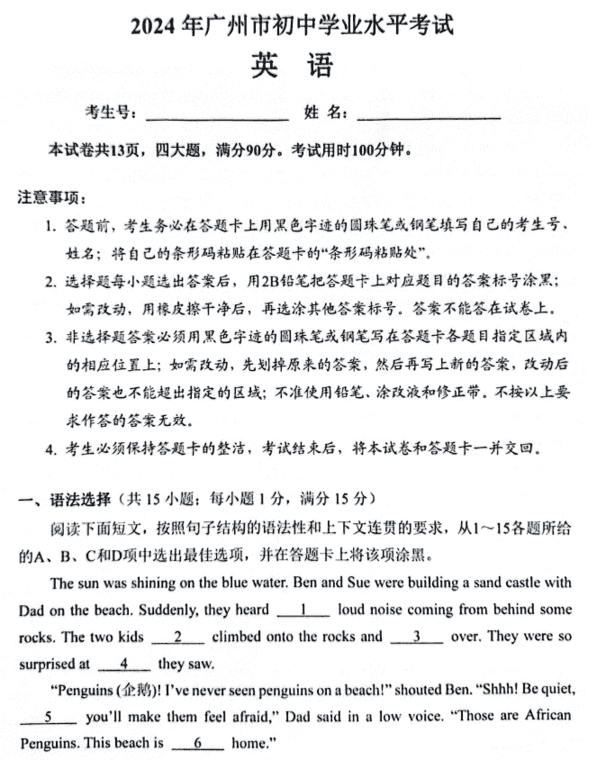

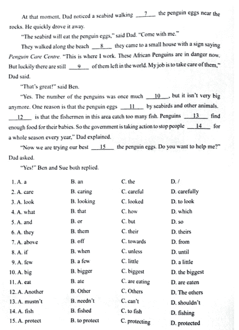

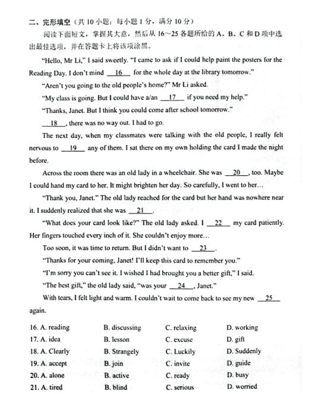

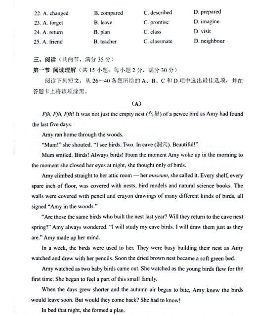

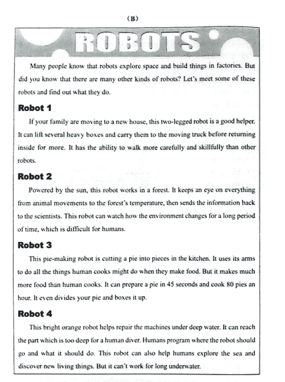

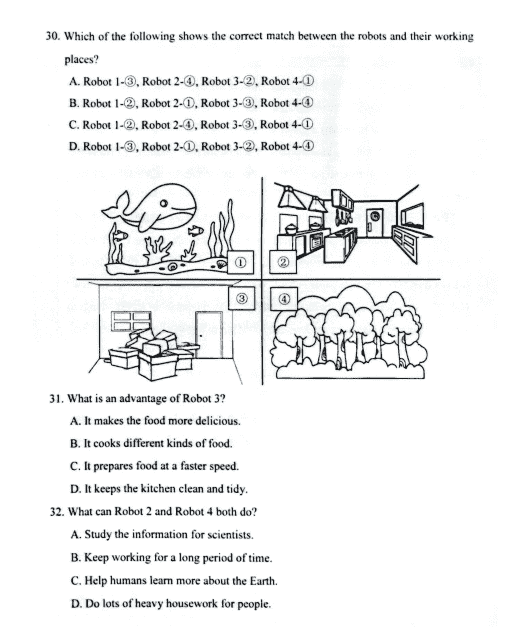

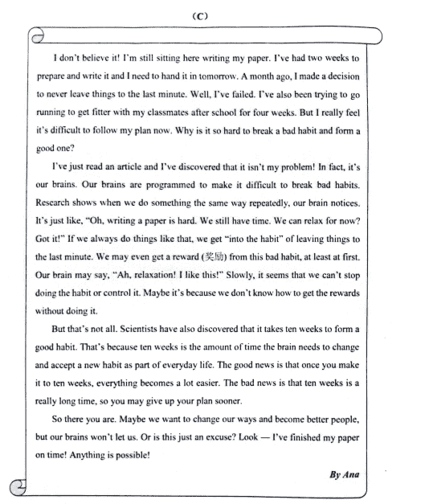

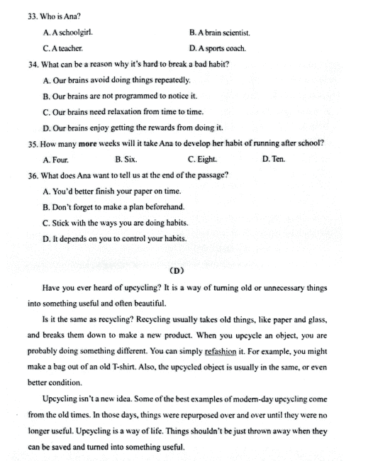

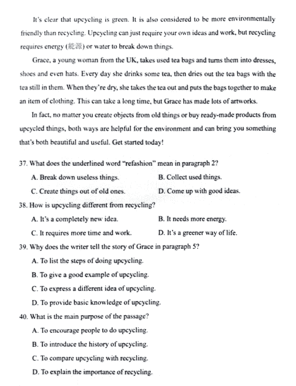

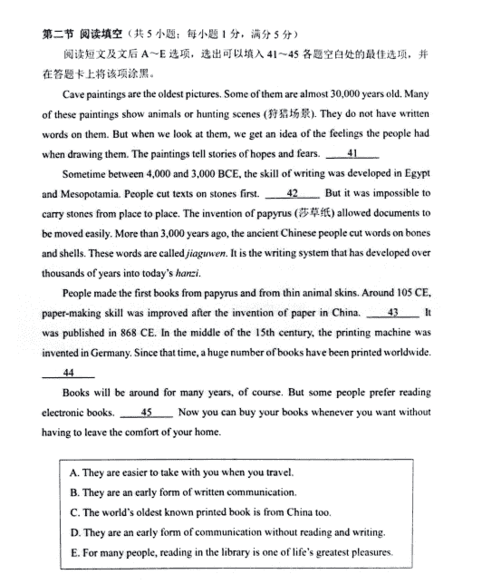

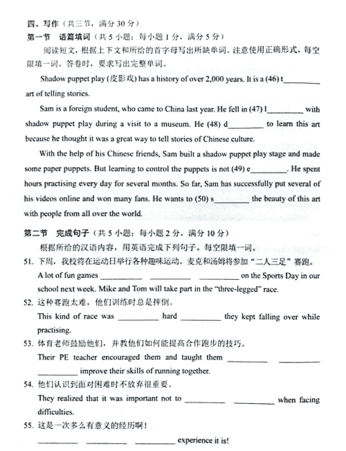

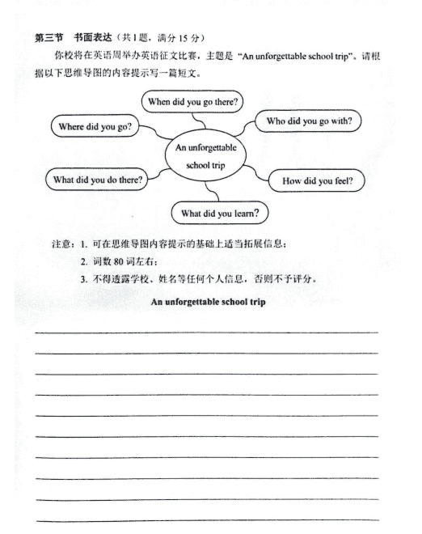