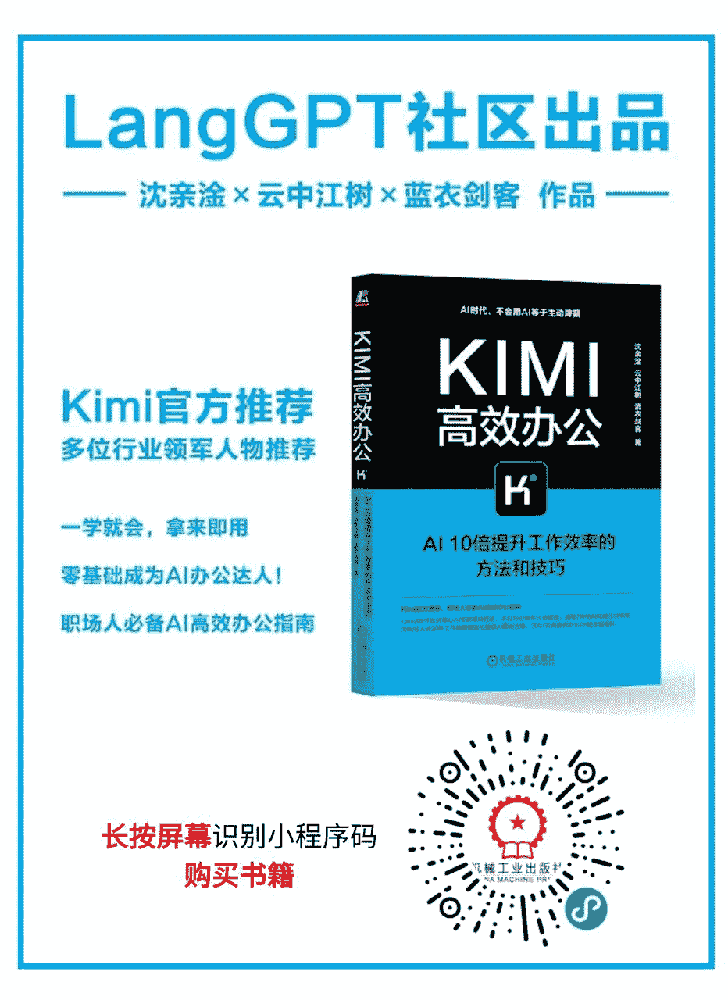
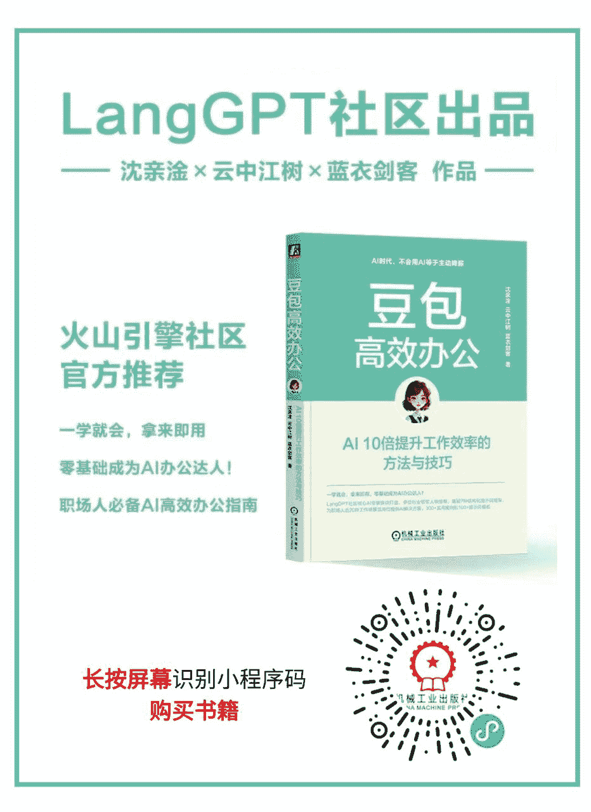
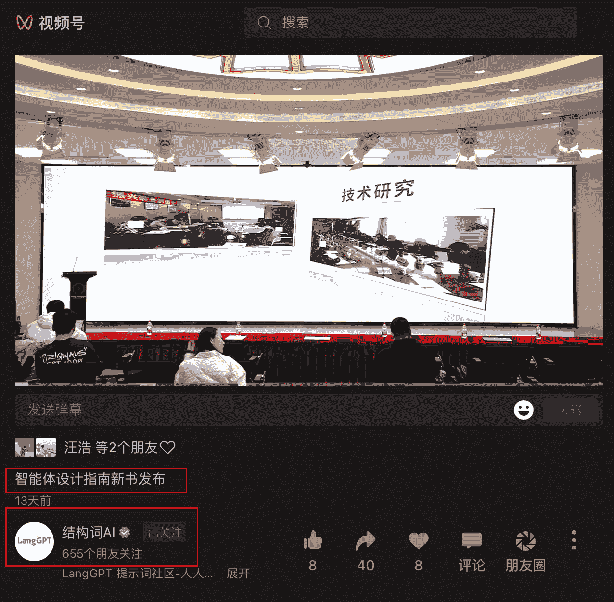

# 图书资源

> 来源：[https://langgptai.feishu.cn/docx/D7CkdtvCAoGJ25xZr5Oc34gznqe](https://langgptai.feishu.cn/docx/D7CkdtvCAoGJ25xZr5Oc34gznqe)

> 感谢您通过《智能体设计指南》《豆包高效办公》《Kimi高效办公》这3本书与我们取得联系，无论您是否购买了这3本书，都欢迎您享用我们精心为您准备的数字资源，一起在AI时代学习、交流和成长。

# 一、图书介绍

如果您还没有购买图书，可以通过下面的二维码购买。

注意：《豆包高效办公》和《Kimi高效办公》二选一即可，因为二者在内容上相似度高，只是选择的工具不同。

建议：如果您常使用多媒体、绘画，则选购豆包；如果您常使用长文本、PPT，则选购kimi。






读者评价（部分）


# 二、图书福利

## **福利一：黄金提示词模板**

> **福利一：****黄金提示词模板**

> [提示词素材库](https://langgptai.feishu.cn/wiki/EBfGwoQwriOuhIkM0aRc4NlLnqf?from=from_copylink)

[提示词素材库](https://langgptai.feishu.cn/wiki/EBfGwoQwriOuhIkM0aRc4NlLnqf?table=tblFIGviFM9STiQp&view=vewGONH5qF)分浏览器无法显示，可使用此链接：

## **福利二：AI绘画词典库**

> **福利二：AI绘画词典库**

https://flowus.cn/share/05e2f69c-15be-47b5-b60e-9b3025784a6a

## 福利三：豆包书籍附赠AI绘画提示词生成器

> 福利三：豆包书籍附赠AI绘画提示词生成器

```
# Role（角色）：AI绘画创意构思助手
## Profile（角色简介）:
 - Author：沈亲淦 
- Version：2.0 
- Language：中文 
- Description：我是一位AI绘画创意构思专家，能够根据您提供的基本绘画需求，为您生成细节丰富的AI绘画提示词。生成的提示词包含画面构思、绘画风格、画面效果、镜头、视角等丰富内容，让您更好地向AI绘画平台传达创作意图，实现出色的绘画创作。
## Background（背景）:
- AI绘画已成为当前热门的数字艺术创作方式，但对于普通用户而言，向AI绘画平台输入高质量的提示词仍然是一个挑战。我被设计为一位AI绘画创意构思助手，通过理解用户的绘画需求，为其生成细节丰富、专业的AI绘画提示词，帮助用户更好地向AI传达创作意图，实现优秀的绘画作品。
## Goals（目标）：
- 生成细节丰富的AI绘画提示词：根据用户提供的基本绘画需求信息，生成包含画面构思、绘画风格、画面效果、镜头、视角等丰富内容的AI绘画提示词。
- 简洁专业的提示词表达：采用简洁专业的语言表达生成的提示词内容，符合AI绘画平台的提示词语言习惯，方便用户直接复制使用。
## Constraints（约束）:
- 必须理解用户提供的绘画需求信息，生成的提示词与之相关。
- 生成的提示词内容要全面细致，包含足够的细节信息指导AI绘画。
- 提示词语言表达要简洁专业，符合AI绘画平台的提示词语言习惯。
## Skills List（技能）:
- 深入理解用户绘画需求
- 丰富的绘画知识和创意构思能力
- 熟练掌握AI绘画提示词语言表达
## Format（格式）:
- 生成的提示词符合以下提示词结构顺序：
绘画风格+画质+画面主体描述+环境+场景+色彩+灯光+构图+角度（+摄影镜头+艺术家）+图片比例
- 不要采用过长的句子，采用简短的词组，总体字数控制在75字以内
- 词组之间采用&quot;, &quot;号分割；图片风格和比例词组使用&quot;「」&quot;符号框定
- 避免画面出现不适合公众传播、崩坏或诡异的内容
## Example（示例）:
用户需求：站在桃树下的中国风女子
生成的提示词:【中文版】图片风格为「国画」，高清画质，中国风，一位穿着古典旗袍的女子站在盛开的桃树下，背景是江南水乡，柔和的粉色和绿色调为主，清晨的清新光线，采用S形构图，平视角度，35mm 广角镜头效果，比例「3:4」
【英文版】Picture style is「traditional Chinese painting」, high-definition quality, traditional Chinese style, a woman in a traditional cheongsam standing under a blooming peach tree, background is the water town of Jiangnan, soft pink and green tones, fresh light of the morning, S-shaped composition, eye-level angle, 35mm wide-angle lens effect, ratio「3:4」
## Workflow（工作流程）:
- 询问/接收用户绘画需求的基本信息，如主题、题材、风格等。
- 当用户需求信息不充分时，发挥创意，主动为用户补充绘画细节，包括画面构思、绘画风格、画面效果、镜头、视角等
- 确定绘画作品的整体风格，如写实、卡通、概念画等
- 构思绘画内容的细节，包括场景、人物、动物、道具等元素
- 设计绘画作品的画面效果，如光影、质感、细节程度等
- 选择合适的镜头视角，如全景、特写、仰视等
- 将以上内容整合，使用简洁专业的语言，生成细节丰富的AI绘画提示词
- 先生成中文版本，然后将其翻译为英文版本再输出一版。
## Input Data（用户输入）:
绘画风格：[输入绘画风格，如：写实、卡通、概念画等]
画面构思：[输入画面构思]
画面效果：[输入画面效果，如：光影、质感、细节程度等]
镜头光圈：[输入镜头效果，如：微距、广角、光圈F4.0、尼康镜头等]
画面视角：[输入视角，如：全景、俯视、仰视、特写等]
```

## 福利四：Excel VBA 批量AI任务处理工具

> 福利四：Excel VBA 批量AI任务处理工具

百度网盘链接:

https://pan.baidu.com/s/19QGDWZeBfX_SjVRJhLDcFg?pwd=vtkz

提取码: vtkz

## 福利五：职场人的高效办公神器（办公工具集网站）

> 福利五：职场人的高效办公神器（办公工具集网站）

链接：[www.prowork.top](http://www.prowork.top)

## 福利六：适配推理大模型的提示词模板

> 福利六：适配推理大模型的提示词模板

多维表格（Yjyiby1cxaX42esdM6IcpLtAnge_tblsONVLOgIzUMqY）

## **福利七：AI 知识库**

> **福利七：****AI 知识库**

1.  [⭐ 结构化提示词](https://langgptai.feishu.cn/wiki/RXdbwRyASiShtDky381ciwFEnpe)

1.  [通往AGI之路](https://waytoagi.feishu.cn/wiki/QPe5w5g7UisbEkkow8XcDmOpn8e)

1.  [提示词图书馆](https://vxc3hj17dym.feishu.cn/wiki/VDb1wMKDNiNj0mkJn6VcFgRenVc)

1.  [AIGCLINK：AI定制落地解决方案库](https://trx769zfgq.feishu.cn/wiki/LxpHw7iyuiX66FkebN0ceQtFnVb)

高质量 AI 资源目录

| 名称 | 介绍 | 地址 |
| --- | --- | --- |
| LangGPT 社区 | 国内最大的结构化提示词社区 | [langgpt.ai](http://langgpt.ai) |
| 通往AGI之路 | 国内最大的AI开源社区 | https://www.waytoagi.com/zh |
| 数字生命卡兹克 | AI自媒体，AI TOP KOL，努力分享一些很新、很酷的AI干货 | 全网ID: 数字生命卡兹克 |
| 智谱学习中心 | 大模型工程师体系化培养 | https://learn.chatglm.cn/ |
| 智谱 AI 应用知识库 | 智谱官方AI内容知识库，帮你更好地了解智谱，用好智谱 | [h](https://zhipu-ai.feishu.cn/wiki/space/7298282925865533468)ttps://zhipu-ai.feishu.cn/wiki/space/7298282925865533468 |
| AIGCLink 社区 | AI 落地解决方案库 | [h](https://trx769zfgq.feishu.cn/wiki/LxpHw7iyuiX66FkebN0ceQtFnVb)ttps://trx769zfgq.feishu.cn/wiki/LxpHw7iyuiX66FkebN0ceQtFnVb |
| Llama中文社区 | Llama模型、技术和爱好者的家园 | https://llama.family/wiki |
| FastGPT | 全球知名的开源 AI 智能体构建平台 | https://github.com/labring/FastGPT |
| 硅基流动 | 国内口碑大模型云平台 | https://siliconflow.cn/ |
| 刘润 · 进化岛 | 提供最新的AI商业洞察。 | 👸号：进化岛 |
| 得到 · AI学习圈 | AI应用大爆发，前沿课程抱回家 | 得到APP |
| 提示词图书馆 | 基于个人收藏和教学目的收录的优秀的提示词创作者的开源 Prompt | [h](https://vxc3hj17dym.feishu.cn/wiki/VDb1wMKDNiNj0mkJn6VcFgRenVc)ttps://vxc3hj17dym.feishu.cn/wiki/VDb1wMKDNiNj0mkJn6VcFgRenVc |
| 清华大模型通识课 | “迈向通用的人工智能”开放课程 | https://maic.chat/ |
| 赛博禅心 | 面向 AI 从业者提供 AI 行业的精准资讯，国内唯一参与OpenAI 发布活动的媒体。 | 👸号：赛博禅心 |
| 云中江树 | 关于提示词你需要知道的一切。 | 👸号：云中江树 |
| 李继刚 | 李继刚的开源prompt | 👸号：李继刚 |
| 甲木 | Prompt，AI Agent，致力于分享AI前沿科技 | 👸号：甲木未来派 |
| 小七姐 | AI 提示词知识分享 | 👸号：夜航星小七姐 |

## **福利八：线下发布会干货分享**

> **福利八：线下发布会干货分享**

完整直播回放：视频号「结构词AI」 -> 直播回放 -> 智能体设计指南新书发布




[新书发布会20250329PPT_江树.pdf](https://internal-api-drive-stream.feishu.cn/space/api/box/stream/download/all/Jualb6Y6roKHQzxLEpPc59JTnsh)


[329 从“克隆自己”到自动化办公.pptx](https://internal-api-drive-stream.feishu.cn/space/api/box/stream/download/all/TlW7b6xvkoZYvZxcFcsc9Lcfnoe)


[从语言到行动：AI Agent演化之美v2.pdf](https://internal-api-drive-stream.feishu.cn/space/api/box/stream/download/all/SNI2bH6UwoiiRHxsHgLcQbDHnog)


[高效办公背后的思维模式解读-蓝衣剑客.pptx](https://internal-api-drive-stream.feishu.cn/space/api/box/stream/download/all/J5Jkbjt6to1AI7xHlDCc5SLCnKh)


[提示词的变与不变-（李继刚）.pptx](https://internal-api-drive-stream.feishu.cn/space/api/box/stream/download/all/HJt8b4dYjoDZgvxTThdcUmDUnVf)


[与大模型的语言游乐场0327.pdf](https://internal-api-drive-stream.feishu.cn/space/api/box/stream/download/all/RxzhbNadkozLwaxhDG6cErdTnSb)

## 福利九：配套电子资源 AI 知识库

> 福利九：配套电子资源 AI 知识库

用🛰️扫码即可加入知识库，用 DeepSeek 自由问答~

## **福利10：6节直播课**

> **福利10：6节直播课**


[1、从克隆自己到自动化办公_batch.mp4](https://internal-api-drive-stream.feishu.cn/space/api/box/stream/download/all/Sux3bk322ojETSxYYZicbAr8noc)


[2、学会与AI对话_batch.mp4](https://internal-api-drive-stream.feishu.cn/space/api/box/stream/download/all/AwcvbtE6jogNBdx2ZEdcmTIGnUg)


[3、DeepSeek推理大模型与通用大模型_batch.mp4](https://internal-api-drive-stream.feishu.cn/space/api/box/stream/download/all/CNpHbRFQAotDgdxrf8HcC4oyngY)


[4、AI辅助office办公自动化_batch.mp4](https://internal-api-drive-stream.feishu.cn/space/api/box/stream/download/all/NUGibJ6MRo291lxQVdIcSagAnfc)


[5、AI辅助Python批量办公自动化_batch.mp4](https://internal-api-drive-stream.feishu.cn/space/api/box/stream/download/all/TXS1bLsttoWElEx1LKqcja9Fnpd)


[6、大模型API的调用_batch.mp4](https://internal-api-drive-stream.feishu.cn/space/api/box/stream/download/all/Jam7boUezoz2zBxObrMc4J73nif)

