# DeepSeek 资料合集

> 来源：[https://langgptai.feishu.cn/docx/REzJdjdXwouSpzxvbEgcR5dDnJb](https://langgptai.feishu.cn/docx/REzJdjdXwouSpzxvbEgcR5dDnJb)

> 本页面编辑权限已打开，欢迎参与A编辑添加内容，

> 遇到权限问题联系云中江树，🛰️ 1796060717https://www.waytoagi.com/zh/prompts/442

> 添加🛰️请自我介绍！！！

> 白嫖党伸手党勿扰，没事儿别加，加多了烦~

> 加的一定请看：[LangGPT 社交礼仪](https://langgptai.feishu.cn/wiki/THdxw39nliLOcjktqWUcL3Q8nDh)

> 不会自我介绍的看：[怎么做自我介绍？](https://langgptai.feishu.cn/wiki/CAhqw6eBJiM6Q8kblydcu7qOn4b)

DeepSeek 交流群，能好好说话的进，白嫖党伸手党勿扰，发广告的送飞机票。

## DeepSeek 创始人专访

[DeepSeek创始人专访：中国的AI不可能永远跟随，需要有人站到技术的前沿](https://langgptai.feishu.cn/wiki/DGIUwsrrMinivBkZLI6cIyZDnZb)

## 清华大学 DeepSeek 从入门到精通——第一版

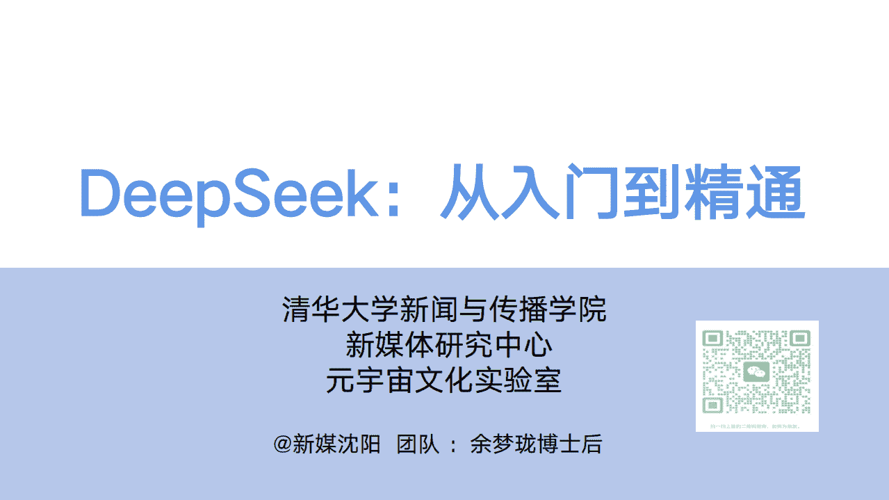

[清华大学deepseek从入门到精通.pdf](https://internal-api-drive-stream.feishu.cn/space/api/box/stream/download/all/RAKSbvsdqoFkxVxEZaOcKuKxn6g)

## 清华大学 DeepSeek 从门到精通——第二版

[DeepSeek如何赋能职场应用？从提示语技巧到多场景应用-清华大学(1).pdf](https://internal-api-drive-stream.feishu.cn/space/api/box/stream/download/all/EPA0b62swomaaGx0nBqcO7JinOf)

## 清华大学-普通人如何抓住DeepSeek红利——第三版

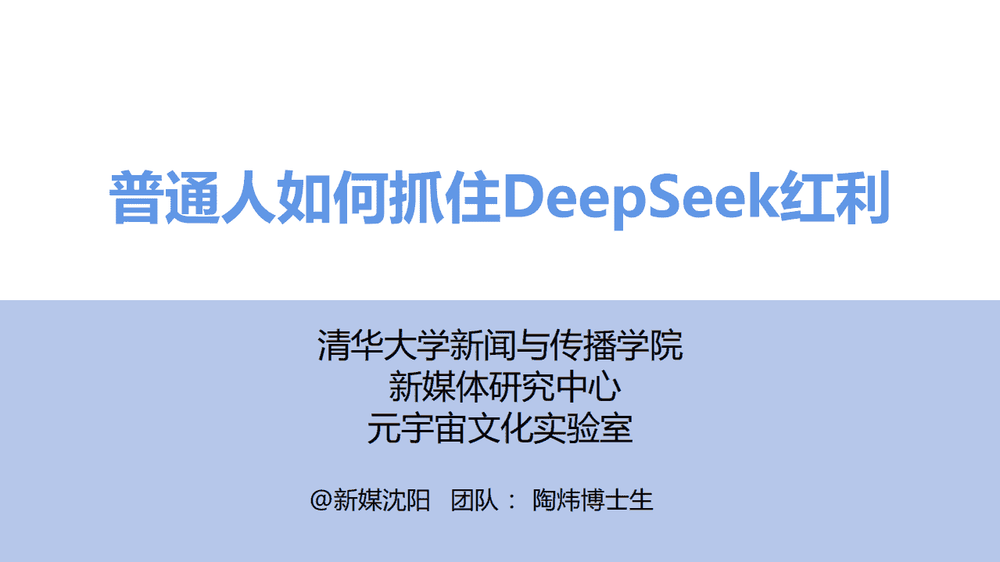

[03 清华大学_第三版_普通人如何抓住DeepSeek红利.pdf](https://internal-api-drive-stream.feishu.cn/space/api/box/stream/download/all/TlhKbi81aoIuWlxRARgcaB73nFe)

## 清华大学-DeepSeek+DeepResearch：让科研像聊天一样简单——第四版

## 清华大学-DeepSeek与AI幻觉——第五版

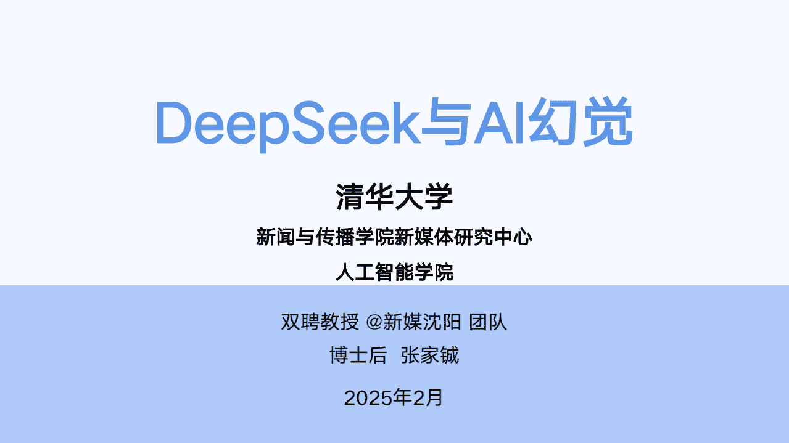

[05 清华大学_第五版_DeepSeek与AI幻觉.pdf](https://internal-api-drive-stream.feishu.cn/space/api/box/stream/download/all/OCmbbSetQorBX5xJhzMcJ0fQnoe)

20250227更新

## 北京大学-DeepSeek与AIGC应用

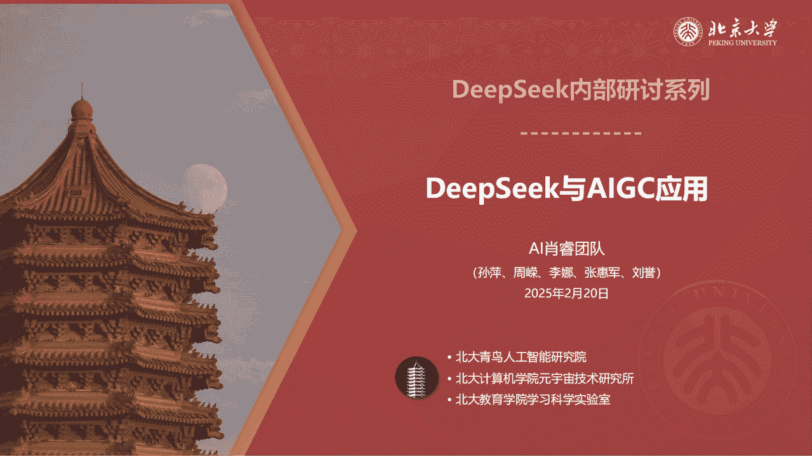

[北京大学-DeepSeek与AIGC应用.pdf](https://internal-api-drive-stream.feishu.cn/space/api/box/stream/download/all/AcbVbgaD8otY1zxluSycLAkxn3c)

## 北京大学-DeepSeek-提示”词工程和落地场景

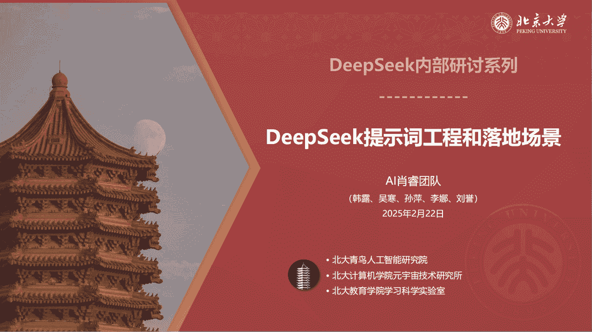

[北京大学-DeepSeek-提示词工程和落地场景.pdf](https://internal-api-drive-stream.feishu.cn/space/api/box/stream/download/all/LKF0by2Avo3GWXxWYUnckX5knMh)

## Deepseek v3 论文

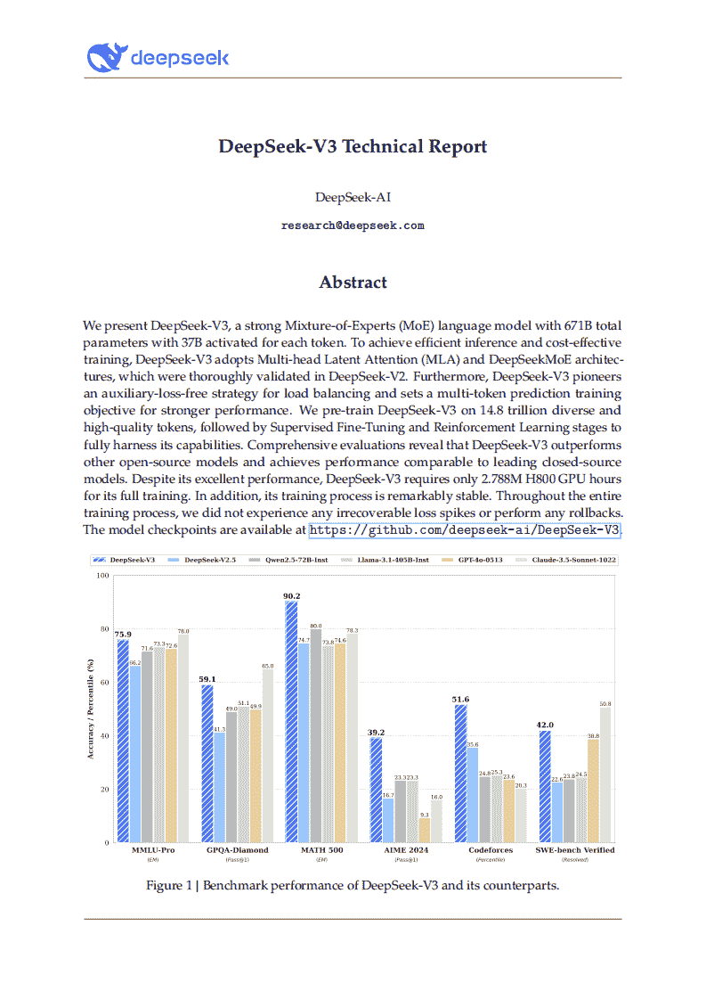

[DeepSeek_V3.pdf](https://internal-api-drive-stream.feishu.cn/space/api/box/stream/download/all/M68Sb4ZBEo37GUxGAMMcLWfFnCd)

## DeepSeek-R1 论文

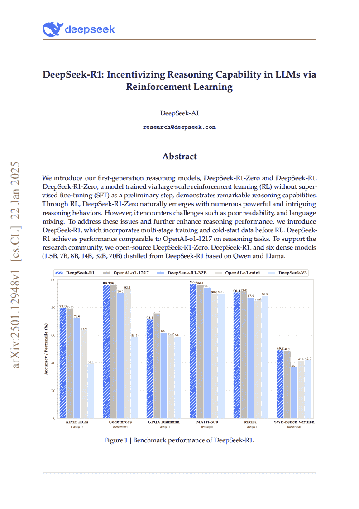

[deepseek-r1.pdf](https://internal-api-drive-stream.feishu.cn/space/api/box/stream/download/all/NlS0bygDDoJOcFxPUNhc5sCankh)

## DeepSeek 研报

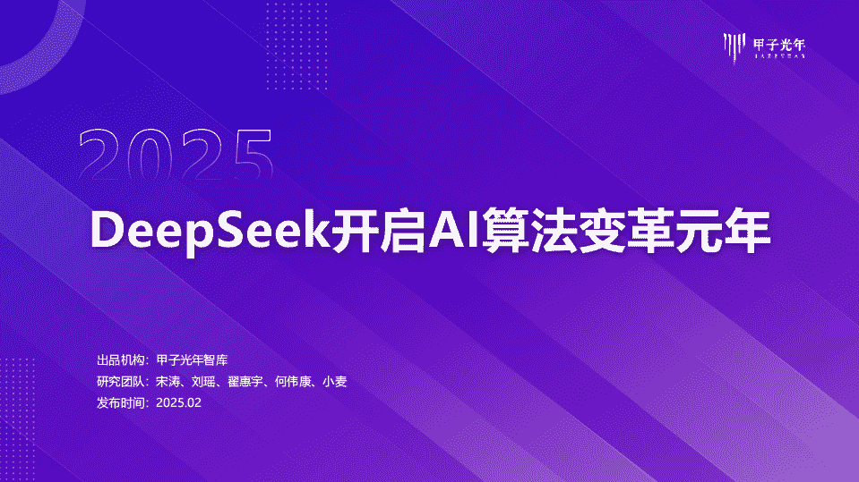

[甲子光年-DeepSeeK开启AI算法变革元年（2025年2月）.pdf](https://internal-api-drive-stream.feishu.cn/space/api/box/stream/download/all/HxApbvaf7ohWsOxL5JqcPBDDnKh)

DeepSeek深度解析：DeepSeek推动高性能AI普惠，AI生态繁荣发展-招商证券.pdf

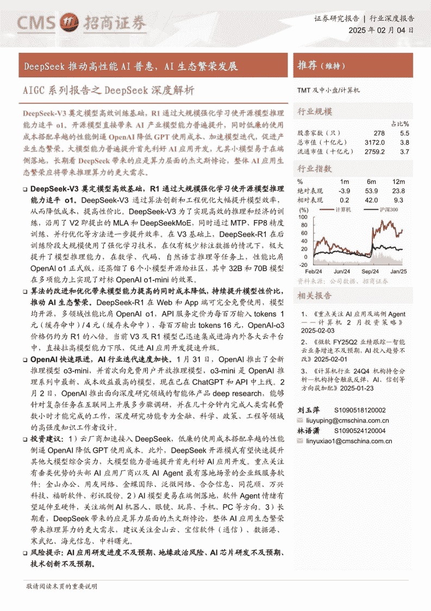

[DeepSeek深度解析：DeepSeek推动高性能AI普惠，AI生态繁荣发展-招商证券.pdf](https://internal-api-drive-stream.feishu.cn/space/api/box/stream/download/all/WTqUbUO75ofvrIxpYcfcrXa5nkf)

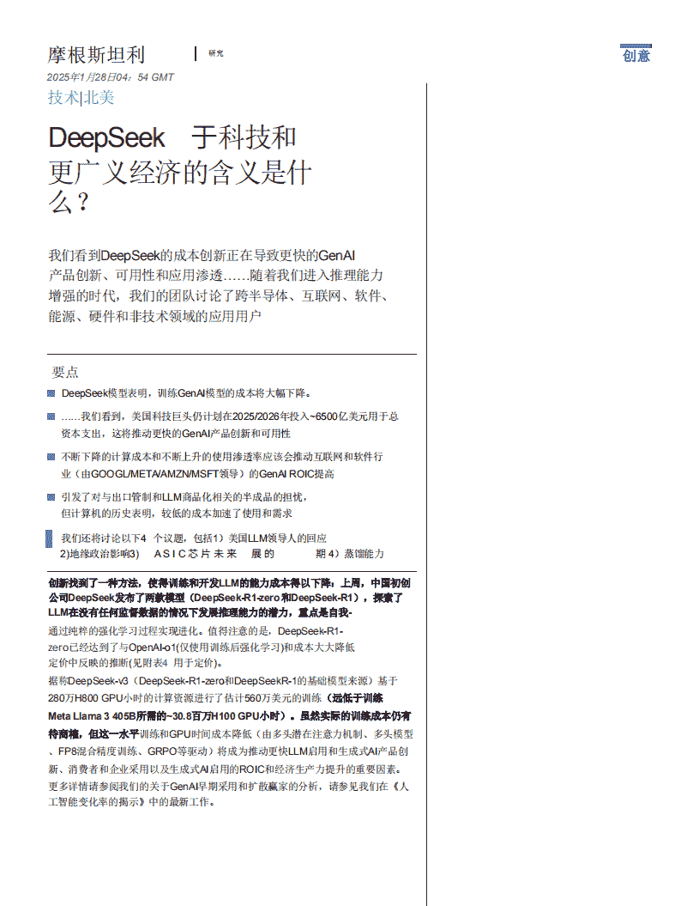

[摩根斯坦利报告—DeepSeek对于科技和更广义经济的含义是什么？.pdf](https://internal-api-drive-stream.feishu.cn/space/api/box/stream/download/all/BmshbweafoTY6qxiDxWcGleRn2f)

理解 DeepSeek R1 这类推理大模型

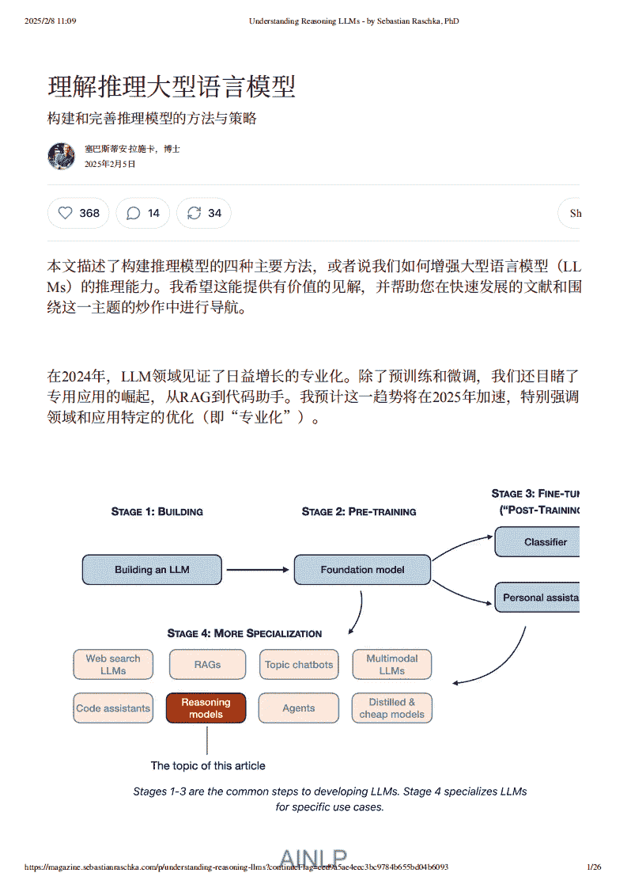

[理解推理大模型-中文版.pdf](https://internal-api-drive-stream.feishu.cn/space/api/box/stream/download/all/NVUKbAzhuolC60xHxdrcV7EdnDh)

麻省理⼯学院（MIT）的⼈⼯智能研究员 Lex Fridman（莱克斯 · 弗⾥德曼）关于DeepSeek的播客

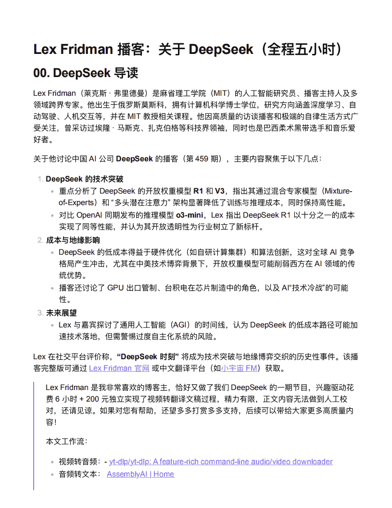

[Lex Fridman 播客：关于 DeepSeek（全程五小时）.pdf](https://internal-api-drive-stream.feishu.cn/space/api/box/stream/download/all/DyFjbKUO3och5WxPzzqcTO9jn1c)