# 线下见——记 LangGPT 社区北京第一期交流沙龙

> 来源：[https://langgptai.feishu.cn/docx/P01adbz8ToNA3AxpGWsczbidn7e](https://langgptai.feishu.cn/docx/P01adbz8ToNA3AxpGWsczbidn7e)

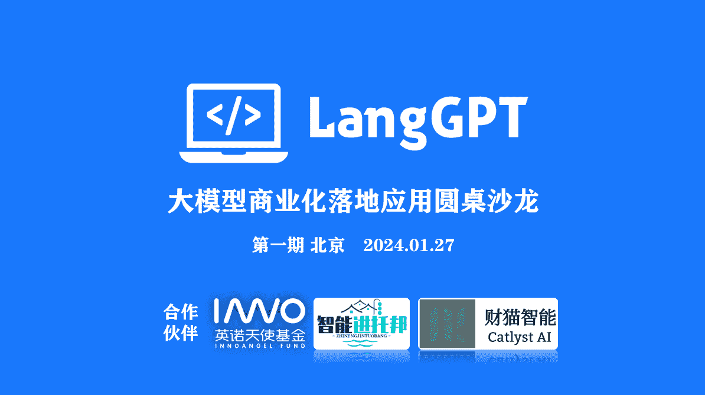

抓住春节回家前的小尾巴，终于在北京顺利举办社区的第一期线下交流沙龙，主题为：“大模型商业化落地应用”。一开始也想在春节前搞大会的，计划之后发现需要准备的事项很多，受时间精力所限没有推进下去，让许多朋友失望了。不过我们觉得敢想敢干最重要，在我们能力范围之内做一些事情，办一个 20 人以下的沙龙，春节之前和大家线下聚一聚，聊一聊，互相学习，互相促进。

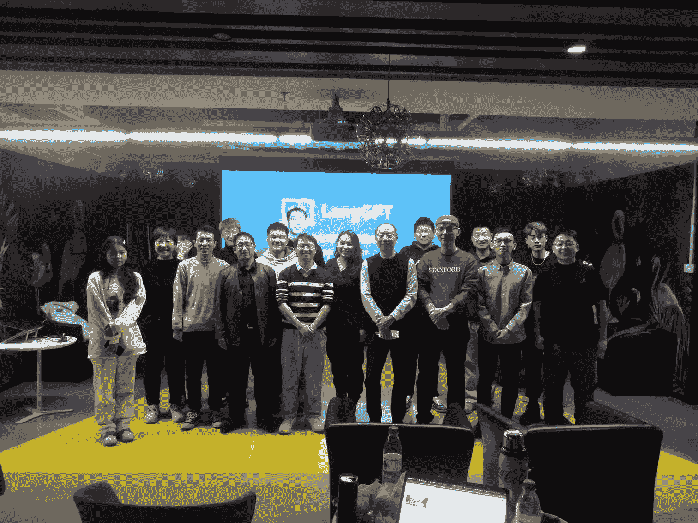

活动合照（大家笑的好开心hh）

蓦然回首，LangGPT 项目在 GitHub 上现在已经快 3 千 star 了，相比我们最初 100 star 的这个目标，整整大了好几百倍，这是大大超出我预期的。当初的我更想不到后来还会建立社区，会在社区朋友众人拾柴火焰高的热情下搭建起知识库，在各个舞台进行提示工程的知识分享，甚至还撰写了论文向顶会投稿等。我们看到我们提出的结构化提示词思想在国内传播，甚至发展出了一定的生态。同时，我们也看到当下大家对于大模型认知的转变：从去年的 “大模型是什么？怎么用？” 到 “怎么把大模型用好？”，因此有了我们这次沙龙，希望大家能够相互学习、相互探讨，共同进步。

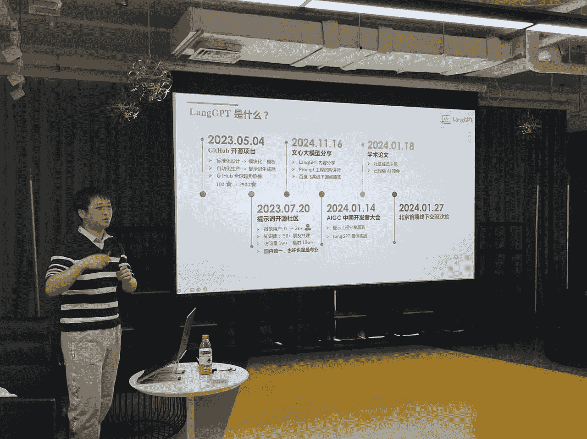

活动还没开始前，提前到来的朋友就已经热烈的交流起来了，因此到活动正式开始的时候，大部分朋友互相之间都有了一定了解。

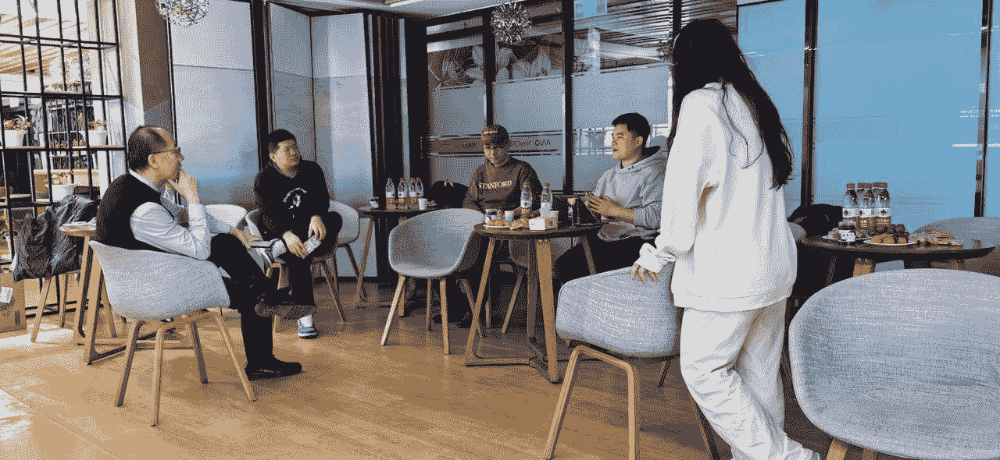

为了保障交流质量，我们采用了嘉宾分享+自由分享的形式。

嘉宾分享部分我们邀请英诺天使基金的王总、《提示工程进阶》书籍作者陈财猫等嘉宾首先进行 15 分钟左右的主题分享，从投资、提示工程、企业落地等角度分享各自的洞见。

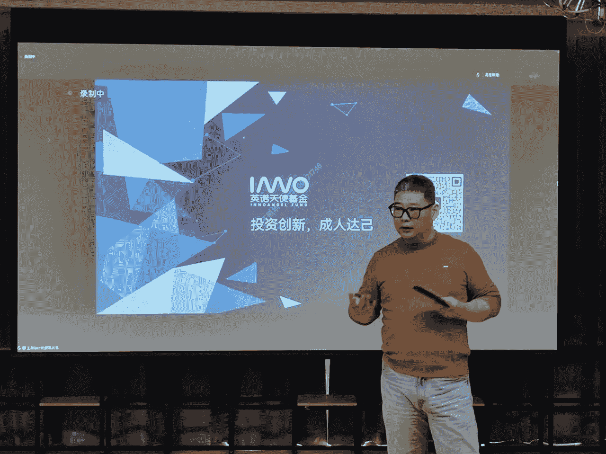

自由分享阶段，考虑到 20 人左右的线下沙龙大家可以交流的充分一点，因此给每人都留出五分钟的分享时间，并且分享完后可就感兴趣的点进行 1-2 分钟的讨论。

为保证活动质量，依据报名时填写的分享内容、所在行业等情况筛选了十几位朋友参与线下交流，来自旅游、家居、金融、媒体、教育、传统行业等等各行各业的朋友进行了主题分享。由于篇幅所限，这里仅展示部分图片。

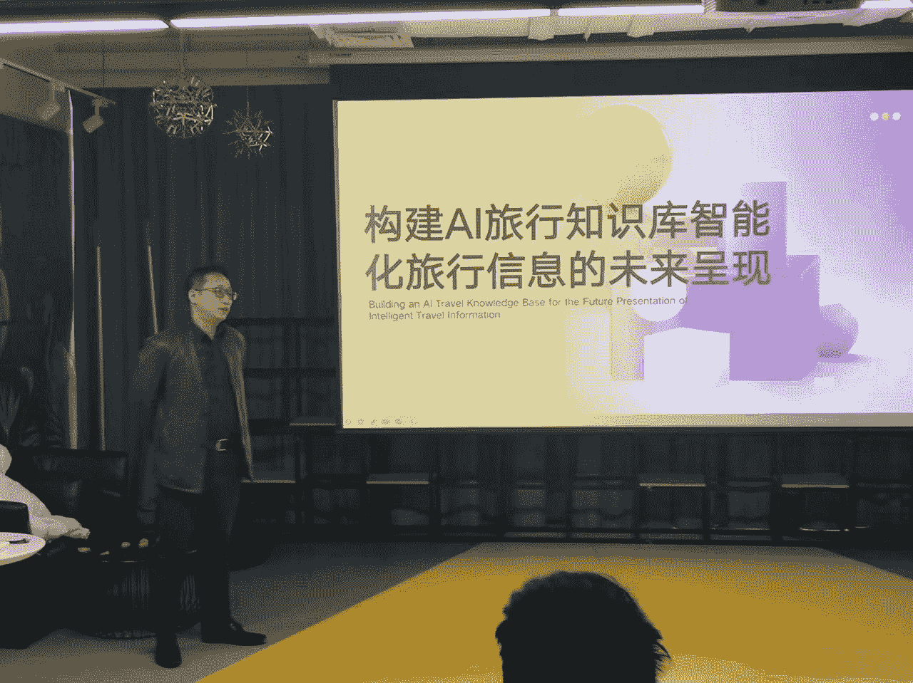

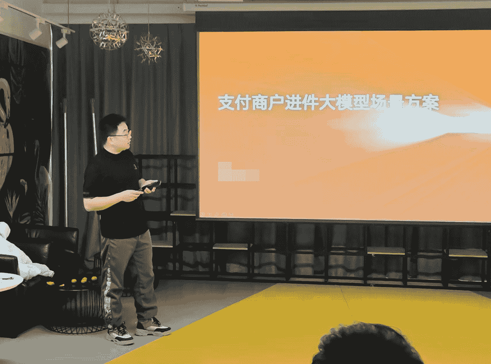

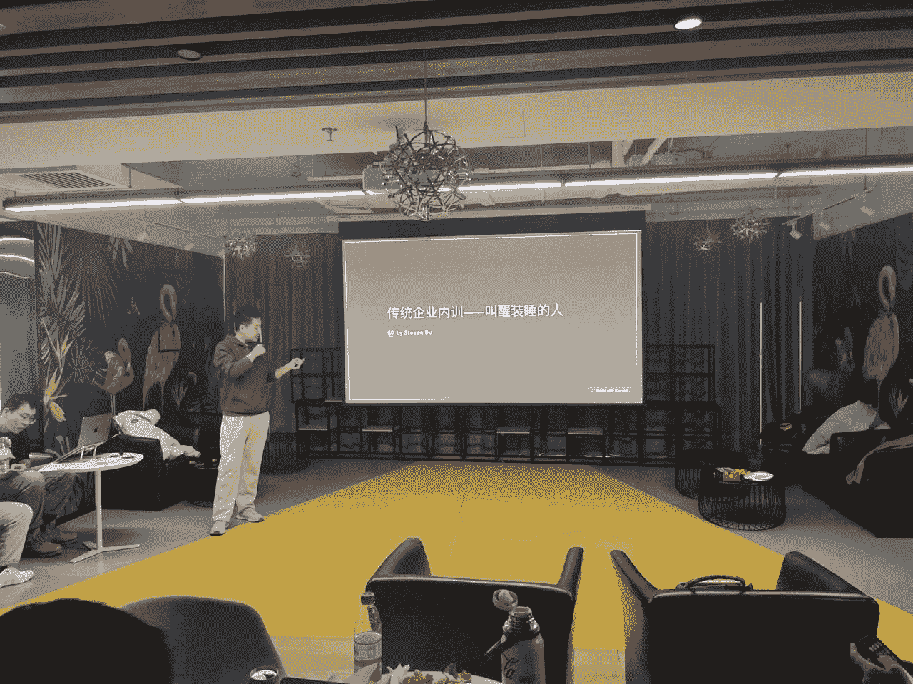

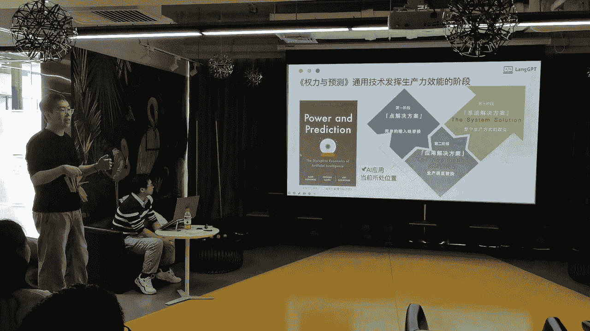

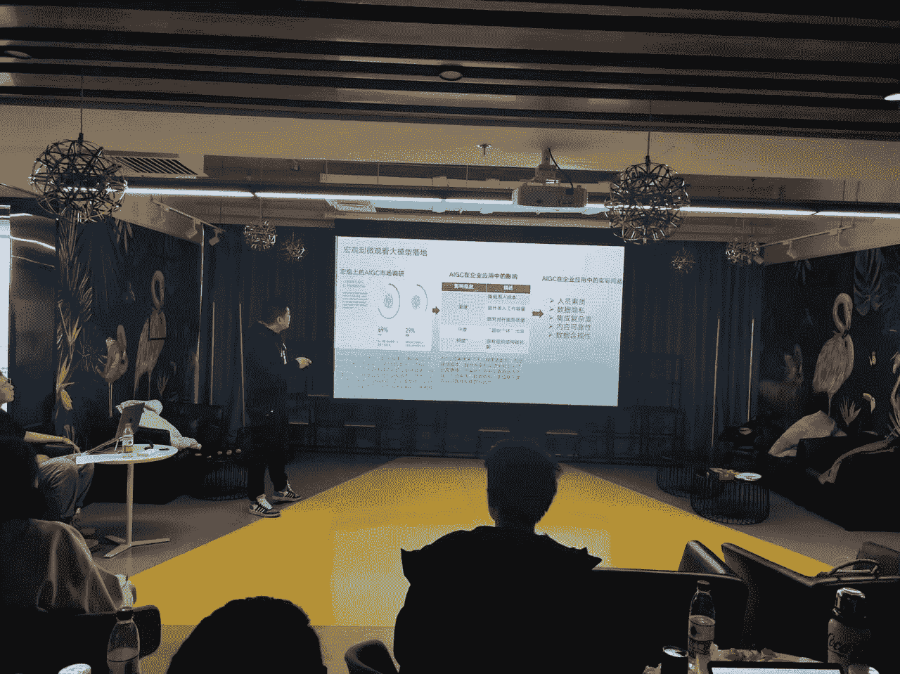

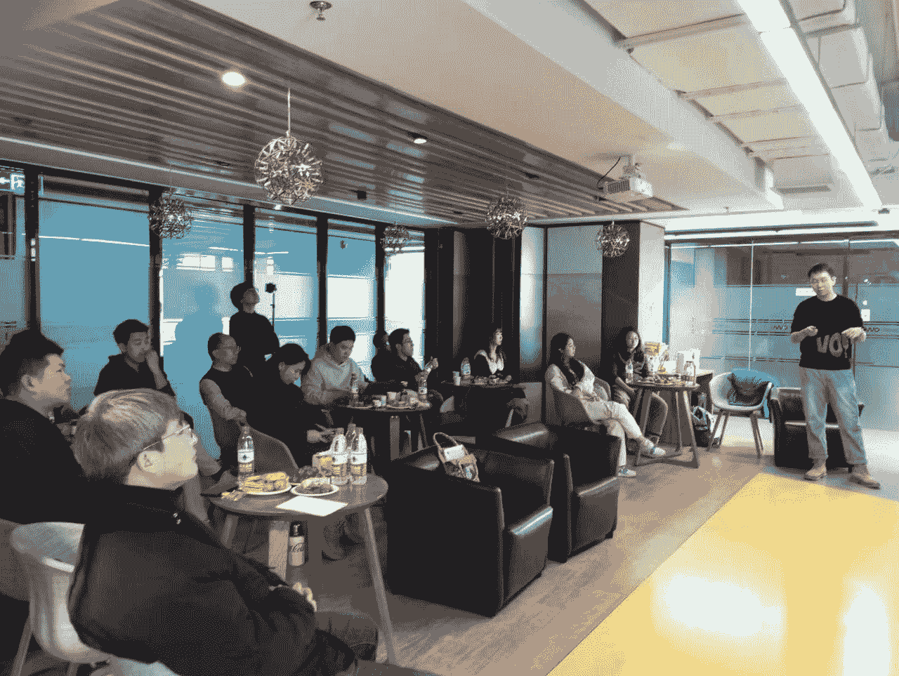

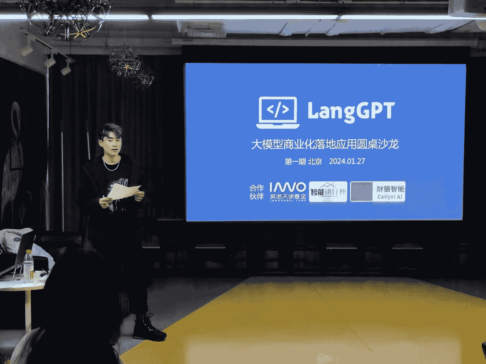

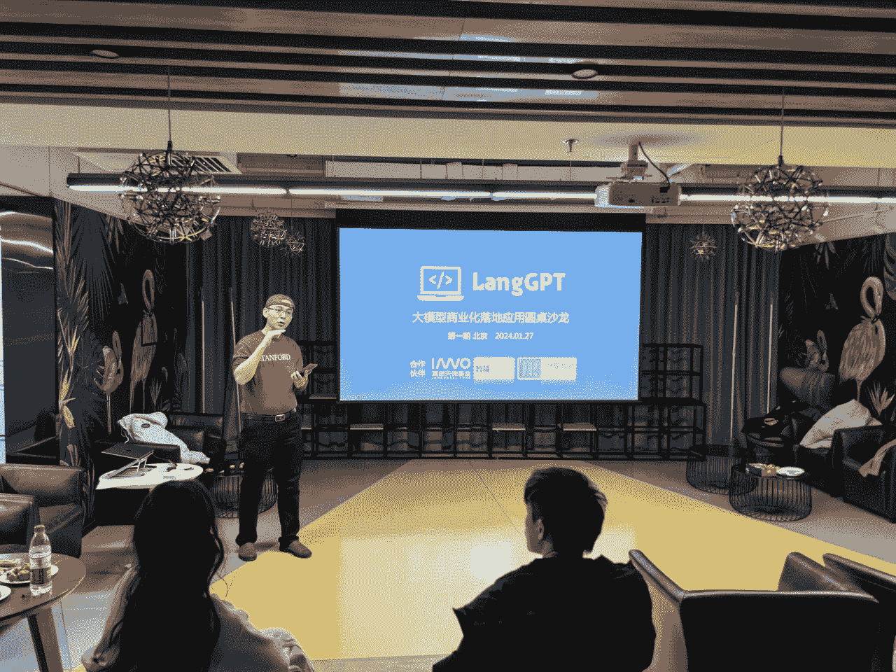

自由分享阶段结束之后，刚好到 5. 30 左右，和活动预计时间相差不多，剩下的时间给大家自由交流，没想到时间过得真快，转眼一个小时就过去了，到了晚饭时间，陈总和我说大家都舍不得离开 hh。

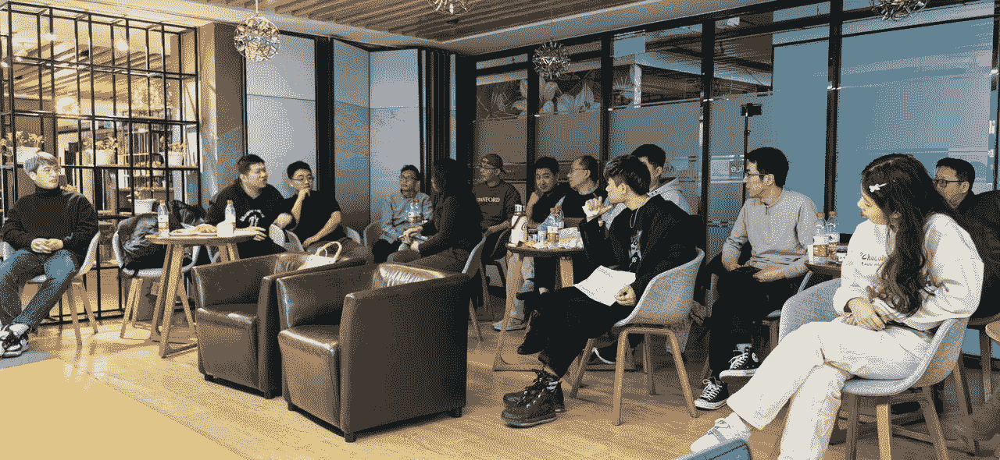

现场活动结束以后大家又一起吃了晚饭，饭桌上又聊了很多，10点多才散伙 hh

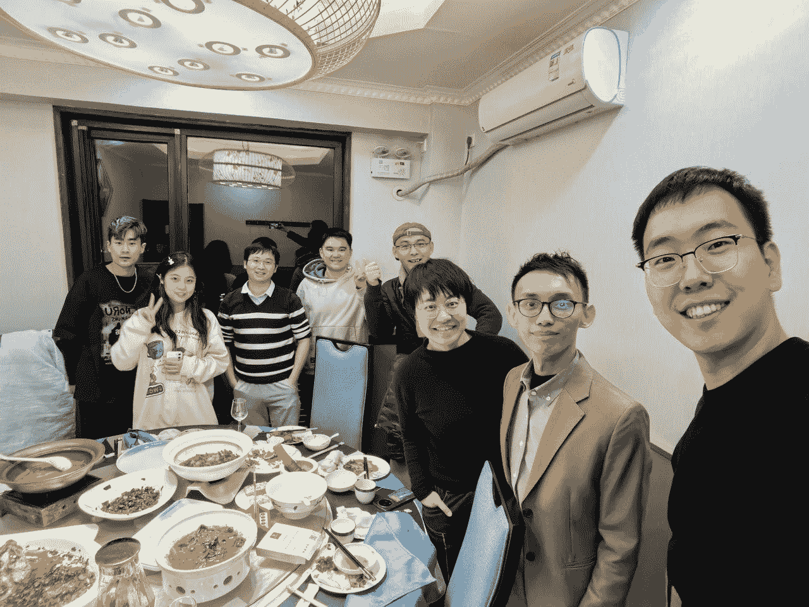

不得不说，组织这样的活动很有收获，相比线上，线下交流大家更敢于表达真实的情况。来自各个行业，不同实践经验，不同年龄阶段的思想的碰撞，也给我带来很多的启发。现在看似火热的 prompt, copilot, agents, bots 等概念和技术，会不会一夜之间、或者在一两年后迅速颠覆、重塑？

这是一个生产力大发展的大时代，生产力决定生产关系，原有的生产要素、生产关系正在解构、重组，这其中有痛苦也有机遇，智能的托邦会是怎样？这种社会秩序下我们的未来会是怎样？人生蜉蝣，却也应奋力挣扎。大模型从各行各业中学习知识，汲取智慧，我们人类虽然无法赶上，但也不能落后太多。各种乱七八糟的念头、想法充满着我的脑海，以至于兴奋到大半夜依然睡不着，试图从这巨大的不确定性中，奋力抓住一些确定性。

在这样的时期，很高兴遇到这样的一群小伙伴们，在一起聊技术、聊 AI ，聊人生。虽然现场出了很多状况，如没有提前准备好，PPT无法播放等等情况，所幸未影响活动正常进行。即使是这样轻量级的活动，也是由许多朋友的努力和汗水促成。陈总和宣总为我们提供了场地和现场的零食水果等等，财猫、Hero 为我们建言献策协助组织，王总为我们站台提供背书等等，团队的思思姐，从上海赶过来参加并且帮忙在现场做了很多事情，尤其我们团队的甲木同学，台前幕后做了许多事情。还有社区的像蓝衣剑客这样热心朋友们，从外地赶过来分享干货等等，大家的支持和付出我都看在眼里，并且深深的感动着，再次感谢大家！

因此在做之前自己确实是有所犹疑的，为什么要做这些？能不能做好？有没有足够的朋友支持我们做？搞砸了怎么办？我的学长雷军说过：先悄咪咪的搞，搞砸了大家也不知道。那我们也这样，于是开始了第一期活动。当我们站在台上看到台下一双双亮晶晶的看着我们的眼睛，当我们看到陈总也被大家的热情感染忍不住上台分享，当我们看到大家在活动结束仍然迟迟不愿离去，当我们听到大家询问下一期的计划，我们知道大家的热情参与，是对本次活动最好的认可。

我们也希望和大家常见、常交流，北京第二期活动计划春节之后进行，若您也喜欢我们的活动，希望为推动活动质量贡献力量，欢迎联系江树 （zephyr_ai），我们需要：

1.  金主爸爸。作为 LangGPT 社区线下的赞助商，赞助活动经费 or 场地。

1.  合作伙伴。有影响力的社区、组织，联名、合作搞活动。

1.  分享嘉宾。作为嘉宾进行主题分享，不论咖位，内容有深度或有思想均可。

1.  和江树一起组织活动：

1.  唯一标准：有热情、愿意投入时间精力参与

1.  急需这些朋友：懂活动组织、会设计、会拍照摄影、会主持 任一才能

1.  小姐姐优先 hh，一群大老爷们儿干事儿太糙啦

在深圳、上海、广州等地的朋友如果希望也有这类活动，请多多支持，可联系江树，我们需要：

1.  活动组织者

1.  活动嘉宾

具备举办活动条件后，可举办相应的线下活动。