# 大模型商业化落地现状与思考—北京

> 来源：[https://langgptai.feishu.cn/docx/WoSId9sNZokWwrxN6pocF0lGnye](https://langgptai.feishu.cn/docx/WoSId9sNZokWwrxN6pocF0lGnye)

# **前言**

2024 年 1 月 27 日，LangGPT社区北京第一期交流沙龙活动跟大家见面了，抓住了年末的小尾巴，跟小伙伴们面对面地畅聊AI现状！身为LangGPT的团队成员，有幸跟江树、财猫从开始筹备，组织，到会场布置，活动安排等等，到场的小伙伴们也非常给力，精彩分享不断，最终共同完成了一次难忘的活动！

活动详细回顾请看LangGPT云中江树的《线下见——记 LangGPT 社区北京第一期交流沙龙》

本次活动的主题是关于“大模型落地应用”，作为团队的一员，同时作为本次的分享嘉宾，对于目前AI的实际应用和团队实践过的一些案例进行复盘总结，形成本次分享内容《大模型商业化落地现状与思考》，期望能够给大家一些启发。

> 限于个人学识、眼界，内容必定有不足、缺陷，甚至错误之处，其中的观点部分更是个人看法，仅供参考。

> 特别致谢：LangGPT 提示词社群的共建者和支持者们。所有的荣誉归于你们，这是我们的最佳实践，优质内容和案例让我们一起将它们带到更多更大的舞台！欢迎访问 LangGPT 知识库: http://feishu.langgpt.ai/

# ** 分享正**文

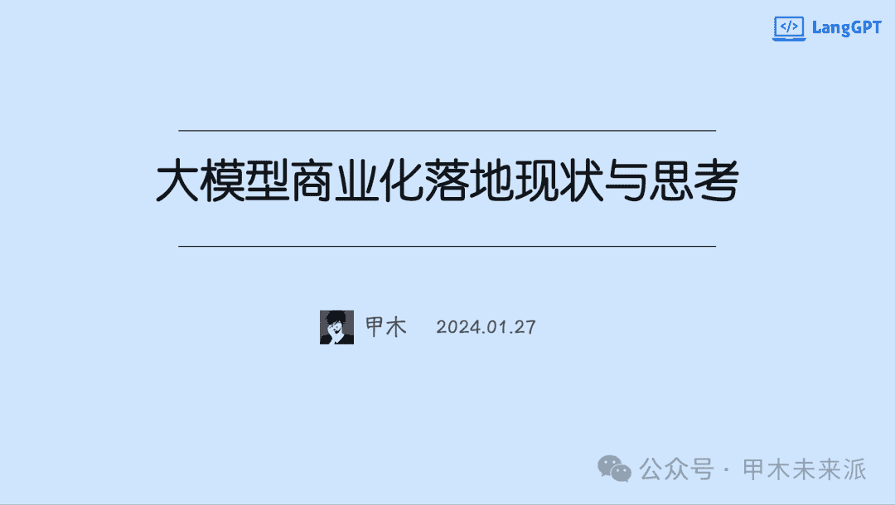

大家下午好！很荣幸能够作为本次活动的分享嘉宾，我是甲木，LangGPT团队成员，很高兴给大家带来《大模型商业化落地现状与思考》的分享。

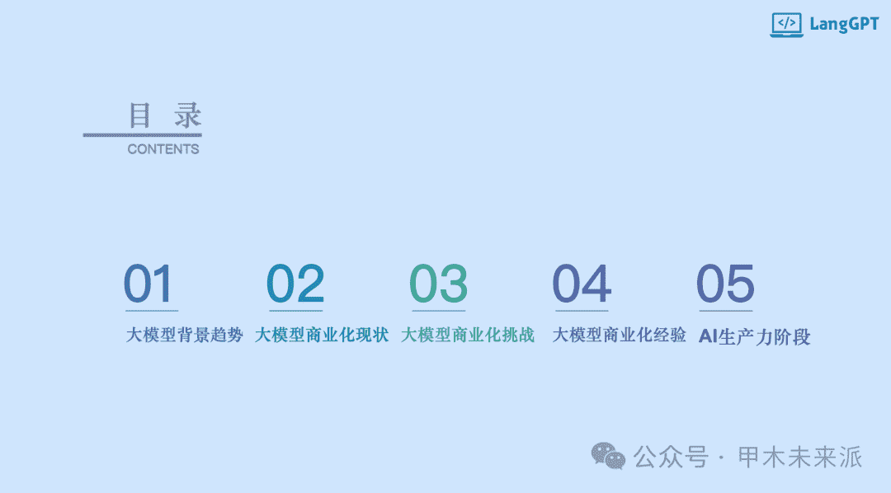

本次分享的内容主要分为五个模块，从大模型的背景入手、深入探讨其在商业领域的现状和应用。接着，我们将分析在商业化过程中所遇到的挑战，并分享一些实战经验，最后将展望AI作为通用技术能够发挥生产力效能所要经历的几个阶段。

## 一、大模型的背景和趋势

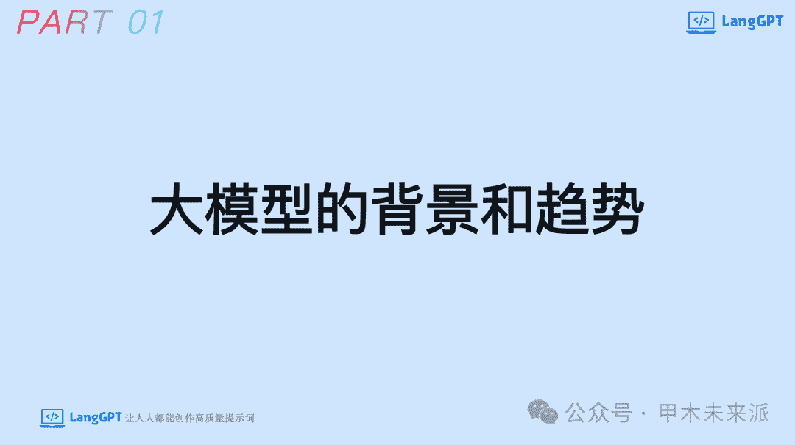

首先，我们先来看大模型的背景和发展趋势。

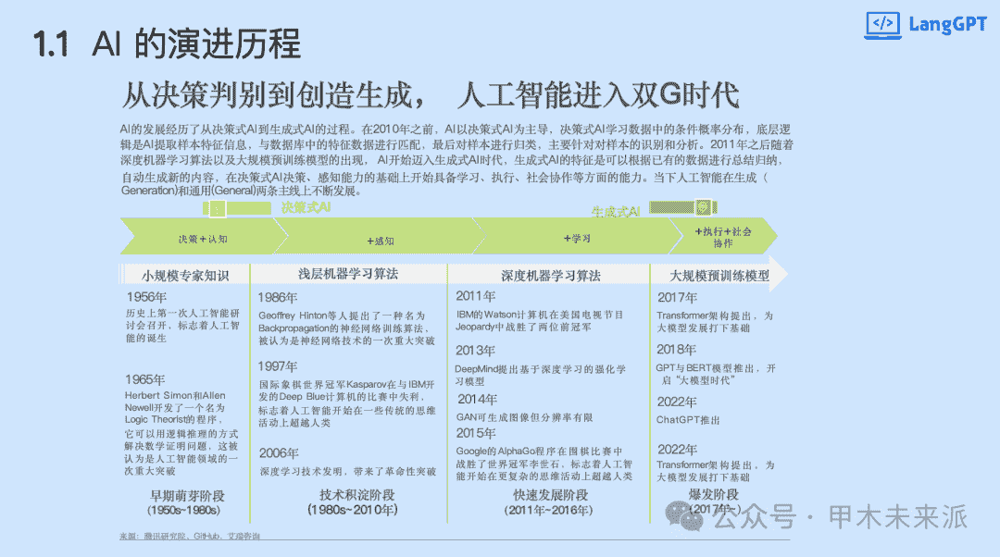

关于AI的演进历程，很多媒体包括各类研究资料都已经做过详细的介绍，相信今天在座的各位对AI的基本情况都已有所了解，因此我不会过多赘述AI的演进历程。（有兴趣的小伙伴可以多从公开资料中查找一下~）

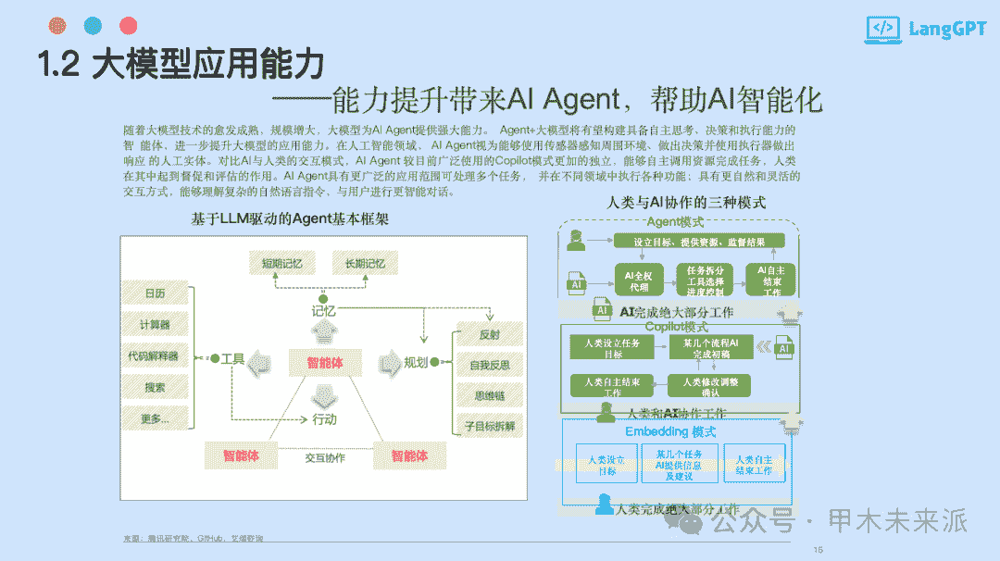

我们的重点将放在大模型当前的应用能力上，随着大模型技术的愈发成熟，规模增大，大模型为AI Agent提供强大能力。  Agent+大模型将有望构建具备自主思考、决策和执行能力的智能体，进一步提升大模型的应用能力，广泛应用于多个行业和领域。

## 二、大模型商业化落地的现状

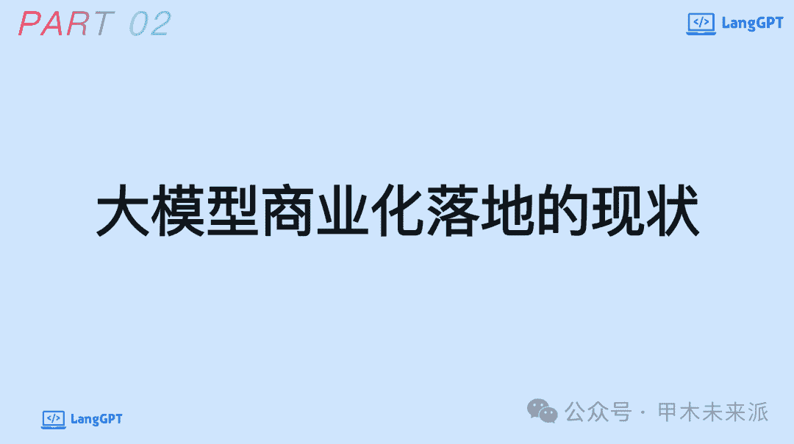

接下来，我们将深入了解大模型在商业化过程中的实际应用情况。

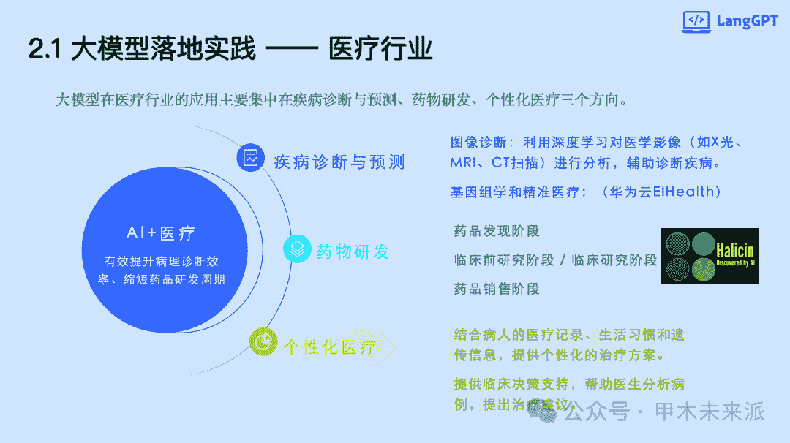

首先来看医疗行业，这是关乎每个人生命健康的重要领域。大模型在医疗行业的应用主要涵盖三个方向：疾病的诊断与预测、药物研发以及个性化医疗。

从医疗前期的图像诊断，基因组学和精准医疗到药物研发阶段再到最后病人的个性化医疗，人工智能都有其适合的应用场景。

例如，在2020年，麻省理工学院利用AI发现了一种名为Halicin的新型广谱抗生素，它不仅能有效杀灭对现有抗生素产生耐药性的细菌，而且不会使细菌产生新的耐药性。这一突破性发现源于AI的助力。

研究者先搞了一个由两千个性能已知的分子组成的训练集，这些分子都被标记好了是不是可以抑制细菌生长，用它们去训练AI。AI自己学习这些分子都有什么特点，总结了一套“什么样的分子能抗菌”的规律。之后又对美国FDA已通过的六万多个分子中进行分析，最终成功识别出了一个符合所有要求的分子，这就是Halicin。之后研究者开始做实验证明，它真的非常好使，大概很快就会用于临床，造福人类。

这个例子充分展示了AI大模型在医疗领域的巨大潜力，目前很多医疗研究机构都进行医疗大模型的开发研究，大模型在医疗领域大有可为！

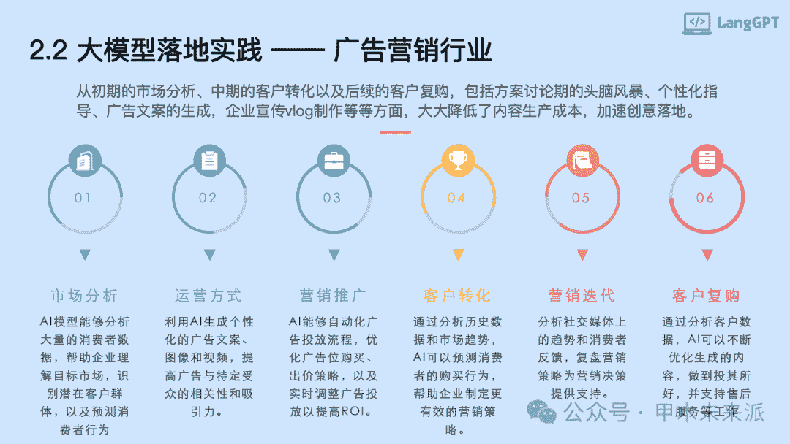

广告营销行业目前仍然是AIGC应用最多的业务场景之一，大模型在营销行业从初期的市场分析、中期的客户转化以及后期的客户复购均可参与打开营销生态新思路，为消费者提供更个性化、智能化和互动性强的营销体验，而对于广告图案的生成完全可以通过 AI+设计相关的SOP来提高效率。

大模型的应用不仅为营销策略提供了新的思路，还能为消费者带来更加个性化、智能化和互动性强的体验。此外，它们还能显著降低内容制作的成本并加速创意的实现过程。

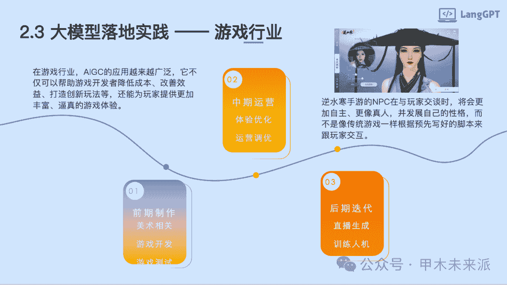

接下来是游戏行业，从一款游戏的前期制作，到中期运营再到后期迭代，大模型不仅能降低成本，还能打造创新玩法，提供更好的游戏体验。    我们来看屏幕上右上角的图片，这是网易推出的首款AI手游《逆水寒》，除了将AIGC应用于美术开发，更在NPC与玩家的交互上呈现独特的剧情体验，而非仅限于预设的脚本。

《逆水寒》制作组在游戏中内嵌了一个全自动“AI作词机”，玩家可以输入几个关键词，AI便会一秒生成一首完整诗词，让玩家变身文人骚客。比如，玩家输入“西湖细雨”，AI会结合游戏里的景色，来一句“雨余微暖细看残，暗香浮动西湖。”根据官方说法，“AI作词机”基于的是网易拥有自主知识产权的伏羲AI引擎，且语料库高达2万多首经典宋词。

众多大模型的应用可以让游戏NPC“活起来”生成新的数字世界，玩家们能够从中体会到独特的乐趣~

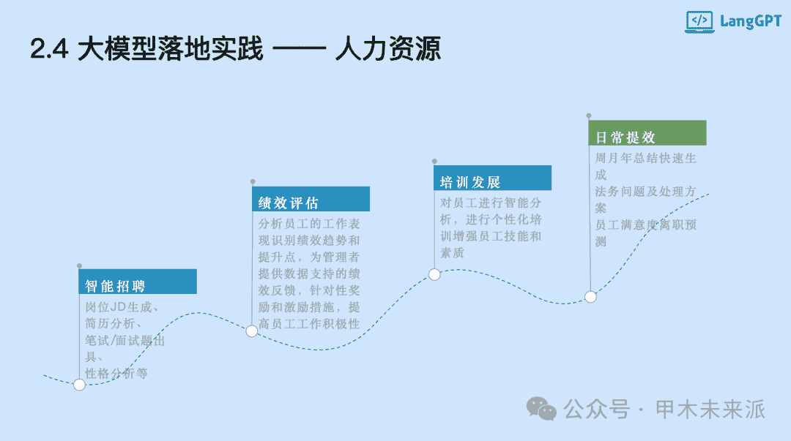

当然在各行各业通用的人力资源管理领域，AI的应用覆盖了从招聘初期（如职位描述生成、简历分析、面试题设计）到员工绩效评估（分析员工工作表现，识别绩效趋势和提升点，为管理层提供数据支持的绩效反馈）再到员工培训与发展各个环节，显著提高了工作效率。

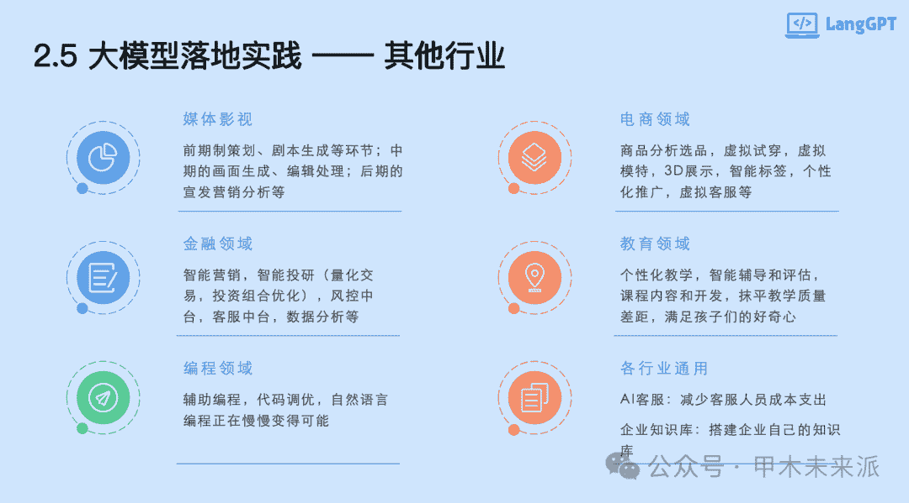

在全行业中，基础办公提效ppt、excel、会议报告、策划会、文案包装、图文海报、客服机器人bot等等都可以从<单个任务task->角色role->角色间协同collaboration>显著提高工作效率。

健身行业—AI减重顾问——既能解决售前客服的问题，也能解决学员离开健身营之后的健康监护，更能提高学员的体验。

美妆领域——美甲设计，美甲颜色生成；珠宝行业工作流优化->线稿、上色、材质成品等等。

除此之外，基本各行各业都能通过AI进行赋能，如影视、电商、金融、教育、编程、美妆等领域，这些应用领域大家都身处各行业内，体感肯定比我更深，大模型同样发挥了重要的辅助作用。

## 三、大模型商业化落地的挑战

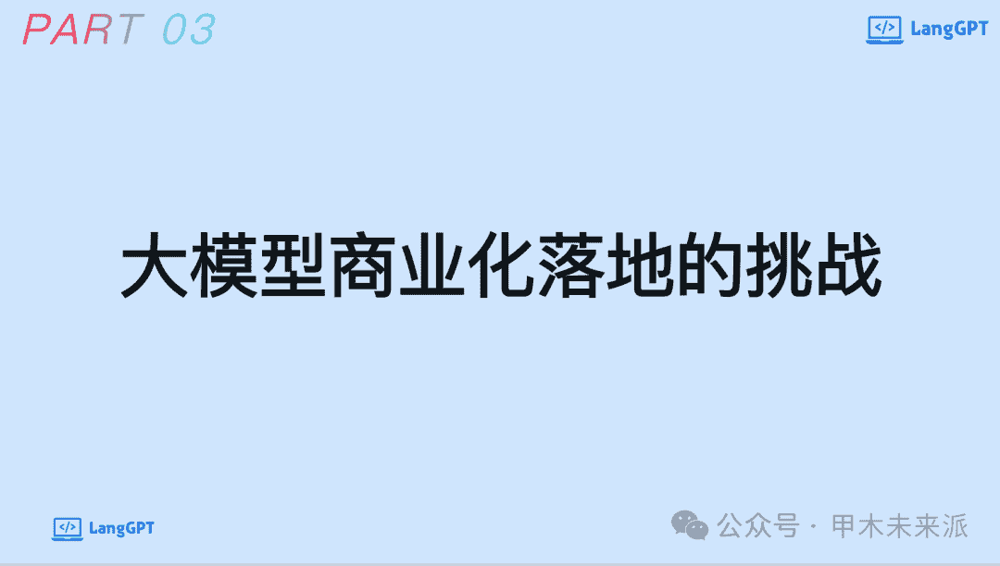

而在商业化落地过程中同样会带来各式各样的挑战。

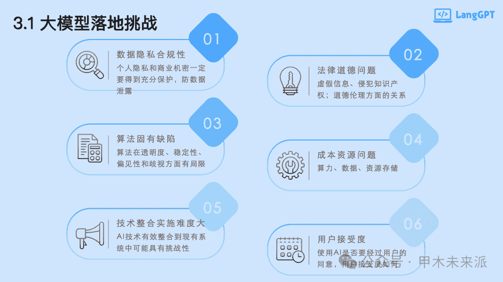

包括但不限于数据隐私与合规性、法律道德、模型准确度、技术整合和实施的难度、成本和资源分配等一系列挑战。

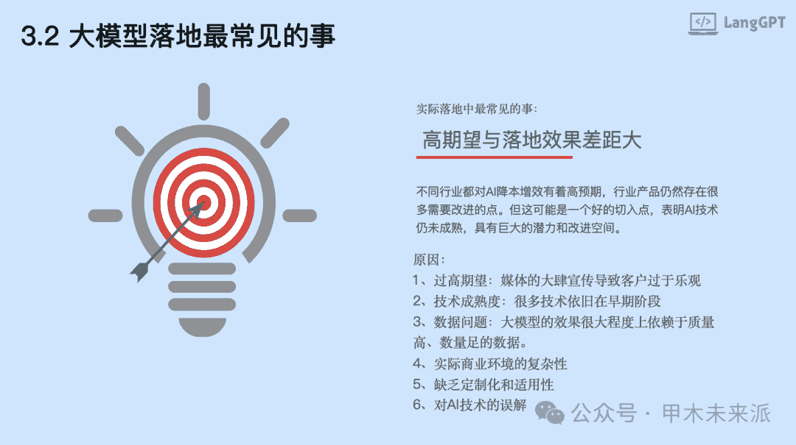

其中最显著的挑战是，不同行业对AI的高期望与实际落地效果之间存在较大差距。

许多行业对AI的预期极高，但实际应用中却常遇到限制，无法完全达到预期效果。这种情况的原因多种多样，包括媒体对AI能力的过度宣传、一些AI技术尚处于发展早期阶段、大模型对高质量和大量数据的依赖、实际商业环境的复杂性，以及客户对AI技术的误解等。这些因素有时会导致看似简单的问题在实际处理中变得复杂。

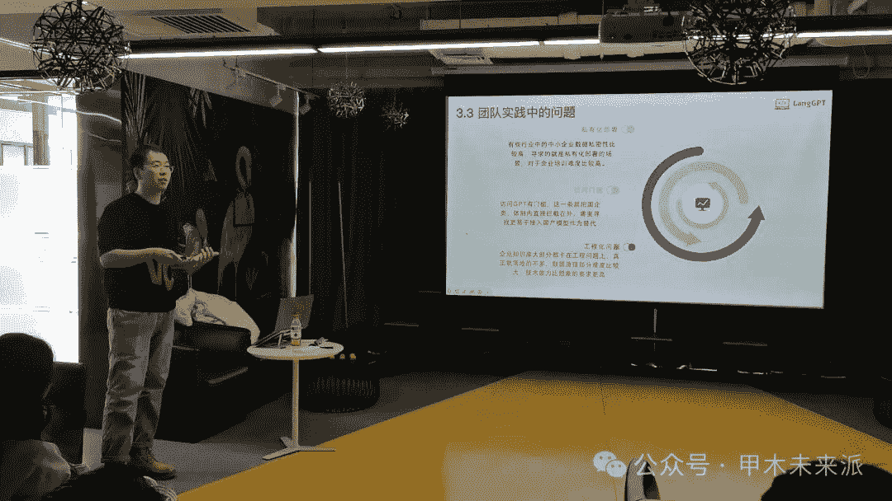

接下来我将分享我们团队在实践中遇到的一些具体问题。

首先是私有化部署的挑战。在许多中小型行业，特别是金融、医疗和法律行业，对数据的私密性要求极高，客户隐私敏感度很高，往往都需要私有化部署的场景，这大大增加了企业培训的难度。

其次，访问GPT有门槛，这一点就把国企类、体制类的合作伙伴直接拦截在外，需要寻找更易于接入的国产模型作为替代方案，比如智谱等。

最后就是工程化落地难的问题，企业知识库大部分都卡在工程问题上，真正能落地的不多，数据清理部分难度比较大，技术能力比想象的要求要更高一些。

这里列举一个企业朋友的诉求，他们希望使用大模型构建AI智能问答机器人，在企业🛰️上当钩子引流用，并实现插件化，以便在企业🛰️中实现闭环操作。因为是金融行业，肯定希望私有化部署，他们还希望利用AI金融服务培训和陪练来赋能员工，提高员工的能力。尽管后两个需求可以通过GPTs或建立RAG来实现，但针对第一个需求，由于他们本身规模不算大，没有一套自己的数字化系统，实际落地的成本可能并不会比传统人力成本节省更多。

当然，这只是我目前的一些初步看法，如果各位有更好的解决方案，欢迎在本次活动结束后进行交流。

## 四、商业化落地的经验分享

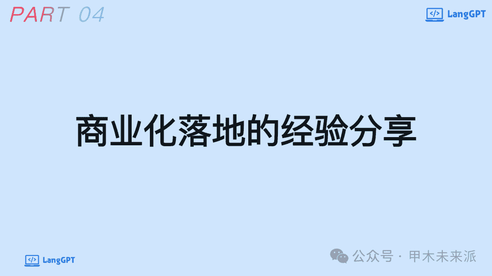

第四个部分我想分享一些有关商业化落地的经验。

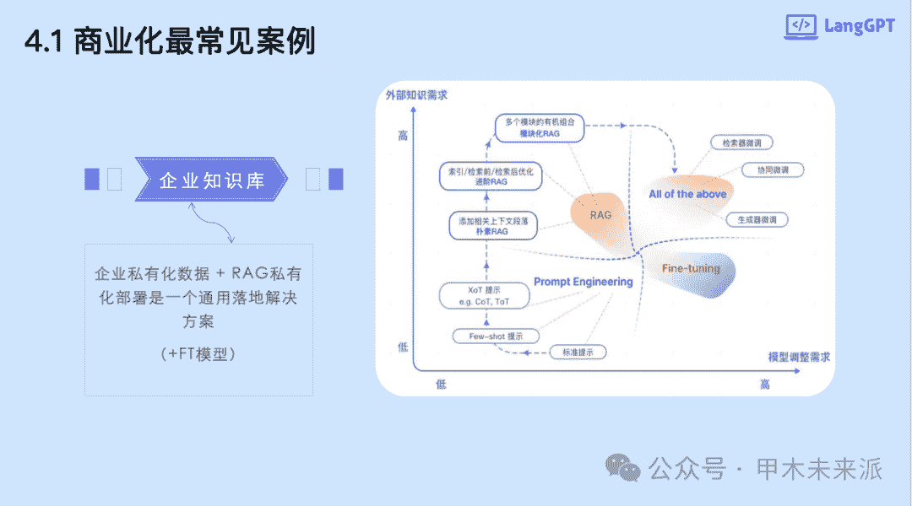

在商业化过程中，构建企业知识库是最常见的需求之一。

一种普遍的解决方案是结合企业私有数据与RAG模型的私有化部署。如有特殊需求，我们还可以进行模型的Fine-tuning（微调），以优化性能。

基础模型主要负责提供推理提示，而RAG则用于整合新知识，实现快速迭代和定制化信息检索。通过Fine-tuning，我们可以增强基础模型的知识库，调整输出，并教授更复杂的指令，从而提高模型的整体性能和效率。这样的联合应用通常能带来最佳性能，适用于多数企业的需求。

而在这个过程中，Know-How很重要！

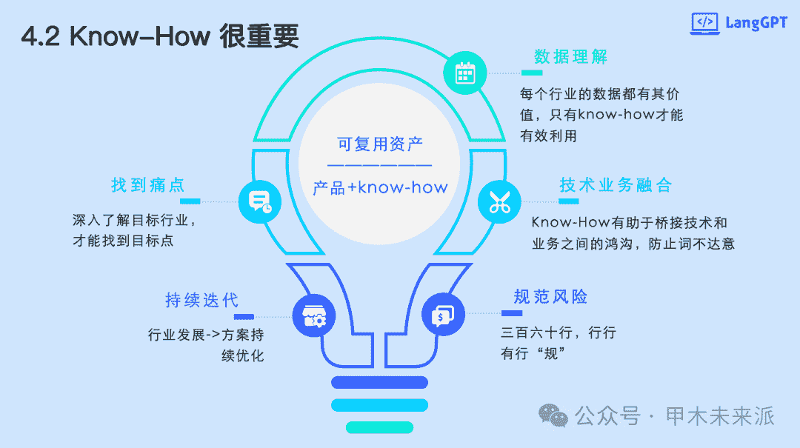

我们想针对不同行业形成一整套打法，然而事实往往事与愿违。

ToB的最大边界在于一套体系其实并不容易打天下，在各自的细分领域，都有卷的空间。

每个做ToB业务的公司都有这么一个公式：

可复用资产/(产品+各类行业的know-how)

通过know-how我们能深入了解目标行业，准确定位到痛点；而在信息时代什么最重要？数据！每个行业的数据都有其价值，只有know-how才能有效利用；

Know-How还有助于桥接技术和业务之间的鸿沟，理解业务目标和流程，确保技术解决方案与业务目标相一致，防止词不达意。

这里举个小例子，说到“系统”这个词，大家往往会想到什么？

作为程序员出身的我，一提到“系统”，第一反应就是指的一整套数字化系统，而对于其他行业却并非如此，之前我跟周易行业的朋友沟通的时候，他就说我们有一套系统，你基于此在这上边构建一套知识库就行，他们指的是这个行业的一套体系化的东西，跟数字化半毛钱关系没有..

同时了解know-how能够让我们了解到行业的风险，防止触碰红线，这个大家懂的都懂哈~

最后随着行业不断发展，客户需求和市场条件也在变化。拥有行业和技术的Know-How有助于持续优化AI解决方案，使之适应这些变化。

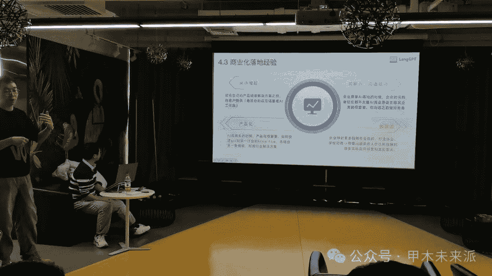

除了know-how之外，再给大家分享一些其他经验。

首先就是要从小做起，在没有自主产品或解决方案之前，我们提供的核心价值在于为客户定制「最适合的应用场景或AI工作流」，并找到真实需求的一个痛点去做小产品或者解决方案；

第二点就是洞察力和沟通技巧，往往一个企业想要AI落地的时候，企业的采购者往往都不太懂AI，这时候用业务语言跟其交流就很重要，在沟通之前做好预先准备，对方属于哪个行业，公司规模如何公司在行业内的排行地位怎么样，对方业务中具体哪些点是可以用AI帮其增效的，材料准备的一定要充分和专业。沟通的时候要接地气，客户案例很重要，很多时候客户并不知道自己想要什么，自己也完全不了解，同时企业采购需要向上汇报审批，帮关键采购者提前准备好材料很重要；

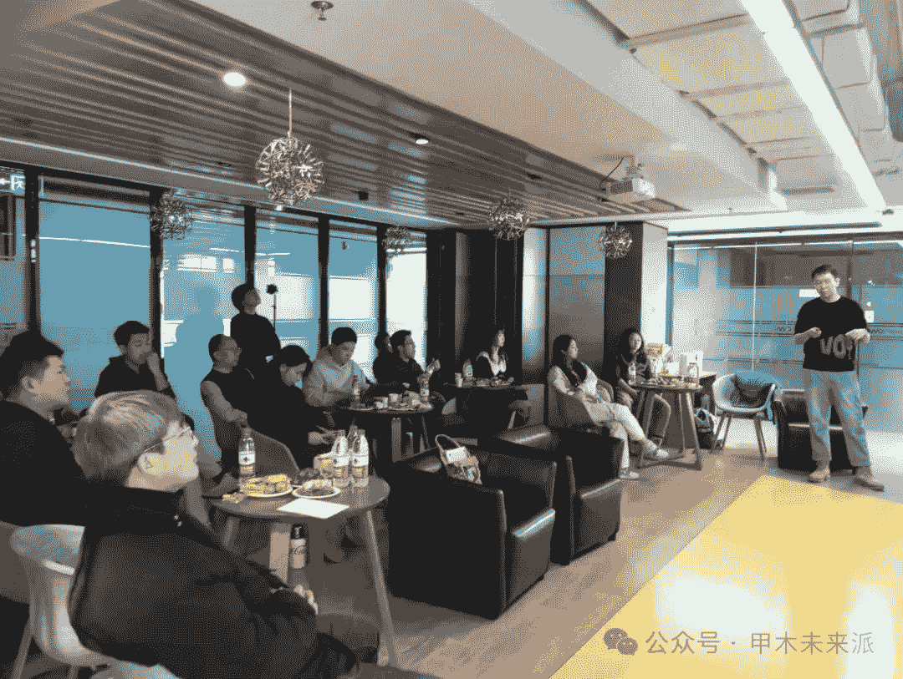

第三点就是要产品化，做AI类服务的时候，优先产品化要比定制化重要很多，快速get某一行业的know-how，总结出来一套模板，形成行业解决方案，同时又能轻易复刻到其他行业，这样的打法非常节约成本；

第四点关于企业培训相关的业务来说，要多思考渠道的问题，与社会组织、行业协会这种团体去对接，有资源的可以链接学校，免费或者微付费去做都可以，慢慢的积累资源，往往这些朋友的资源都非常丰富，同时这些都是精准客资，后续再思考转化的问题，带着问题来的人往往能接触到很多实际应用场景和真实需求。

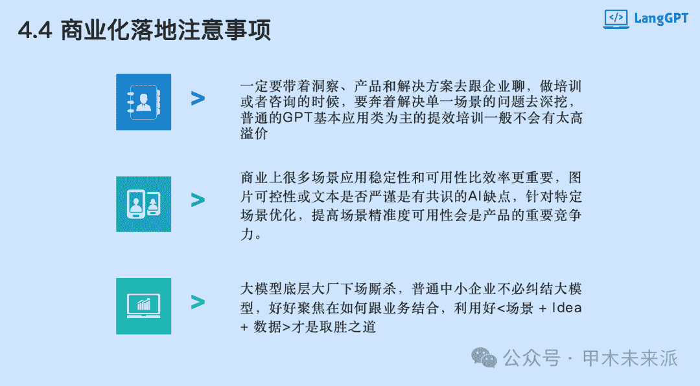

再跟大家分享一些商业化落地的注意事项：

一定要带着洞察、产品和解决方案去跟企业聊，做培训或者咨询的时候，要奔着解决单一场景的问题去深挖，普通的GPT基本应用类为主的提效培训一般不会有太高溢价；

其次商业上很多场景应用稳定性和可用性比效率更重要。图片不可控或文本不严谨是有共识的AI缺点，这个大家在具体的场景中都有过很深的体验，针对特定场景优化，提高场景精准度可用性会是产品的重要竞争力。

现在大模型领域各个大厂都下场厮杀，普通中小企业不必纠结大模型，没有技术底子和资金支持就不要想着自己去搞底层大模型的研发工作，周期长不讨好。好好聚焦在如何跟业务结合即可，利用好<场景 + Idea + 数据>才是取胜之道。

## 五、AI生产力阶段

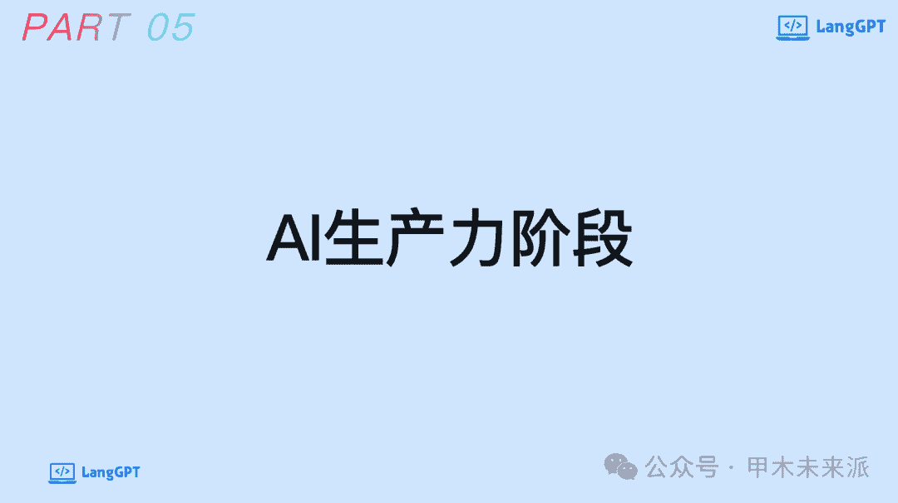

最后一part想跟大家探讨一下关于AI生产力阶段的问题。

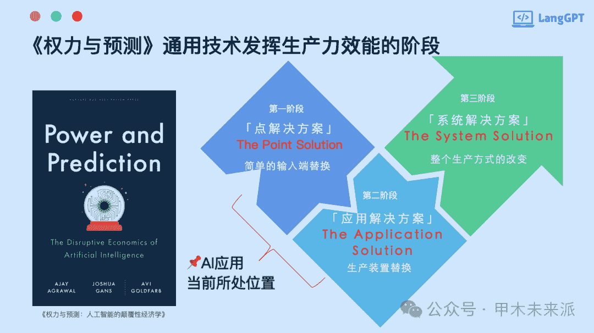

2022年11月份的时候，三个加拿大经济学家出了一本书《权力与预测：人工智能的颠覆性经济学》，这本书认为，通用技术要真正发挥生产力效能，需要经过三个阶段。拿电力取代蒸汽来举例：

第一阶段叫「点解决方案（The Point Solution）」，是简单的输入端替换。

灯泡比蜡烛方便一点，用电力有时候会比蒸汽动力便宜一点，可能会有替换的意愿。你的生活方便了一点点，你的成本降低了一点，但是仅此而已。

第二阶段叫「应用解决方案（The Application Solution）」，是把生产装置也给换了。

以前工厂用蒸汽动力都是一根蒸汽轴连接所有机器，蒸汽一开所有机器都开。改用电力之后，工厂发现如果每台机器都有独立的电源，那就完全可以用到哪台开哪台，更省钱，当然生产装置的内部也都得根据独立电源重新设计。这是需要时间的。

第三阶段叫「系统解决方案（The System Solution）」，是整个生产方式的改变。

蒸汽时代的厂房，建在水源地附近，因为要用到蒸汽轴，所有机器都必须布置在中央轴的附近。用上电力之后可以**随处置办厂房，**随处安装插头，机器可以放在工厂里任何一个位置，那么就可以充分利用空间，没必要把所有机器集中在一起。这就使得「生产流水线」成为可能。这已经不是局部的改进，这要求生产方式和组织方式都得到系统性的变革。

目前，AI的发展正处于这三个阶段的前两个阶段，距离整个生产方式的根本变革还有一段距离，希望我们共同期望能尽快见证着这一阶段的到来！

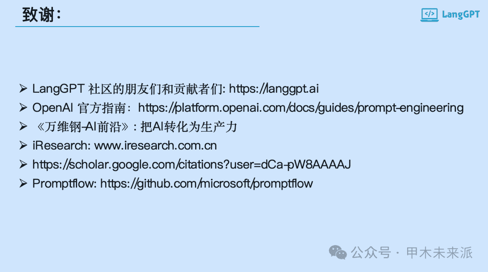

谢谢大家，我的分享完毕，在这个沙龙上，我仅是一家之言，起个抛砖引玉的作用，还希望多听听大家的见解。

# **最后**

感谢各位小伙伴们的支持，才能让我们这个活动办得这么漂亮，从大家的笑容中就能感受到收获满满~

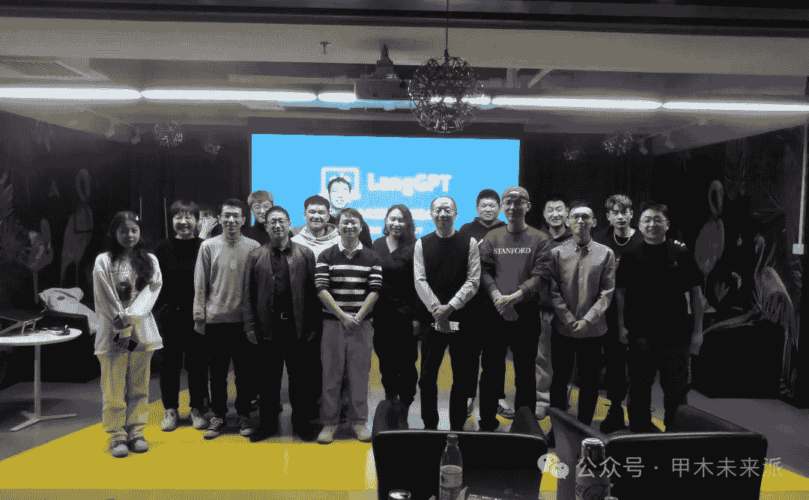

若您也喜欢我们的活动，希望为推动活动质量贡献力量，欢迎联系甲木 （zuiyn_soul），我们需要：

1.  金主爸爸。作为 LangGPT 社区线下的赞助商，赞助活动经费 or 场地。

1.  合作伙伴。有影响力的社区、组织，联名、合作搞活动。

1.  分享嘉宾。作为嘉宾主题分享，不论咖位，内容有深度或有思想均可。

1.  和江树、甲木一起组织活动：

1.  唯一标准：有热情、愿意投入时间精力参与

1.  急需这些朋友：懂活动组织、会设计、会拍照摄影、会主持 任一才能

1.  小姐姐优先（江树说的，你们懂得）

在深圳、上海、广州等地的朋友如果希望也有这类活动，请多多支持，可联系江树，我们需要：

1.  活动组织者

1.  活动嘉宾

具备举办活动条件后，可举办相应的线下活动。