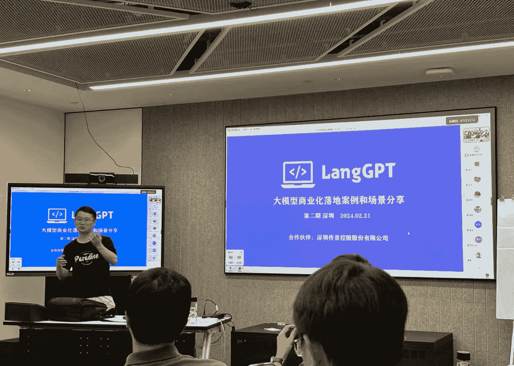
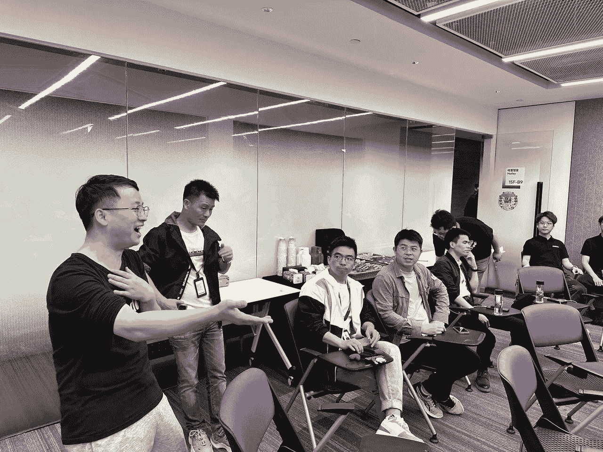
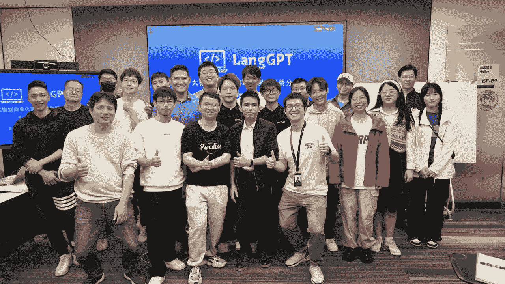

# 大模型商业化落地现状与思考-深圳

> 来源：[https://langgptai.feishu.cn/docx/Y3CqdqauroVomwxWkdHc9rlgnLe](https://langgptai.feishu.cn/docx/Y3CqdqauroVomwxWkdHc9rlgnLe)

# **前言**

活动主题：大模型商业化落地案例和场景分享

时间：2月21日周三晚上19:00~21:00

地点：深圳市南山区打石二路南深圳万科云城六期1栋。云科技大厦，传音控股公司会议室。

合作伙伴：深圳传音控股股份有限公司

活动流程： 主题分享 (50 min) + 自由交流 (70min)

（一）会场签到

（二）主题分享

1.  LangGPT 介绍与提示工程商用案例——云中江树（LangGPT 创始人）

[LangGPT交流-第二期-深圳.pdf](https://langgptai.feishu.cn/wiki/XTcFw6Didi79sAkOPCjcj5FVnFb)

1.  AI 2.0时代，如何拥抱与驾驭大模型？—— 杨芳贤（LangGPT 联创，腾讯云TVP 最具价值专家）

[LangGPT线下分享0221-杨芳贤.pdf](https://langgptai.feishu.cn/wiki/GKgYwrofkiKMQvklv9zcg7vqnRf)

1.  提示词工程师对于 Sora 文生视频模型的思考—— 刘海 （LangGPT 社区成员，提示词工程师）

（三）圆桌交流 (1h)：

1.  自我介绍环节:

1.  自由交流，互相链接

