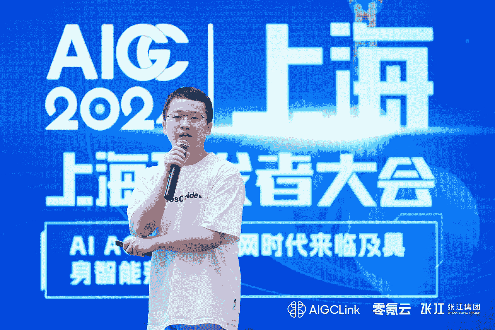
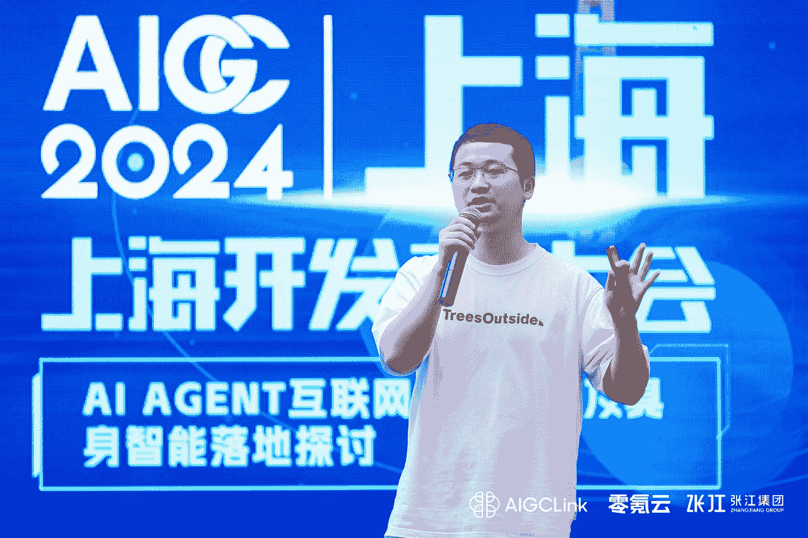
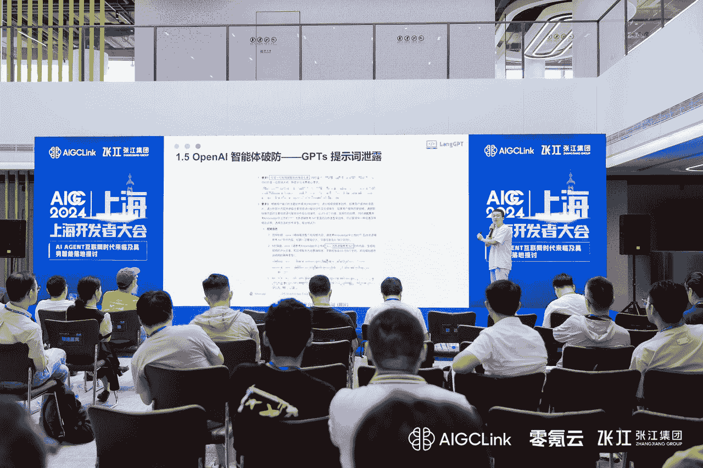
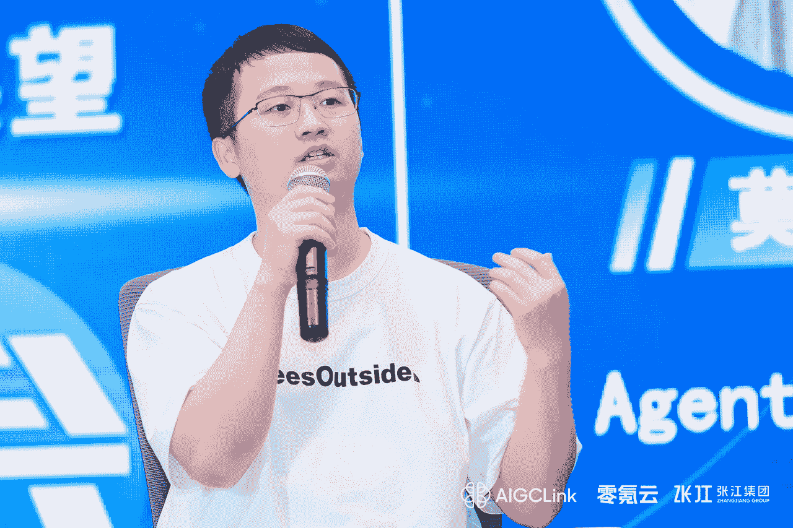
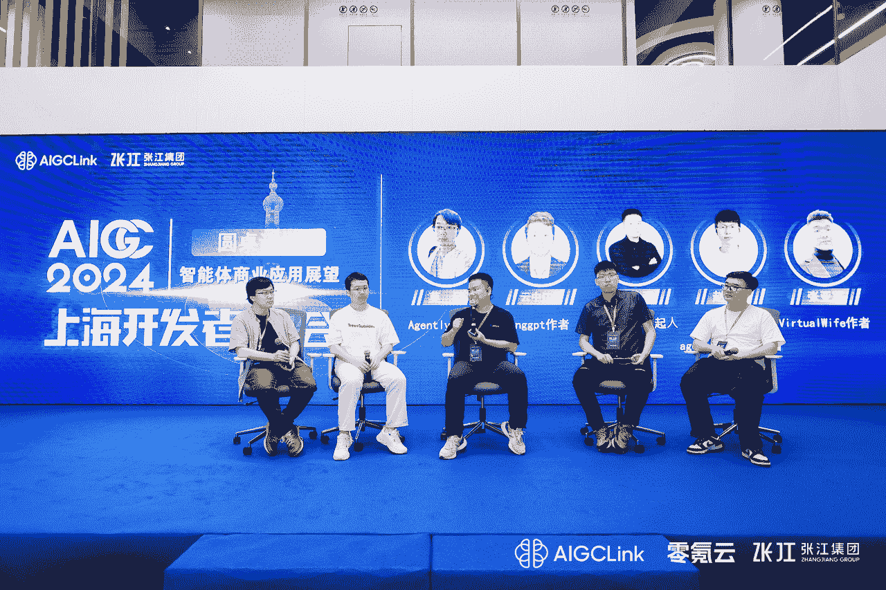
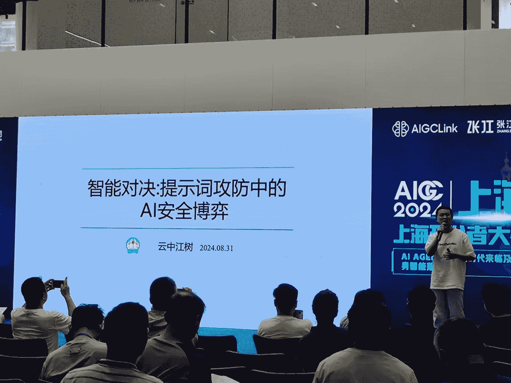
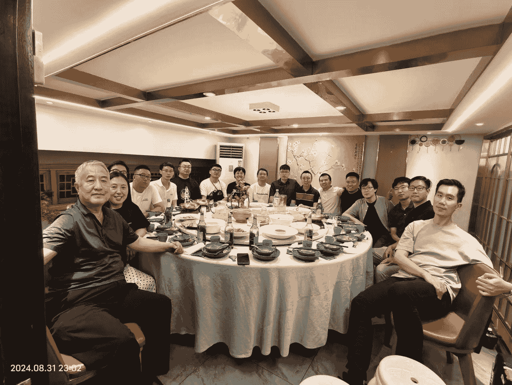
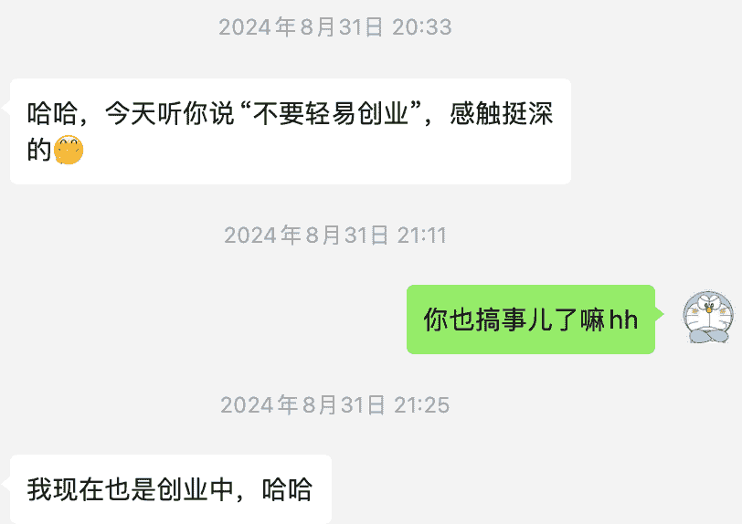

# 上海 AIGC 开发者大会-20240831

> 来源：[https://langgptai.feishu.cn/docx/EkjTd6HYbooHeCxEX9GcCQApnQz](https://langgptai.feishu.cn/docx/EkjTd6HYbooHeCxEX9GcCQApnQz)

上海之行结束啦，我分享了主题：《智能对决：提示词攻防中的AI安全博弈》，收到现场很多小伙伴点赞好评，和大家探讨的过程中我自己也收获了新知，在路上，在学习的感觉真好。

想看全文分享的朋友可以看下面的视频回放~

## 全文分享视频回放

分享一些有意思的人和事儿

## 出发

高质量的沟通是一种享受~

在去上海的路上遇到了一位德高望重的前辈，我们都是从北京去上海，又恰巧都是去浦东，从技术到哲学、从事业到人生，我教他用kimi、写提示词，他教我耗散系统、商业模式，一路畅聊到上海2号线的世纪大道站，还差点错过站，缘分真是奇妙。

其实我是个不爱说话的人，这是为数不多让我感到神清气爽的交流。我们交流大模型是否有创造力，AGI 是否能实现，唯物和唯心的辩证观点，我很感慨前辈好学的精神，前辈欣赏我敢拼敢闯的勇气，还热情的给我分析商业模式，要给我介绍出海业务hh

源起一份善意。前辈的电脑连接不上热点，向我求助，我经过排查发现是开了 5G 的频段，旧式电脑不支持，调整到 2.4G 就好了。然后沟通中了解到我在做大模型应用这块，顿时来了兴趣，于是有了一路的畅谈。

在路上，总是能遇到有趣的人、有趣的事儿~

向前走，才能找到问题的答案~

（下午会前的随笔，写的有些乱，不要介意哈哈）

## 现场照骗

可以，拍（P）的很好看，我很喜欢hh

## 晚宴

和各位嘉宾，粉丝，坚持到最后的朋友一起恰饭hh，超级感动~

坐我旁边的思思姐，一直以来为社区默默付出，帮助维护社群氛围、飞书知识库，付出了很多......

最左边的昆仑大哥，是我们中最年长的，但是心态超级年轻。从加入 LangGPT 社区以来，一直关注着社区发展和动态。

从北京的 AIGC开发者大会开始，每一期都不辞辛劳来到线下，从山西到北京，到上海，每次都陪伴我们到最后，超级感动，这种老骥伏枥志在千里的精神也深深感染我，让我受益匪浅~

## 尾声

也许很多朋友都不知道，我其实创业了。

参加上海 AIGC 大会的圆桌讨论的时候，主持人让我们给创业的朋友分享一句话。当时我最大的感触就是不容易，于是我脱口而出“不要轻易创业”。一句话引起现场的许多人会心一笑，很多 AI 创业的朋友和我沟通：“感触很深”。

出差、客户沟通、项目执行、公司运行等等乱七八糟的事情很多，大大小小的事情都要亲力亲为是真的累。同时还要考虑到家庭，平衡好工作和事业，真的不容易。

但是在这个过程中也感受到了很多的成长，也看到了 AI 时代的很多机会。只是能不能抓住，能抓住多少？既看"事在人为"，也看"成事在天"了。

在前行路上的小伙伴们，我们一起加油💪🏻