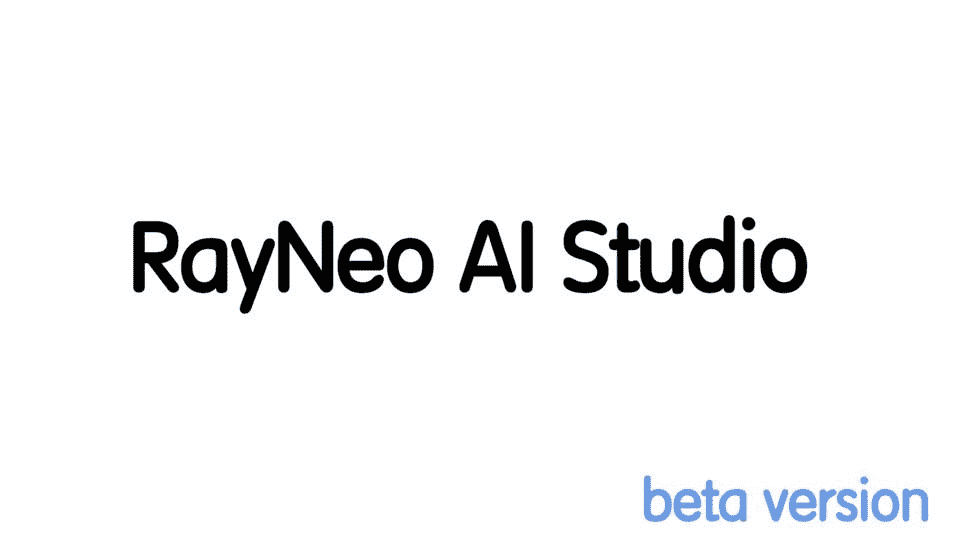
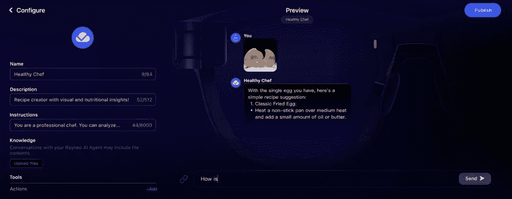

# (已结束)社区活动🔥携手雷鸟创新开启AI Challenge大赛！

> 来源：[https://langgptai.feishu.cn/docx/DWg8dsR75owudwxQ3yzcSUIUnme](https://langgptai.feishu.cn/docx/DWg8dsR75owudwxQ3yzcSUIUnme)

LangGPT的小伙伴们，大家好啊，随着提示工程的不断发展，各位小伙伴们肯定也制作了很多属于自己的GPTs，现在，终于有机会可以把GPTs变成落地应用了！LangGPT社区与雷鸟创新的AI Challenge大赛已经拉开帷幕！🎉 百万奖金！🔥🔥🔥准备好迎接挑战，让你们的创意在智能科技的天空中翱翔了吗？百万奖金池已经准备好，等待着你们的才华和智慧！

🏁 比赛分为两个赛道：

一、面向所有创作者的AI Agents创作赛

二、面向专业开发者的AI应用开发赛

无论你是技术小白还是编程高手，这里都有适合你的舞台。 小伙伴们的创意将有机会被全球用户所体验，你的作品将有机会在「RayNeo AI Store」上线，成为雷鸟AR眼镜用户的新宠。

通过RayNeo AI Studio平台，你可以轻松创造出属于自己的AI Agents，让它们在雷鸟X2 AR眼镜上运行，为生活带来前所未有的便利。🌟 无论是生活中的小助手，还是工作中的得力伙伴，AI Agents都能成为你智能生活的新伙伴。🌟 记住，你的创意，可能就是下一个改变世界的起点。🚀

[RayNeo AI Agents演示.mp4](https://internal-api-drive-stream.feishu.cn/space/api/box/stream/download/all/AiTWbSWV4oyMpoxZJXwcCK9knmc)

🎈 准备好了吗？让我们在LangGPT社区与雷鸟创新的AI Challenge大赛中，一展风采，让世界见证你的创新力量！

## 一、具体赛事相关（**扫码进群报名**）

一场「AI + AR」大赛，两种赛制，百万激励

「RayNeo AI Studio」即日上线，同时全**球首届「AI + AR」**大赛也正式开始，比赛总激励高达100万元。

所有的创作者都可以基于「RayNeo AI Studio」平台调试输出适用于 AR 眼镜的 AI Agents，优秀作品后续都有机会上线「RayNeo AI Store」，给更多雷鸟 AR 眼镜用户体验。

如果有开发者觉得这个赛道相对简单，没关系，我们还有专业赛道。

开发者可以基于 AI 接口及 RayNeo ARDK 开发 AI 相关的 AR 眼镜应用，该赛道第一名最高可获得1万美金奖励。

## 二、「RayNeo AI Studio」介绍

> 这也是全球首款针对 AR 眼镜的 AI 开发平台。

该平台具备多模态识别、知识库索引、实时在线联网数据源、文生图等 AI 能力，具备强大的创作扩展性，此外还兼容 ChatGPT Action 配置，支持 GPTs 的快速迁移。同时，结合 AR 眼镜的摄像头、麦克风等设备，可以轻松让用户通过 AR 眼镜实现更直观的 AI 交互体验。

**它**没有任何技术门槛，每一个人，哪怕只是用一句简单的话，都能快速生成一个 AI Agents ，轻松做出属于自己 AR 眼镜独有的 AI 应用。

**「RayNeo AI Studio」所生产的 AI Agents 是一种能够感知环境、进行决策和执行动作的智能体**。它能够针对目标独立思考并做出行动，它会根据给定任务详细拆解出每一步的计划步骤，依靠来自外界的反馈和自主思考，实现目标。

**简而**言之，「RayNeo AI Studio」所生产的 AI Agents 可以模仿人类的主观能动性，有目的地进行「计划」、「组织」、「实施」、「学习」等行为，直至完成一项工作或目标。

举个例子，如果你想让 AI 大模型给你买一件衣服，AI 大模型只能给出诸如「我只是一个文字 AI 助手，无法购买衣服」等回答。

但如果你在「RayNeo AI Studio」平台上生成了一个特定的 AI Agents。你可以通过 AR 眼镜拍摄你眼前的商品，除了让商品信息、评价、价格等显示在你眼前，它还能基于设定好的目标进行拆解，分析如何才能为你买到全网最便宜的同款，并输出对应的决策方案，如搜索全网价格、选择下单、支付等，然后按照这些步骤进行操作，过程中，无需我们去指定每一步操作。

或者，当我们在外收到邮件通知时，除了在 AR 眼镜前显示邮件内容外，还可以通过生成好的 AI Agents ，口头描述回复内容，并由该 AI Agents 自动归纳整理回复；如有会议还一并设置在我们的日程中，大大简便了我们的工作和生活。

这就是 AI Agents 的强大，简单到用一句话，复杂到你给他「喂」一些数据和资料，它都能快速帮你完成你所需要的目标。

我们希望，借助「RayNeo AI Studio」，像 coolwulf 这类的「业余程序员」能越来越多，借助「AI + AR」，给用户带来更多生活上的便利。

所有的创意都不应该停留在想象层面，技术虽然无声，但我们可以从中感受到改变世界的力量。

## 三、软硬结合，能力升维

1955年8月31日，研究者们提交了一份关于「两个月，十个人共同研究人工智能（AI）」的研究计划。第二年，通过了这一份研究计划的学术会议正式在达特茅斯大学举行。但遗憾的是，他们对自己研究项目的时间表太过乐观了。在研究计划中他们写到「我们以为，如果细心地选择一群有能力的科学家一起工作一个暑假，就可以达成划时代的学术突破」，但是事情比他们预想的要更加耗费时间。

但也正是从那时开始，AI 正式诞生了。历史的车轮滚滚向前，技术的发展永不停歇，相比于过去，今天的 AI 技术发展不再停留在应用层面，而是在这个时代找到了自己的最佳硬件载体，AI 技术也处于剧变的节点。借助「RayNeo AI Studio」平台，每一个人都可以快速生成和AR眼镜相结合的 AI Agents，软硬件的结合，也让能力得到了升维。

在之后极长的时间里，「AI + AR」都是未来科技的主旋律，我们希望人人都是这个时代里的超级英雄。

## 四、**关于雷鸟创新**

雷鸟创新成立于2021年10月，由TCL电子（01070.HK）孵化，公司核心团队来自腾讯、大疆、Meta、OPPO、爱奇艺，以及各类新锐创业公司，在近眼显示光学设计、自研AI算法模型，以及多模态人机交互等领域拥有深厚积累，并且在供应链及生产工艺方面具有较高水平。

2023年，雷鸟创新在半年内完成两轮融资，并发布全球首款消费级真AR眼镜「雷鸟X2」，这也是业内首款发布和量产的双目全彩MicoLED+光波导AR眼镜。

多家第三方机构数据显示，2022年Q4至2023年Q3，雷鸟创新在国内消费级AR眼镜主要线上平台市场份额已连续四季度位居中国第一。

3 月 4 日，消费级 AR 品牌雷鸟创新宣布完成新一轮过亿元融资，本轮融资由华泰紫金、燕创基金等多家机构联合投资。据悉，融资金额将用于新一代消费级 AR 眼镜的技术研发、量产和市场普及，以及推动 AR+AI 眼镜生态建设。