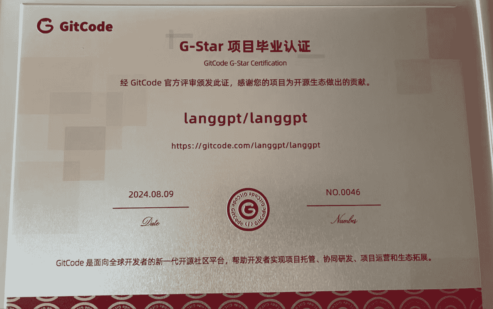
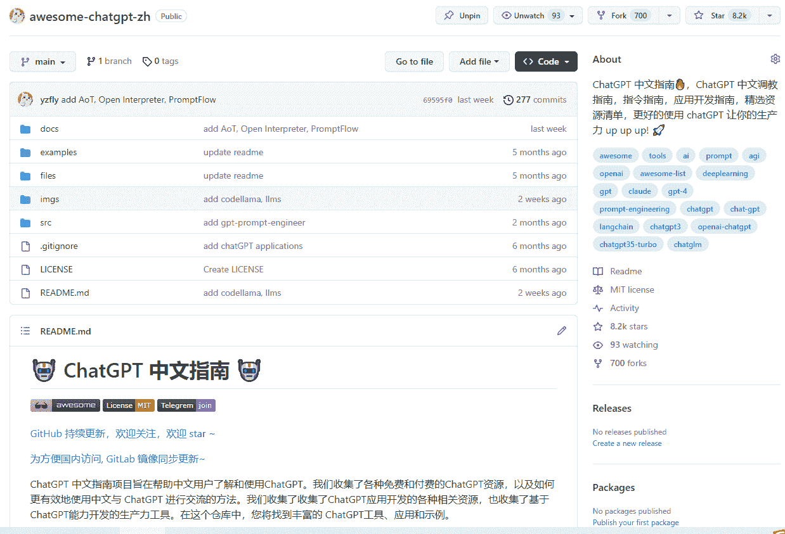
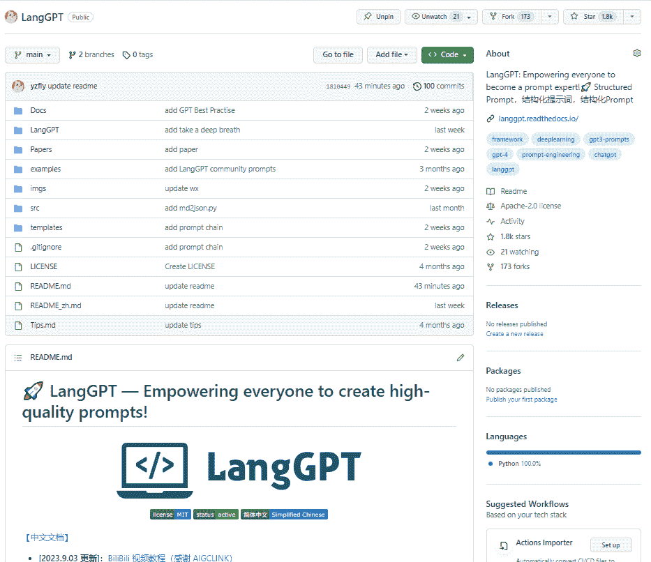
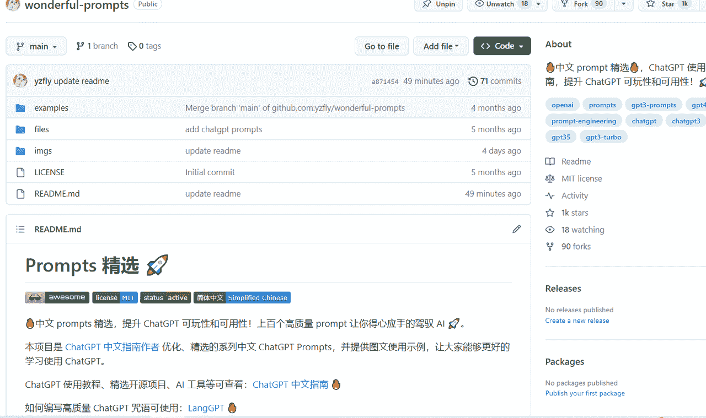
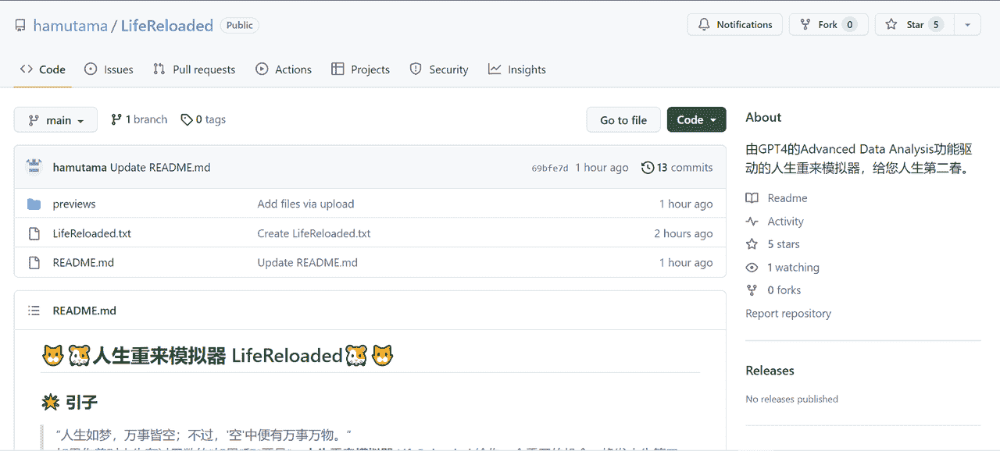
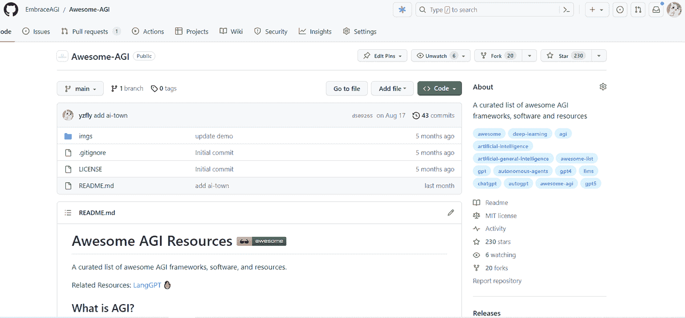
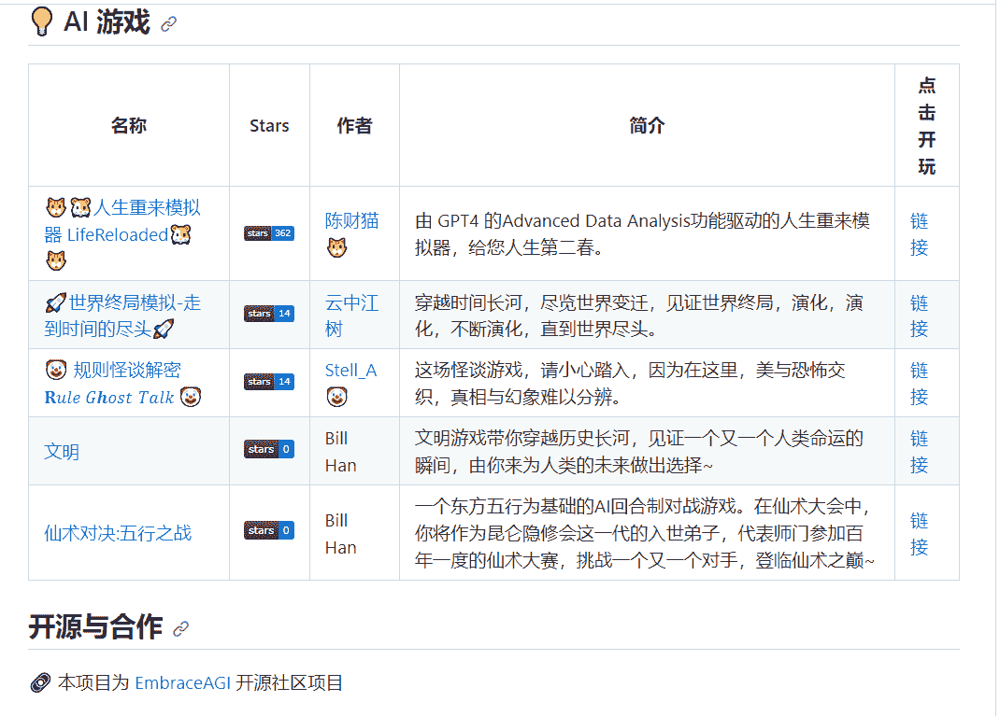
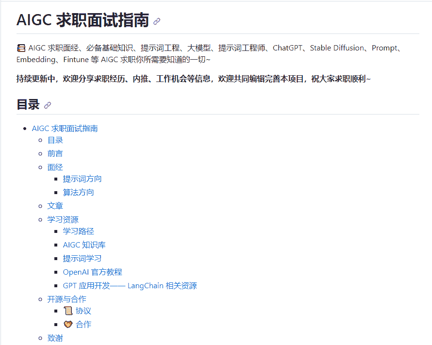

# 🌐 社区开源项目

> 来源：[https://langgptai.feishu.cn/docx/Evf9dSSqFoaY2sx8lGRcXIE4nyE](https://langgptai.feishu.cn/docx/Evf9dSSqFoaY2sx8lGRcXIE4nyE)

**社**群开源项目合集，欢迎多多 Star !

## 所获荣誉

GitCode 平台 G-Star 明星项目

## ChatGPT 中文指南 （1w+ ⭐）

https://github.com/yzfly/awesome-chatgpt-zh

## 结构化提示词 LangGPT  (9k+ ⭐)

> https://github.com/yzfly/LangGPT

## 中文 prompts 精选 (1k+ ⭐)

> https://github.com/yzfly/wonderful-prompts

## 人生重开模拟器 (600+ ⭐ )

> https://github.com/hamutama/LifeReloaded

## Awesome-AGI (200+ ⭐)

> https://github.com/EmbraceAGI/Awesome-AGI

AGI 精选资源、项目， Agents 开源项目精选

## Trickle-On-WeChat  (50+ ⭐)

> https://github.com/PromptExpert/Trickle-On-WeChat

在🛰️端使用类似Trickle的图片信息识别和提炼，并进行图片信息管理的功能，思路简介：https://mp.weixin.qq.com/s/Q9ubSQHhEgpn2Yf6ndoi5w

## AIGG(GPT 驱动的 AI 游戏)  (200+ ⭐)

> https://github.com/EmbraceAGI/AIGoodGames

欢迎一起参与，分享你的 AI 游戏

## [**AIGC 求职面试指南**](https://github.com/EmbraceAGI/AIGC_Interview#aigc-%E6%B1%82%E8%81%8C%E9%9D%A2%E8%AF%95%E6%8C%87%E5%8D%97)**  (400+ ⭐)**

> https://github.com/EmbraceAGI/AIGC_Interview

AIGC、提示词工程师学习路径、求职面经

