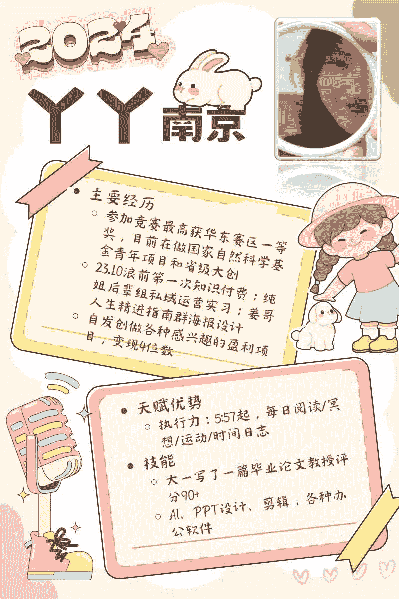
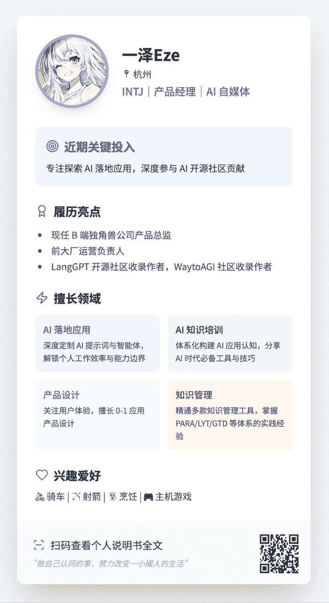
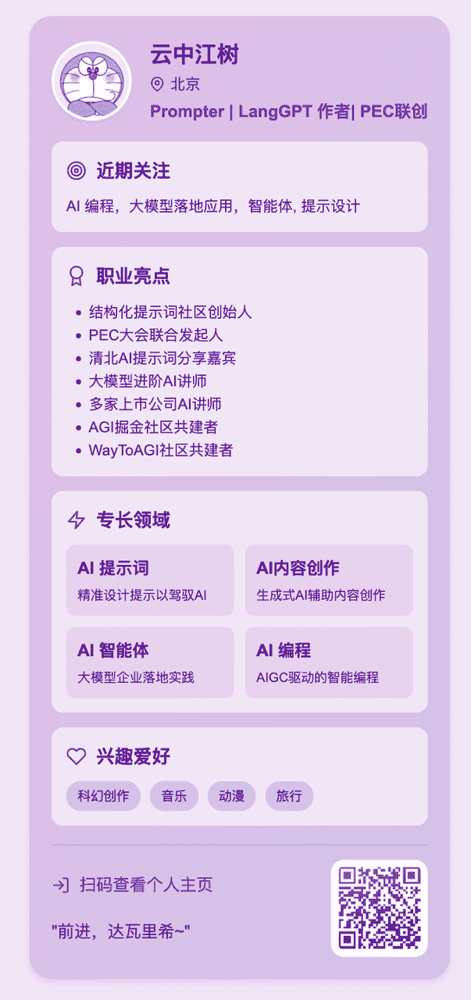
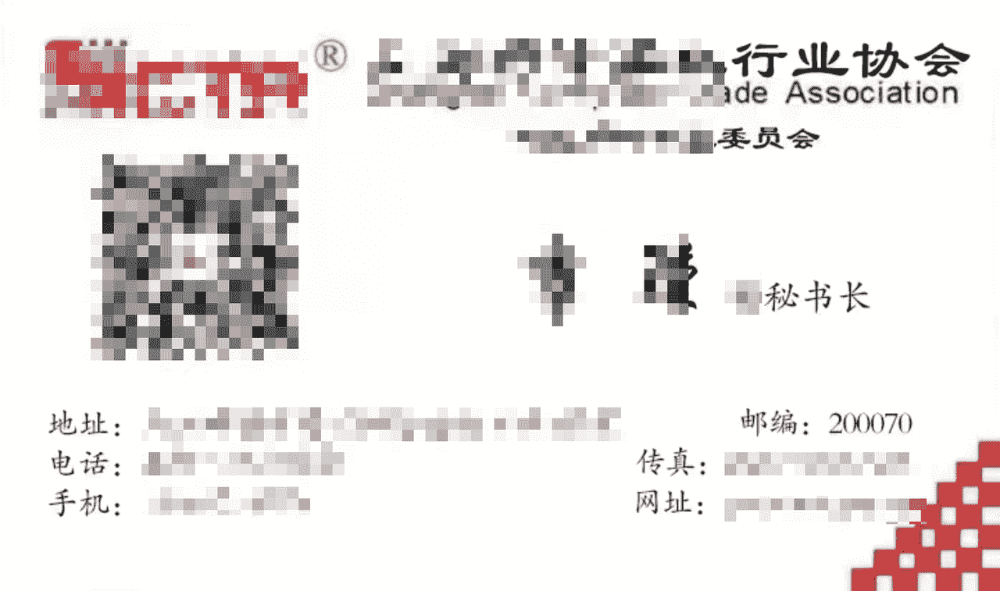

# 怎么做自我介绍？

> 来源：[https://langgptai.feishu.cn/docx/E3JTd37dDow0SUxFYVFcpBQRnpf](https://langgptai.feishu.cn/docx/E3JTd37dDow0SUxFYVFcpBQRnpf)

进群请做自我介绍，好的自我介绍是友好交流的第一步~

1.  大佬请随意，如罗永浩，不需要自我介绍，都认识......

1.  如果彼此不认识，自我介绍是让人认识你的一个契机，核心以说明清楚“你是谁”这一问题，可以参考下面的优秀案例。

## 社区优秀案例

### 文字风

```
【姓名】xxx
【所在城市】北京
【职业】xxx
【我的标签】篮球爱好者、ENFJ、轻食创业者
【兴趣爱好】篮球、新能源汽车、前沿事物、摄影、羽毛球
【目前正在做的是/资源】
1、AI 绘画
2、AI 提示词
3、xxx
【个人经历、成绩】
1、xxx
2、xxx
【我的需求】
1、结交志同道合的新朋友
2、xxx
【可以提供】
1、学校优秀资源
2、xxx
```

### 海报风

[AI 高颜值社交名片](https://langgptai.feishu.cn/wiki/WG7OwFMcOi1GQ1kHIsjctEUnnC1) AI 一键制作可以参考社区文档







### 商务风



### 文档风——个人使用说明书

<https://www.feishu.cn/community/article?id=7380053495614799876>