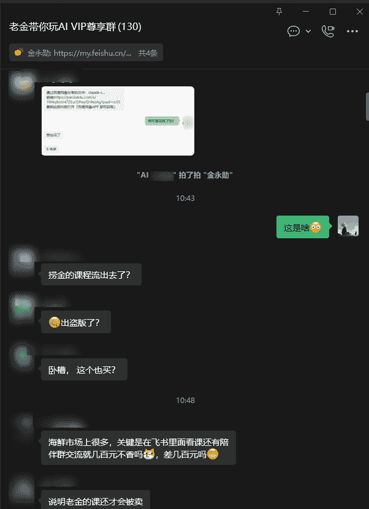
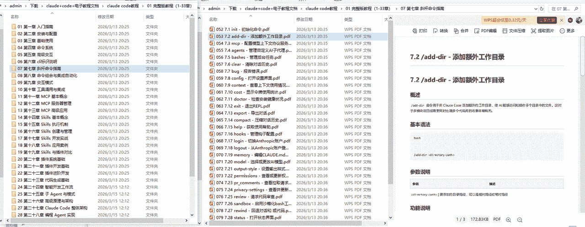
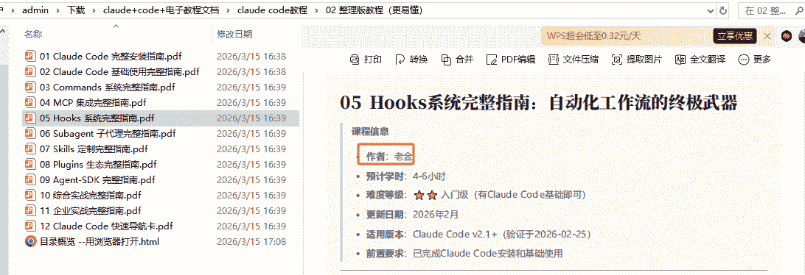
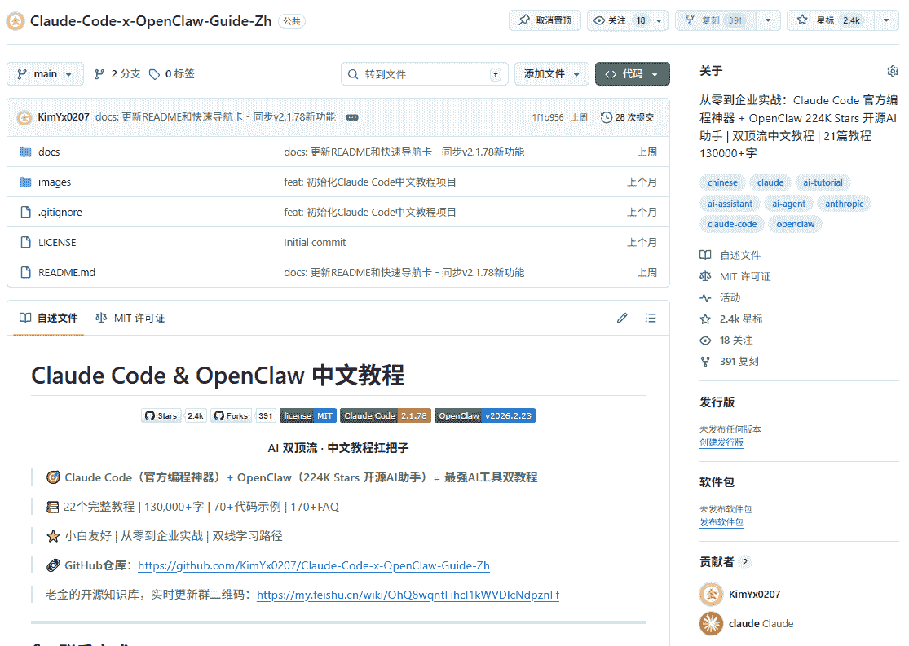
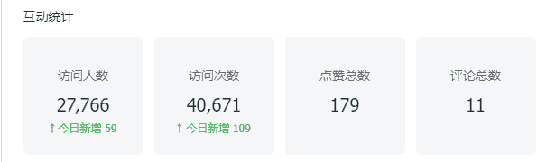
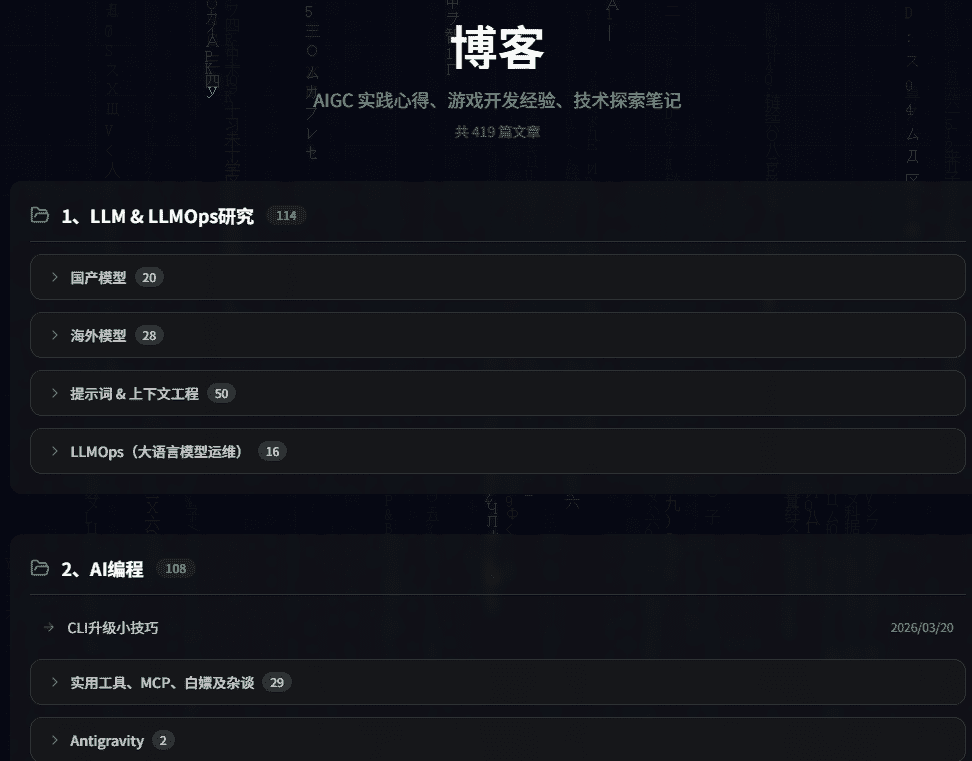

# 我的Claude Code和小龙虾的全中文开源教程，被人卖8块8了，不知道该哭还是该笑

> 来源：[https://my.feishu.cn/docx/RIbNdOCZ7oNxEqxQ1UOcN40mnfh](https://my.feishu.cn/docx/RIbNdOCZ7oNxEqxQ1UOcN40mnfh)

来源是我学员发来的一个网盘截图。

我下载一看，好家伙——美化成了PDF，而且很大概率他可能真的学的比我的学员还好。

因为他把细节全给我拆碎了，真是细节中的细节。

然后吧。。。还赫然写着"老金"的署名。

你们品品这个画面，人家搬你的内容，还帮你署名了。

说实话，这个署名其实没毛病。

这套教程用的是"MIT许可证"（一种开源协议，允许自由使用但必须保留原作者名字）。

但对方显然不知道这层，稀里糊涂地把"老金"俩字也一并打包进去了。

**都不知道该说他敬业还是业余。**

## 第一反应：苦笑

说明啥？说明教程有价值啊。

能被人盗版，能被人美化，能被人署名——说明确实有人需要这个内容。

开源作品被人拿去变现，这事儿在程序员圈子里不算稀奇。

但这次不太一样。

## 不是愤怒，是焦虑

不是因为钱的事。

8块8，卖不了几份，我能挣几个钱？

是一种说不清的焦虑。

老金我琢磨了半天，才想明白这焦虑从哪来：

**我不知道他卖的是哪个版本。**

## 版本迭代，血泪史

这套教程走到今天，经历了4个版本迭代。

v1.0是2026年2月11号发布的，说是v1.0，其实就是个初版。那时候写得急，有些地方没说清楚，有些代码示例有bug，还有些配置方法已经过时了。

**v1.0确实有不少错误。**

后来陆续收到读者反馈，慢慢修正，才有了v2.0、v3.0。

v3.0的时候把两套教程合二为一了——之前Claude Code和OpenClaw是分开的，后来发现很多场景都是一起用的，干脆合并了。

最新是v3.1，2026年3月18号刚更新，支持的是Claude Code 2.1.78和OpenClaw v2026.2.23，内容比v1.0完善了不知道多少。

## 所以你懂我焦虑啥了吧

如果那个老哥打包的是v1.0版本，那买到的读者可就亏大了。

初版的那些错误还在，配置方法过时，代码跑不通——

花8块8买了一套带bug的教程，这不是冤大头吗。

最怕的是他们把这个怪到我头上。。可是我是实实在在在更新最新版 = =

还有我作为一个认真写教程的人，看到有人花冤枉钱买了错误版本，心里确实不是滋味。

## 不是来卖惨的

这个放到网盘卖的老哥，我也不知道是谁。

可能就是个普通的知识付费中间商，看网上有免费资源，顺手打包卖一波，赚个信息差。

**说不上是敌人，就是个不懂行的。**

不懂啥呢？不懂这教程已经更新到v3.1了。

不懂v1.0那些坑早就填上了。

## 我想要的不多

如果你不幸买了那个盗版包，没关系，亏不了几个钱。

**但你值得拿到最新最全的版本。**

最下面地址栏里，不论我的Github，还是飞书开源知识库里都有最新版。

顺手帮我star一下，让更多人能看到。

免费的，有问题还能提issue，老金我看到会回。

## 写给认真想学的你

**如果你正在考虑要不要买那个8块8的包**——别买了。最新版免费，路径我下面给了。

如果你已经买了——也别觉得自己傻。

8块8不算多，就当是提前预习了。

但接下来，请用免费版对照一下，看看你手里的版本是不是最新版。

**不是的话，换新版。**

## 心态问题

开源作品被人拿去变现这事，说大不大，说小不小。

往大了说，确实有点膈应人。

往小了说，人家愿意花钱买，说明教程确实有价值。

而且你看——**人家还帮你署名了呢。**

从这个角度看，好像也不是坏事。

老金我的态度是：开放心态，但不无底线。

底线就是——别让认真学习的读者花冤枉钱。

至于署名这件事——随他去吧，反正名字是我的，谁也拿不走。

GitHub上那个仓库和飞书知识库，我会继续维护。

读者反馈的问题，我会继续修。

Claude Code和OpenClaw有新功能，我会继续更新。

再次求个免费的Github的星星，让更多人看见。

如果你上不去Github，也可以在下面的飞书开源知识库里找。

飞书开源知识库里是我完整的更大范围的文章列表。

访问量是这样一个级别。

共计文章数量在我的小破站会实时统计到。

目前为止419篇。

**开源这件事，我会一直做下去。**

比如你还可以在我的Github或者小破站里看到我推荐的我的开源工具。

其中findskill和anyrouter这俩改编于其他作者，剩余都是我自己的。

至于有没有人来盗版——来了就来吧。

毕竟能被人盗版，还被人署名，也算是一种认可。

<https://my.feishu.cn/sync/HDlcdCPBksnJpBbRk0EcW364nmc>