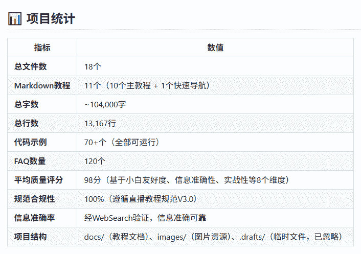
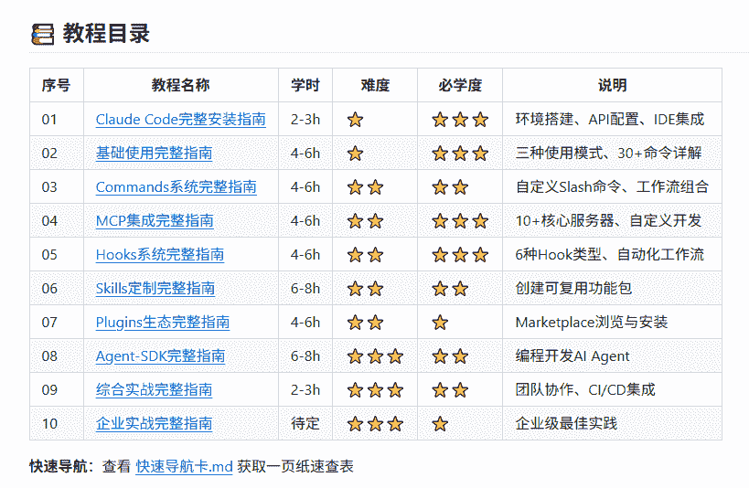
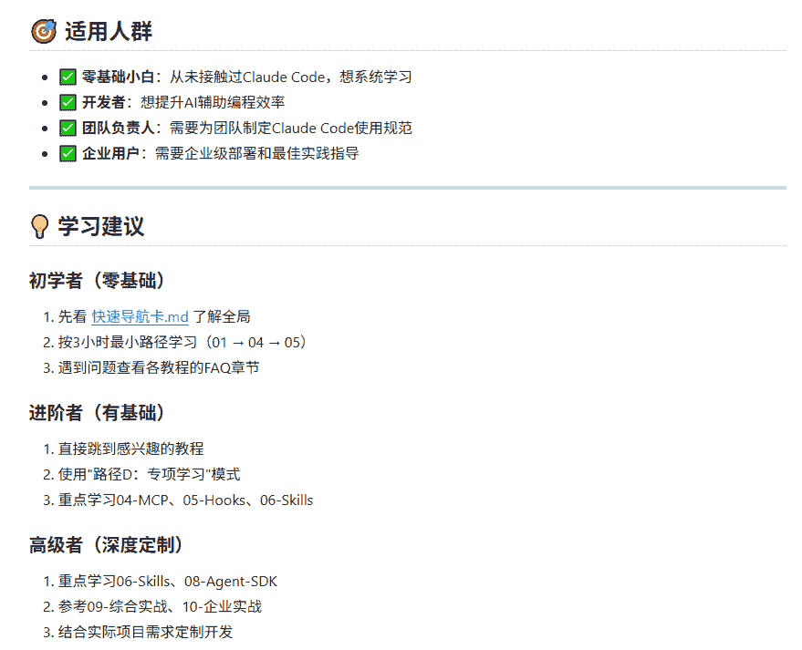

# 老金开源10万字Claude Code中文教程，零基础到企业实战完整路径

> 来源：[https://my.feishu.cn/docx/HZGidLEWfoBzvextlLycblUynSd](https://my.feishu.cn/docx/HZGidLEWfoBzvextlLycblUynSd)

老金我憋了 **3个月**，终于把这个 **10万字** 的 **Claude Code** **中文教程 **整出来了。

C**laude-C**o**de-Guid**e**-Zh，10个**完整教程、70+代码示例、120个FAQ，全部免费开源。

这是老金我送给大家的 **新年礼物**。

而且，**过年期间老金我还**会开源一个 重磅的Agent Team Skill，让 多Agent协作 变得像说话一样简单。

本着一个初衷：让更多人领略到 **AI** 带来的变化。

写完之后老金我自己都觉得累。

## 为什么要搞这个教程

说实话，老金我用 **Claude Code** 用了大半年，踩了无数坑。

中文资料太少，官方文档全是英文，很多功能根本不知道怎么用。

每次遇到问题，要么去 **Discord** 翻半天，要么自己瞎摸索。

老金我就想，这不行啊。

这么好的工具，因为语言障碍被挡在门外，太可惜了。

**所以决定把**自己的学习笔记整理成 系统化教程，免费开源给大家。

**最重要的是什么？**

老金我不想搞那种"从入门到放弃"的流水账。

而是真正按照学习曲线来组织内容，零基础的人能看懂，有经验的人也能找到进阶内容。

**这个**教程的结构设计，老金我改了至少 5遍。

## 10万字都写了啥

先说数据。

**10万字**，不是那种凑字数的水文，而是真正的系统化内容。

**10个完整教程**，从零基础到企业实战，每一步都有详细说明。

**70+代码示例**，不是那种"自己看着办"的伪代码，而是可以直接跑的完整案例。

**120个FAQ**，基本上你能想到的坑，老金我都踩过了，这里都有答案。

**老金我**粗略算了一下，这个工作量至少得 3个月。

更关键的是，这个教程的 **平均质量评分达到98分**。

老金我按照 **小白友好度**、**信息准确性**、**实战性** 等8个维度严格打分。

而且所有信息都经过 **WebSearch验证**，确保准确可靠。

第一部分是 **基础入门**，教你怎么安装配置 **Claude Code**。

这部分老金我写得特别细，连 **Windows** 和 **Mac** 的差异都考虑到了。

因为老金我知道，很多人就是卡在安装这一步就放弃了。

第二部分是 **核心功能**，包括代码生成、重构、调试这些日常操作。

每个功能都有详细的使用场景和最佳实践。

比如代码重构那一章，不仅教你怎么用，还告诉你什么时候该用、什么时候不该用。

第三部分是 **进阶技巧**，**Skills**、**Hooks**、**MCP服务器** 这些高级功能。

这部分是老金我最喜欢的，因为这些功能能真正提升效率。

教程里不仅有理论讲解，还有实际案例，看完就能上手。

第四部分是 **企业实战**，团队协作、**CI/CD集成**、安全规范这些。

这部分对于想在公司推广 **Claude Code** 的人来说特别有用。

老金我把自己在团队里推广的经验都写进去了。

## 4种学习路径，总有一种适合你

老金我设计了 **4种学习路径**，不同基础的人都能找到适合自己的方式。

**路径A：快速上手**（3小时）

适合零基础小白，只学最核心的功能。

第一步学安装配置（60分钟），第二步学MCP集成（30分钟），第三步学Hooks系统（30分钟）。

3小时就能上手，能用 **Claude Code** + 能用 **MCP** + 能用 **Hook**。

**路径B：完整学习**（24-34小时）

适合想系统掌握的人，按周学习，6周搞定。

从安装指南到Agent-SDK，每个教程都完整学习。

**路径C：问题排查**

遇到问题直接查FAQ，120个问题基本覆盖所有坑。

**路径D：专项学习**

有基础的人直接跳到感兴趣的教程，重点学习MCP、Hooks、Skills。

## 70+代码示例有多实用

代码示例是这个教程的另一个亮点。

不是那种"**Hello World**"级别的玩具代码，而是真正能解决实际问题的案例。

比如有一个示例是用 **Claude Code** 重构遗留代码。

从分析代码结构，到制定重构计划，再到具体实施，每一步都有详细代码。

老金我自己就是用这个方法重构了好几个老项目。

还有一个示例是配置自定义 **Hooks**。

这个功能老金我之前研究了好久才搞明白。

现在把完整代码和注释都写进教程了，你们可以直接拿去用。

**最实用的是什么？**

每个代码示例都有详细注释，不是那种"自己看着办"的风格。

而且还有常见错误提示，告诉你哪些坑要注意。

老金我觉得这个设计特别贴心，能省很多踩坑时间。

## 120个FAQ都是真实踩过的坑

**FAQ** 部分是老金我花时间最多的。

因为这些问题都是老金我实际使用中遇到的，不是那种"理论上可能"的问题。

比如"为什么 **Claude Code** 总是超出上下文限制？"

**这个问题老金**我之前也被折磨过，教程里给出了 5种解决方案。

从调整配置到优化提示词，每种方法都有详细说明。

还有"怎么在团队中推广 **Claude Code**？"

这个问题对于想在公司用 **Claude Code** 的人来说特别实用。

教程里不仅有技术方案，还有说服管理层的技巧，很接地气。

老金我粗略统计了一下，这 **120个FAQ** 覆盖了安装配置、日常使用、进阶技巧、团队协作四个方面。

基本上你能想到的问题，这里都有答案。

## 开源的初衷

老金我为什么要开源这个教程？

说白了，就是想让更多人领略到 **AI** 带来的变化。

**Claude Code** 是个好工具，但中文资料太少，很多人想用但不知道怎么入门。

老金我就想，既然自己踩过这些坑了，为什么不把经验分享出来？

让后面的人少走弯路，这不是挺好的事儿吗。

而且开源之后，社区可以一起完善，教程会越来越好。

**最打动老金我的是什么？**

我的开源知识库访问量已经越来越大了。

**看到大**家真的在用，老金我觉得这 3个月 没白费。

## 过年期间的重磅礼物：Agent Team Skill

对了，老金我过年期间还会开源一个 重磅的Agent Team Skill。

这个 **Skill** 可以让 **Claude Code** 的 **多Agent协作** 更简单，一句话就能自动组队。

**手动挡时代** 要结束了，**自动化编排** 才是未来。

这也是老金我送给大家的 **新年礼物**。

**希望**能帮助更多人提升开发效率，让 AI 真正成为你的编程伙伴。

## 老金我的建议

如果你想学 **Claude Code**，这个教程是个很好的起点。

零基础的人可以从头开始看，有经验的人可以直接跳到进阶部分。

**教程结**构清晰，内容详实，代码示例实用，FAQ 覆盖全面。

老金我建议你先把基础教程过一遍，然后跟着代码示例动手实践。

遇到问题就去 **FAQ** 里找答案，基本上能解决 **90%** 的问题。

等基础打牢了，再去看进阶教程和企业实战部分。

还有个 **快速导航卡**，一页纸速查表，把所有核心内容都浓缩了。

老金我建议你先看这个，了解全局，再开始学习。

项目地址：**https://github.com/KimYx0207/**Claude-Code-Guide-Zh

老金我已经开源了，你们可以去 **Star** 支持一下。

有问题可以在项目里提 **Issue**，老金我会尽快回复。

这个教程是老金我用心整理的，希望能帮到你们。

<https://my.feishu.cn/sync/HDlcdCPBksnJpBbRk0EcW364nmc>