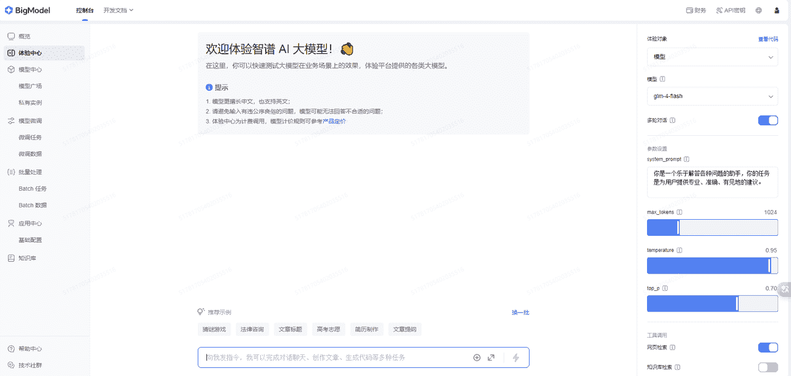
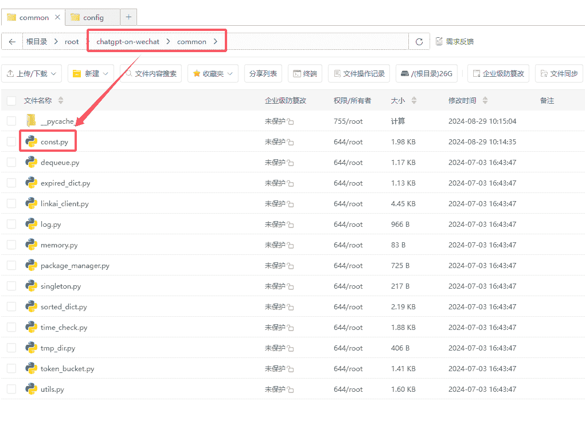
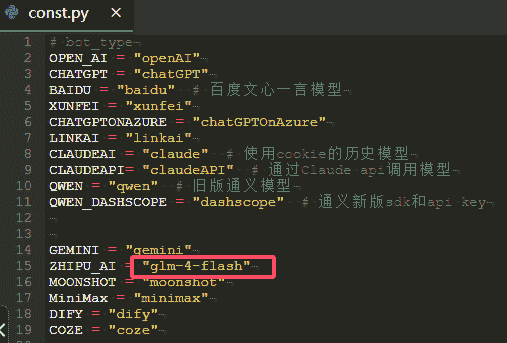
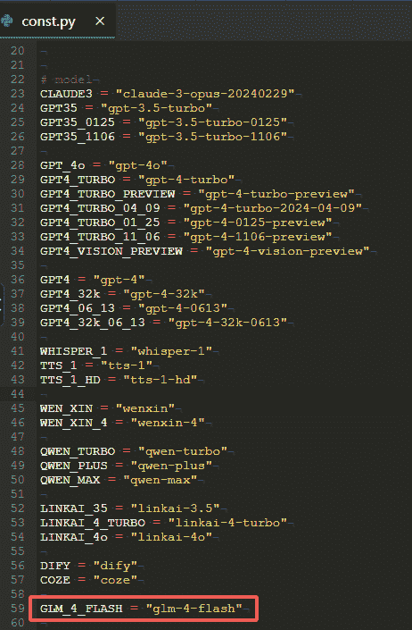
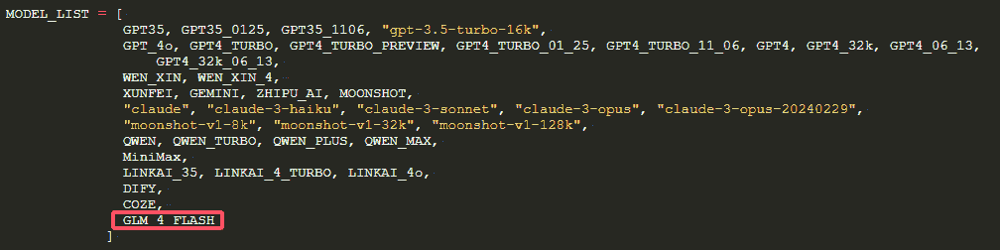
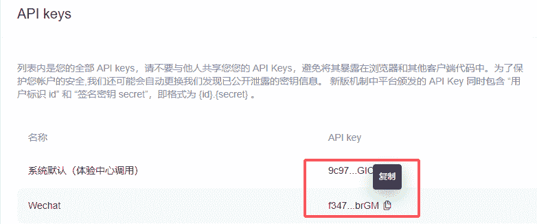
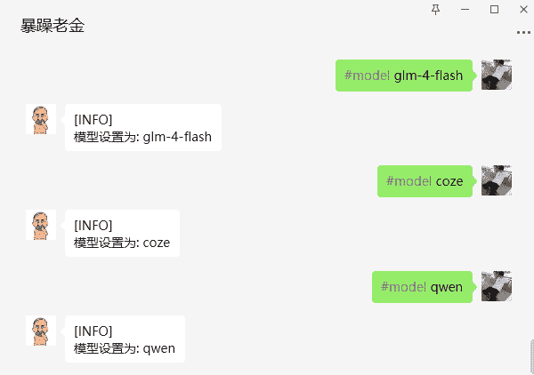

# GLM-4-Flash模型免费使用攻略

> 来源：[https://my.feishu.cn/docx/I9XidieQVoM6MsxUEFYc7sH3ndd](https://my.feishu.cn/docx/I9XidieQVoM6MsxUEFYc7sH3ndd)

王炸！智谱 AI 旗下的大模型开放平台宣布 GLM-4-Flash 全面免费，并且该模型微调也开启了限时免费活动。

体验地址：https://open.bigmodel.cn/

### 一、GLM-4-Flash 介绍

GLM-4-Flash 模型是智谱 AI 第一个免费的大模型 API，速度极快，可以用在文章创作、代码调试、代码生成、知识库问答、PPT 助手、思维导图生成等场景。

GLM-4-Flash 模型的优势在于：

+   强大的推理能力：支持 128K 上下文推理和多语言处理；

+   极快的生成速度：生成速度大约在 72.14 token/s，约等于 115 字符/s；

+   支持函数调用：其函数调用能力与 GPT-4 相当；

+   支持网页检索：能够实时访问天气、新闻等信息。

+   具备多轮对话、网页浏览、Function Call（函数调用）和长文本推理（支持最大 128K 上下文）等功能，同时支持包括中文、英语、日语、韩语、德语等在内的 26 种语言。

### 二、GLM-4-Flash 模型实测

GLM-4-Flash 模型已经在大量测试中展现了能力。

从模型界面来看，GLM-4-Flash 支持多轮对话、自定义系统指令构建（比如设定模型身份、任务目标）以及网页搜索、知识库搜索和函数调用等工具调用功能。

此外，用户也可以自由调整 GLM-4-Flash 对话窗口的最大 tokens 数量（输入上下文长度）、模型温度（控制生成的随机性和创造性）、top_p（控制回答风格，保证输出结果正确性的同时增加多样性）。



### 三、接入COW

我的读者最关心的来了，怎么接入COW白嫖这个强大的模型呢？操作很简单，小白无脑一步一步跟着做就行。

首先，你要确保完成部署了[COW初级使用教程](https://tffyvtlai4.feishu.cn/wiki/AS5pw7JOQi9lHWk56pucqjkinSc)。

然后修改2个部分：

#### 增加glm-4-flash模型

路径/root/chatgpt-on-wechat/common文件夹下，打开 const.py 文件



# bot_type中修改 ZHIPU_AI = "glm-4-flash"



# model中添加glm-4-flash



MODEL_LIST中增加GLM_4_FLASH



#### 修改COW配置文件

路径/root/chatgpt-on-wechat/下，打开config.json文件进行修改。

API Key获取地址：https://open.bigmodel.cn/usercenter/apikeys ， 复制即可，填写到"zhipu_ai_api_key"



因直接使用LLM本身，所以要在COW的"character_desc"中填写人设，注意不能换行。

修改model、zhipu_ai_api_key、zhipu_ai_api_base、character_desc，4个部分，其他按需添加。

```
{
  &quot;channel_type&quot;: &quot;wx&quot;,   
  &quot;model&quot;: &quot;glm-4-flash&quot;,
  &quot;zhipu_ai_api_key&quot;: &quot;填写你的智谱API KEY&quot;,
  &quot;zhipu_ai_api_base&quot;: &quot;https://open.bigmodel.cn/api/paas/v4&quot;,

  &quot;text_to_image&quot;: &quot;dall-e-3&quot;,
  &quot;voice_to_text&quot;: &quot;openai&quot;,
  &quot;text_to_voice&quot;: &quot;openai&quot;,
  &quot;proxy&quot;: &quot;&quot;,
  &quot;hot_reload&quot;: false,
  &quot;single_chat_prefix&quot;: [&quot;&quot;],
  &quot;single_chat_reply_prefix&quot;: &quot;&quot;,
  &quot;group_chat_keyword&quot;: [&quot;@机器人大军&quot;], 
  &quot;group_chat_prefix&quot;: [],
  &quot;group_name_white_list&quot;: [&quot;ALL_GROUP&quot;],
  &quot;concurrency_in_session&quot;: 1,
  &quot;group_welcome_msg&quot;: &quot;&quot;,
  &quot;speech_recognition&quot;: true,
  &quot;group_speech_recognition&quot;: false,
  &quot;voice_reply_voice&quot;: false,
  &quot;conversation_max_tokens&quot;: 2000,
  &quot;expires_in_seconds&quot;: 3600,
  &quot;character_desc&quot;: &quot;填写人设，注意不能换行&quot;,
  &quot;temperature&quot;: 0.5,
  &quot;subscribe_msg&quot;: &quot;&quot;,
  &quot;use_linkai&quot;: false,
  &quot;linkai_api_key&quot;: &quot;&quot;,
  &quot;linkai_app_code&quot;: &quot;&quot;
}
```

大功告成，然后重新扫码登录即可，COW路径下的终端里执行以下代码。

```
nohup python3 app.py &amp; tail -f nohup.out
```

[COW 切换model说明](https://tffyvtlai4.feishu.cn/wiki/WEVqwFrrti0oaik9Y97c1tELnub)然你也可以和我一样，使用多种模型，教学参考



<https://my.feishu.cn/sync/HDlcdCPBksnJpBbRk0EcW364nmc>