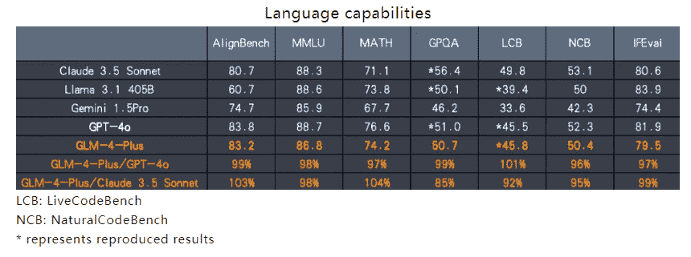
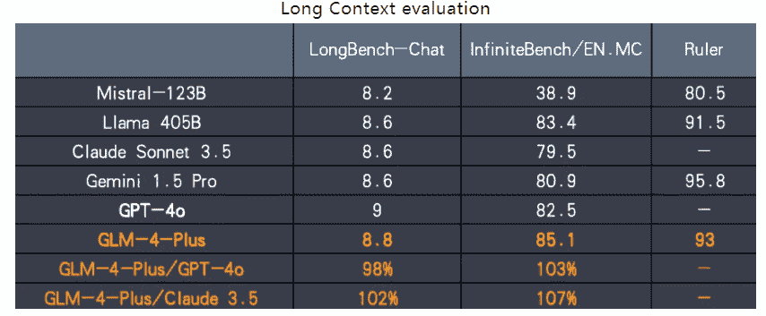
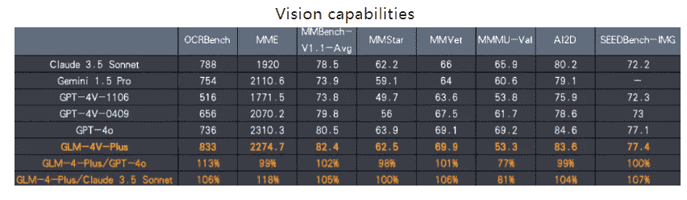
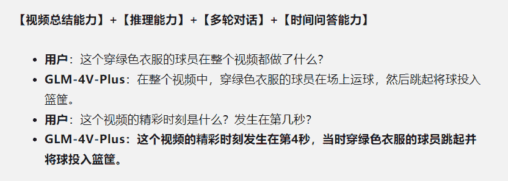
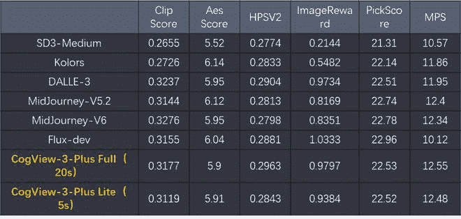
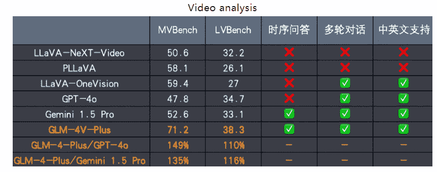
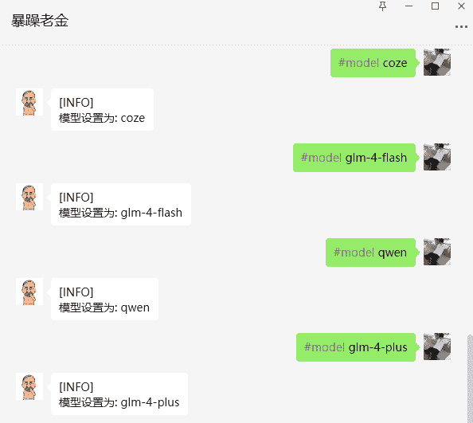

# GLM-4-Plus

> 来源：[https://my.feishu.cn/docx/E2YddWXMvoNbuYxVz1lcNgEWnod](https://my.feishu.cn/docx/E2YddWXMvoNbuYxVz1lcNgEWnod)

昨儿才说完GLM-4-Flash免费的重磅消息，今儿突然发现个重磅玩意，哦不对，是多个重磅玩意。

说来也巧，不是因为看到了什么新闻，而是今天一起床，看到了这个。

不是，哥们，别人都开始各种收费商业化了，你这咋还送送送个没完啊？

**而且别**人也就一两百万的送送玩玩，你这也忒实惠了！一送就是一千万？？？

于是我去看了下都发布了什么模型，没看不要紧，一看惊了呀！

然后又恰巧，看到了智谱发的文章。

嗯？这是要干啥？

不鸣则已，一鸣惊人啊！

这是要全方位的来大干一场啊！

同时，官方公布了这样一个视频。

[DM_20240830192640_001.mp4](https://internal-api-drive-stream.feishu.cn/space/api/box/stream/download/all/JTAzbrQ9LoWW9SxrZa5cW8Wjnnb)

看起来是不是似曾相识？

没错，和chatgpt的上一次发布会上的惊喜有过而不及！

实时语音、图像/视频理解、智能推理、图像生成，全齐活了。

而且，他不像OpenAI那个口嗨大师，公布完迟迟不上线，智谱这是已经上了。

**#**** ****官方内测申请链接放文末了**

给大家总结一下主要更新亮点:

+   **大语言模型**

语言基础模型GLM-4-Plus:在语言解析、指令执行和长文本处理能力上实现了质的飞跃，持续保持在国际竞争中的领先地位。

+   **文生图模型**

CogView-3-Plus:性能与业界顶尖的MJ-V6和FLUX模型相媲美。

+   图像/视频理解模型GLM-4V-Plus

不仅在图像理解方面表现出色，还具备基于时间序列分析的视频理解能力。该模型即将在开放平台bigmodel.cn上线，并成为国内首个通用的视频理解模型API。

+   **视频生成模型CogVideoX**

继2B版本发布并开源后，5B版本也正式对外开源，性能得到显著提升，成为目前开源视频生成模型中的佼佼者。

+   **开源佼佼者**

智谱开源模型的累计下载量已超过2000万次，为开源社区的繁荣发展做出了显著贡献。

GLM-4-Plus在多个关键领域均表现出色。在语言能力方面，该模型在理解、指令遵循和长文本处理等方面已达到国际领先水平，其表现与GPT-4和拥有405B参数的Llama3.1不相上下。特别值得一提的是，GLM-4-Plus通过精准的长短文本数据混合策略，显著提升了长文本推理效果。

在视觉智能领域，GLM-4V-Plus展现出卓越的图像和视频理解能力。它不仅具备时间感知能力，还能处理和理解复杂的视频内容。值得注意的是，该模型将在智谱开放平台上线，成为国内首个通用视频理解模型API，为开发者和研究人员提供强大的工具。

比如，你给它一段这样的视频，并询问它穿绿色衣服的球员在整个视频都做了什么?它可以精准地描述球员的球员所做的动作，还能准确地告诉你视频的精彩时刻在第几秒：

[智谱AI震撼发布GLM.mp4](https://internal-api-drive-stream.feishu.cn/space/api/box/stream/download/all/UVFfbdhJ4oW4GVx4d5GcYGtcnmf)

截图自官方

智谱AI在生成领域同样取得了突破性进展。

CogView-3-Plus在文生图性能上已接近目前最优的MJ-V6和FLUX等模型。

同时，视频生成模型CogVideoX推出了性能更强的5B版本，被认为是当前开源视频生成模型中的最佳选择。

最让人激动的是，智谱今天推出了一个炫酷的功能——国内首个面向C端用户的AI视频通话功能。

这个功能可以说是全能型选手，集文本、音频和视频于一身，还拥有超强的实时思考能力。用户和AI聊天就像和朋友一样自然，就算聊天中多次被打断，AI也能迅速反应过来。

[GLM-4-Flash模型免费使用攻略](https://tffyvtlai4.feishu.cn/wiki/D2YywG1XTi2DgpkAGckcrU0GnQc)于怎么嵌入COW，请参考昨儿的文章 ，把里面的flash都换成plus就行了。

这不，老金已经用上了，很爽很舒服！

智谱内测申请地址在这，大家快去填写吧！

<https://my.feishu.cn/sync/HDlcdCPBksnJpBbRk0EcW364nmc>