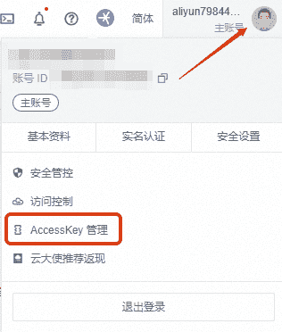
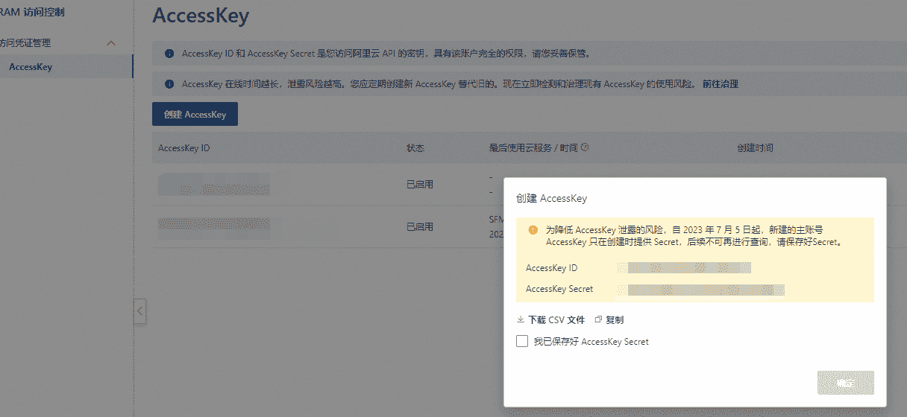
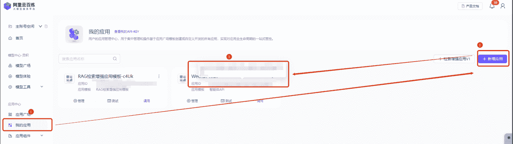
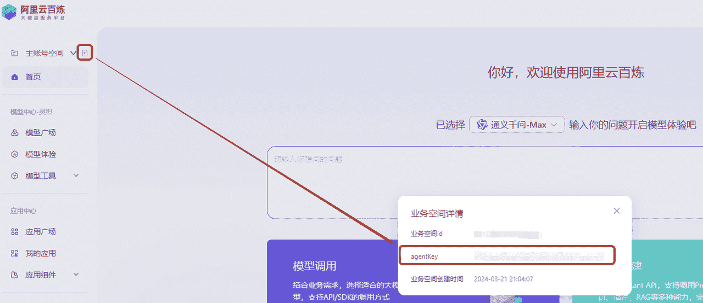
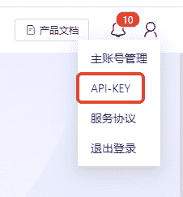

# 连接COW的方法

> 来源：[https://my.feishu.cn/docx/VLBcdF9JLo21Wyx5aJ7ca4iunog](https://my.feishu.cn/docx/VLBcdF9JLo21Wyx5aJ7ca4iunog)

QwenMax是我一直推崇的国内LLM，今天介绍下它怎么在Cow（Chatgpt-on-wechat）项目中配置。

首先根据官方[COW的Config设定](https://tffyvtlai4.feishu.cn/wiki/Ti7uwsKgiiW6bpk2nmQcVhQ8nnb)，我们能找到以下配置信息：

```
    # 通义千问API, 获取方式查看文档 https://help.aliyun.com/document_detail/2587494.html
    &quot;qwen_access_key_id&quot;: &quot;&quot;,
    &quot;qwen_access_key_secret&quot;: &quot;&quot;,
    &quot;qwen_agent_key&quot;: &quot;&quot;,
    &quot;qwen_app_id&quot;: &quot;&quot;,
    &quot;qwen_node_id&quot;: &quot;&quot;,  # 流程编排模型用到的id，如果没有用到qwen_node_id，请务必保持为空字符串
```

接下来，我们去寻找**以上所需要的Ke**y，Qwen强的LLM都是1,000,000 tokens限时免费使用额度，有效期 30 天，且应用只支持Qwen_Max，今儿我就告大家这个Key怎么获取。

确实很绕，估计大家自己都找不着。需要结合灵积和百炼两个业务系统寻找所需要的配置。

已和阿里人员进行了反馈，希望能尽快调整。

进入正文，一共所需4个配置内容。

# 通义旧版SDK，走Agent

## Access ID 和 Access Key

打开网页https://ram.console.aliyun.com/overview，右上角点击头像，弹出框选AccessKey管理



打开界面后在这获取。

## 关闭界面后无法再查看Secret，复制后自行保存。



## APP ID

还是这个地址https://bailian.console.al**iyun****.****com/****#**/home，选中**左侧我的应用****，**创建应用，然后在3区域复制APP ID，## 需要注意的是APP ID可能显示不全，需要把鼠标放到上面查看是否完整。



## Agent Key

还是这个地址https://bailian.console.aliyun.com/#**/home，选中左**上角，然后弹出框里找到Agent Key

## 需要注意的是APP ID可能显示不全，需要把鼠标放到上面查看是否完整。



# 灵积新版SDK，只走LLM，不走Agent

## API Key

打开网页https://bailian.console.aliyun.com/#/home，右上角点击头像，弹出框选API-Key



# Cow配置

/chatgpt**-on-w**echat**/con**fi**g.j**son进行修改，修改model配置，添加qwen相关Key

**##**** ****配置时注意清空中文**

```

    &quot;model&quot;: &quot;qwen&quot;, ** **
 
    # 通义千问API, 获取方式查看文档 https://help.aliyun.com/document_detail/2587494.html
    &quot;qwen_access_key_id&quot;: &quot;&quot;,
    &quot;qwen_access_key_secret&quot;: &quot;&quot;,
    &quot;qwen_agent_key&quot;: &quot;&quot;,
    &quot;qwen_app_id&quot;: &quot;&quot;,
    &quot;qwen_node_id&quot;: &quot;&quot;,  # 流程编排模型用到的id，如果没有用到qwen_node_id，请务必保持为空字符串
    
    
    ———————————————————————————————————— 或 ————————————————————————————————
    
  
    &quot;model&quot;: &quot;qwen-max&quot;,  
    
    # 阿里灵积(通义新版sdk)模型api key
    &quot;dashscope_api_key&quot;: &quot;&quot;,

```

完成后，重新扫码登录即可。

<https://my.feishu.cn/sync/HDlcdCPBksnJpBbRk0EcW364nmc>