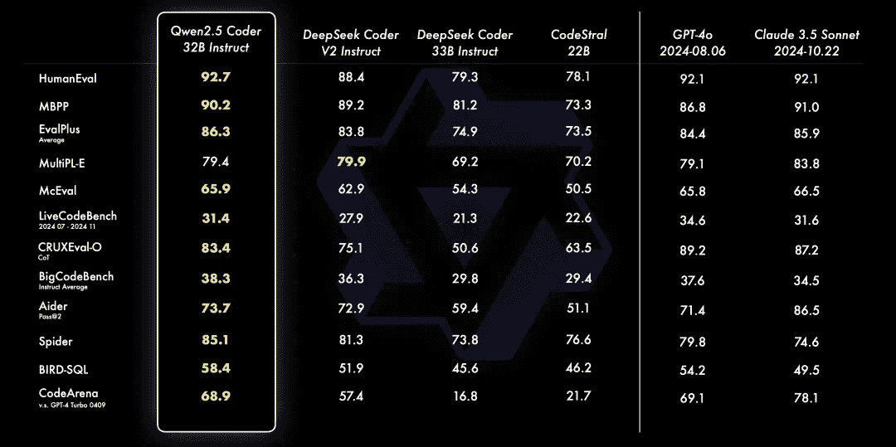
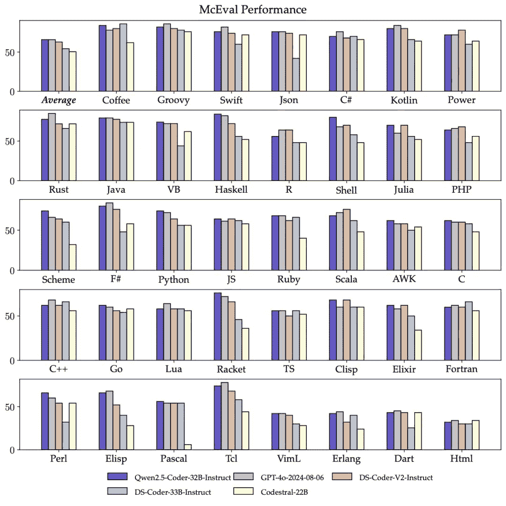
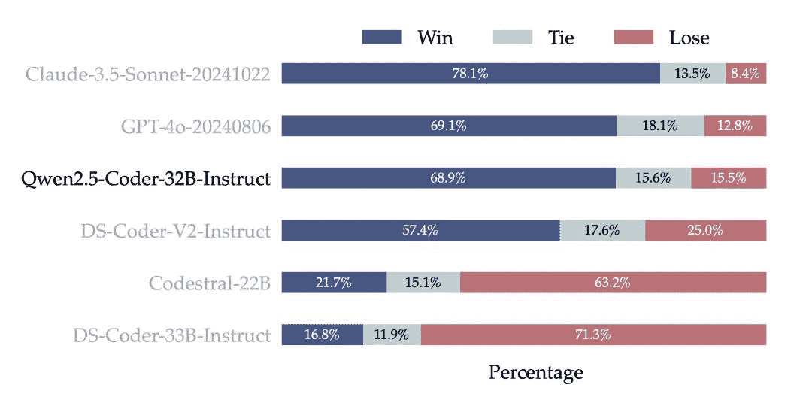
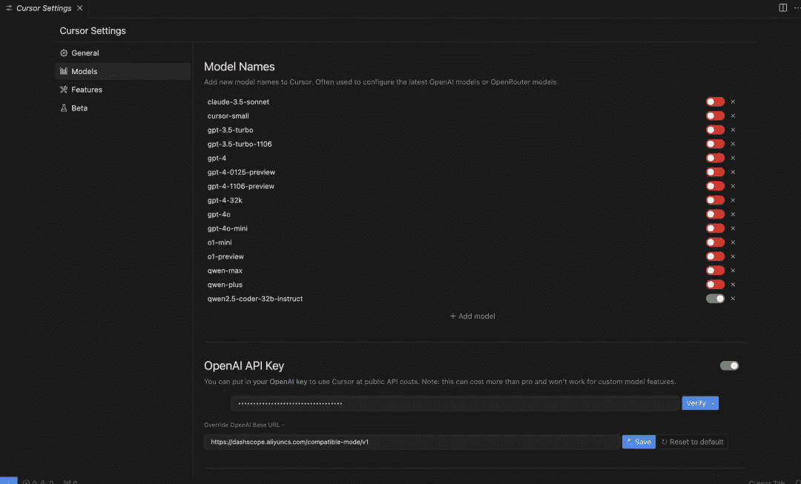
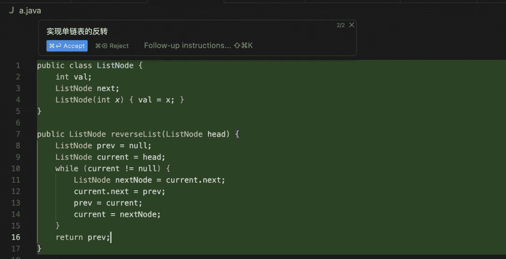
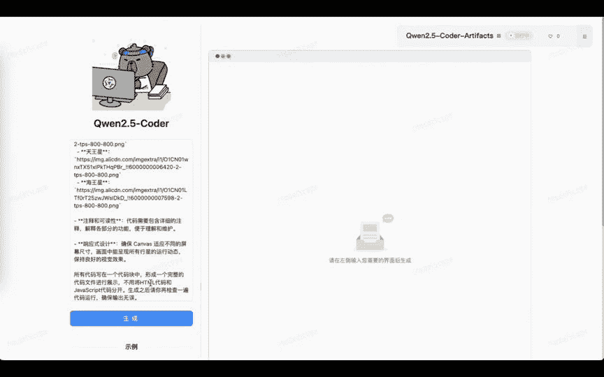
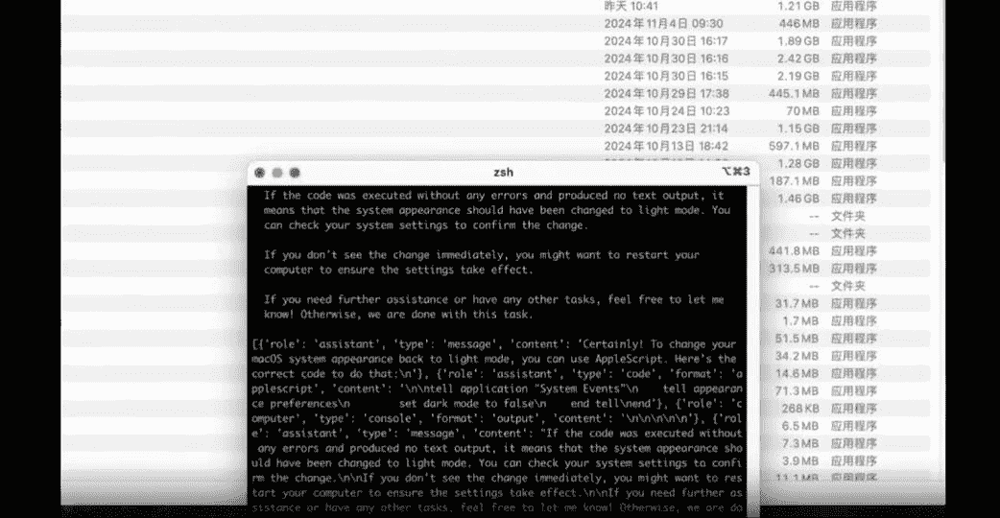
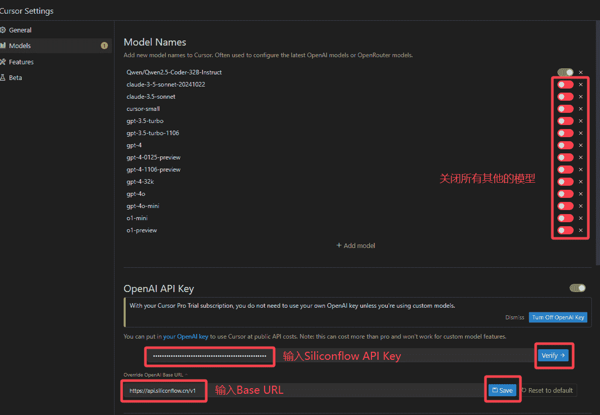
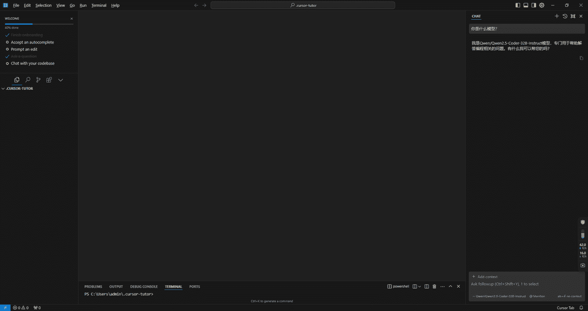

# Qwen2.5-Coder深夜开源炸场：Prompt编程时代来了！

> 来源：[https://my.feishu.cn/docx/UbLud0qGtoWQUOxZ1neclP9Xnpd](https://my.feishu.cn/docx/UbLud0qGtoWQUOxZ1neclP9Xnpd)

### 前言

2024年11月12日凌晨，阿里通义千问团队悄然发布了Qwen2.5-Coder全系列模型，瞬间引爆了开发者社区。这一系列不仅将开源代码生成模型推上新的高度，也为开发者提供了强大、灵活、实用的多尺寸选择。无论是代码生成、代码修复还是多语言支持，Qwen2.5-Coder都展现出强大的性能，为开发者带来了惊人的智能潜力。接下来，让我们深入了解Qwen2.5-Coder如何在Cursor、Artifacts和Interpreter等实际应用场景中“闪耀登场”！

---

### Qwen2.5-Coder的三大爆点，惊不惊喜？

#### 1. 顶尖代码实力，不输GPT-4o！

首先要说的就是Qwen2.5-Coder-32B-Instruct这位“大佬”。在多个代码生成基准测试上，比如EvalPlus、LiveCodeBench和BigCodeBench，这款模型已经超越了大部分开源对手，还能硬刚GPT-4o！不仅代码生成一流，修复Bug和代码推理更是一绝。最牛的是，代码修复基准Aider上打出了73.7分的好成绩，真·高手在AI。



#### 2. 各种尺寸任你选，灵活得不像话

这次Qwen2.5-Coder有6种尺寸，0.5B到32B都涵盖了，意思就是从轻量小应用到大型复杂任务都能搞定。针对不同项目需求，不同预算的开发者都能找到合适的模型。Instruct模型还能实现对话式互动，让你感觉自己多了个AI队友，一起愉快“写代码”。

#### 3. 支持多语言编程，程序员的快乐星球

Qwen2.5-Coder-32B-Instruct支持40多种编程语言，没错，就连冷门语言Haskell和Racket都不在话下！在McEval多语言测试中得了65.9分，这种适应性简直YYDS啊！多语言支持意味着啥？意味着以后写多语言代码不再头大，AI直接帮你搞定。



---

### 不用手敲也能搞定：Qwen2.5-Coder的Prompt编程

有没有一种感觉，平时写代码脑子跟不上手速？现在Qwen2.5-Coder给了大家一个“只动嘴、不动手”的机会——只需输入简单的Prompt，比如“写一个快速排序算法”，模型就能帮你生成高质量代码、修复Bug，还能补全代码。

Qwen2.5-Coder在Prompt编程上的表现为开发者提供了无限可能。在Prompt编程中，Qwen2.5-Coder是极具效率的“编程伙伴”。



---

### 真实场景下的AI超神：三大亮点功能速览

#### 场景一：Cursor里的万能小助手

Qwen2.5-Coder简直是Cursor的“灵魂搭档”。Cursor这款代码助手再搭配Qwen2.5-Coder-32B-Instruct，代码生成、修复更加智能化。想用的话很简单，只需要在Cursor里配置API Key和URL，然后随时调出代码生成和补全的功能——亲测，用起来超爽！



**操作指南**：打开Cursor，用Command+K快速调出代码功能，试试这款AI代码助手带来的惊喜体验！



#### 场景二：Artifacts的创意工厂

想象一下，你的编程不再只是代码，而是充满了视觉创意！Artifacts里，Qwen2.5-Coder不仅是代码生成器，简直像个“编程画笔”。简单配置几步，你就能在本地搭建一个Artifacts创作环境，适合做互动游戏、动图、SVG绘图等创意项目，程序员的艺术细胞一下子被释放出来。

```
git clone https://www.modelscope.cn/studios/Qwen/Qwen2.5-Coder-Artifacts.git
cd Qwen2.5-Coder-Artifacts
pip install -r requirements.txt
pip install gradio
python app.py
```

制作游戏


[微信公众平台 (2).mp4](https://internal-api-drive-stream.feishu.cn/space/api/box/stream/download/all/FrJJbd3rDo1kbQx5ORicy41ln4b)

制作动图



[微信公众平台 (3).mp4](https://internal-api-drive-stream.feishu.cn/space/api/box/stream/download/all/QGIuby2QKoEQrMxMx76ctOWanae)

SVG作画


#### 场景三：给电脑“开小灶”——AI操作系统

Qwen2.5-Coder还能跟Interpreter工具联动，接收“切换系统模式”这类命令，为你的电脑操作提供自然语言支持。配置方式也不复杂，只需几行代码就能让AI来搞定桌面操作！是不是很炫酷？

在MAC安装环境

```
pip install open-interpreter
```

进入Python环境：

```
from interpreter import interpreter
interpreter.llm.api_base = &quot;YOUR_BASE_URL&quot;
interpreter.llm.api_key = &quot;YOUR_API_KEY&quot;
interpreter.llm.model = &quot;openai/Qwen-Coder-32B-Instruct&quot;
interpreter.chat(&quot;Can you set my system to light mode?&quot;)
```



[Qwen2.5 Coder.mp4](https://internal-api-drive-stream.feishu.cn/space/api/box/stream/download/all/YgjcbWle6ojBvNxxQe7cRiaVnbc)

---

### SiliconCloud的推理加速版上线，极速体验等你来！

阿里通义千问团队的发布一出，SiliconCloud第一时间就把Qwen2.5-Coder-32B-Instruct的推理加速版上线了！免去繁琐的配置步骤，直接API调用，体验推理加速的高效感。适合那些时间紧张的开发者们，快速生成代码就是快人一步！

**价格小贴士**：SiliconCloud的Qwen2.5-Coder-32B-Instruct现价仅￥1.26 / M tokens，超值！

**邀请好友有福利**：成功邀请一位小伙伴注册，就能获得2000万Tokens，相当于14元额度。让你的朋友们也体验下“AI代码助手”的神奇吧！

注册地址：https://cloud.siliconflow.cn/i/wdyoipMi

####  安装 Cursor

Cursor中的使用方法：

按步骤在 Cursor 官网（https://www.cursor.com/）下载、安装并登录 Cursor。


#### 配置要使用的模型

这里以硅基流动平台上的 Qwen/Qwen2.5-Coder-32B-Instruct 模型为例：

先打开SiliconCloud 模型广场，找到 Qwen/Qwen2.5-Coder-32B-Instruct，点击复制。


打开 Cursor Settings - Models，关闭所有自带模型，然后添加上一步复制的模型名称。



#### 开始使用

> 注意：Windows 系统使用 Ctrl 键，Mac 系统使用 Command 键。后续将统一使用 Ctrl 表示。

在编辑页面使用 Ctrl+K 可以生成代码（根据需求重构或是新写一段代码），Ctrl+L 可以打开对话框。更多 Cursor 使用方法详见网络上的文章或视频。



#### 已知的 Cursor 免费版限制

+   Chat 框中无法直接 Apply 代码。需要手动复制更改粘贴到对应的文件，也可以直接在编辑页面使用 Ctrl+K 生成代码功能 Accept 更改。

+   无法使用自动补全。由于 Cursor 是基于 VSCode 开发，也可以装相关 VSCode 插件解决此问题，如 Codeium、MarsCode、通义灵码等。

+   无法使用 Composer 功能（由 @Frank Lin 葆 提出，暂无解，可开通会员或注册新的试用账号来获取 Pro 资格）。

---

### **结语**

Qwen2.5-Coder的发布不仅推动了开源代码生成模型的发展，还让Prompt编程逐步从概念走向实用。无论是代码生成、修复、多语言支持，还是推理加速能力，Qwen2.5-Coder都带给开发者们“极致体验”。赶紧试试，看AI能带给你多少“编程惊喜”吧！

<https://my.feishu.cn/sync/HDlcdCPBksnJpBbRk0EcW364nmc>