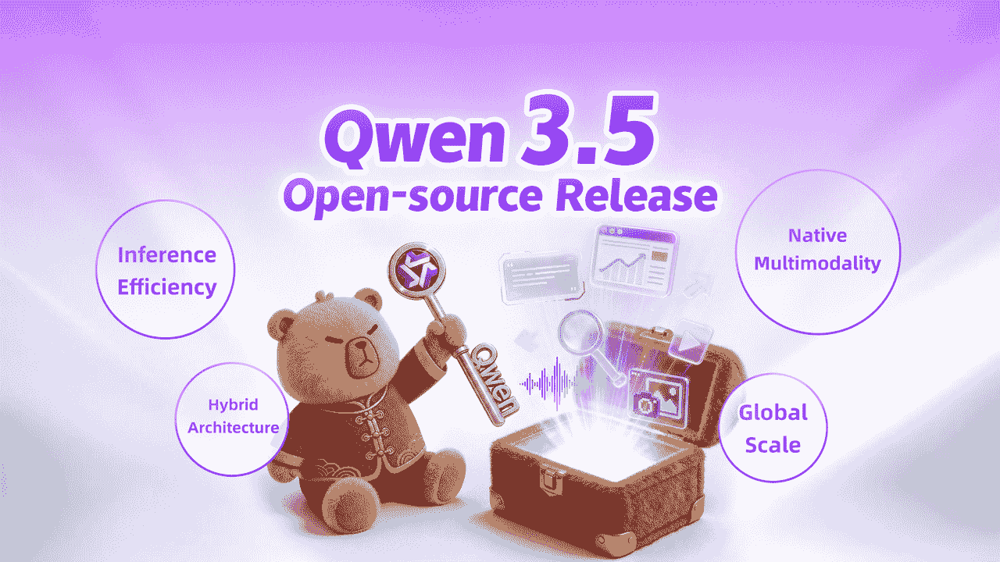
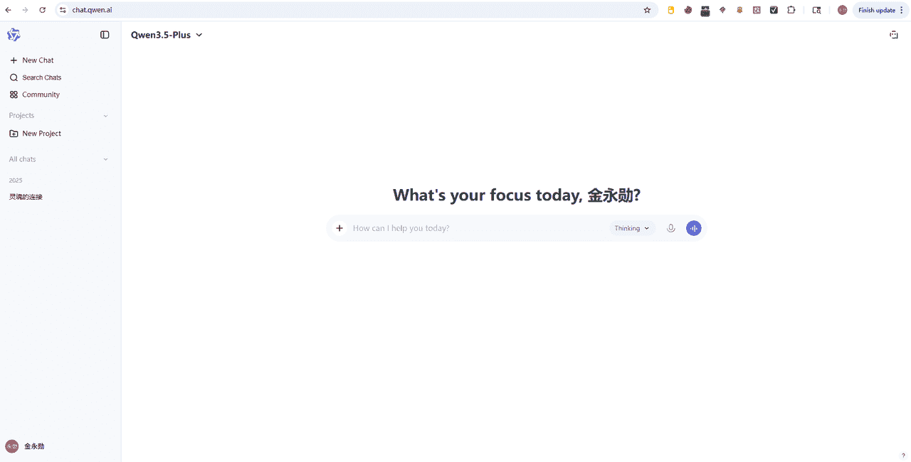
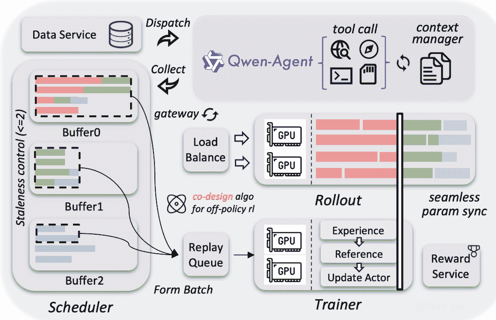
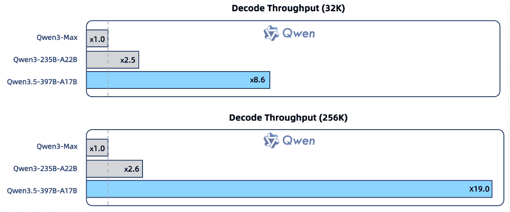
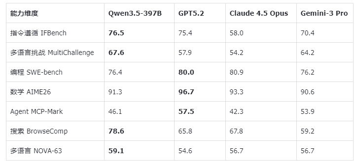
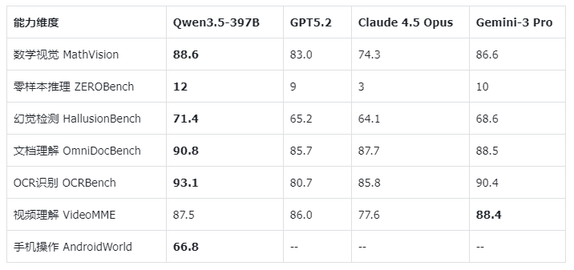
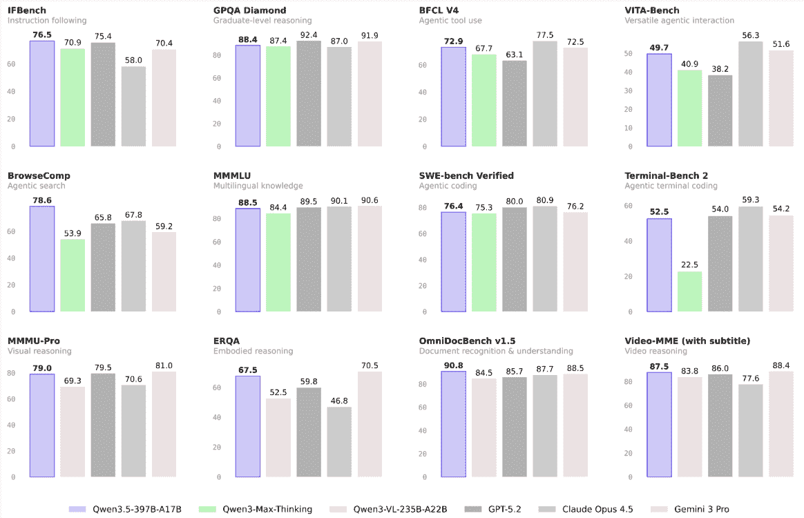
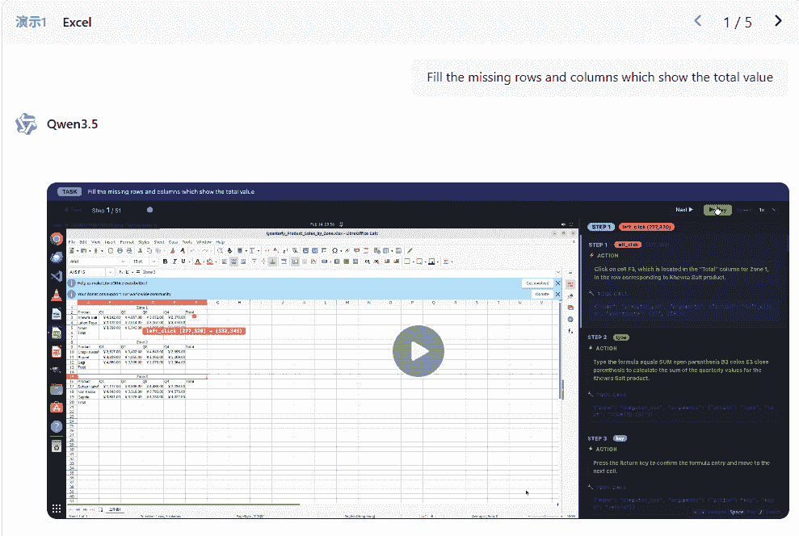
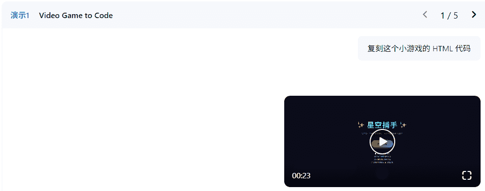
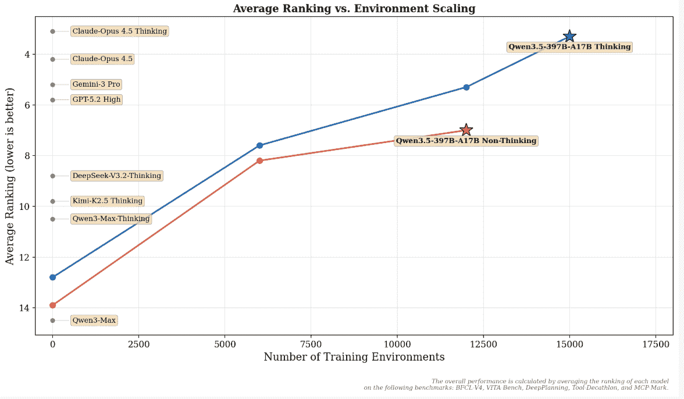

# 除夕夜，国产顶流压轴上线，`QWEN3.5`多模态开源！

> 来源：[https://my.feishu.cn/docx/ObvWdg9AVopzGsxDmbicSGrynIb](https://my.feishu.cn/docx/ObvWdg9AVopzGsxDmbicSGrynIb)



除夕夜，老金我刚咬了一口韭菜鸡蛋饺子。

手机"叮"的一声，弹出个通知。

老金我瞄了一眼——`Qwen3.5`，上线了。饺子差点没喷出来。

赶紧打开 `chat.qwen.ai`，两个模型直接挂在上面，可以用了。

阿里这帮人，大年三十放大招，连个发布会都没开，就这么安安静静地把东西甩出来了。

老金我放下筷子，扒了一晚上代码和文档，确认了一件事：

这不是小版本迭代，这是架构级别的重构。



---

## 先说结论：Qwen3.5到底升级了什么

根据老金我除夕夜扒的`HuggingFace`代码库、阿里云官网和`chat.qwen.ai`的实际体验，帮你梳理了3个核心变化。

### 第一个：原生多模态。

注意，是"原生"，不是"拼接"。

`Qwen3`之前的多模态方案是语言模型+视觉模块的两段式架构。

`Qwen3.5`直接把视觉感知和语言推理塞进了同一个训练框架。

阿里云官网对`Qwen3.5-Plus`的描述是："原生多模态合一训练，混合架构双创新突破。"

简单说，以前是两个人配合干活，现在是一个人同时搞定。

### 第二个：`Gated Delta Networks`——线性注意力机制。

官方确认，`Qwen3.5`采用了一种叫 `Gated Delta Networks` 的线性注意力，跟传统的`Gated Attention`做了混合架构。

传统`Transformer`的注意力计算量跟序列长度的平方成正比，`Gated Delta Networks`把这个关系拉成线性。

翻译成人话：处理长文本的速度快了，显存占用也降了。

而且不是快了一点半点——官方实测数据：

+   在`32k`上下文长度下，`Qwen3.5-397B-A17B`的解码吞吐量是`Qwen3-Max`的 8.6倍

+   在`256k`上下文长度下，这个数字是 19.0倍

+   跟`Qwen3-235B-A22B`比，分别是3.5倍和7.2倍

老金我看到这个数据的时候饺子真喷出来了。

### 第三个：更大的模型家族。

目前在`chat.qwen.ai`上已经可以直接使用的有两个版本：

+   `Qwen3.5-Plus`（闭源`API`模型，通过阿里云百炼提供服务，支持 1M token上下文窗口）

+   `Qwen3.5-397B-A17B`（开源旗舰模型，3970亿参数只激活170亿）

跟之前`HuggingFace`代码里泄露的`9B`和`35B-A3B`相比，正式发布的模型规模大得多。

`3970`亿总参数，比`Qwen3`的旗舰`235B-A22B`直接翻了快一倍。

总参数量达`3970`亿，每次前向传播仅激活`170`亿参数，在保持能力的同时优化速度与成本。

语言与方言支持从`119`种扩展至`201`种，词表从`15万`扩大到`25万`，在多数语言上带来约10-60%的编码/解码效率提升。

简单说，同样的一段话，`Qwen3.5`能用更少的token表示，推理更快，`API`费用也更省。



---

## 线性注意力到底意味着什么

这块稍微展开说一下，因为这可能是`Qwen3.5`最关键的技术突破。

不懂技术的朋友别跳过，老金我用人话给你翻译。

传统`Transformer`用的是标准自注意力机制。

简单理解：AI在读一篇文章的时候，每读到一个字，都要回头看一遍前面所有的字。

如果文章有1万个字，每个字要跟其他9999个字各看一次。

字数越多，AI就越吃力——计算量是"字数的平方"级别的。

`Qwen3.5`用的`Gated Delta Networks`，核心思路是：用一个巧妙的数学方法，让AI不用每次都回头看所有内容。

结果就是：计算量从"字数的平方"降到"字数的倍数"。

听起来差别不大？我给你举个具体例子：

处理一个10分钟的视频：

+   传统方式：可能需要64G显存的显卡才能跑

+   `Gated Delta Networks`：16G显存就够了

这不是快了几个百分点的问题，是能不能跑起来的问题。

很多任务以前根本跑不动，现在可以了。

`Qwen3.5`更聪明的地方在于：它把`Gated Delta Networks`（线性注意力）和`Gated Attention`（标准注意力）做成了混合架构。

简单任务用线性注意力省资源，复杂任务自动切换到标准注意力保精度。

不是非此即彼，而是动态选择——什么场景用什么方案。

这也是为什么官方说的"`Qwen3-Next`架构"——更高稀疏度的`MoE` + 混合注意力 + 多token预测。

多token预测是什么意思？

传统模型一次只能"想"出一个字，`Qwen3.5`一次能预测多个字，生成速度又快了一截。



## 原生多模态为什么重要

之前的多模态模型大多是"拼接式"的。

打个比方：就像找了一个英语翻译和一个法语翻译，中间再安排一个协调员把两人的翻译对接起来。

先训一个语言模型（处理文字），再训一个视觉编码器（处理图片），最后用对齐层把两者连起来。

这种方式有个天然缺陷：视觉和语言的理解是割裂的。

`Qwen3.5`走的是另一条路——从预训练阶段就把文本、图像、视频放在一起训。

模型从一开始就"看"和"读"同时进行。

就像培养一个从小就双语环境长大的孩子，不需要翻译，直接理解。

阿里官方说法是"统一架构整合语言推理与视觉感知"。

### 这对普通用户来说意味着什么？

1、你发一张图给AI，它能真正"看懂"图里的内容，不容易出现"看到了但理解错了"的情况

2、一次对话就能同时处理图片+文字，不用分两步操作

3、成本更低——一个模型干两个模型的活，`API`费用直接砍半

阿里官网已经写了"效果、成本与多模态理解深度上同时超越`Qwen3-Max`与`Qwen3-VL`"。

如果这个说法成立，那`Qwen3.5-Plus`可能是目前性价比最高的多模态模型之一。

比如这样提问，它都能准确且快速的回答：

## 跑分亮了：Qwen3.5到底有多强

说技术架构大家可能没直觉，直接看跑分数据。

官方放了一大堆`benchmark`对比，老金我帮你提炼最关键的几个：

### 自然语言能力（对比`GPT5.2`、`Claude 4.5 Opus`、`Gemini-3 Pro`）：



几个重点：

1、指令遵循（`IFBench` 76.5）和多语言挑战（`MultiChallenge` 67.6）两项全场第一。

这意味着你给它的指令它听得更准，不容易跑偏。

2、搜索`Agent`能力（`BrowseComp` 78.6）也是第一。

联网搜索信息的能力很强。

3、多语言能力（`NOVA-63` 59.1）第一。

201种语言不是白支持的。

4、编程和数学还是`GPT5.2`和`Claude`强一些，但差距不大。

视觉语言能力（这才是`Qwen3.5`的杀手锏）：



乖乖，视觉能力这块`Qwen3.5`真的杀疯了：

+   `MathVision` 88.6——看图做数学题，全场最高

+   `OCRBench` 93.1——文字识别能力，直接碾压，比`GPT5.2`高出12个点

+   `OmniDocBench` 90.8——文档理解能力第一，对搞办公的朋友来说太实用了

+   `HallusionBench` 71.4——幻觉最少，看到什么说什么，不瞎编

+   `AndroidWorld` 66.8——能操作安卓手机，这个后面单独说

注意，这是一个`3970`亿参数只激活`170`亿的模型跑出来的成绩。

跟`GPT5.2`这种完整版闭源大模型对打还能在多个维度赢，开源模型能做到这个水平，老金我服了。



---

## Visual Agent：AI能操作你的手机和电脑了

这是老金我觉得最炸裂的功能，但很多报道都没重点说。

`Qwen3.5`可以作为 `Visual Agent`，自主操作手机和电脑完成日常任务。

什么意思？你告诉它"帮我把这个`Excel`表格的缺失行补全"，它真的能：

1、打开`Excel`文件

2、识别出哪些行和列需要补全

3、自动填写数据

4、保存文件



全程不需要你动手，AI自己操作界面完成。

官方展示了好几个演示：

+   手机端：适配主流`App`，你说"帮我发条朋友圈"，它能自己操作完成

+   电脑端：处理跨应用的数据整理、多步骤流程自动化

`AndroidWorld`跑分`66.8`，目前公开数据里最高的。

这不是`ChatGPT`那种"帮你写个脚本自己跑"。

`Qwen3.5`是真的在操作`GUI`界面，像人一样点击、输入、滑动。

对于不会编程的普通用户来说，这个能力可能比会写代码更有用。

## 空间智能和视觉编程

除了操作手机电脑，`Qwen3.5`在"看"这件事上还有两个特别的能力。

### 空间智能：

借助对图像像素级位置信息的建模，`Qwen3.5`能做到：

+   物体计数——图里有几个苹果，它能数准

+   相对位置判断——电话亭在黄色货车的左边还是右边

+   驾驶场景理解——看行车记录仪画面，分析为什么没在路口停车

官方展示了一个驾驶场景的例子：给它一段行车记录仪视频截帧，它能分析出"信号灯在我接近停车线时变黄，此时距离太近无法安全停车，所以选择通过路口"。

这个能力在自动驾驶和机器人导航场景里非常关键。

### 视觉编程：

更酷的是，`Qwen3.5`能把看到的东西变成代码：

+   手绘界面草图 → 结构清晰的前端代码

+   游戏视频 → 逻辑还原代码

+   长视频 → 自动提炼为结构化网页

你甚至可以让他看视频手搓游戏。



---

## 春节档：AI圈的神仙打架

`Qwen3.5`选在除夕夜发布，这个时间点太狠了。

这个春节档，至少还有3个重磅选手要登场。

1、`DeepSeek V4`——最受期待的选手，`V3`已经证明了`DeepSeek`的实力

2、`GLM-5`——智谱的新旗舰，之前`Pony Alpha`的表现已经让人刮目相看

3、`MiniMax 2.2`——`M2.5`编程能力追平`Claude`，`2.2`值得关注

老金我觉得今年春节档的竞争格局跟去年完全不同。

去年是`DeepSeek V3`一家独大。

今年是四五个玩家同时出牌。

对普通用户来说，这其实是好事。

竞争越激烈，开源模型的能力提升越快，`API`价格越便宜。

## MoE架构：小身材大能量

`Qwen3.5-397B-A17B`这个版本号值得单独说一下。

`397B`是总参数量，`A17B`是激活参数量——`3970`亿参数里每次只用`170`亿。

什么意思？打个比方：

这就像一个公司有`3970`个员工，但每次处理一个任务只需要`170`个人同时干活。

其他人"待命"，等需要的时候再上。

这就是`MoE`（`Mixture of Experts`，混合专家）架构的核心思路。

模型里有很多"专家"模块，每个`token`只激活其中几个。

好处是：模型容量大（知识多），但推理成本低（算得快）。

回顾一下`Qwen3`的数据：

`Qwen3-235B-A22B`（`2350`亿参数，激活`220`亿）在编程、数学、推理上已经能跟`DeepSeek-R1`、`GPT-5`正面对决。

`Qwen3-30B-A3B`在`SWE-Bench`上拿到`69.6`分，价格性能比吊打一众付费模型。

`Qwen3.5-397B-A17B`直接把总参数量拉到`3970`亿，是`Qwen3`旗舰的1.7倍。

但激活参数只有`170`亿，比`Qwen3`旗舰的`220`亿还少。

翻译成人话：知识储备更多了，但跑起来反而更省资源。

再加上原生多模态和线性注意力的加持，老金我认为这是2026年上半年最值得关注的开源模型之一。



## 现在就能用：3步上手`Qwen3.5`

说了这么多技术细节，老金我讲讲实际怎么用。

好消息是：你现在就可以直接体验`Qwen3.5`，不用等。

### 第1步：打开 `chat.qwen.ai`

浏览器直接输入 `chat.qwen.ai`，这是阿里官方的对话平台。

注册一个账号就能用，支持手机号和邮箱注册。

不需要🪜，国内直接访问。

### 第2步：选模型和模式

页面顶部有个模型选择器，点开会看到两个选项：

+   `Qwen3.5-Plus`：推荐日常使用，速度快，响应快

+   `Qwen3.5-397B-A17B`：旗舰模型，适合复杂任务（推理、写代码、分析长文档）

不知道选哪个？选`Qwen3.5-Plus`就行，够用了。

需要更强的推理能力再切`397B`。

选好模型后，还能选三种思考模式：

+   `auto`（自动）：自适应思考，该深入就深入，该快就快，推荐大多数场景使用

+   `thinking`（思考）：遇到难题用这个，模型会进行深度推理，一步步想清楚再回答

+   `fast`（快速）：简单问题用这个，不消耗思考`token`，回答又快又省

### 第3步：直接对话

跟`ChatGPT`的用法一模一样——输入框打字，回车发送。

支持的功能包括：

+   纯文字对话（问答、写作、翻译、编程）

+   上传图片让它分析（产品截图、文档照片、手写笔记）

+   上传文件让它总结（`PDF`、`Word`、代码文件）

+   联网搜索（点击搜索按钮，它会帮你查最新信息）

**完全免费，目前没有次数限制。**

对，你没看错，免费的。

这也是阿里开源生态的一贯打法。

## 开发者进阶用法

如果你是开发者，除了网页版还有更多玩法。

### 场景1：`API`调用（`1M`上下文窗口）

阿里云百炼已经上线`Qwen3.5-Plus`的`API`，支持100万`token`的上下文窗口。

100万`token`是什么概念？大概相当于一次性读完一本750页的英文小说还绰绰有余。

而且`API`完全兼容`OpenAI`格式，切换成本几乎为零：

```
from openai import OpenAI

client = OpenAI(
    api_key="your-api-key",
    base_url="https://dashscope.aliyuncs.com/compatible-mode/v1",
)

completion = client.chat.completions.create(
    model="qwen3.5-plus",
    messages=[{"role": "user", "content": "介绍一下Qwen3.5"}],
    extra_body={
        "enable_thinking": True,
        "enable_search": False
    },
    stream=True
)
```

两个关键参数：

+   `enable_thinking`：开启推理模式，让模型先想再答，适合复杂问题

+   `enable_search`：开启联网搜索和`Code Interpreter`

### 场景2：Vibe Coding（跟编程工具集成）

官方明确说了，百炼`API`可以跟这些编程工具无缝集成：

+   `Qwen Code`——阿里自己的编程助手

+   `Claude Code`——`Anthropic`的CLI工具

+   `Cline`——`VS Code`插件

+   `OpenClaw`——开源`Agent`框架

+   `OpenCode`——开源编程工具

也就是说，你在`Claude Code`里把模型切成`Qwen3.5-Plus`，一样能用。

价格比`GPT-5`便宜10倍以上，对于日常编程来说性价比拉满。

### 场景3：多模态应用

原生多模态意味着你可以用一个模型搞定：

+   图片内容识别+文案生成

+   视频内容理解+摘要提取

+   图文混排文档的解析和问答

+   `GUI`自动化——让AI帮你操作软件界面

以前这些任务要调`3-4`个不同的`API`，现在一个就够了。

### 场景4：本地部署

`Qwen3.5-397B-A17B`虽然总参数`3970`亿，但激活参数只有`170`亿。

等开源权重发布后，用`Ollama`或`vLLM`部署，消费级显卡也有可能跑起来。

后续如果有更小的版本（比如`9B`），`16G`显存的显卡就能流畅运行。

## 老金的判断

`Qwen3.5`除夕夜在`chat.qwen.ai`正式上线了。

老金我说说自己的看法。

### 看好的点：

+   原生多模态是正确的方向，拼接式迟早要被淘汰

+   `Gated Delta Networks`解决了长序列的核心瓶颈，`8.6`倍/`19`倍的吞吐量提升不是闹着玩的

+   `MoE`架构在成本和性能之间找到了平衡点——`3970`亿参数只激活`170`亿，这个比例很激进

+   视觉能力真的强——`OCR`、文档理解、数学视觉多项第一

+   `Visual Agent`能操作手机电脑，这是AI从"回答问题"到"替你干活"的关键一步

+   阿里在开源这条路上一直很坚定，`Qwen3`的开源质量有目共睹

+   完全免费使用，对普通用户来说门槛为零

### 值得关注的未来方向：

官方博客最后提了三个方向，老金我觉得每个都很重要：

1、跨会话持久记忆——现在的AI每次对话都是"失忆"状态，未来能记住你之前聊过什么

2、具身接口——不只是操作手机电脑屏幕，未来可能控制机器人在真实世界干活

3、自我改进机制——AI能自己变得更好，不需要人类手动更新

阿里原话是："将当前以任务为边界的助手升级为可持续、可信任的伙伴。"

老金我的态度是谨慎乐观。

架构升级的方向是对的，除夕夜放这个大招，阿里是真的有底气。


跑分数据已经出来了，视觉能力多项碾压GPT5.2和Claude 4.5 Opus，你现在就可以去`chat.qwen.ai`亲自试试。

有一点可以确定：2026年的开源大模型，竞争只会越来越激烈。

对于开发者和普通用户来说，这是最好的时代。

---

## 参考资料

+   Qwen3.5官方博客（本文核心信息来源）：`https://qwen.ai/blog?id=qwen3.5`
+   Qwen3.5在线体验（直接可用）：`https://chat.qwen.ai/`
+   阿里Qwen3.5悄然曝光：`https://news.qq.com/rain/a/20260209A066UE00`
+   TechNews Qwen 3.5详情：`https://technews.tw/2026/02/09/qwen-3-5-revealed/`
+   线性注意力与MoE架构细节：`https://www.80aj.com/2026/02/08/qwen-35-linear-attention-moe/`
+   Qwen官方博客：`https://qwenlm.github.io/`
+   阿里云千问模型官网：`https://www.aliyun.com/product/tongyi`
+   阿里云百炼API平台：`https://bailian.console.aliyun.com`
+   快科技AI圈春晚报道：`https://news.mydrivers.com/1/1103/1103341.htm`
+   新浪财经Qwen3.5曝光：`https://finance.sina.com.cn/tech/discovery/2026-02-10/doc-inhmfytc6068648.shtml`
+   中关村在线Qwen3.5报道：`https://ai.zol.com.cn/1132/11328481.html`
+   QwenLM GitHub仓库：`https://github.com/QwenLM/Qwen3`

`https://my.feishu.cn/sync/HDlcdCPBksnJpBbRk0EcW364nmc`
