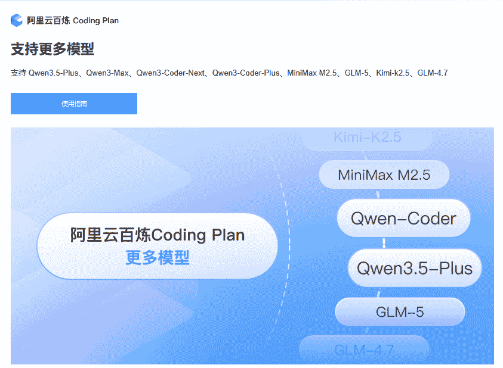
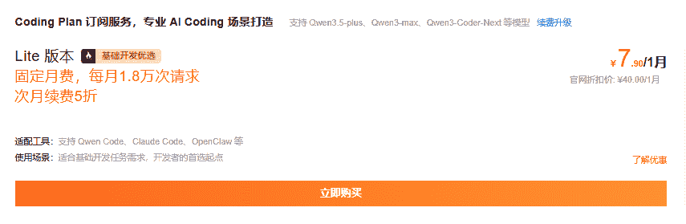
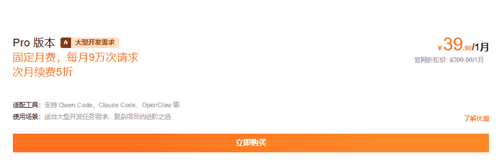
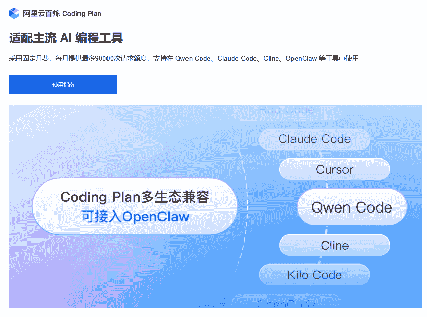
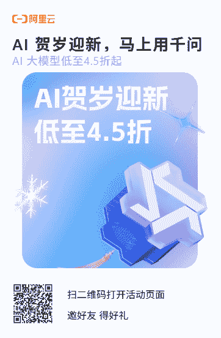

# 阿里出手！骨折价打包Qwen，Kimi，GLM！一键对接Claude Code！

> 来源：[https://my.feishu.cn/docx/WFpvdXHiioQsXGxijZ6cFYPfnUd](https://my.feishu.cn/docx/WFpvdXHiioQsXGxijZ6cFYPfnUd)

昨天刚把 15万字Claude Code + OpenClaw实战教程 开源，后台就炸了。

问得最多的一个问题：API太贵了，有没有便宜的方案？

老金我太理解这个痛点了。

每个月现在消耗大几亿token，直接给我干沉默了。

刚好这两天 **百炼Coding Plan** 悄悄升级了，老金我仔细看了一下，发现这次改动还挺大的。

帮你们梳理一下，看看值不值得冲。

## 这次升级了什么

最大的变化是模型库扩容了，一口气加了3个新模型。

**Qwen3.5-Plus**

千问最新的编程模型，代码生成能力比上一代提升不少。

阿里自家的亲儿子，在百炼平台上跑起来肯定是最顺的。

**Kimi-2.5**

月之暗面的最新模型，长上下文处理是它的强项。

写长文件、读大项目的时候，上下文窗口大就是优势。

**GLM-5**

智谱的新模型，全球炸裂的存在，适合需要逻辑推理比较多的编程场景。

看到这你可能会懵：阿里的平台，怎么卖月之暗面和智谱的模型？

**这就是百**炼的定位，它不只是阿里自家模型的入口，而是一个模型超市。

各家大模型厂商把自己的模型放上来，开发者在一个平台上就能用到不同家的模型。

类似AWS的Bedrock，上面既有自家的也有Claude、Llama这些第三方模型。

对开发者来说好处很明显：一个API Key、一套计费、多个模型随便切。

加上原来就支持的模型，现在百炼的模型池算是比较全了。

不同场景可以灵活切换，写前端用一个，调试用另一个。

这种"一个订阅用多个模型"的模式，确实比单独买API划算。

## 价格到底香不香

老金我帮你们算了笔账。

**Lite版**

**原价40**元/月，新用户首月只要 7.9元。

包含18000次请求，日常写代码、改Bug、问问题够用了。

**Pro版**

原价200元/月，新用户首月 **39.9元**，首次续费也只要100元。

请求量更大，适合每天泡在IDE里的重度用户。

对比一下其他方案。

Anthropic官方API，按token计费，重度使用每月100到200元不等，而且费用不可预期。

OpenAI API，GPT-4o每百万token 5美元起，用多了也肉疼。

百炼的包月模式好处是费用固定，不用担心某天写嗨了token爆表。

7.9元什么概念？

一杯奶茶的钱，能用一个月的AI编程API。

就算试了不满意，下个月不续就行，试错成本几乎为零。

## 工具兼容性

这是老金我觉得最实用的一点。

百炼Coding Plan目前支持这些主流AI编程工具：

**Claude Code**：老金我天天用的，直接配API Key就能对接

**Cursor**：目前最火的AI编程IDE，无缝支持

**Cline**：VS Code里的AI编程插件，配置简单

**Qwen Code**：阿里自家的编程工具，原生支持

**OpenClaw**：开源的AI编程框架，社区活跃

基本上你能叫得上名字的AI编程工具都覆盖了。

配置方式也简单，拿到API Key填进工具设置里就行。

不用折腾什么代理、转发，国内直连，延迟也低。

## 活动详情

**活动时间：2026年2月19日23**:00 到 2026年4月1日00:00

**新用户专享**

首购低至2折，就是前面说的Lite版7.9元、Pro版39.9元。

首次续费还有 **5折优惠**，Pro版续费只要100元。

**邀新福利**

这个机制老金我觉得设计得挺聪明的，简单说就是三方都有好处。

**通过邀请链**接购买，买的人直接得 10元赠金。

**买完之**后你会生成自己的专属链接，分享出去，每成功邀请一个人你得 30元。

被你邀请的人同样得 **10元赠金**。

最高返现3000元，如果你身边搞开发的朋友多，这个羊毛值得薅。

注意两个点。

一是"新用户"专享，之前用过百炼的老用户没有首月优惠。

二是活动4月1号截止，想试的别拖太久。

## 老金我的建议

**适合冲的**

已经在用 **Claude Code** 或 **Cursor**，想找个便宜的API方案。

想体验国产大模型写代码的效果，7.9元试错成本极低。

团队多人协作，包月模式比按量计费更好控制预算。

**可以观望的**

已经有稳定的API方案且费用可接受，没必要折腾。

对模型质量要求极高、只认Claude Sonnet或GPT-4o的，国产模型可能暂时达不到你的预期。

老金我的态度是：7.9元首月，值得试一下。

国产大模型这两年进步很快，Qwen3.5在编程场景的表现已经相当能打了。

就算最后觉得不如Claude，至少你有了第一手的对比数据，以后选API心里有底。

**想试的点下**面链接，通过这个链接购买可以多拿 10元赠金。

买完之后记得生成自己的邀请链接分享给朋友，你得30元，朋友也得10元。

https://www.aliyun.com/benefit/ai/aistar?clubBiz=subTask..12410027..10263..

对了，买完不会配置的也别慌。

老金我昨天刚开源了一份 15万字的Claude Code + OpenClaw实战教程，从零开始手把手教你配置API、搭建工作流、写Skill，链接在下面。

关注老金，AI工具不迷路。

<https://my.feishu.cn/sync/HDlcdCPBksnJpBbRk0EcW364nmc>