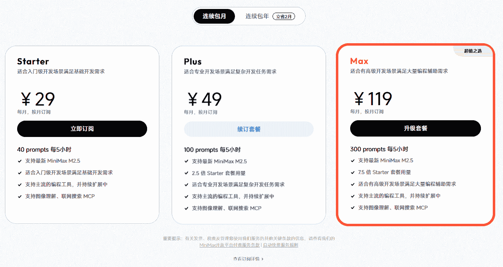
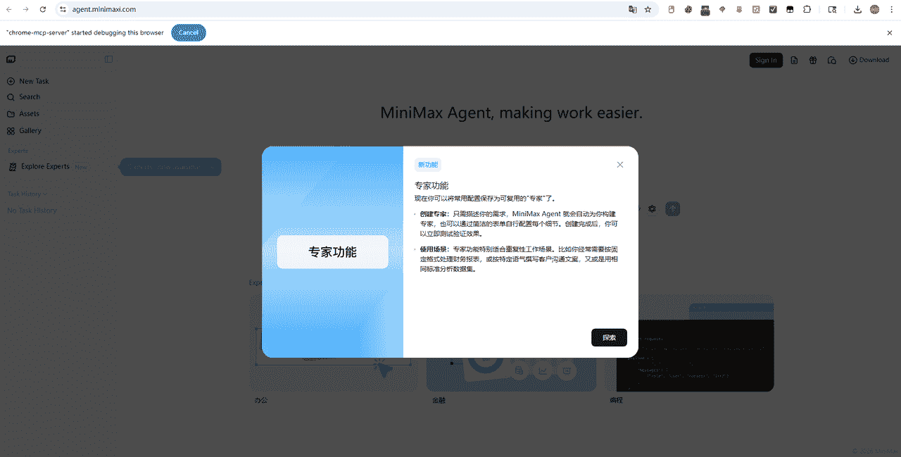

# MiniMax M2.5的自我迭代能力：108天迭代3次，内部80%代码AI写的

> 来源：[https://my.feishu.cn/docx/SrWsdwUl8oXumaxvKoacDELFnfg](https://my.feishu.cn/docx/SrWsdwUl8oXumaxvKoacDELFnfg)

今天（2月13日）早上MiniMax发布M2.5，老金我看完官方公告直接傻了。

不是因为价格便宜20倍，而是因为两个数据：

108天迭代3次，从74%干到80.2%。

MiniMax内部编程场景，80%的新代码是M2.5写的。

这tm才是真正的自我学习和成长暴增。

**老金我也实打实的用**了一天，感觉是评价就是 很顺畅！很便宜！

**它有个充****值邀请，使用我分**享的可以 9折购 ，先看完老金我的介绍，有兴趣的 文末老金放了链接。

主页还有专家模式，能干很多事儿。

地址：https://agent.minimaxi.com/

言归正传，看看他们这次做了什么。

## 第一个震撼：Forge RL框架自我学习

M2.5为什么能在108天内迭代3次？

官方给出的答案是：**Forge RL框架**。

这是MiniMax自研的Agent强化学习框架，核心特点：

**数十万真实环境训练** - 不是模拟环境，是真实业务场景

**40倍训练加速** - 通过树状合并训练样本实现

**任意Agent接入** - 支持任意脚手架和工具

**过程奖励机制** - 全链路监控完成质量

老金我解释一下什么叫"数十万真实环境训练"。

传统AI训练：在GitHub上爬代码 → 在Stack Overflow上爬问答 → 在公开数据集上训练

MiniMax训练：在MiniMax内部真实项目上训练 → 在客户真实业务场景上训练 → 在数十万不同环境上训练

**这tm就是实战出来的模型。**

再说说"40倍训练加速"。

传统强化学习训练一个模型，可能要几个月。

MiniMax用Forge框架，几天就能训练完。

速度快40倍，成本降到1/40。

这就是为什么M2系列能在108天内迭代三次（M2→M2.1→M2.5）。

## 第二个震撼：108天迭代3次，成长暴增

老金我做了个时间线：

2025年10月27日：M2发布，SWE-Bench Verified 74%

2026年1月：M2.1发布，SWE-Bench Verified 76%

2026年2月12日：M2.5发布，SWE-Bench Verified 80.2%

108天，三次迭代，提升6.2个百分点。

老金我再看看其他公司：

Claude Opus 4.5：2025年10月发布，80.8%

Claude Opus 4.6：2026年2月发布，80.8%（4个月没进步）

GPT-5.1：2026年1月发布，78%

Gemini 3 Pro：2025年12月发布，76%

看到没？

Claude从4.5到4.6，4个月时间，分数没变。

GPT-5.1和Gemini 3 Pro，都没超过80%。

MiniMax从74%到80.2%，只用了108天。

这就是自我学习带来的成长暴增。

更牛的是，M2.5发布不到24小时，用户已经在MiniMax Agent上构建了1万+专家。

什么是专家？

专家 = Office Skills + 行业经验。

举个例子：

行业研究专家：Word Skills + 研究框架SOP = 自动生成研报

金融建模专家：Excel Skills + 机构建模规范 = 自动生成财务模型

代码审查专家：编程能力 + Code Review规范 = 自动审查代码

**1万+专家，24小时内创建。**

这个速度说明什么？

说明M2.5的能力已经强到可以让普通人快速定制专属AI助手了。

## 第三个震撼：80%内部代码AI写的

自我学习的成果是什么？

MiniMax官方公告写得很清楚：

在MiniMax内部真实业务场景中，整体任务的30%由M2.5自主完成。

覆盖研发、产品、销售、HR、财务等职能。

其中，在编程场景表现尤为突出，M2.5生成的代码已占新提交代码的80%。

老金我算了笔账：

假设MiniMax有100个工程师，每人每天写100行代码，那就是1万行/天。

80%是AI写的，就是8000行/天。

相当于80个工程师的工作量被AI替代了。

最牛的是什么？

这是MiniMax自己用自己的模型跑出来的真实数据。

不是实验室数据，不是benchmark，是真实生产环境。

## 第四个震撼：原生Spec能力+Office Skills

M2.5最牛的地方不是写代码快，而是会思考。

官方说法是：模型演化出了原生Spec行为。

什么意思？

传统AI写代码：你给需求 → AI直接写代码 → 你发现不对 → 改需求 → AI重新写

M2.5写代码：你给需求 → **M2.5先做架构设计**（拆解功能、结构、UI设计）→ 你确认架构 → M2.5再写代码

**这就是架构师的工作方式。**

老金我看官方给的案例，M2.5拿到需求后会先输出：

技术栈选型、模块拆解、数据库设计、API设计。

然后你确认了架构，它才开始写代码。

这个流程跟人类架构师一模一样。

更牛的是，M2.5不只是编程强，办公场景也强。

官方说法是：**Word、PPT、Excel金融建**模等办公高阶场景中取得了显著的能力提升。

老金我看了官方给的案例：

**Excel场景**：

给M2.5一个任务"做一个财务模型，预测未来3年的收入、成本、利润"。

M2.5输出：收入预测模型（线性回归）+ 成本预测模型（固定+变动）+ 利润预测模型（自动计算）+ 敏感性分析（±10%变化）+ 图表展示（趋势图+热力图）

**这是专业级财务分析师的工作。**

**PPT场景**：

给M2.5一个任务"做一个产品发布会PPT"。

M2.5输出：封面页 + 核心亮点页 + 技术架构页 + 应用场景页 + 价格对比页 + 总结页

不是简单的表格，是完整的专业输出。

## 价格便宜20倍，但这不是重点

老金我最后说说价格。

MiniMax M2.5：输入$0.15/M，输出$1.20/M

Claude Opus 4.6：输入$5.00/M，输出$25.00/M

**Claude Opus 4.6的输出价格**是MiniMax M2.5的20.8倍。

老金我算了笔账：

按100 tokens/秒计算，连续运行1小时，成本约1美元。

按50 tokens/秒计算，成本约0.3美元。

1万美元理论上可以支持4个Agent连续工作一年。

但老金我要说：

价格便宜不是M2.5最牛的地方。

最牛的地方是：

Forge RL框架自我学习 - 数十万真实环境训练

108天三次迭代 - 行业最快成长速度

内部80%新代码AI写的 - 真实生产力革命

原生Spec能力+Office Skills - 像架构师一样思考

这四个才是M2.5的核心竞争力。

价格便宜只是附赠的。

## 老金建议

MiniMax M2.5适合谁？

**个人开发者**：编程能力追平Claude，价格便宜20倍。更重要的是，M2.5会做架构设计。你不需要从零开始写代码，只需要review AI的架构设计。

**企业用户**：M2.5在真实业务场景训练过，不需要额外微调，直接就能用。一个月能省几万美元。

**AI创业者**：用Claude的成本太高，很多项目根本不赚钱。换成MiniMax M2.5，成本降到1/20，利润空间立马出来了。

## 怎么用？

MiniMax M2.5现在有三个入口：

**MiniMax Agent**（推荐）：agent.minimaxi.com

可以直接用Office Skills，创建专家。免费额度够你测试了。

老金我直接充了一波，然后大家拿我这个充可以有9折优惠！

🎁 MiniMax 跨年福利来袭！邀好友享 Coding Plan 双重好礼，助力开发体验！

好友立享 9折 专属优惠 + Builder 权益，你赢返利 + 社区特权！

👉 立即参与：https://platform.minimaxi.com/subscribe/coding-plan?code=3nUJXdOpHs&source=link

老金我建议：先用MiniMax Agent测试，确认效果后再上API或订阅。

---

MiniMax M2.5这次发布，老金我给95分。

为什么不是100分？因为还没开源。

官方说会在HuggingFace开源，支持本地部署，但具体时间没说。

但就目前来看，MiniMax M2.5已经是国产大模型的天花板了。

Forge RL框架自我学习，数十万真实环境训练。

108天三次迭代，行业最快成长速度。

内部80%新代码AI写的，真实生产力革命。

原生Spec能力+Office Skills，像架构师一样思考。

这四个优势加起来，就是降维打击。

老金我预测：未来半年，MiniMax M2.5会成为企业用户的首选。

原因很简单：性能够用，价格便宜，速度快，真实场景训练过。

最后老金我说一句：

**如果你还在用Claude Opus 4.6跑Agen**t任务，赶紧换MiniMax M2.5。

不是因为便宜，是因为它真的更强。

<https://my.feishu.cn/sync/HDlcdCPBksnJpBbRk0EcW364nmc>