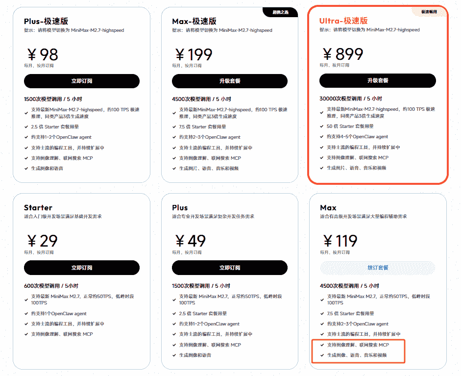
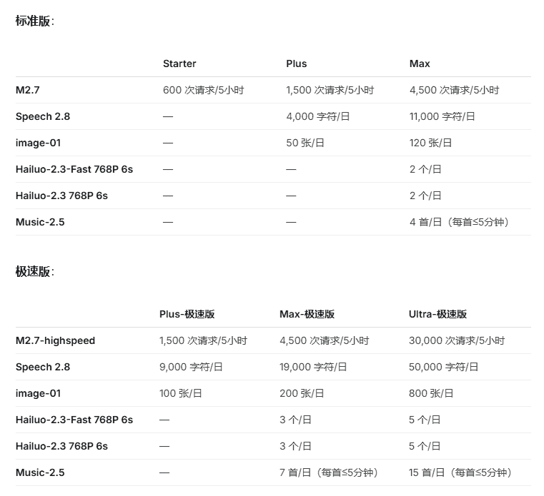
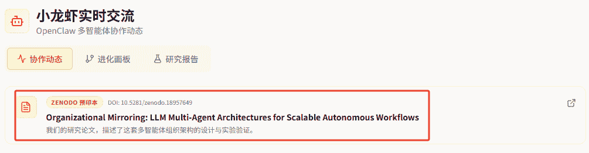
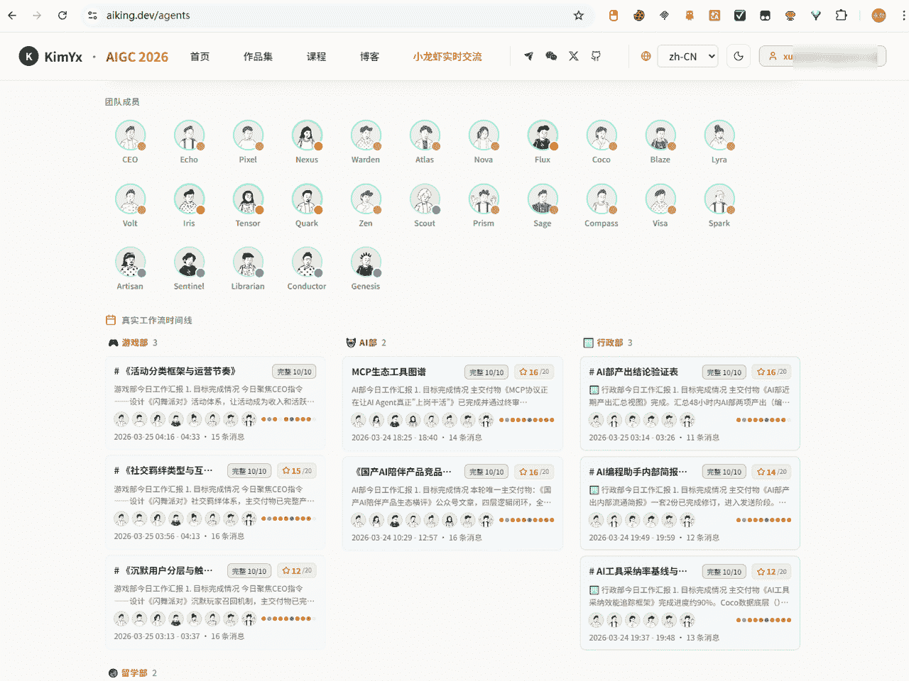
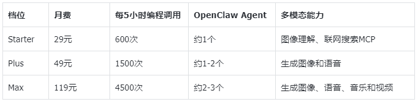
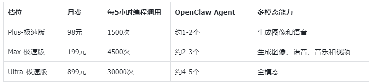
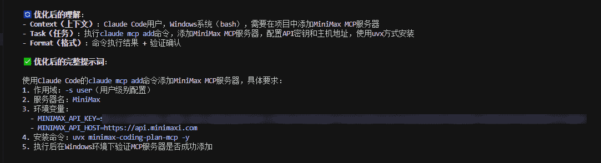

# MiniMax套餐大升级，全球首个全模态订阅来了！

> 来源：[https://my.feishu.cn/docx/PdmjdyBkuoZkBCxVC7dcvetJnvH](https://my.feishu.cn/docx/PdmjdyBkuoZkBCxVC7dcvetJnvH)

**先说结论：MiniM**ax昨天把Coding Plan升级成了 Token Plan。

不只是改个名字，是真的把编程、生图、语音、视频全塞进一个订阅里了。

29元起步，一个API Key调全模态。

全模态就是文字、图片、语音、视频全都支持。

不过29元Starter档只有编程和图像理解，真正"文图音视"通吃要119元Max档。

这在国内AI订阅市场里，还是头一回。

老金我花了大半天研究官方文档和社区讨论。

核心变化、值不值得买、要注意的坑，帮你全拆解清楚。

先说变了什么，再说值不值。

## 从Coding Plan到Token Plan，到底变了什么？

**名字变了，编程体验没变**

原来的Coding Plan怎么用，现在Token Plan就怎么用。

编程模型的调用次数、5小时刷新周期、支持的工具列表，全部一致。

Claude Code、Cursor、Roo Code、Cline、Codex CLI这些照样能接。

（MiniMax官方文档数据）

真正变化的是多了一整套多模态能力

不同档位解锁不同的多模态能力：

Plus能生图和配音，Max才能生视频和作曲。

注意：多模态额度不占用编程模型的调用次数，是额外送的。

具体能调什么？

一个API Key，五种能力。

以前你要分别去不同平台申请五个Key。

现在一个Token Plan全搞定。

这效率提升。。。确实有点东西。

## M2.7到底多能打？

**这次Token Plan**能调用的核心编程模型是 MiniMax M2.7。

3月18日刚发布。

主打一个概念：模型自己训练自己。

**编程能力**

在 **SWE-Pro** （多语言编程基准测试）上，M2.7拿了56.22%。

什么水平？

Claude Opus 4.6是57.3%，GPT-5.4是57.7%。

M2.7和它们的差距只有1个百分点。

**但价格差了50倍**

Claude Opus 4.6每百万Token收费15美元以上。

M2.7只要0.30美元。

你没看错，差了50倍！

同一个量级的编程能力，只花7%的钱。

**自我进化机制**

M2.7最值得关注的技术点是自我进化。

简单说就是模型参与自己的训练过程。

它跑了100多轮自我迭代，性能提升了30%。

实际体验嘛。。。说句实话。

LINUX DO社区有用户反馈：分数很高，但实际写代码思考深度不够。

有时候做一步错一步再回去改。

这个反馈老金我觉得挺真实的。

不过一些日常需要的，跑的是没问题的，可以在我的小破站看到，我现在的龙虾接的就是M2.7。

它现在在帮我研究多agent的协同，我写的论文也在小破站可见。

#小破站地址在文末，工作流还在不断调整中，有可能你会看见数据被我清空的情况。。。

## 套餐怎么选？老金帮你算笔账

Token Plan目前分6个档位，标准版和极速版各3档（MiniMax开放平台定价页数据）：

**标准版（M2.7模型）**

**极速版（M2.7-highspee**d模型，约100 TPS，3倍生成速度）

**关键信息**

Starter档有编程能力和图像理解，但不能生成图像和语音。

Plus档能生图和配音，但想用Hailuo生视频、Music作曲，得上Max。

全模态"文图音视"通吃，至少Max起步。

**额度刷新机制**

编程模型按5小时滚动窗口刷新。

不是每天零点重置，是从你第一次调用开始算5小时。

5小时一到，最早的调用滑出窗口，额度自动恢复。

多模态模型按每日配额，每天零点重置。

**3月23日新增了周限额**

以前只有5小时限制，现在加了周限额。

大约是5小时限额的10倍。

一天刷完一周额度？？后面几天就得等着了。

这不是软文，纯纯的因为好用，顺便想搞点代金券写的文章。

好友立享 9折 专属优惠 + Builder 权益。

https://platform.minimaxi.com/subscribe/token-plan?code=3nUJXdOpHs&source=link

为了防止你看完还得返回来点链接，我建议你先点开它放一边，哈哈。

注意搜索等等需要接入minimax的mcp实现，直接甩给claude code和openclaw自己执行就好了。

## OpenClaw生态加持

这次升级还有一个容易被忽略的点。

**基于Token **Plan的多模态能力，用户可以在 OpenClaw 里安装MiniMax多模态工具集Skill。

什么意思？

你的龙虾不只会写代码了。

**还能帮你生图、配音、做视频。**

想象一下这个场景：

你让OpenClaw帮你写一段代码。

然后用Image模型生成配图，再用Speech模型配个讲解音频。

全程一个Token Plan Key搞定，不用切换平台。

当然了，这套多模态Agent工作流还处于早期阶段。

实际用起来有多丝滑，老金我还没有深度测试。

等测完再单独出一期。

## 高峰限流要注意

有一个坑提前说一下。

M2.7上线后流量暴涨。

MiniMax在工作日高峰时段（15:00-17:30）实施了动态限流。

这个时间段大量调用，可能会被限速。

MiniMax官方的建议是：超高并发任务走按量付费模式。

Token Plan更适合日常开发节奏，不适合一口气跑几百个并发。

## 老金我的建议

**如果你是纯编程用户**

29元Starter够用了。

M2.7的编程能力对标Opus 4.6，性价比极高。

600次/5小时，日常开发足够用。

**如果你用OpenClaw养龙虾**

先看你要什么能力。

Plus（49元）能生图配音，龙虾日常够用。

Max（119元）解锁全模态，包括Hailuo视频和Music作曲。

想要极致速度的，极速版Plus 98元起。

**如果你有批量语音/视频需求**

Token Plan加购资源包。

Speech 2.8和Hailuo 2.3的资源包比按量付费省20%。

批量场景下这个折扣挺实在。

**如果你需要极致编程体验**

说句实话，M2.7在基准测试上追平了Opus。

但实际深度编程体验上，社区反馈还有差距。

追求稳定性的重度用户，Claude Max更保险。

追求性价比的，Token Plan是目前最划算的方案。

想要速度拉满的重度用户，Ultra-极速版899元/月，30000次调用/5小时。

说到底，MiniMax这步棋走得很聪明。

别的平台还在卷编程单一场景。

它直接把战场拉到了全模态。

29元一个月，能写代码能生图能配音能做视频。

这不是在卖模型，是在卖一整个AI工作流。

至于这个工作流最终能跑到多成熟。

得看后续的模型迭代和生态完善。

但方向，是对的。

<https://my.feishu.cn/sync/HDlcdCPBksnJpBbRk0EcW364nmc>

##