# Kimi K2.5来了！老金用了一天发现这玩意儿要逆天！

> 来源：[https://my.feishu.cn/docx/Tn3sdqPPRo0SIzxepBycHTd3nDc](https://my.feishu.cn/docx/Tn3sdqPPRo0SIzxepBycHTd3nDc)

昨天刷到月之暗面发布Kimi K2.5的消息，立马下载试了一天。

卧槽，这玩意儿真的要逆天了。

## 1.04万亿参数，直接开源

先说参数规模。

Kimi K2.5用的是MoE（混合专家）架构，总参数1.04万亿。

激活参数370亿，上下文窗口128K。

**重点来了：完全开源。**

不是那种"开源但不给商用"的假开源，是真正的Apache 2.0协议。

你想怎么用就怎么用，想改就改，想商用就商用。

## 原生多模态，不是后期拼凑

**Kimi **K2.5最牛逼的地方是原生多模态。

什么叫原生？

就是从训练开始，文本、图像、代码就是一起学的。

不是像某些模型，先训练文本，后来再硬塞个视觉模块进去。

所以它能够做PPT、看网站、看视频等等，并一一复刻！

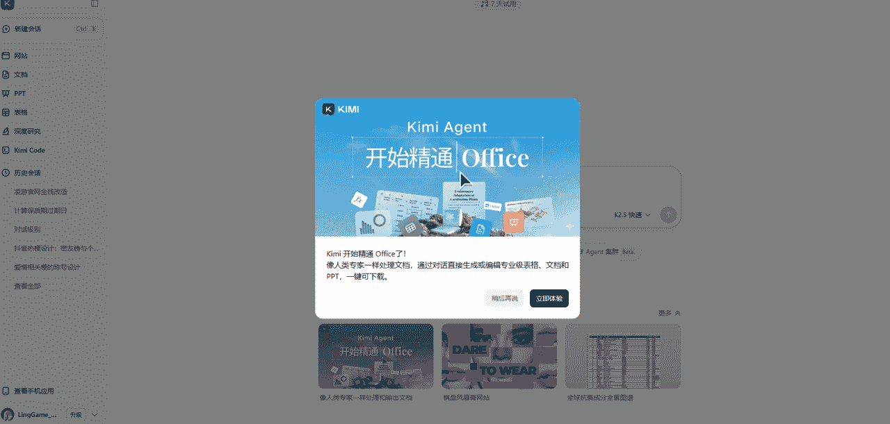

## Agent Swarm集群协作

**Kimi K2.5还有**个杀手锏：Agent Swarm。

简单说就是多个AI智能体协同工作。

**举个例子**：

你让它做一个完整的Web项目。

传统AI：一个模型从头写到尾，容易出错，逻辑混乱。

Kimi K2.5：

+   Agent 1负责需求分析

+   Agent 2负责架构设计

+   Agent 3负责前端开发

+   Agent 4负责后端开发

+   Agent 5负责测试调试

每个Agent专注自己擅长的领域，最后统一整合。

在官方演示的"寻找 100 个细分领域的 YouTube 头部博主"任务中.

人类需要几天.

传统单体 AI 需要数小时.

而 Kimi Agent Swarm 仅需几分钟。

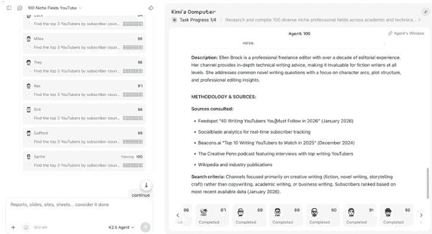

**效率提升不是一点半点。**

但他有个小门槛，需要Allegretto，也就是199/月。

但对于大批量的用户来说，肯定物超所值。

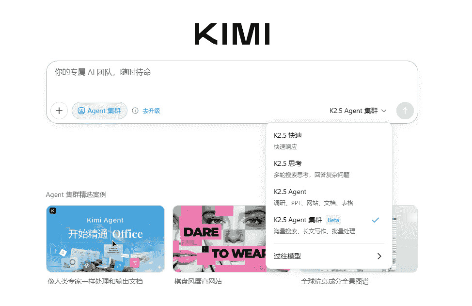

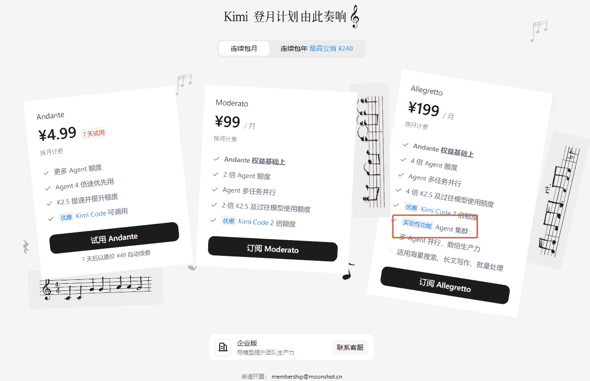

## 性能测试：吊打一众国际大模型

在 Agent、代码、视觉理解及一系列通用智能任务上取得开源 SoTA 表现。

同时 Kimi K2.5 也是 Kimi 迄今最全能的模型，原生的多模态架构设计，同时支持视觉与文本输入、思考与非思考模式、对话与 Agent 任务。

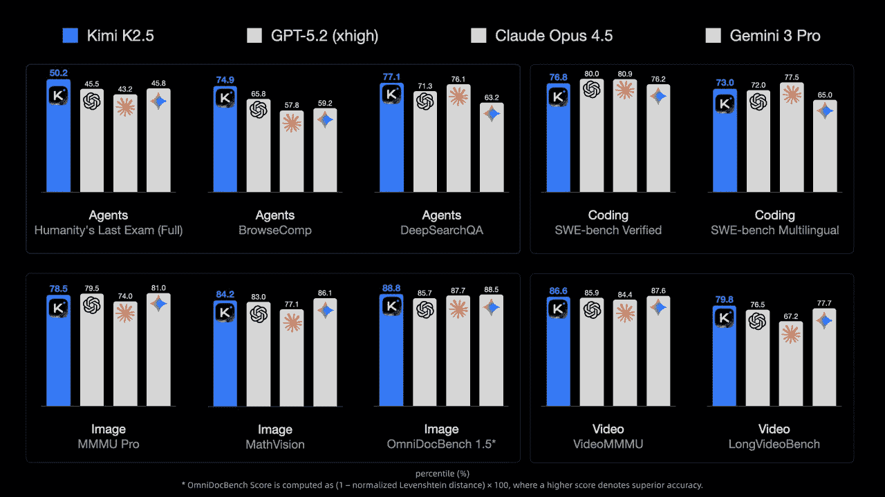

## 实际使用场景

老金试了几个场景，分享一下，最离谱的是它的网页生成，审美超一级了。

这是它官网的说明，标记的是老金实测，非常认同，远远甩其他模型。

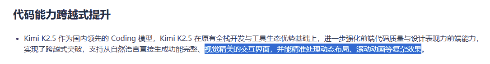

直接使用官网：https://www.kimi.com/

老金我先来测试个 **PPT** 看看。

哦豁，质量非常高，光看审美就已经非常nice了。

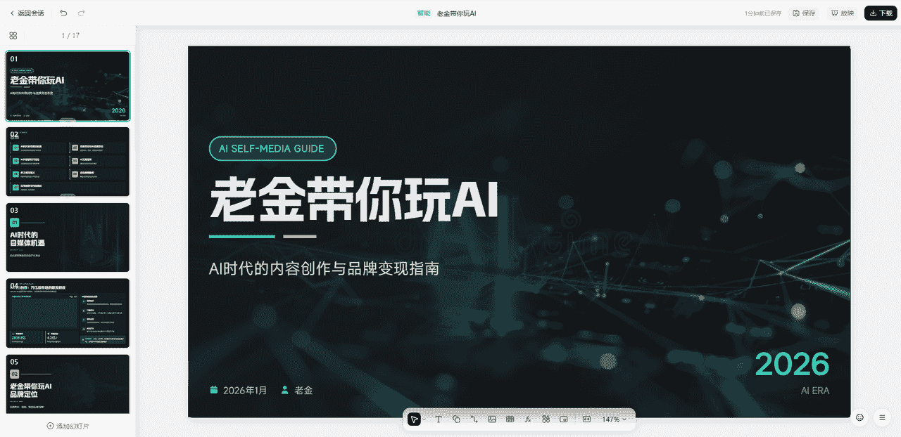

可下载PPT格式

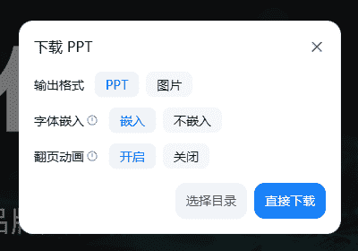

线上也可以直接改，下载到PPT没有任何区别。

线上版，指哪改哪：

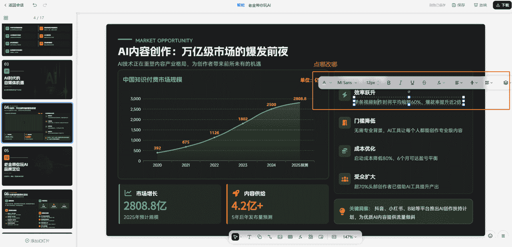

PPT版，不像以前会串行串内容了:

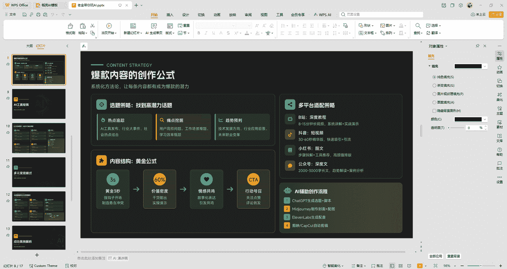

再来看看网页！这个我真觉得绝了！

他的交互设计是真绝了，各种动画做的非常好了。

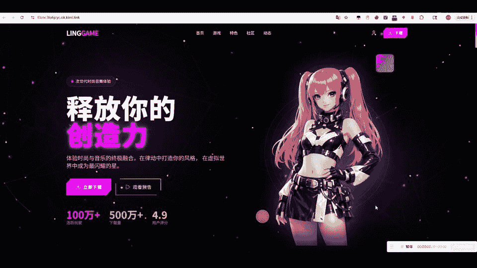

[测试.mp4](https://internal-api-drive-stream.feishu.cn/space/api/box/stream/download/all/NjypbJWMQo3J0Rx9OWhcrIXOnud)

## 开源意味着什么

**Kimi **K2.5开源，对开发者来说是真正的福音。

本地部署：下载模型，本地跑，想怎么用就怎么用。

自由定制：可以根据自己的需求微调模型，不用求着大厂给你定制版本。

商业化无限制：Apache 2.0协议，商业化完全自由，不用担心版权问题，不用交授权费。

## 国产AI的逆袭

Kimi K2.5的发布，标志着国产AI真正能打了。

不是那种"追赶"的状态，是真正的"超越"。

更重要的是，月之暗面证明了：

中国AI公司不是只会抄袭，是真的有创新能力。

原生多模态架构、Agent Swarm集群协作，这些都是原创技术。

不是简单的"参数堆砌"，是真正的技术突破。

## 写在最后

Kimi K2.5的发布，对整个AI行业都是好事。

**对开发者**：有了更强大、更自由的工具

**对企业**：有了更便宜、更灵活的方案

**对行业**：有了更多竞争、更快进步

老金用了一天，真心觉得这玩意儿要逆天。

如果你还在用GPT或Claude，建议试试Kimi K2.5。

尤其是做代码开发的，多模态任务的，本地部署的。

**这玩意儿，真的香。**

<https://my.feishu.cn/sync/HDlcdCPBksnJpBbRk0EcW364nmc>