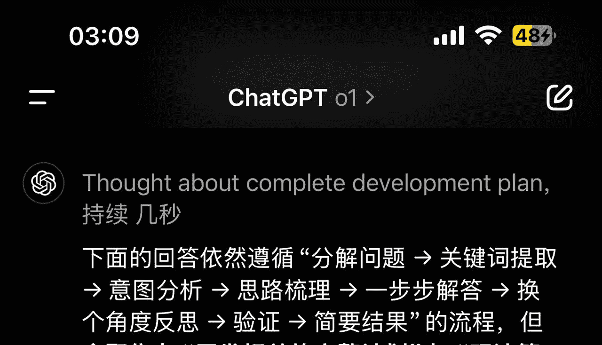
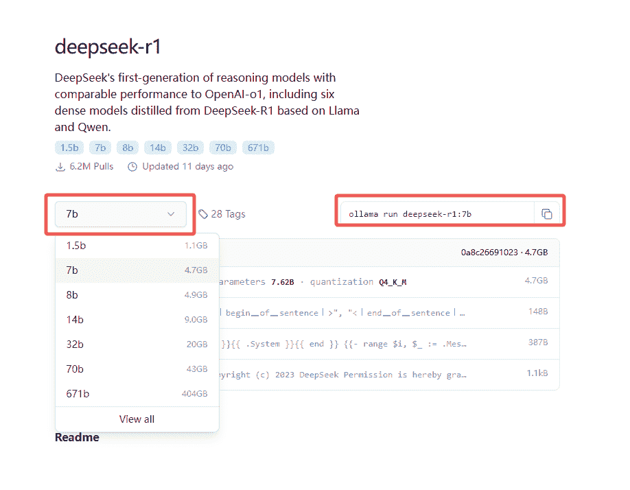
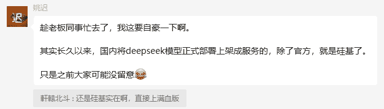
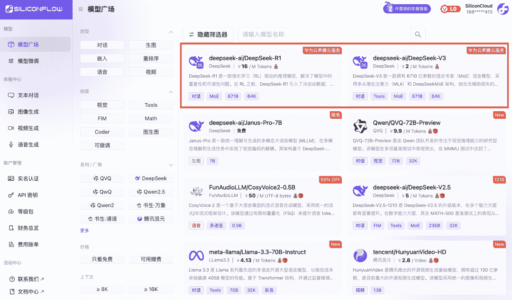
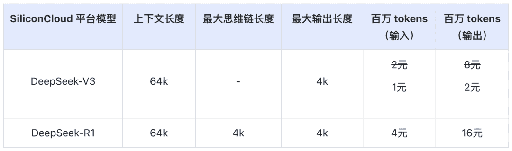
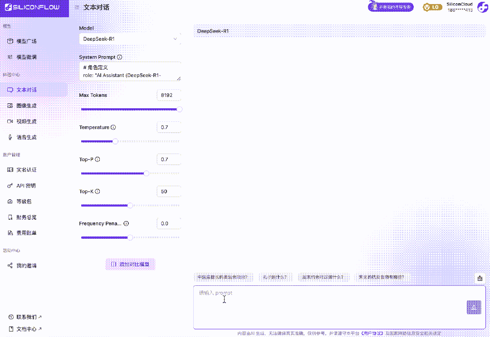
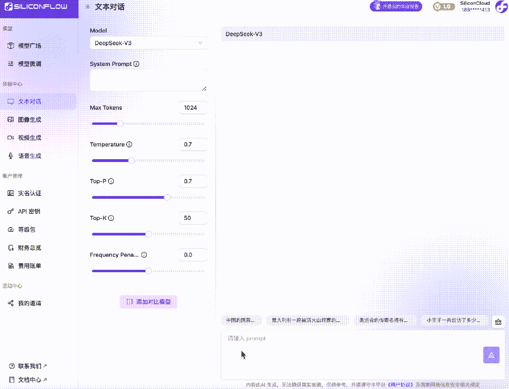

# DeepSeek怎么用？怎么本地部署？老金手把手教你！

> 来源：[https://my.feishu.cn/docx/XG1jdAvykoBlHbxrWozcooMqnTd](https://my.feishu.cn/docx/XG1jdAvykoBlHbxrWozcooMqnTd)

Hello，大家过年好，老金年前太忙了，过年期间完全是在一直补觉 =。=

最近Deepseek大火，这就给大家来讲讲。

本文一共分为3大块：

1、老金目前对Deepseek的评判说明，仅代表个人观点。

2、Deepseek怎么用？是不是如其他人所说不需要提示词？这里很明确的先告诉大家：不是。

3、Deepseek怎么本地部署？以及如果本地跑不动，有什么办法能在本地接入API接口满血跑？

---

### 一、Deepseek牛在哪？

老金首次接触Deepseek是在23年，就因为“价格低”，它也是被誉为“价格屠夫”的一家公司，原本是做金融量化的一家企业。

小伙伴们可能不懂“量化”这个词的含义，它代表的东西有很多，在老金我的职业生涯中，近几年也用到的越来越多。

在老金看来，“量化”代表了：有明确目标、有执行规则、有时间预期、有数量要求等，多维度的可执行方案。

看懵了是吧？我拿简单一点的话来说明。

❌案例：把这东西弄得非常牛逼！ - 这句话里没有任何实用的量化信息，所以无法落地执行。

✅案例：一周内，通过漏斗法则，一步步检测转化率，查看哪个步骤有问题，并找到转化率最低的3个步骤，给出解决方案 - 有目标，有时间，有方法，有数量。

这只是一个让大家能够简单理解的说明，当然量化它没这么简单。

不然它也做不到国外上千亿美元训练的**模型，**它500多万就能做到，直接差了接近2万倍！

不论RLHF也好，MOE也罢，你可能看过很多文章写过Deepseek出色的地方在这。

但是老金我告你，都不是。

它拥有着目前全世界最好的“框架”，一个好的“框架”，不仅能带来成本的大幅度降低，还能带来速度上的提升，质量上的提升，真正地做到“事半功倍”。

这个就是Deepseek带给老金我最印象深刻的地方，也是西方列强最为忌惮的地方。

实话实说，Deepseek现在的输出结果，如果玩AI时间长的人都知道，是不错，但算不上惊艳。

但老金我坚信，因为成本达到万倍的差距，给它些时间，它就能超出一切了。

老金在推荐国内的就三家 - 阿里的QWEN，智谱，以及DeepSeek，这三家企业都是老金在深度使用一系列LLM后筛选出来的。

### 二、提示词没用了？

答案当然是否定的，在老金的认知里，一直在给大家讲解“AI的本质是工具”。

老金我的灵魂提问：你见过不会用工具就能把工具用好的吗？

基于RL它只是做了反思，去列举了更多的可能性而已。

但是你依旧要会判断，也就是说，如果你没认知，它就算是个超人，它也帮不了你。

因为，**它根本不清楚你的需求**。

> 强化学习（Reinforcement Learn[ing, RL）的核心](https://zhida.zhihu.com/search?content_id=238203296&content_type=Article&match_order=1&q=Observation&zhida_source=entity)概念可简单概括为：一个机器人（Agent）在看到了一些信息（Observation）后，自己做出一个决策（Action），随即根据采取决策后得到的反馈（Reward）来进行自我学习（Learning）的过程。

在老金认为，归类为“推理模型”和“非推理模型”的提示词使用技巧，会更恰当一些。

在Chatgpt o1出来时，震惊世界，震惊的到底是什么？

其实就是推理步骤，它能够在没有提示词的情况下，分析你的意图，也仅此而已。

为什么要用“仅此而已”？因为这个对于一个会提示词的人来讲，只是多打一些字，和少打一些字的区别。

再次强调，会提示词 = 对该件事物具备了认知，知道该怎么处理

没懂是吧？这里老金拿一段提示词来做说明，通常结构化的提示词会长这个样子。

```
## 角色
你是XXX专家，你擅长使用XXX

## 目的
你要完成 XXXX

## 规则
1、不要做的 事情1
2、不要做的 事情2
3、一步步进行，每个步骤进行检查与反思

## 工作流
1、你应该先做 事情1
2、再做 事情2
```

一般来讲，用于“非推理模型”上，这个结构化的提示词，已经够用了，。

那么和“推理模型”的差距在哪呢？

又到老金的灵魂提问环节：“你认为你的认知是对的吗？规则和工作流都是对的吗？”

推理模型其实在做的就是这件事，我们来看看它们都在推理什么样的过程。



看到了吧，其实和自己写的结构化提示词没有太大区别。

老金真实的使用评价是，它每次不一定是最好的，甚至不一定是对的。

因为，它还是在它的语料模型里，算出来下个字是什么而已。

老金我甚至在反思，为什么老金我在初次使用推理模型时候，认为它很厉害，但是，用久了就会发现，它输出的内容就一般了。

其实在这里，模型没变化、算法没变化，但是因为老金问的都是本行业相关的内容，其实是老金在这一年多的时间里成长了，知道更多的处理方法了而已。

所以又回到了根本，AI能不能用好，是基于你个人认知有多高。

记住了，它现在不会创造，只会依照数据，进行缝合。

这里有个小窍门，基于推理，只要把话说清楚就可以了。

**通用公式：我要什么？给谁用？希望达到什么样的**目标？有没有工作顺序？有没有忌讳？讲人话

这个公式会帮助LLM进行推理，其他都容易理解，“讲人话”的意思是让它输出通俗易懂的内容，而非专业术语，与“我是小白”等等是同理的。

老金给个案例：我要做每日早报，给老板和同事每天早上看，希望把和行业{{游戏开发}}相关的信息整理出来，涉及的工作流请你自行考虑3种方案，给我分析各自的优劣势，不要暴露成本或收入等敏感信息，用通俗易懂的话进行描述，不要使用专业术语。

### 三（1）如何在本地使用？

这里老金依旧推荐老伙伴 - Dify和Ollma。

最近关注老金的小伙伴有不少，重新介绍一下这俩产品。

**Dify:**

LLMOPS我只推荐2个，一个是COZE，另一个就是DIFY。

COZE大家都知道了，是闭源的，创作者很多，数据不是隐私的。

DIFY的好处就是弥补了这些，它开源，可以本地化部署，数据是隐私的。

**Ollma：**

开源模型本地部署的一款软件。[Ollama 开源大语言模型部署](https://tffyvtlai4.feishu.cn/wiki/Fjv4wcML6i4r4QkK9iEcJEOonfc)

---

[Dify本地部署](https://tffyvtlai4.feishu.cn/wiki/HZKXwSIn3iFBZYkcSWFcJAUhnof)装技巧都是一样的，参考老金我之前写的说明：

唯独的区别在于下载模型：

https://ollama.com/library/deepseek-r1

如下图，选择合适自己显存的，这里常规的话，推荐7b,8b，一般都跑得动。

在Ollama内输入右侧框的指令即可。

**这里只是为了大家尝鲜使用，除了Deepseek官网（目前总是崩溃，****因**为攻防战），目前国内的唯一满血版本请看下方第四部分，来自硅基和华为昇腾云的版本。



### 三（2）满血版R1怎么能用？

为什么说Deepseek，老金我要推荐Siliconflow呢？

因为，它是国内除了官网以外，目前唯一的满血版！



啥是满血？上图中最大的671b版本！参数最大的，推理能力最强的。

硅基流动（SiliconFlow）：

作为一个Infra（基础设施）团队，硅基流动的的核心目标是实现Token自由，成为AI应用的“卖铲人”。

注册链接：https://cloud.siliconflow.cn/i/wdyoipMi

看到这里估计有人会先问一句，为什么不直接用厂商的API？而是选一个套了一层壳的API？意义在哪？

用了Siliconflow之后，发现它带来的好处至少有以下3点：

1、无需自建服务，即享高性能模型API，如GPT-4o！

2、原厂API速度升级，SiliconFlow优化模型响应，快人一步！

3、 统一接入多厂家API，一个key，配置一次，效率翻倍！

为啥第三部分没用它？因为目前DIFY还不支持，经过老金亲测，自行加入是无法识别的。


估计是过年的原因，速度慢了一些，只能等年后了。

当然，这里有一些可以使用的端，以及自行接入API的方法，在Siliconflow的说明里写了出来。分别如下：



SiliconCloud 上线的这两款模型主要包括五大特点：

1.  基于华为云昇腾云服务首发推出了 DeepSeek x 硅基流动 x 华为云的 R1 & V3 模型推理服务。

1.  通过双方联合创新，在自研推理加速引擎加持下，硅基流动团队基于华为云昇腾云服务部署的 DeepSeek 模型可获得持平全球高端 GPU 部署模型的效果。

1.  提供稳定的生产级 DeepSeek-R1 & V3 推理服务。让开发者能够在大规模生产环境中稳定运行，并满足业务商用部署需求。华为云昇腾云服务可提供澎湃、弹性、充足的算力。

1.  4. 零部署门槛。让开发者更加专注于应用开发，开发应用时可直接调用 SiliconCloud API，带来更轻松易用的使用体验。

1.  5. 与 DeepSeek 官方优惠期价格保持一致，SiliconCloud 上的 DeepSeek-V3 的优惠期价格（截止 2 月 8 日 24:00）为 ￥1 / M tokens（输入）& ￥2 / M tokens （输出），DeepSeek-R1 的价格为 ￥4 / M tokens（输入）& ￥16 / M tokens （输出）。



在线体验

DeepSeek-R1：r1.siliconflow.cn

DeepSeek-V3：v3.siliconflow.cn

API 文档：docs.siliconflow.cn/api-reference

开发者朋友可以感受一下 SiliconCloud 上的 DeepSeek-R1 & V3 在国产芯片上加速后的效果。更快的输出速度还在持续优化中。





如果你想直接在客户端应用里体验 DeepSeek-R1 & V3 模型，可在本地安装以下产品，接入 SiliconCloud 的 API 后（可自定义添加这两款模型），即可体验 DeepSeek-R1 & V3。

+   大模型客户端应用：[**ChatBox**](https://mp.weixin.qq.com/s?__biz=Mzk0NzYzNTMyMA==&mid=2247486630&idx=1&sn=d8ac50b5db961cf5eb78e124ab3c3b60&scene=21#wechat_redirect)**、**[**Cherry Studio**](https://mp.weixin.qq.com/s?__biz=Mzk0NzYzNTMyMA==&mid=2247485462&idx=1&sn=9635f38ad5c4fbf808ff0e937f9cdee1&scene=21#wechat_redirect)**、**[**OneAPI、L**](https://mp.weixin.qq.com/s?__biz=Mzk0NzYzNTMyMA==&mid=2247484595&idx=1&sn=e538c854e204bd06263c4458bf26db77&scene=21#wechat_redirect)obeChat、NextChat

+   代码生成应用：[**Cursor**](https://mp.weixin.qq.com/s?__biz=Mzk0NzYzNTMyMA==&mid=2247485191&idx=1&sn=95a76fa7288aa490cd73641609f6c582&scene=21#wechat_redirect)**、Windsurf、Cline**

+   大模型应用开发平台：[**Dify**](https://mp.weixin.qq.com/s?__biz=Mzk0NzYzNTMyMA==&mid=2247484595&idx=1&sn=e538c854e204bd06263c4458bf26db77&scene=21#wechat_redirect)

+   AI 知识库：[**Obsidian AI**](https://mp.weixin.qq.com/s?__biz=Mzk0NzYzNTMyMA==&mid=2247486231&idx=1&sn=fdd37fda738c35872fa2ed1fe2d0bebb&scene=21#wechat_redirect)**、**[**FastGPT**](https://mp.weixin.qq.com/s?__biz=Mzk0NzYzNTMyMA==&mid=2247486330&idx=1&sn=6b56dffc30accda32a346ac9e4a0cfdb&scene=21#wechat_redirect)

+   翻译插件：[**沉浸式翻译、**](https://mp.weixin.qq.com/s?__biz=Mzk0NzYzNTMyMA==&mid=2247484595&idx=1&sn=e538c854e204bd06263c4458bf26db77&scene=21#wechat_redirect)[**欧路词典**](https://mp.weixin.qq.com/s?__biz=Mzk0NzYzNTMyMA==&mid=2247485752&idx=1&sn=513b5368e925e7d5f7c823f6187c9e56&scene=21#wechat_redirect)

更多场景与应用案例接入教程可参考：https://docs.siliconflow.cn/usercases/awesome-user-cases

<https://my.feishu.cn/sync/HDlcdCPBksnJpBbRk0EcW364nmc>