# Deepseek官网总卡？傻瓜式教程！有手就行！

> 来源：[https://my.feishu.cn/docx/NqUvd5bUloU5dSxEcbscEHJ0nke](https://my.feishu.cn/docx/NqUvd5bUloU5dSxEcbscEHJ0nke)

昨儿老金刚说Dify还不支持R1，结果被啪啪打脸 - - 原来是老金我没升级。

今儿给大家带来两种本地部署的方法，这玩意居然还真有人拿来挣钱！？

居然挣得还不少？

老金我就懵逼了呀！

免费的公众号教程传播不出去，付费的付款人数比我阅读量都高，找谁说理去 =。=

本期带来两种方式教学。

分别是傻瓜式的chatboxai还有Dify。

这俩都是作为LLMOPS（大语言模型的运**维平台，总有人问**，这回记住了**哈！不行就去老金的开源知识库里**多学学！ 关注公众号，发送：“知识精华”），可以灵活调用LLM的。

想在本地跑大语言咱就免谈了，或许大家都看了别人推的啥1.5B，7B，8B之类的模型，但是老金我告你，那都是垃圾！

既然是推理模型，当然语料越多越好！

如果你实在想搞，那么去看老金昨儿的文章，使用Ollama部署。

[DeepSeek怎么用？怎么本地部署？老金手把手教你！](https://tffyvtlai4.feishu.cn/wiki/VfylwCZsIihDRJkyok5c2YP8nBh)

**所以，作**为一个硬核AI知识博主，老金我当然推荐 满血版！

## 满血版Deepseek API Key

来自Siliconflow的671B版本！它是国内除了官网以外，目前唯一的满血版可自由使用的，当然如果你只想联网使用，秘塔刚刚也更新了满血版。

先来注册一个，硅基大大方方的给每人赠送2000万Token。

注册链接：https://cloud.siliconflow.cn/i/wdyoipMi

注册完成后，选择API密钥，然后点击复制就行，先保留着，我们先下载调用软件。

## Chatboxai

今儿推荐个新玩意，这本来是我给我朋友做的，上手超级简单，所以推荐给小白用户。

如果你是刚接触AI，老金我觉得这个有手就行，1分钟搞定的适合你！

打开网址下载：https://chatboxai.app/ ，当然直接使用网页版也可以！

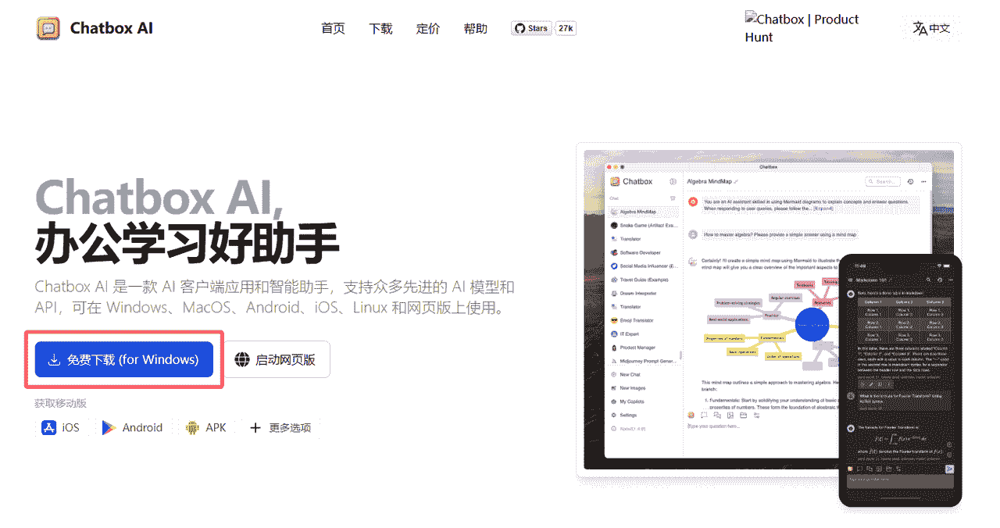

安装完成后，直接打开！选择使用自己的Key，选Siliconflow。

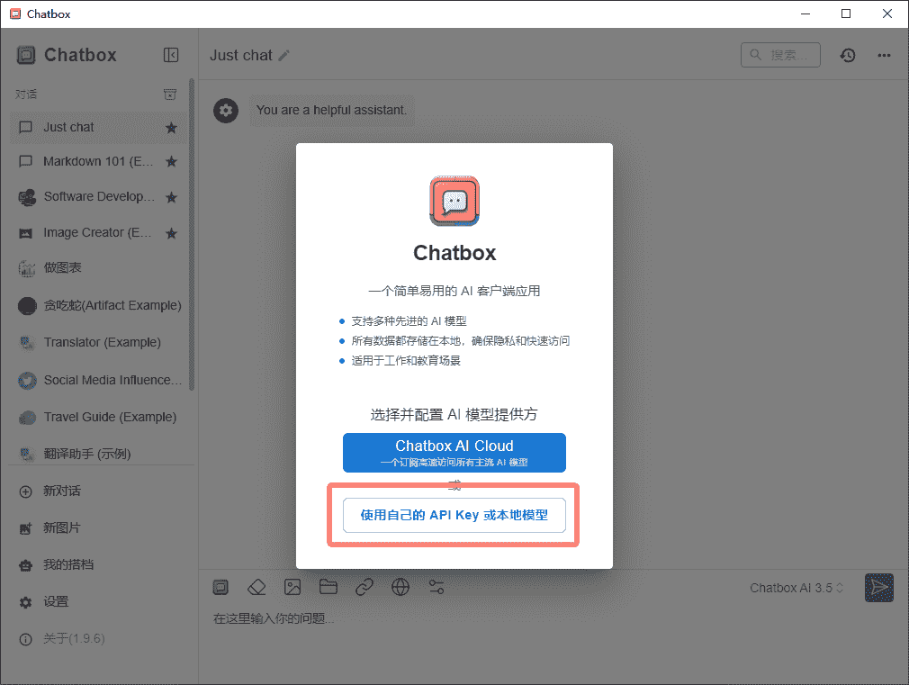

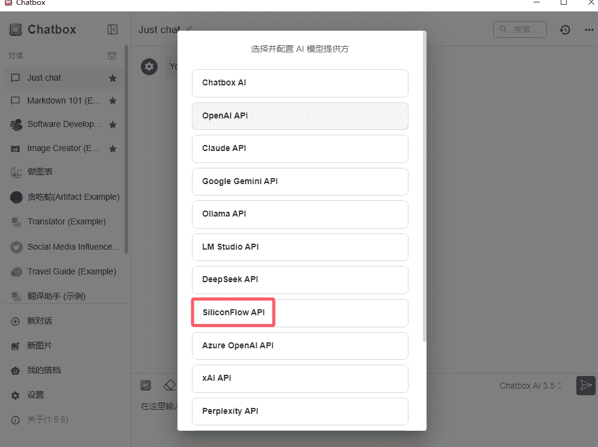

把刚刚网页的硅基流动的Key贴进来，模型拉到最下面（截止目前）。

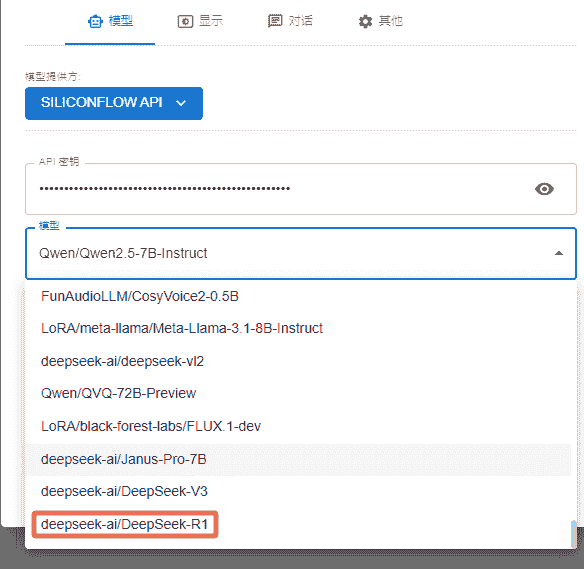

完事儿！是不是有手就行！是不是就1分钟！

而且最重要的！不卡！再也不用看Deepseek官网的总是卡死的问题了！（当然这不是他们的问题，是流量太大了，毕竟100多个国家免费榜登顶）

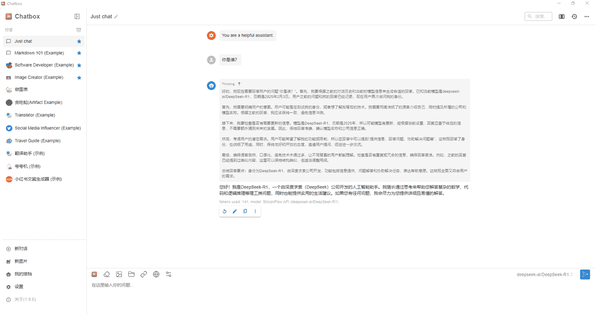

## Dify

作为老金一直推荐的平台，Dify咱就不多说了，功能强大且多，不知道是啥的，可以翻翻老金我的知识库，或者文章最下方的合集。

和Chatboxai一样，本地或者线上都行，老金我上面教了下载本地的，这个就线上吧。

[Dify本地部署](https://tffyvtlai4.feishu.cn/wiki/HZKXwSIn3iFBZYkcSWFcJAUhnof)果对Dify本地部署感兴趣，请看老金之前的文章。

本地部署的需要注意一下，你要确认你的Dify版本是0.15.2（目前最高）。

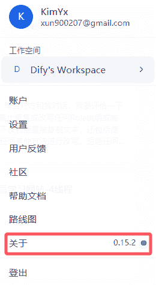

打开网页：https://cloud.dify.ai/

注册老金我就不写了，写了N次了，直接进入正题。

因为Dify官网还没接，我们需要手动添加模型，按照顺序点击。

**此处注意3号，因为老金设置过API K**EY了，小伙伴们需要在下方先找到Siliconflow，配置完成后，再拉到上面，选择添加模型。

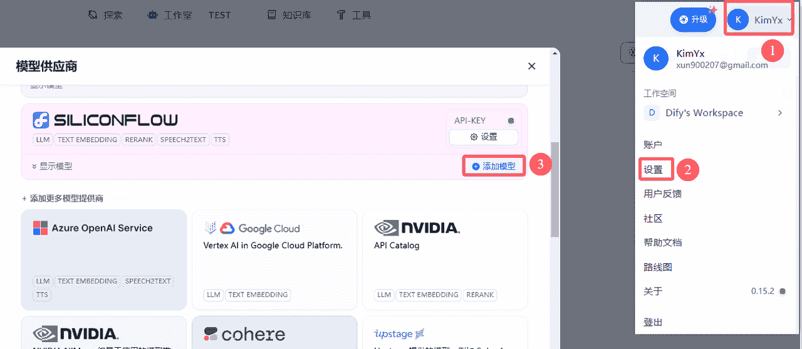

**填**写模型信息，模型名字直接复制：deepseek-ai/DeepSeek-R1 ，输入上面硅基网页的API Key。

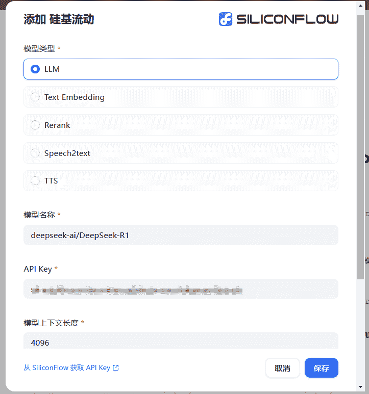

在屏幕左侧，创建一个空白应用。

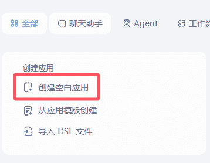

选择**聊天助手**，Agent亲测还不好使，坐等Dify更新。

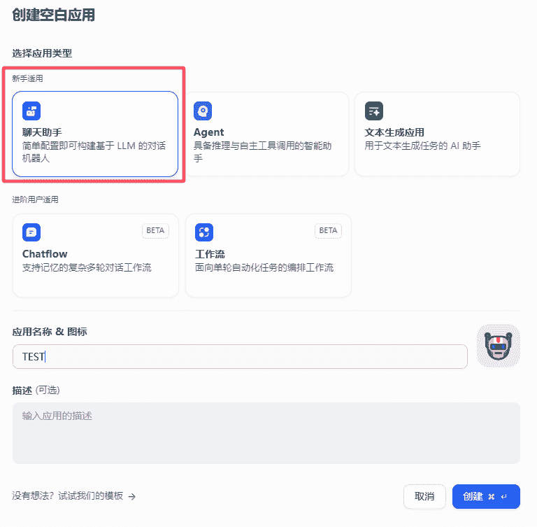

Chatflow和Workflow测试了下，也是好使的，只有Agent不行。

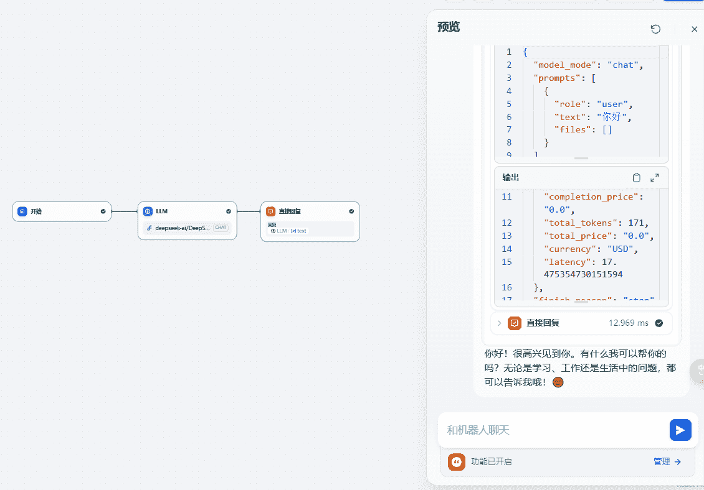

还有个劣势，它在Dify中不显示思维链（也就是思考过程，就是Deepseek官网上的小灰字儿），估计是还没兼容的问题，还是坐等更新。

依次点击选择。

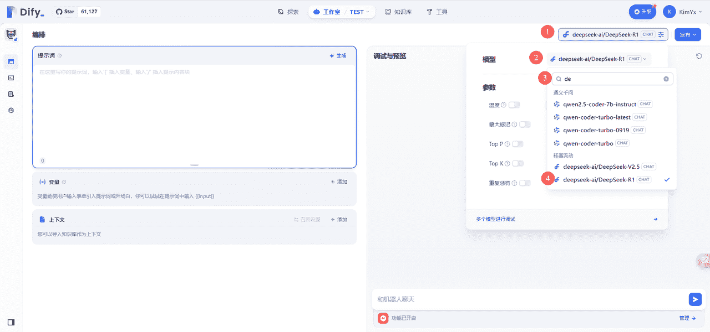

就完事儿了！完事儿了！

赶紧点赞转发加评论！

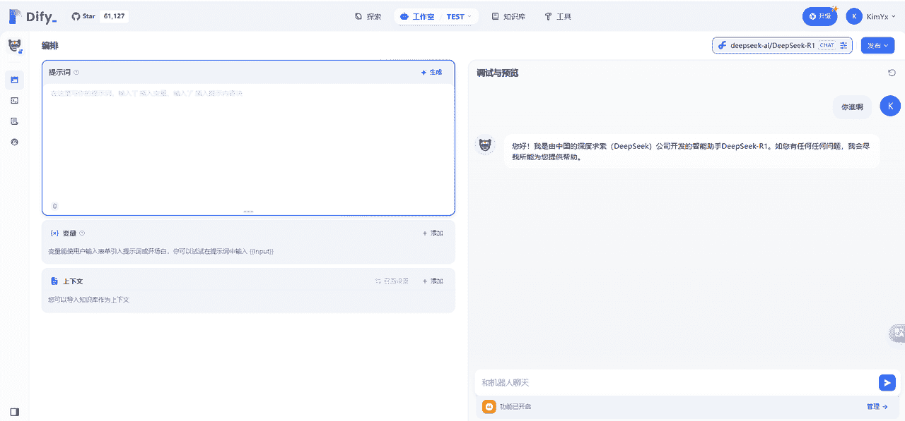

最后，你会觉得这Dify不是和Chatboxai 一样的吗？是不是这样的疑问？

Dify作为老金推荐最多的LLMOPS，当然不止于此，和Coze一样，能用插件，用工具，用各种工作流，用知识库，而且免费开源，数据私密！懂了吗？！

<https://my.feishu.cn/sync/HDlcdCPBksnJpBbRk0EcW364nmc>