# DeepSeek R1怎么在工作流中联网？老金手把手教学（上）

> 来源：[https://my.feishu.cn/docx/YSThdaPrnoROOgx1cMmcvK0Rnse](https://my.feishu.cn/docx/YSThdaPrnoROOgx1cMmcvK0Rnse)

介于老金我前两天写的万字长文提示词教学，回访后发现小伙伴们嫌太长了，有用，但是看不完。

因此老金把本篇Deepseek满血版联网分为上下两部分。

本篇介绍 Coze中如何在工作流中使用。

下一篇讲介绍 Dify中如何使用，Dify会用到下面的硅基流动，有用到的小伙伴可以先准备好。

Dify和Coze的区别是Dify可以本地部署，也可以使用工作流或智能体等等。

文末有福利：清华大学发布的DeepSeek从入门到精通。

[DeepSeek](https://tffyvtlai4.feishu.cn/wiki/MnWZwv8YwidNz5k4ydocgIOdnuh)金已完成的Deepseek开源教程合集：

---

**硅基流动：****https://cloud.silic**onflow.cn/i/wdyoipMi

+   这是个网站，是**满血版！****，****能直接对话，还能调** API，用于本地部署或在线平台。

+   **优点是免费赠送2000万Token，有各大模型，不限于**大语言模型、绘画模型、视频模型和语音模型

+   老金我曾多次推荐过，老金的机器人基本上走的全是硅基流动的API接口。

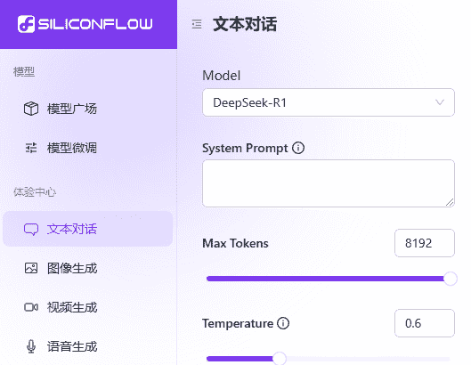

废话不多说，本期教程直接开始。

---

## 火山引擎中加入R1模型

登录火山引擎，并查询“**火山方舟**”。

https://console.volcengine.com/coze-pro/overview?scenario=coze


如图所示，**搜索DeepSeek R1模型**，可以看到还有蒸馏版本，大家自行开通。

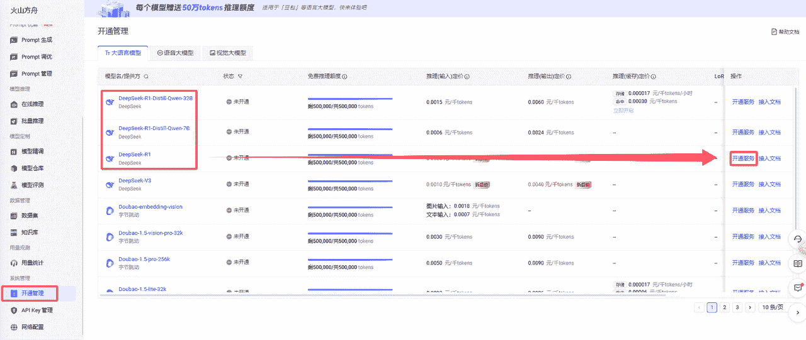

选中后开通。

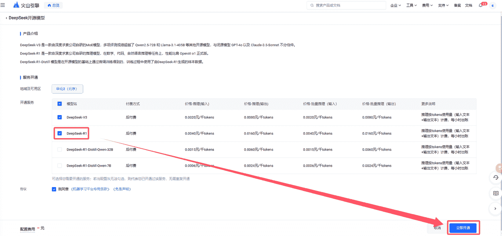

找到**在线推理**，这个的作用是智能体实时推理。

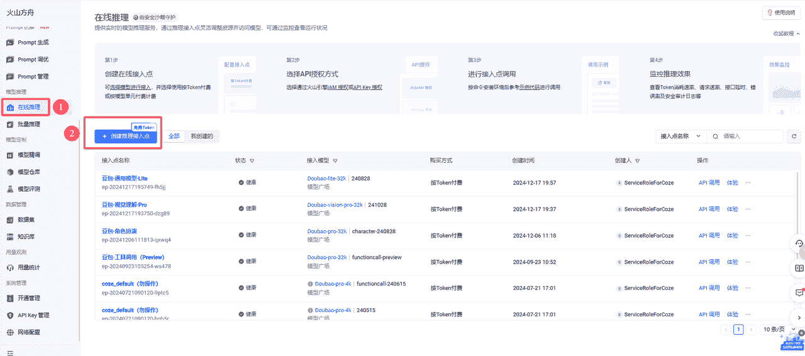

填入名字，增加Deep Seek R1模型。

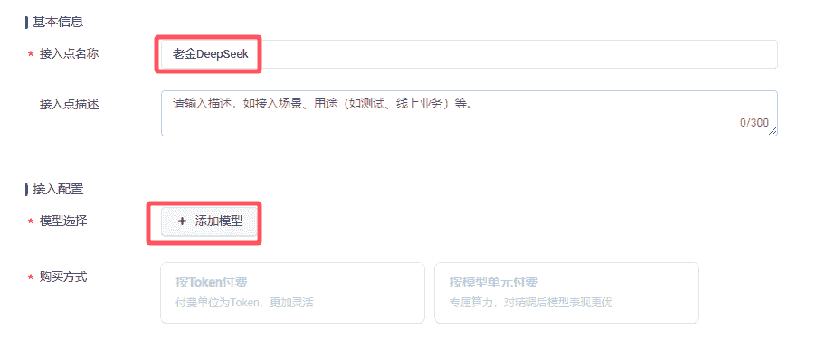

如图顺序选择。

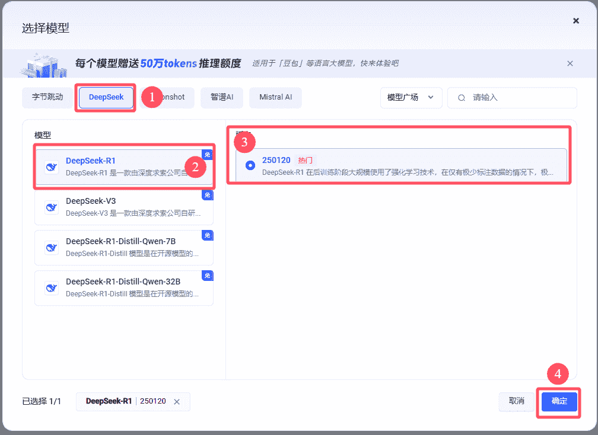

确认接入。

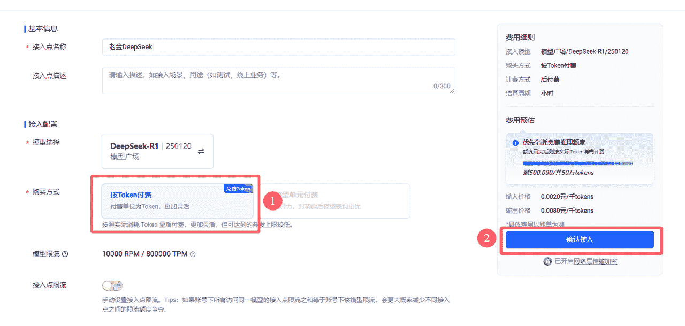

## 创建智能体

返回Coze主页，选择工作空间，创建智能体。


输入名字后确认。


开启智能体页面，点击添加工作流。

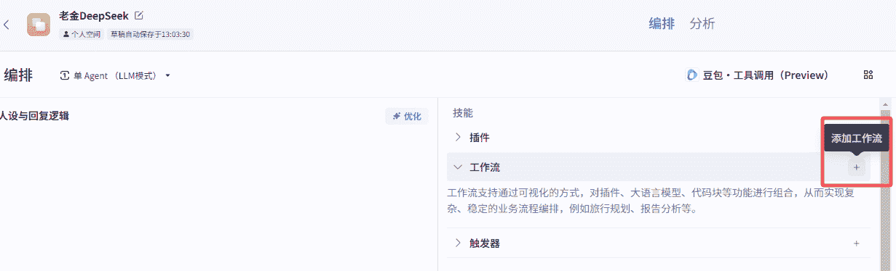

选择对话流。对话流和工作流的区别：

**对话流** 是专门用于对话场景的工作流，**能够记住用户历史对话**，实现更智能、连贯的交互。比如充当 AI 助手或智能客服。

而 **工作流** 更适合于**功能类请求**，比如按步骤自动处理任务，适合批量数据处理或任务执行，如生成报告或制作海报等等。

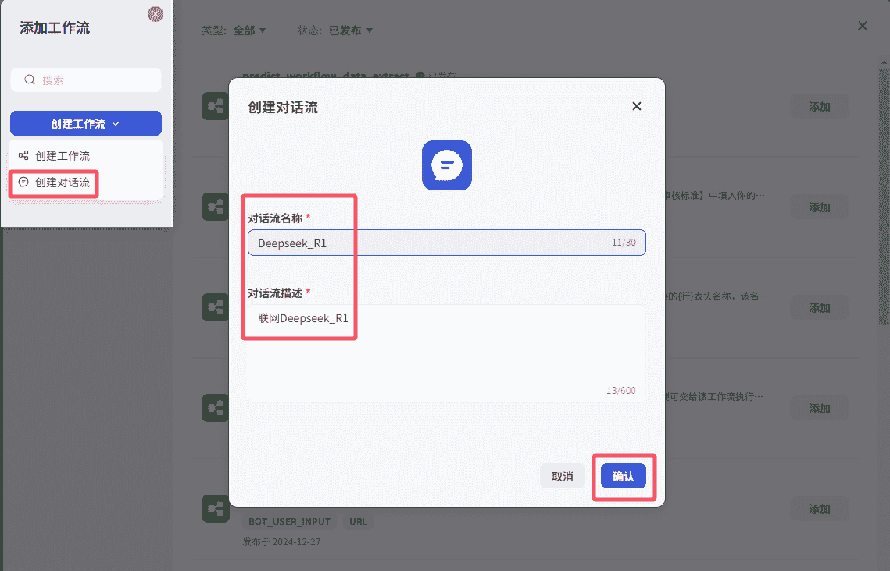

## 配置对话流

先讲整体的逻辑 **用户输入->提取关键词->联网搜索->DeepS**eek R1对返回信息整理并推理->输出。

首先，添加**关键词提取**，使用**通用豆包模型****即可，如**Deepseek R1的推理模**型，不需要做这么简单的事儿，**否则浪费Token，速度也会很慢。

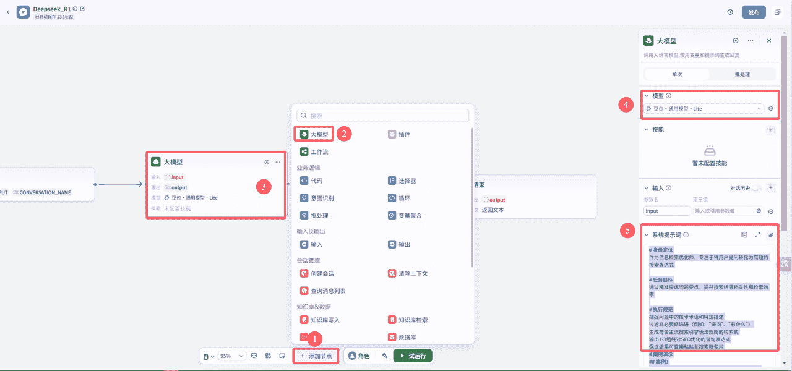

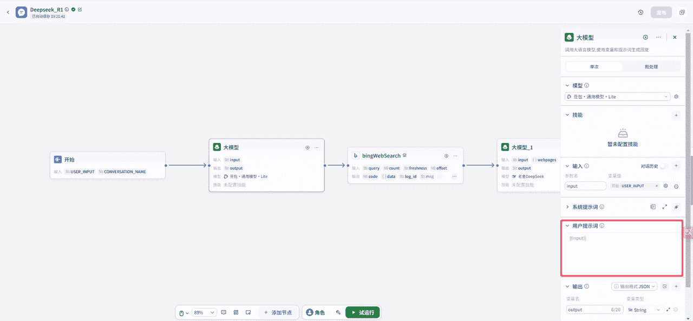

```
# 身份定位
作为信息检索优化师，专注于将用户提问转化为高效的搜索表达式

# 任务目标
通过精准提炼问题要点，提升搜索结果相关性和检索效率

# 执行规范
捕捉问题中的技术术语和特定描述
过滤非必要修饰语（例如：&quot;请问&quot;、&quot;有什么&quot;）
生成符合主流搜索引擎语法规则的检索式
输出1-3组经过SEO优化的查询表达式
保证结果可直接粘贴至搜索框使用

# 案例演示
## 案例1
原始问题：Word文档自动保存功能突然失效怎么办
优化结果：Word 自动保存失效

## 案例2
原始问题：Python如何实现数据可视化图表
优化结果：Python 数据可视化图表
```

然后添加搜索，这里我们使用必应搜索。

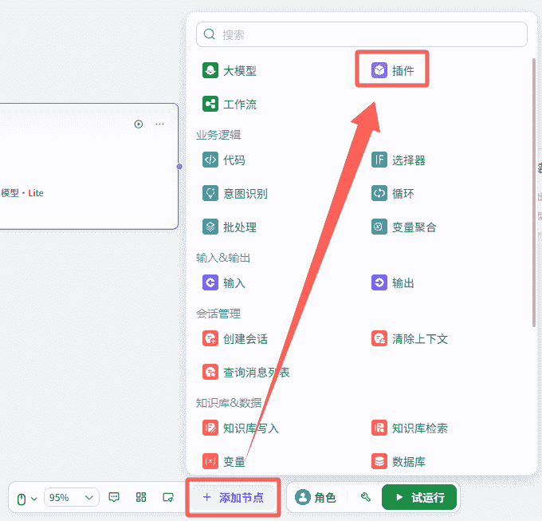

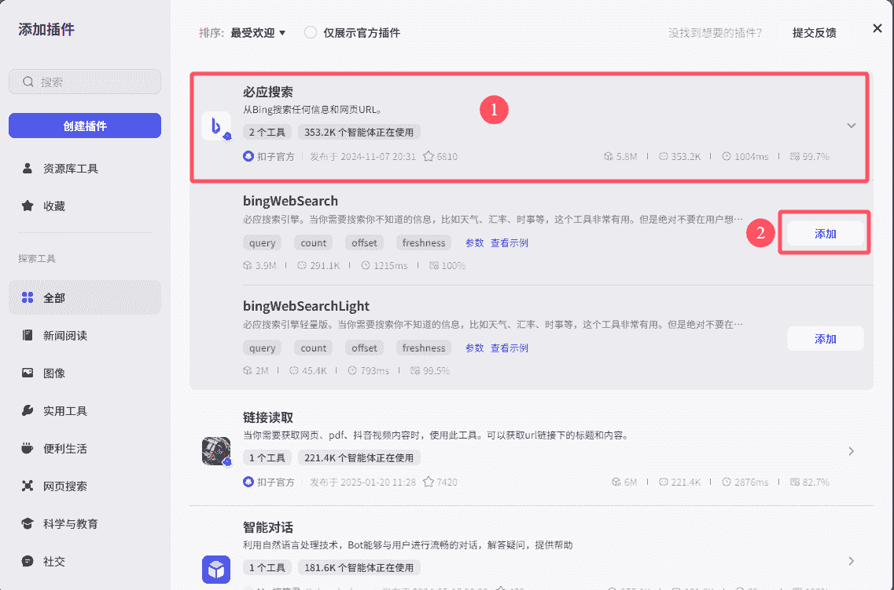

再添加DeepSeek R1模型，对搜索结果进行推理及整理。按照老金的图示，依次添加。

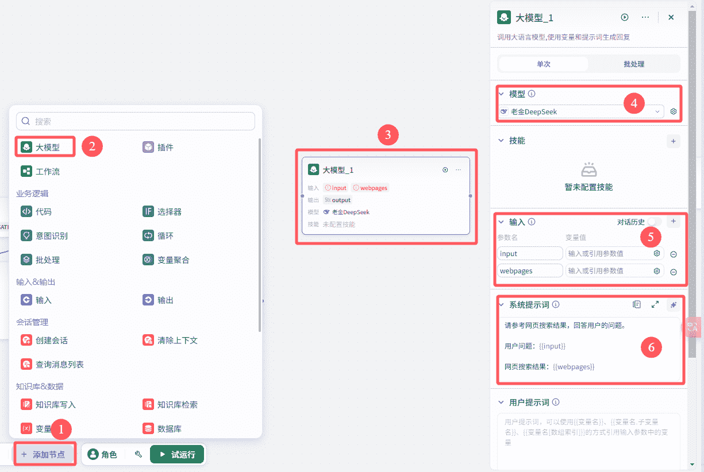

```
请参考网页搜索结果，回答用户的问题。

用户问题：{{input}}

网页搜索结果：{{webpages}}
```

最后，链接整个流，把线都连上。

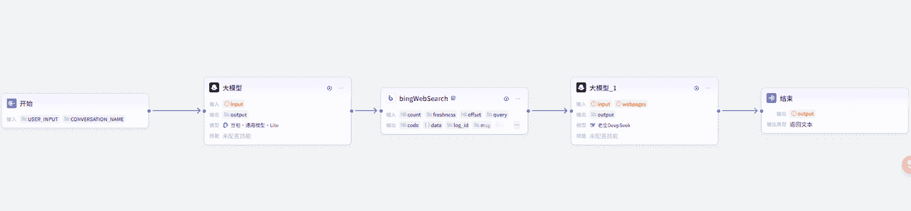

黄色代表变量没有赋值，看见黄色的依次点开选择对应的变量名称即可，让我们一个个处理。

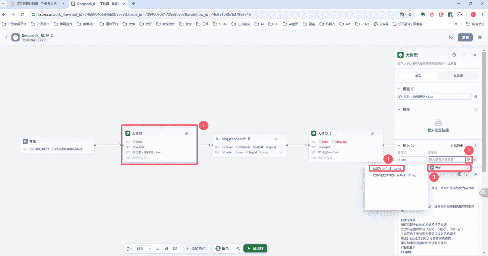

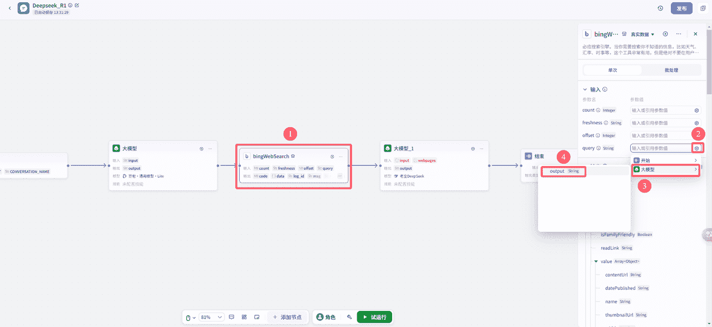

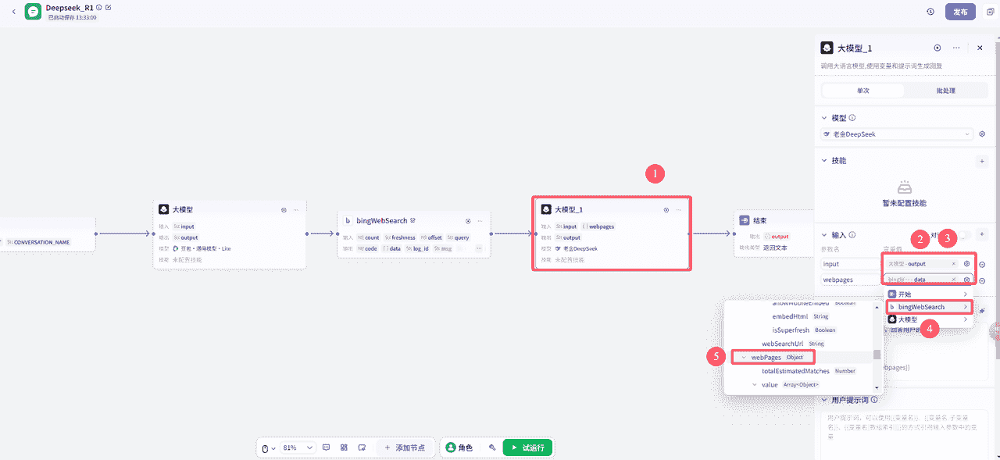

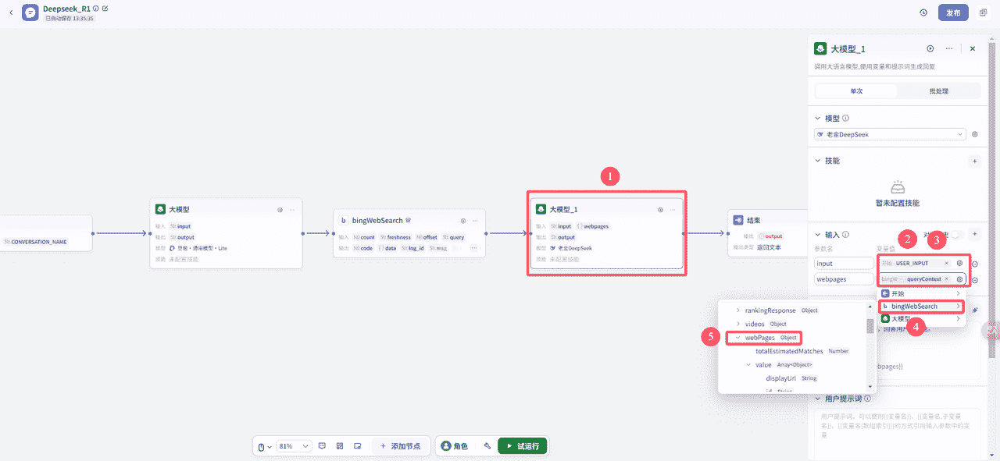

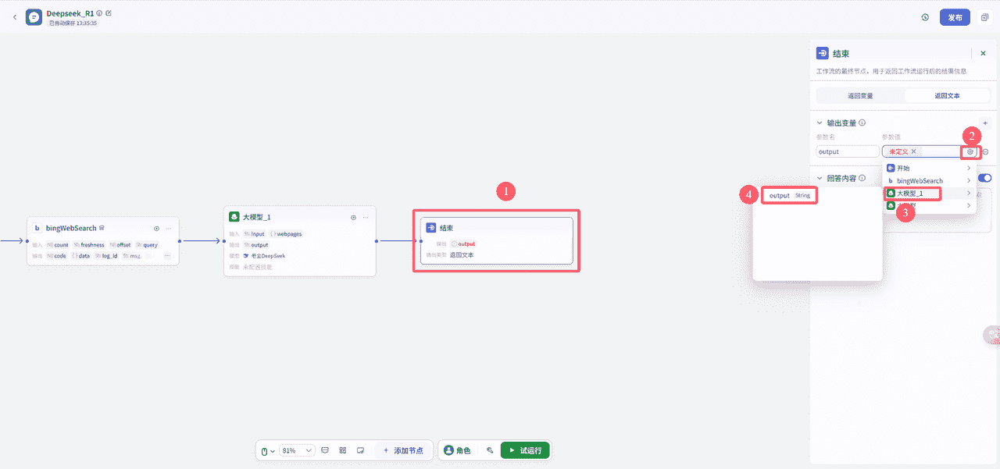

增加流式输出，填写变量{{output}}

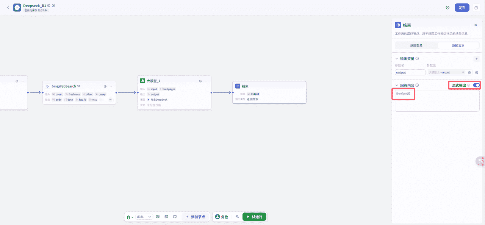

发布前试运行一下，没问题的话发布后，返回智能体界面。

就可以使用满血版联网的DeepSeek R1了。


当然，如果你还想实现对话也是的话，这里也修改成DeepSeek R1。

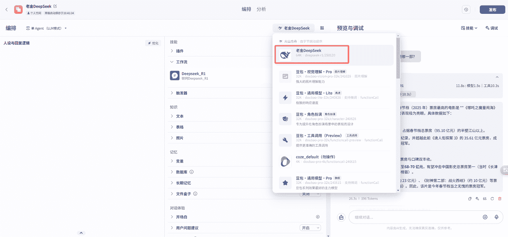

## 福利

关注**👸号**“**金子的知识星球**”，发送“**Deepseek**”获取清华大学发布的**DeepSeek从入门到精通**。


以上，本期分享完成，希望对大家有所帮助。

---

如果觉得不错，随手点个赞、在看、转发三连吧🙂

如果想第一时间收到推送，也可以给我个星标⭐～谢谢你看我的文章。

关注发送“**知识精华**”，可获得免费的知识链接地址。


##