# DeepSeek R1怎么在工作流中联网？满血Dify超强版本（下）

> 来源：[https://my.feishu.cn/docx/L6dqduvvToKL6Ex98zgctE6JnBh](https://my.feishu.cn/docx/L6dqduvvToKL6Ex98zgctE6JnBh)

前两天介绍了Coze版本。

今儿接上集，咱来讲讲Dify里怎么用。

Dify是开源中老金推荐最多的LLMops了，没得说，老金推荐，必属精品。

Agent、ChatFlow、Workflow通通拿下，Dify都支持，唯独差一些的RAG（知识库）年初也迎来了更新。

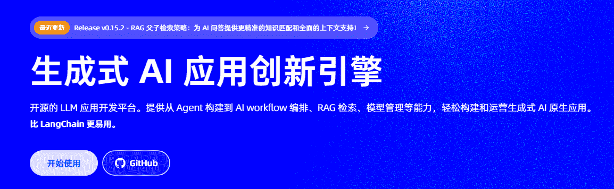

文末有福利：清华大学发布的DeepSeek从入门到精通。

[DeepSeek](https://tffyvtlai4.feishu.cn/wiki/MnWZwv8YwidNz5k4ydocgIOdnuh)金已完成的Deepseek开源教程合集：

---

## **硅基流动**

**https://cloud.silic**onflow.cn/i/wdyoipMi

这是个网站，是**满血版！****，****能直接对话，还能调** API，用于本地部署或在线平台。

**优点是免费赠送2000万Token，有各大模型，不限于**大语言模型、绘画模型、视频模型和语音模型

老金我曾多次推荐过，老金的机器人基本上走的全是硅基流动的API接口。

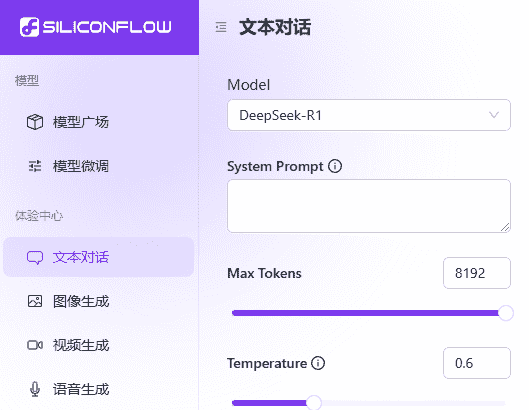

废话不多说，本期教程直接开始。

---

[Dify本地部署](https://tffyvtlai4.feishu.cn/wiki/HZKXwSIn3iFBZYkcSWFcJAUhnof)金本次使用的还是线上版本，本地部署的Dify请参考 ，无论线上还是本地部署，流程是一样的。

### 搭建流程：

打开Dify官网：https://cloud.dify.ai/apps

依次点击，因为老金设置过API KEY了，所以会显示在上面。

没关联过的小伙伴们**需要在下方先找到Siliconflow**，配置完成后，再拉到上面，选择添加模型。

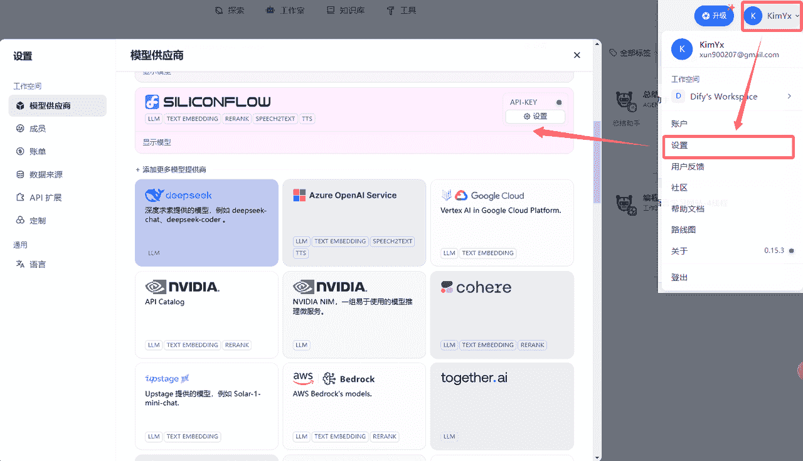

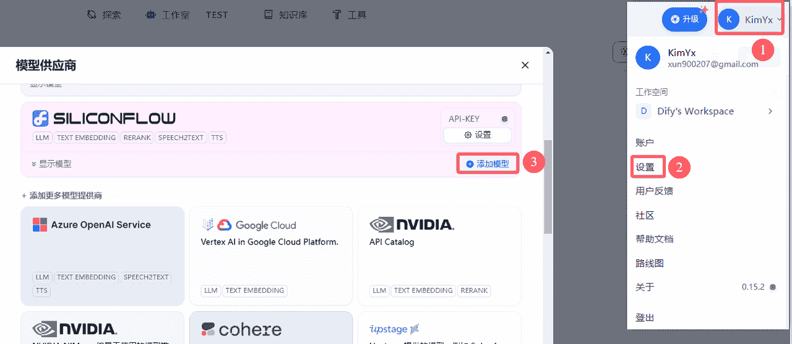

**填**写模型信息，模型名字直接复制：deepseek-ai/DeepSeek-R1 ，输入上面硅基网页的API Key。

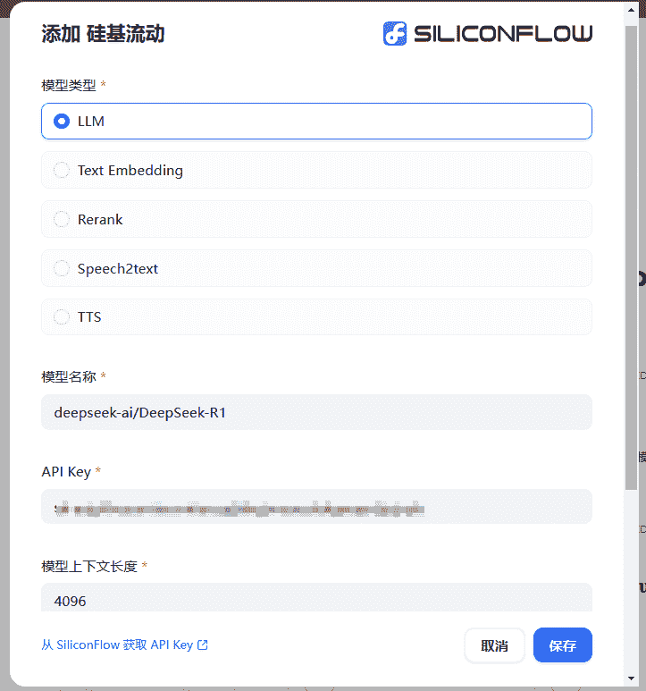

在屏幕左侧，创建一个空白应用。

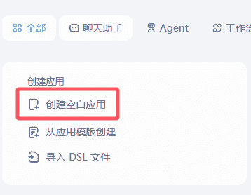

与上集Coze中教学同理，选择对话流。对话流和工作流的区别：

**对话流** 是专门用于对话场景的工作流，**能够记住用户历史对话**，实现更智能、连贯的交互。比如充当 AI 助手或智能客服。

而 **工作流** 更适合于**功能类请求**，比如按步骤自动处理任务，适合批量数据处理或任务执行，如生成报告或制作海报等等。

创建个牛X轰轰的名字先。

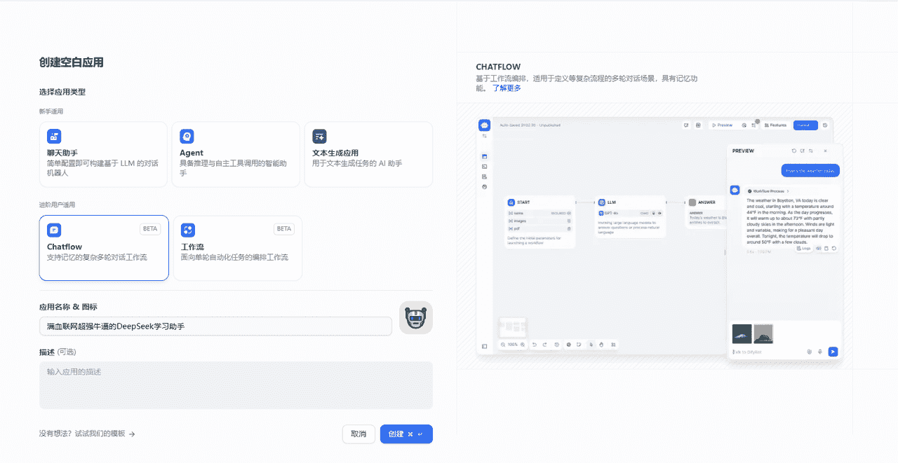

记住核心操作，**空**白区域 -> 右键 -> 添加节点。

然后拽7个LLM、工具Serper、工具Tavily Search、工具Flux。

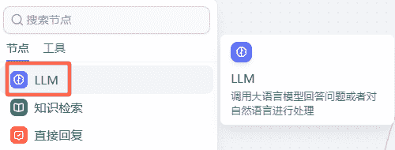

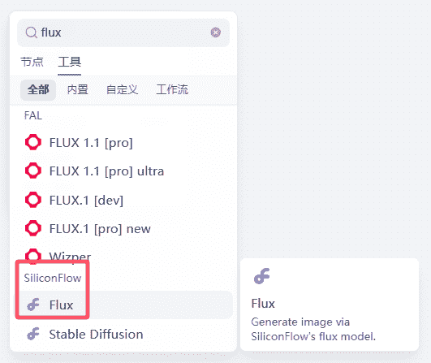

### **节点定义：**

LLM：大语言模型节点。

Serper：一个强大的原生AI搜索引擎和网页内容提取工具，提供高度相关的搜索结果和网页原始内容提取。

Tavily Search：一个强大的原生AI搜索引擎和网页内容提取工具，提供高度相关的搜索结果和网页原始内容提取。

Flux：基于硅基的生图工具。

[以上工具](https://tffyvtlai4.feishu.cn/wiki/YkJgwLEjsiMm6ckaeIGc5yTdnQd#doxcncuMDJF31zjAusDpXy0Uxng)，如果你用了老金我推荐的硅基流动，那么是完全免费的。

### **逻辑概念：**

1、如提取关键词这种简单逻辑，不要使用推理模型，会很慢，且浪费Token，结果不会有什么区别，没必要。

2、需要逻辑的地方，才使用推理模型进行推理。

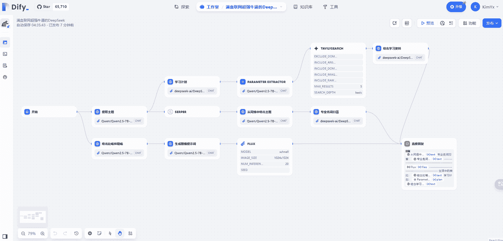

**行了，不折**腾大家自**己搭建了，老**金我直接把DSL文件放出来，导入即可使用。

提示词可以挨个点击查看学习。

这里直接在**公众号**“**金子的知识星球**”，发送“**Deepseek联网**”获取。

然后直接导入即可。

在Dify主页点击**导入DSL****文件**。

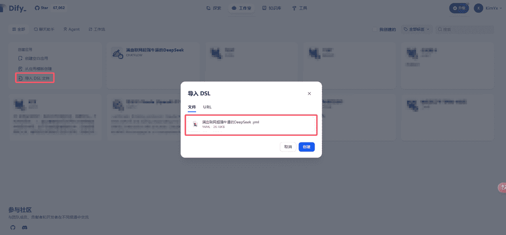

## 效果演示

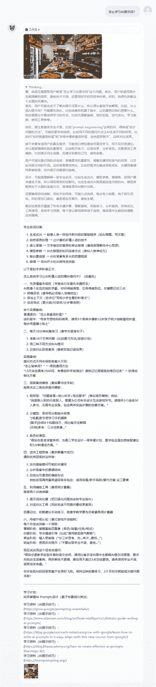

## 文末福利：

关注**公众号**“**金子的知识星球**”，发送“**Deepseek**”获取清华大学发布的**DeepSeek从入门到精通**。

以上，本期分享完成，希望对大家有所帮助。

---

如果觉得不错，随手点个赞、在看、转发三连吧🙂

如果想第一时间收到推送，也可以给我个星标⭐～谢谢你看我的文章。

关注发送“**知识精华**”，可获得免费的知识链接地址。

##