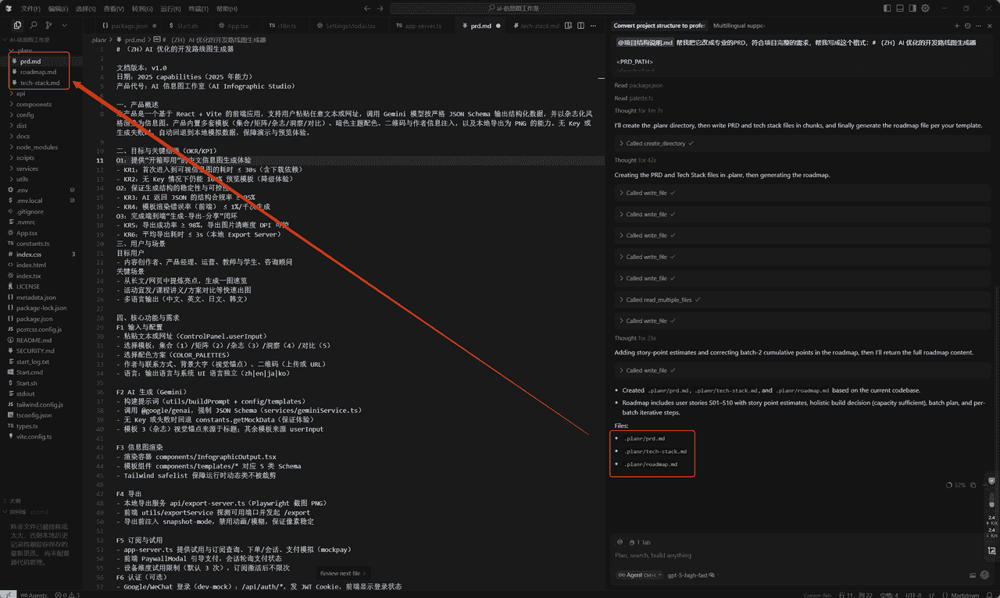
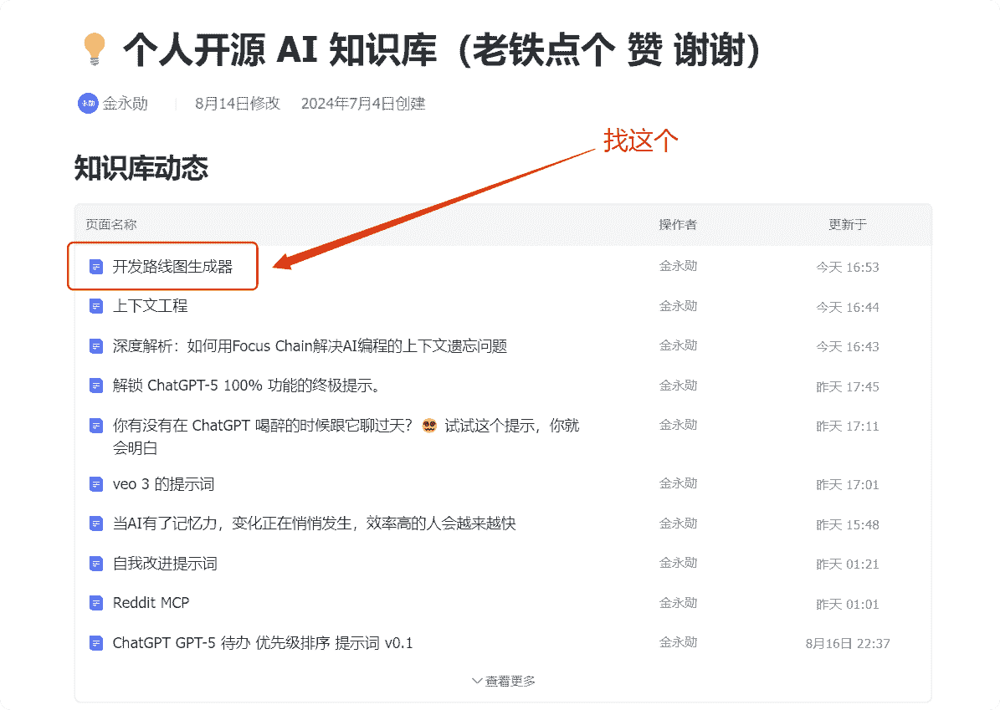

# 深度解析：如何用Focus Chain解决AI编程的上下文遗忘问题

> 来源：[https://my.feishu.cn/docx/XrHsd6HMRo3GB9xDRJmcmNnOnCb](https://my.feishu.cn/docx/XrHsd6HMRo3GB9xDRJmcmNnOnCb)

老金我最近在琢磨一件事。

最近不少小伙伴跟老金我抱怨，说用AI写代码或聊天，最烦的就是上下文不够用，AI老是来回遗忘。

你前面跟它说的需求，聊个10几轮，它就给你忘到天边儿去了。

这个问题，行话叫 Goal Drift (目标漂移)。

说白了，就是AI在处理又长又复杂的任务时，上下文一多，就忘了自己最初要干啥了。

就像咱们写代码，写着写着，突然忘了最开始那个Bug是啥来着，一个道理！

这主要是因为几个原因：

一个是所谓的 Lost in the Middle (中间遗忘现象)。

大语言模型，对你输入内容的开头和结尾记得最牢，中间那段就稀里糊涂的，关键信息就这么丢了。

再一个就是上下文窗口再大也没用。

现在动不动就百万Token，但光能装不行啊，里面塞满了没用的信息，反而把AI给污染了，性能不升反降。

但是！但是来了哈！

老金其实之前说过解决方案，但是老金当时不知道这叫什么办法。

最近听到了一个叫 Focus Chain (聚焦链) 的术语，老金一看，就是这方法。

趁此机会老金我再给大家讲一遍，原理其实特简单：

## Focus Chain 说明

**1、先立个Paln：**

你给AI一个任务，它不着急动手，而是先给你整一个详细的 To-Do List (步骤清单) 或 PRD（产品需求文档）。

这就相当于一个路线图，明明白白，这里弄好了，自己审核过了，再让AI动手。

初始的提示词特别重要，初始做不好，后面改到手抽筋。

这里的提示词太长，老金就不贴在文内了。

通过后台的“**知识精华**”获取老金的开源知识库链接。（直接放链接会给我弄没 = = ）

**2、随时拿出来瞅瞅：**

在干活的过程中，**定期**比如每完成两次，就把这个Plan拿出来对一遍。

**干完的打个勾**，剩下的接着干。这样一来，它忘不了最初的目标。

**3、计划还能改：**

**这计划不是死的，随着任**务推进，可以随时加新步骤、改优先级，相当灵活。

说白了，这个聚焦链就等于给AI配了个贴身的项目经理，随时能把它拽回正轨，让它别忘了自己到底要干啥。

## **王炸组合：深度规划工作流**

你以为这就完了？还没呢！

这帮人还给聚焦链配了个搭档，叫 Deep-Planning (深度规划) 工作流。

这俩一组合，简直爽歪歪！

这个工作流分两步走：

**第一步，规划阶段：**

如果我们在Github等之类的地方拿到了一些源代码，看起来会灰常费劲，又慢又累。

之前老金介绍过DeepWiki可以快速查看。

[DeepWiki MCP！AI 助你秒懂 GitHub 开源项目代码与文档！](https://tffyvtlai4.feishu.cn/wiki/HON2we6gsiF9S8k5kZVcWFuOnke)

这回呢，你可以让自己的IDE或CLI直接查看。

让他们把你的代码库翻个底朝天，读文件、理清依赖关系，然后生成一个超级详细的实施计划。

这个阶段它还会主动跟你沟通，把需求问清楚，确保计划万无一失。

**第二步，执行阶段：**

计划定好了，AI才开始动手写代码。

这时候聚焦链就上场了，保证它严格按照计划执行，一个都别跑！

这种先规划、后执行的模式，就避免了在聊天里来回拉扯导致的上下文污染。

让AI一上来就在接近95%准确率的最佳状态干活，而不是聊到后面性能掉到70%都不到。

**老金有话说**

家人们，这事儿给老金我带来的冲击，远不止是技术层面的。

我们一直在追求更强大的AI，给它更大的内存，更快的速度。

但这就像给一个迷茫的人无限的自由，他最终可能哪也去不了。

真正的强大，不是拥有无限的可能，而是在万千道路中，始终记得自己要去向何方。

今天我们教AI用聚焦链来对抗遗忘，其实也是在审视我们自己。

在这个信息爆炸、注意力被无限分割的时代，我们自己的“聚焦链”又是什么？

我们给AI的，不仅仅是一段代码，一个工具。

我们是在赋予它一种接近“意志”的东西——一种锚定目标、穿越混沌的能力。

这可能才是我们创造AI的终极意义：

在创造一个更聪明的工具的同时，也照见了我们自己，那个渴望专注、渴望创造、渴望抵达彼岸的灵魂。

未来已来，与其说是AI在学习我们，不如说是我们在与一个更强大的自己对话。

在代码的世界里，你是否也曾寻找过那份对抗遗忘的锚定物？

<https://my.feishu.cn/sync/HDlcdCPBksnJpBbRk0EcW364nmc>