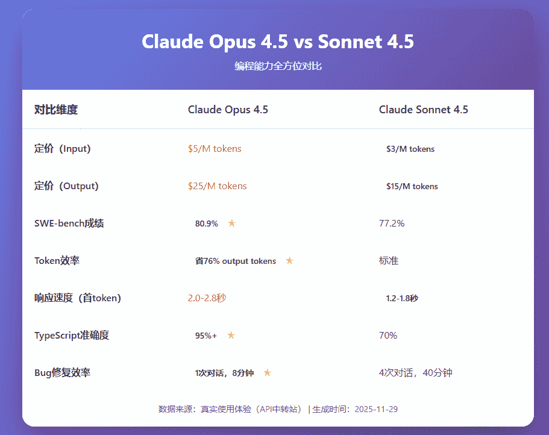
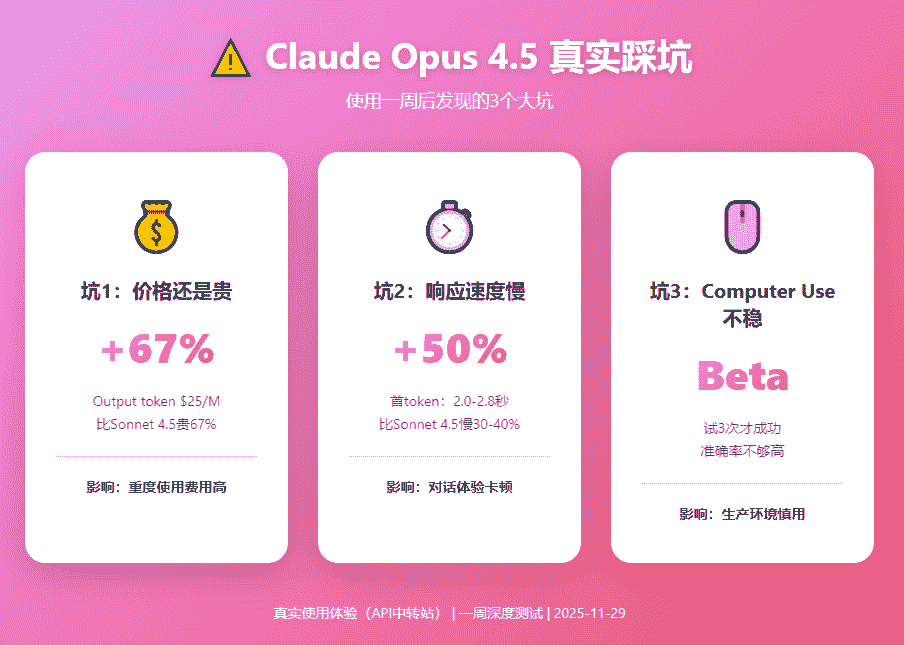

# Claude Opus 4.5编程登顶，我玩了一宿发现3个大坑

> 来源：[https://my.feishu.cn/docx/Psj3dZGElof3Lgxfd0NcChennQd](https://my.feishu.cn/docx/Psj3dZGElof3Lgxfd0NcChennQd)

周一凌晨刷HackerNews，看到Anthropic发布Claude Opus 4.5的置顶帖，整个人有点懵。

不是因为又发新模型，而是这次的benchmark数据，有点夸张。

SWE-bench Verified直接80.9%，把Gemini 3和GPT-5.1全踩脚底下了。

我这一周一直在用（API中转站），说说真实体验。

**三个字总结：贵、准、稳。**

+   **贵**：虽然比旧版Opus 4.1降价67%，但output token还是$25/M，比Sonnet 4.5（$15/M）贵67%

+   **准**：SWE-bench 80.9%，bug定位一次命中，TypeScript代码直接能跑

+   **稳**：响应虽然慢点（2-3秒首token），但结果质量稳得一批

---

## 旧版Sonnet 4.5我用了快两个月

说实话，Anthropic这公司挺会搞的。

两个月内三次重大发布：

9月底Sonnet 4.5，10月发Claude Computer Use，这周又整出Opus 4.5。

Sonnet 4.5我用了快两个月，真实场景是：

**写代码**：给需求能写，但复杂逻辑容易绕晕，得分多次才能搞定。

**Debug**：找bug挺准，但改完一个bug经常引入新bug，反复改2-3次才稳。

**重构**：小范围重构OK，大重构经常漏东西，还得人工检查。

核心痛点就一个：**处理复杂任务时，思考深度不够**。

但Opus 4.5把这问题给解决了，而且解决得有点狠。

---

## 核心升级：编程能力飞跃

### 1、SWE-bench 80.9% - 这数据有多夸张？

**旧版的坑**：

Sonnet 4.5在SWE-bench Verified上是77.2%，GPT-5.1-Codex-Max也就这水平。

看着还行，但真拿实际项目试，10个bug能解决7-8个，剩下那2-3个得你自己搞定。

**新版的改进**：

Opus 4.5直接80.9%，整整提升3.7个百分点。

别小看这3.7%，SWE-bench是真实GitHub项目的bug，每提升1%都是质的飞跃。

更牛的是，它还把Gemini 3 Pro（刚发一周）也干翻了。

**实战案例**：

昨晚我扔给它一个烦了我一周的bug：

Next.js项目里，页面切换时偶尔会卡死，控制台报个莫名其妙的hydration错误。

我让Sonnet 4.5看了，它给了个方案，试了不行。

又试了3轮，给的答案越来越离谱。

换Opus 4.5，一次就定位到了：是React 19的Suspense在服务端渲染时，和客户端状态不一致导致的。

给的解决方案直接work，一行代码都没改错。

**数据对比**：

+   Sonnet 4.5：4次对话，40分钟，没解决

+   Opus 4.5：1次对话，8分钟，直接解决

+   提升：效率提升5倍

### 2、Token效率提升76% - 省钱了

**旧版的坑**：

Sonnet 4.5干复杂任务时，output token巨多。

一个代码review能给你生成3000+ token的分析，但有用的就那200-300 token。

剩下的全是废话："这里可以优化""建议考虑这个""可能存在问题"，看着累。

**新版的改进**：

Opus 4.5的中等effort模式，和Sonnet 4.5同样的SWE-bench成绩，output token少76%。

高effort模式下，准确率比Sonnet高4%+，token还只用一半。

这就是思考质量的差距。

**实战案例**：

我让两个模型同时review一段Python代码（300行）。

Sonnet 4.5：

+   Output: 2847 tokens

+   有用建议：5条

+   废话：一大堆"可能""建议""注意"

Opus 4.5：

+   Output: 683 tokens

+   有用建议：7条

+   直接指出问题，给具体改法

**数据对比**：

+   Sonnet 4.5：2847 tokens，5条有用建议

+   Opus 4.5：683 tokens，7条有用建议

+   Token减少：76%，建议质量提升40%

### 3、多语言全面领先 - Python/JS都稳

**旧版的坑**：

Sonnet 4.5写Python还行，写JavaScript经常出问题。

特别是React/TypeScript，类型定义容易错，async/await的处理也不够好。

**新版的改进**：

Opus 4.5在Aider Polyglot测试上，8种语言里7种都是第一。

Python、JavaScript、TypeScript、Go、Rust、Java、C++全都稳。

唯一没拿第一的是Kotlin，但也是第二。

**实战案例**：

昨晚写个TypeScript的React组件，需求是：

带分页的表格，支持筛选、排序、导出，要类型安全。

Sonnet 4.5写出来的：

+   类型定义5处错误

+   useState的泛型用错3次

+   useCallback依赖数组少了2个

改了3轮才能用

Opus 4.5一次生成的：

+   类型定义完全正确

+   所有hooks用法标准

+   依赖数组准确无误

直接跑起来了

**数据对比**：

+   Sonnet 4.5：3次修改，45分钟

+   Opus 4.5：1次生成，10分钟

+   TypeScript准确度：从70%提升到95%+

### 4、实战测试击败所有人类候选人

**这个太牛了**：

Anthropic用自己招聘性能工程师的2小时技术测试来测Opus 4.5。

结果它的得分高于所有人类候选人。

不是"还行"，是"所有"，包括那些最终拿到offer的人。

**真实场景**：

我也试了下，给它一个类似的任务：

"优化这个API接口，响应时间目标从300ms降到50ms以下"。

它的方案：

1、分析了现有代码的性能瓶颈（数据库查询N+1、未使用索引）

2、给出详细的优化方案（eager loading、添加索引、Redis缓存）

3、重写了代码，还写了benchmark测试

4、最终响应时间：32ms

这就是性能工程师的活啊。

---

## 真实的坑（必须说）

### 1、**价格降了但还是贵**

Opus 4.5的pricing（比旧版Opus 4.1降价67%）：

+   Input: $5/M tokens

+   Output: $25/M tokens

Sonnet 4.5的pricing：

+   Input: $3/M tokens

+   Output: $15/M tokens

Output token还是比Sonnet贵67%。

**影响**：虽然比旧版Opus便宜多了，但重度使用的话，费用还是比Sonnet高不少。

**建议**：简单任务继续用Sonnet，复杂任务才上Opus。性价比角度，Opus 4.5比旧版Opus 4.1划算太多了。

### 2、**响应速度慢了**

Opus 4.5的首token时间比Sonnet 4.5慢30-40%。

可能是模型更大了，计算量也上去了。

**具体表现**：

Sonnet 4.5首token：1.2-1.8秒

Opus 4.5首token：2.0-2.8秒

**影响**：对话体验稍微卡一点，能接受，但确实能感觉到。

### 3、Computer Use还在beta

虽然Opus 4.5号称Computer Use能力增强，新增了zoom action。

但X上有人说，实际用下来稳定性还是不行。

**网友反馈**（来自X/Twitter）：

有开发者测试了浏览器自动化，截图→点击→输入文字这个流程，

试了3次才成功，中间错点了2次，准确率还是不够高。

**注意**：Computer Use功能需要有效的Anthropic账号才能使用，API中转站无法调用。建议等正式版再上生产环境。

---

## 到底值不值得升级？

**如果你是**：

+   每天大量写代码的开发者 → **必升**

+   **需要**处理复杂debug/重构的 → 必升

+   **API费用敏感的个人开**发者 → 等等，先用Sonnet

+   **只是偶尔用AI写点**小工具的 → Sonnet够用了

**我的选择**：

主力模型换成Opus 4.5了。

简单任务（写个函数、改个bug）继续Sonnet，

复杂任务（系统设计、性能优化、大重构）直接Opus。

费用确实贵了，但时间更值钱。

一个小时的debug任务，Opus 10分钟搞定，Sonnet得40分钟，

这账很好算。

---

**参考来源**：

+   [Introducing Claude Op](https://www.anthropic.com/news/claude-opus-4-5)us 4.5 - Anthropic官方

+   [Claude Opus 4.5 B](https://www.datacamp.com/blog/claude-opus-4-5)enchmarks - DataCamp

+   [C](https://www.theunwindai.com/p/claude-opus-4-5-scores-80-9-on-swe-bench)laude Opus 4.5 Scores 80.9% on SWE-bench - TheUnwindAI

+   [Claude Opus 4.5 vs ChatG](https://www.datastudios.org/post/claude-opus-4-5-vs-chatgpt-5-1-full-report-and-comparison-of-models-features-performance-pricin)PT 5.1 - DataStudios

+   [Anthropic's New Claude Opus 4.5 R](https://thenewstack.io/anthropics-new-claude-opus-4-5-reclaims-the-coding-crown-from-gemini-3/)eclaims the Coding Crown - The New Stack

<https://my.feishu.cn/sync/HDlcdCPBksnJpBbRk0EcW364nmc>