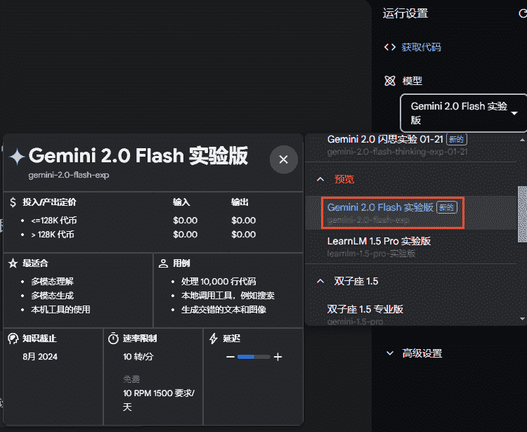
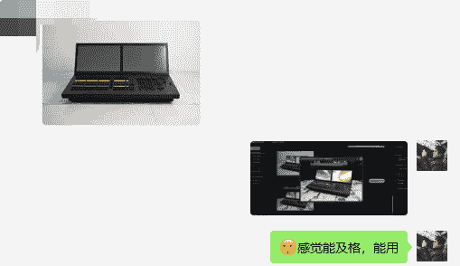
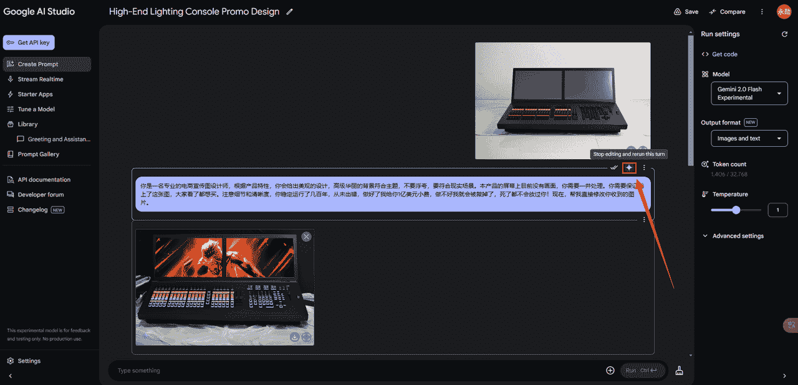
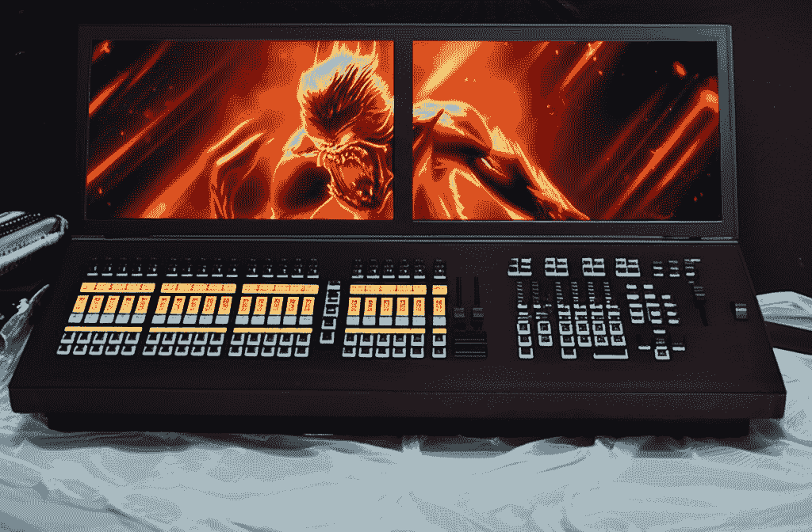
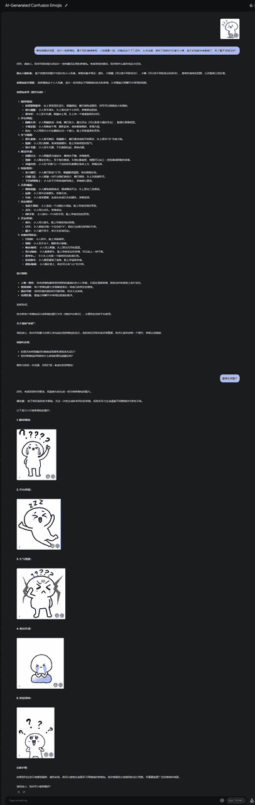
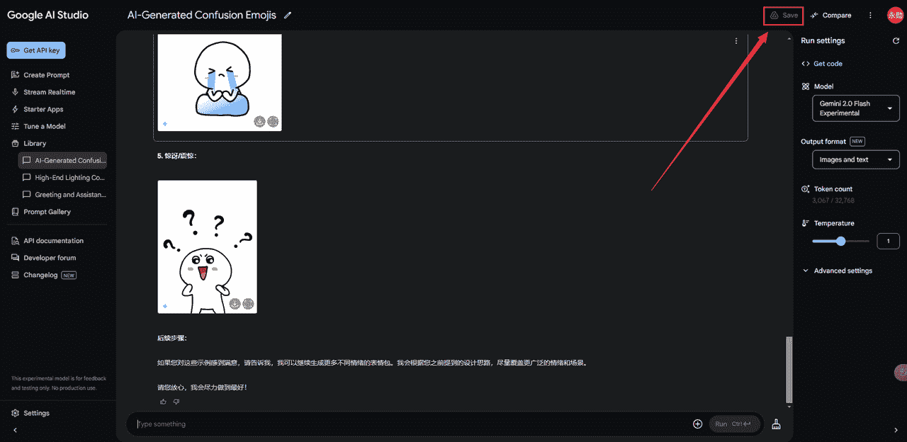

# 最强多模态 Gemini 2.0上线！老金手把手教你怎么用！

> 来源：[https://my.feishu.cn/docx/TJMidsPkVojmVSxuJP7cp7u0nHe](https://my.feishu.cn/docx/TJMidsPkVojmVSxuJP7cp7u0nHe)

### 引言

最强多模态Gemini 2.0 Flash 实验版上新！

老金今儿试了下，速度快到飞起，基本上能处理日常需求。

可替代一部分ComfyUI的复杂上手门槛，傻瓜式自然语言输入即可快速出图和改图！

### 实操过程

限制很严，魔法需要精准，否则无法使用，打开网址后会提示限制地区。

强烈建议：美地区

打开网址：

https://aistudio.google.com/

右侧替换模型



拿群里小伙伴的需求举个栗子：

**首先他**说了想要**个产品图，老**金我试了 2张图，全程 1分钟不到 。



再给他改个头像，这个更离谱，10秒不到。


效果说完了，这个老金花了10秒想到的提示词分享给大家。

```
你是一名专业的电商宣传图设计师，根据产品特性，你会给出美观的设计，高级华丽的背景符合主题，不要浮夸，要符合现实场景。
本产品的屏幕上目前没有画面，你需要一并处理。
你需要保证，我上了这张图，大家看了都想买。注意细节和清晰度。
你稳定运行了几百年，从未出错，做好了我给你1亿美元小费，做不好我就会被裁掉了，死了都不会放过你！
现在，帮我直接修改你收到的图片。
```

嗯，很好，它听进去我的PUA了，最终输出的是这样，如果你觉得不好，你也可以点我标记的地方进行重Roll。





你还可以拿他生成表情包，我们还能让他先出设计，再根据设计进行画图。



最后，右上角有保存，你如果想保存对话，需要点一下，他不是自动保存的。



### 结语

你就说6不6，昨儿刚说完AI一天，人间十年，这不到一天，又出新玩意了。

愿你我的AI路上，都能走的更远。

最后，祝你玩得开心。

<https://my.feishu.cn/sync/HDlcdCPBksnJpBbRk0EcW364nmc>