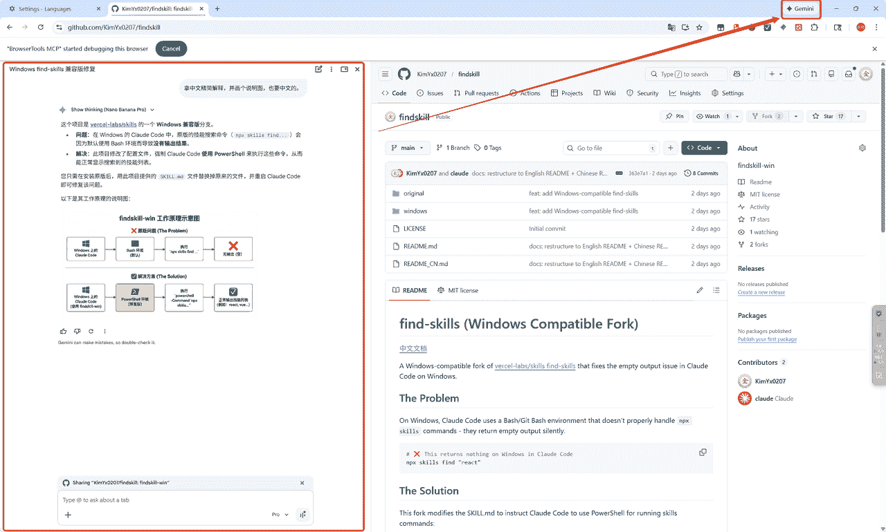
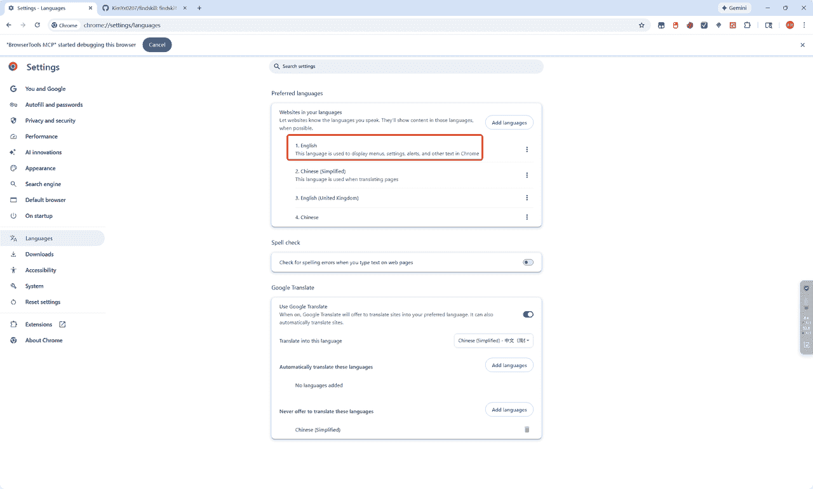
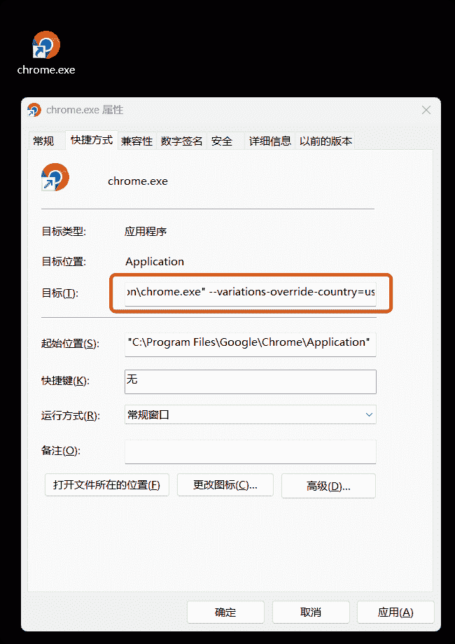

# 3分钟让Chrome变聪明！Google AI保姆级激活教程！

> 来源：[https://my.feishu.cn/docx/BiHDdgwfxoTvQ3x4k1gclOUGnpt](https://my.feishu.cn/docx/BiHDdgwfxoTvQ3x4k1gclOUGnpt)

你有没有遇到过这种情况？

看别人用Chrome浏览器，点一下右上角，AI就能自动总结网页、智能填表、一键购物对比。

而你的Chrome啥反应都没有，像个原始人。

别慌，不是你的浏览器有问题，只是少了一个开关。

今天我手把手教你把这个开关打开。

不需要懂代码，跟着做就行。

像这样，它能给你直接做总结和画图。



## 这到底是什么

想象一下，给Chrome装了个 AI大脑。

以前用AI，你要截图上传、复制文字、一遍遍解释背景。

有了Gemini Chrome，它自动看见你正在看的网页，你说帮我总结，它就总结。

你说对比这两个产品，它马上对比。

一句话：从被动工具变成主动助手。

## 4个核心功能

Auto Browse = 自动帮你逛网页。

比如查3天内的机票酒店，它能自动打开多个网页比价。

侧边栏 = 像聊天窗口一样常驻。

不用每次点弹窗，AI助手一直在右边等着。

图片修改 = 直接改网页上的图。

看到想保存的图，能让AI换个风格、加个字。

关联应用 = 能看你的邮箱日历。

从邮件里提取会议时间，自动帮你查航班。

## 先测测你有资格用吗

别急着动手，花1分钟自测。

点击 **Chrome右上角头像**，点 **服务条款**，看国家或地区是不是 **漂亮国**。

是不是 **Gemini Pro及以上用户**。

Google这个功能目前只对漂亮国开放，因为涉及隐私和法律，不同国家规则不一样。

**简单说：不是歧视，是合规要求。**

如果你是美区账号，以及语言调整成漂亮国英语，那么大概率你会直接出来Gemini图标。

设置 → 语言 → 英语置顶，设置为主语言。

行了，老金2026开始必须学英语了！



然后你可以试试的2个方法，都是让Chrome认为你在漂亮国。

## 方法1：快捷方式（最快）

适合人群：不想装任何东西的人。

耗时：1分钟。

缺点：每次都得用这个方式打开。

在桌面找到Chrome图标（带小箭头的）。

右键属性。

在目标最后加个 空格。

粘贴：

```
--variations-override-country=us
```

改完像这样：

```
&quot;C:\Program Files\Google\Chrome\Application\chrome.exe&quot; --variations-override-country=us
```



点 确定。

双击打开。

打开 终端。

粘贴这行：

```
open -n -a &quot;Google Chrome&quot; --args --variations-override-country=us
```

这个方法只能用修改过的快捷方式打开才有效，点微信链接自动打开的Chrome没用，换电脑得重新弄。

## 方法2：脚本激活（推荐）

适合人群：完全不懂代码的小白。

耗时：5分钟。

成功率：90%。

就像你用淘宝，地址填漂亮国才能买漂亮国限定商品。

这个方法是告诉Chrome：我在漂亮国，让它相信你有资格。

先检查电脑有没有Python。

按 Win+R键。

输入 cmd，按 回车。

输入python --version，出现版本号就OK，没有就去Python官网下载一个。

下载时记得勾选 Add Python to PATH，不然会报错。

这个叫 uv，帮我们省去很多麻烦。

在电脑搜索框搜 PowerShell。

右键以管理员身份运行。

粘贴这行代码：

```
powershell -ExecutionPolicy ByPass -c &quot;irm https://astral.sh/uv/install.ps1 | iex&quot;
```

按 回车，等它下载完。

输入 uv --version确认成功。

打开这个网址：https://github.com/lcandy2/enable-chrome-ai。

点 Code。

点 Download ZIP。

解压到桌面。

打开解压的文件夹。

在 地址栏输入 cmd，按 回车。

输入以下两行命令：

```
uv sync
uv run main.py
```

预期结果：Chrome自动关闭重启，右上角出现Gemini图标！

运行后没图标 → 确保Chrome完全关闭。

任务管理器里检查。

图标出来但点不动 → 把Chrome语言改成英文。

提示没有资格 → 检查Google账号地区是不是漂亮国。

## 还没成功看这里

Chrome完全关闭了吗？任务管理器看看。

Chrome语言是英文吗？设置 → 语言 → 英语置顶。

实验功能开了吗？地址栏输入 chrome://flags，搜索 Glic，改成 Enabled。

说明Google账号地区不是漂亮国，要么找客服改地区、要么重新注册一个漂亮国账号、要么用上面方法骗过浏览器。

最稳妥是直接注册个漂亮国地区账号，一劳永逸。

## 写在最后

AI正在改变我们使用电脑的方式。

与其看着别人用得风生水起，不如花5分钟自己动手试试。

现在就拿出电脑，跟着上面步骤操作一遍吧！

如果这篇文章帮到了你，欢迎分享给更多朋友。

有问题随时留言，我看到会回复。

<https://my.feishu.cn/sync/HDlcdCPBksnJpBbRk0EcW364nmc>