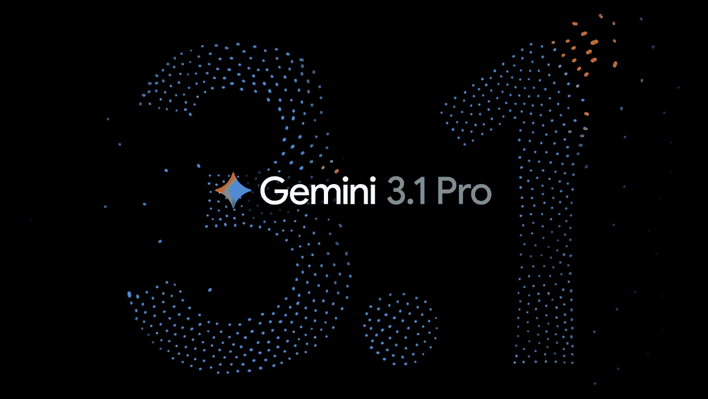
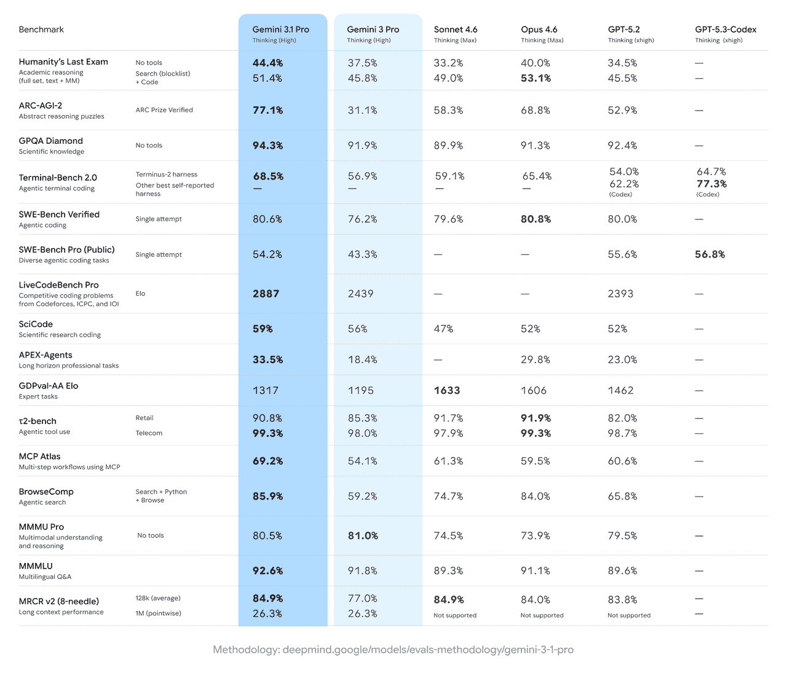
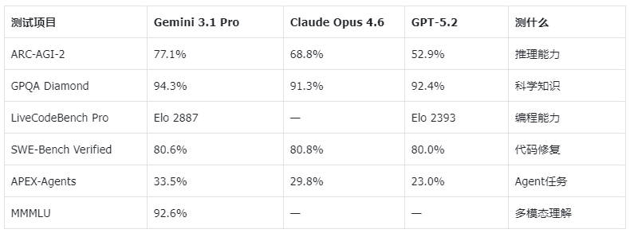
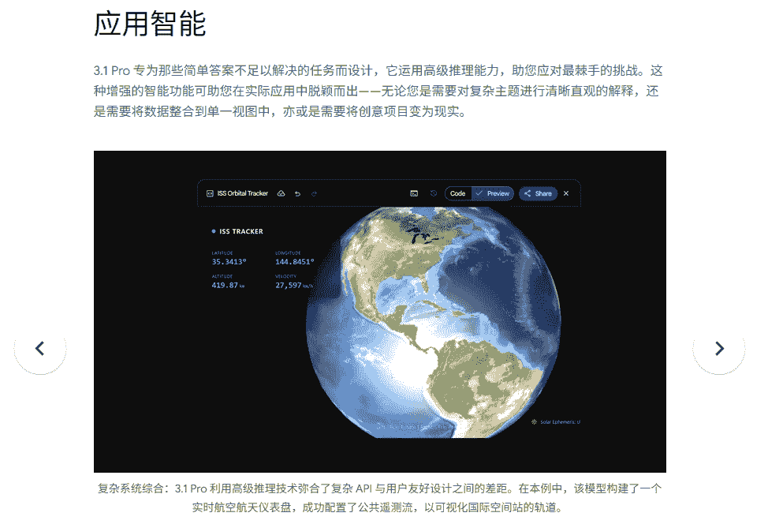
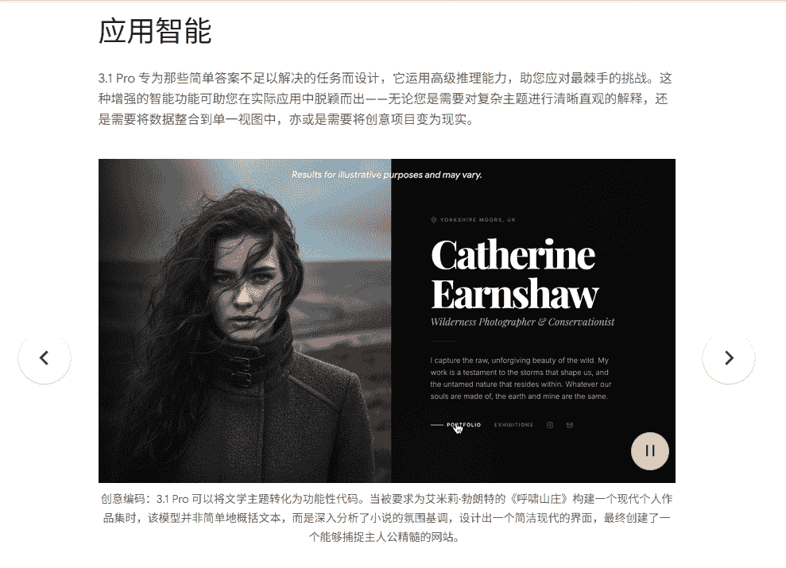
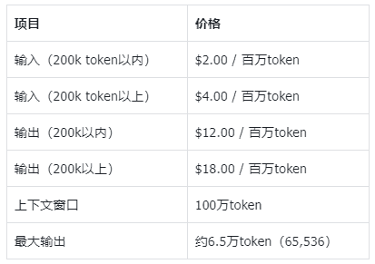

# 16项测试赢了13项！Gemini 3.1 Pro碾压GPT-5.2和Claude

> 来源：[https://my.feishu.cn/docx/YwBIdOFMNoCvQMxq849cATirneh](https://my.feishu.cn/docx/YwBIdOFMNoCvQMxq849cATirneh)

**昨天晚上（2月19号），老金**我刷到一条消息——Google发布了 Gemini 3.1 Pro。

说实话，第一反应是"又更新？Gemini 3 Pro去年11月才出，这才3个月就搞.1版本？"

谷歌你是不是太急了。

但老金我点进官方博客一看，卧槽。

ARC-AGI-2推理测试，得分从31.1%直接飙到77.1%。

推理能力翻了不止一倍，价格跟上一代完全一样。

老金我今天花了一上午扒完所有公开资料。

5大核心升级，一次给你讲清楚。

## 最炸裂的升级：推理能力暴涨148%

这次Gemini 3.1 Pro最大的看点就一个——推理。

**ARC-AGI-2** 是目前业界公认最难的推理测试之一，专门考AI"举一反三"的能力。

不是靠死记硬背能过的，得真的理解题目里的模式，然后推导出答案。

上一代Gemini 3 Pro得分31.1%。

这次直接干到77.1%，涨了46个百分点，涨幅148%。

77.1%是什么水平？横向对比一下：

比Claude Opus 4.6高了8.3个百分点，比GPT-5.2高了24.2个百分点。

谷歌第一次在推理赛道上，把OpenAI和Anthropic同时甩在身后。

## 16项测试赢了13项：不过也不是全赢

推理最亮眼，但其他方面呢？

根据Google公布的数据，Gemini 3.1 Pro在16项标准测试中拿下了13项第一。

老金我挑几个最关键的说：

几个关键数字解读一下。

GPQA Diamond 94.3%，考的是研究生级别的科学难题。

94.3%意味着在物理、化学、生物这些硬核学科上，答题水平超过了大部分研究生。

SWE-Bench Verified 80.6%，这个对程序员最重要。

用真实GitHub issue来测AI能不能修bug，十个真实bug能修八个，已经非常实用了。

但老金我必须说句公道话——Claude也没输透。

SWE-Bench上Claude Opus 4.6以80.8%微微领先。

GDPval-AA专家任务测试里，Claude Sonnet 4.6拿了1633分，Gemini 3.1 Pro只有1317分，差距不小。

Humanity's Last Exam（工具辅助版），Claude也赢了，53.1%对51.4%。

所以真实情况是：Gemini 3.1 Pro在大部分测试上确实领先，但在专家级任务和部分场景上，Claude仍然有优势。

不是某一家全面碾压，而是各有各的强项。

---

## 最容易被忽略的升级：SVG生成和Agent能力

这两个升级很多人可能没注意到，但老金我觉得挺重要。

第一个是 **SVG文件生成** 大幅提升。

SVG就是网页上常用的矢量图格式（做数据可视化、图标、交互图表都靠它）。

Gemini 3.1 Pro在这方面比上一代有了质的飞跃。

Google给了一个很硬核的demo。

让Gemini 3.1 Pro独立配置了一个公开遥测数据流，实时可视化国际空间站的轨道，做成了一个航空航天仪表盘。

注意关键词：独立配置。

不是"帮你写段代码你自己跑"，而是AI自己找数据源、自己生成可视化、自己搭了一个能跑的仪表盘。

这已经是真正的 **Agent能力** 了——给它一个目标，它自己想办法搞定。

Google也明确说了，后续会继续优化在"ambitious agentic workflows"上的表现。

翻译成大白话就是：让AI能独立完成更复杂的多步骤任务。

---

## 价格不变渠道拉满：诚意确实到位

重要的事情说三遍：**价格没涨。**

跟Gemini 3 Pro完全一样的价格，性能翻倍升级。

100万token的上下文窗口也保留了，能塞进去的信息量还是业界天花板。

能在哪用？渠道铺得很开：

消费端：Gemini App（Pro和Ultra用户）、NotebookLM

开发端：Gemini API、Google AI Studio、Gemini CLI、Google Antigravity、Android Studio

企业端：Vertex AI、Gemini Enterprise

微软端：GitHub Copilot、Visual Studio、VS Code

对，你没看错。

GitHub Copilot现在也能选Gemini 3.1 Pro做底层模型了。

Google的模型跑在微软的产品里——放在两年前这是不可想象的。

另外这次还有个细节值得注意：这是Google第一次用.1版本号做中期更新。

以前Gemini的中期迭代都是.5（比如1.5、2.5），这次改成.1，说明更新节奏在加快。

## 老金我的建议

说了这么多好的，老金我也得泼盆冷水。

第一，目前是 **Preview状态**。

Google自己说了还在调优，特别是Agent工作流方面。

Preview就意味着可能有bug、可能改API，生产环境别急着上。

第二，benchmark分数高不等于什么都强。

ARC-AGI-2考的是模式推理，但你日常用AI写代码、写文章、做分析，推理只是其中一个维度。

前面也说了，Claude在专家任务上依然强势，GPT在通用对话上也有自己的优势。

第三，这些数据都是Google自己报的。

第三方独立验证还没出来，等更多人实测之后结论会更靠谱。

总的来说，Gemini 3.1 Pro这次升级确实有料。

推理翻倍、16项测试赢13项、价格不变、渠道拉满，诚意是实打实的。

老金我的建议：

开发者可以先在Google AI Studio上试试，API价格跟上代一样，试错成本很低。

普通用户有Gemini Pro或Ultra订阅的，直接在App里就能用上了。

没订阅的别着急，等正式版出来再考虑也不迟。

你们觉得Gemini 3.1 Pro这次升级怎么样？

评论区聊聊，老金我很好奇你们的看法。

<https://my.feishu.cn/sync/HDlcdCPBksnJpBbRk0EcW364nmc>