# 深切感受了几天，GPT5没那么糟，也让我看见了未来的发展方向！

> 来源：[https://my.feishu.cn/docx/YO3yddVfcoJkEWxqXfRc0e3mnFc](https://my.feishu.cn/docx/YO3yddVfcoJkEWxqXfRc0e3mnFc)

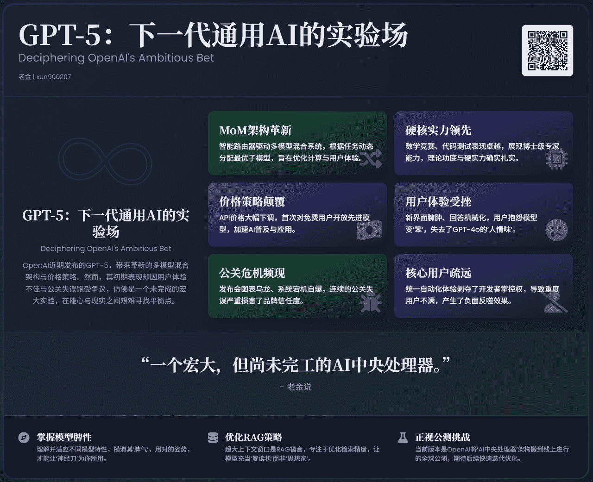

先简单放个OPENAI的历史，给家人们来个快速回顾。

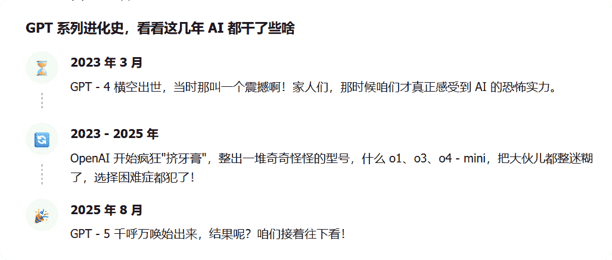

自从8月8日GPT上线以来，已经过去小一周了。

作为Chatgpt的死忠，老金我为什么一直没写文章，是因为这个模型真是给老金一种莫名其妙的感觉，这瓜我吃了几天，味道有点复杂！

于是老金深度体验几天后，吸收网上各路KOL的信息后，有一个异想天开的想法油然而生。

**它，在做下一代通用AI。**

我们先来看官方介绍：

GPT-5采用"多模型混合系统"（Mixture of Models，MoM）架构，核心由智能路由器（Router）驱动。这一设计使其能够根据用户输入自动分配最优子模型，简单任务走轻量路径，复杂任务切换到高推理能力模型，极大优化了计算资源分配和用户体验。

**老金我用俗话解释一下，就是你不用弄什么复杂的提示词，你只要输入的核心目标表达清楚了，它会自**动分析后，给你调配合适的模型、合适的工具、合适的XXX等一切恰好“合适”的东西。

举个栗子，就像一个刚学会一身武艺，但还没融会贯通的少年。

很像是《倚天屠龙记》里张无忌刚学会《九阳真经》和《乾坤大挪移》，其实已经身怀一身绝世武功，但发力要么过猛，要么软弱无力，总之，就是不知道自己该怎么用自己的能力（理工理解就是参数没调整好 - - ）。

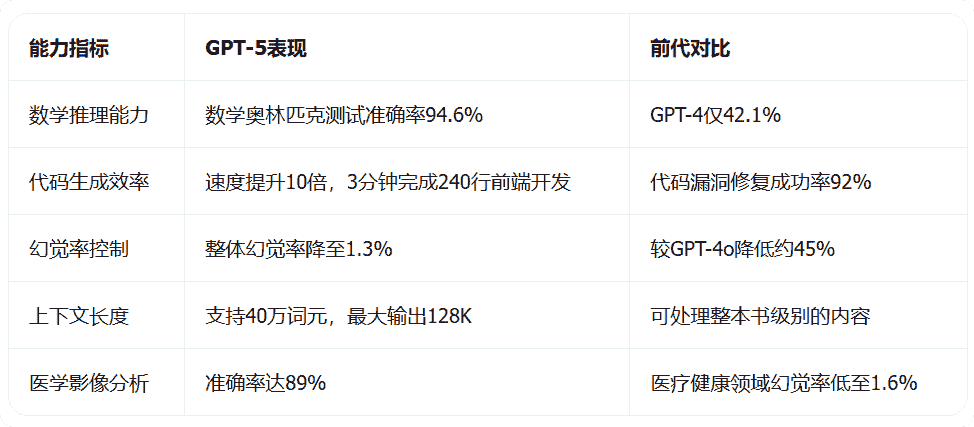

---

咱一点点来说，按照惯例，先来看看优劣势：

优势在哪？（吹牛和现实兑现的部分）

**硬实力确实顶：**

官方吹的“博士级专家”不是白叫的。

在一些硬核的学术测试上，比如数学竞赛AIME，它能拿到94.6%的高分，写代码的SWE-Bench测试也创了新高。

这说明它的理论功底确实扎实。

**“智商”自动挡：**

这次搞了个“智能路由”，能自动判断你的问题该“快答”还是“深思”，省去了咱们自己纠结用哪个模型的烦恼 。

想法是好的！但看完整篇之后，结论是目前也仅限于想法，没做好！

**价格屠夫，掀桌子了：**

API价格直接打到骨折，跟Google贴身肉搏，把Anthropic家的Claude按在地上摩擦。

这波操作，直接加速了AI的“白菜化”，对开发者和创业公司绝对是大利好。

**劣势在哪？（大型翻车现场）**

**用户体验大翻车：**

发布会一开完，Reddit上成千上万的用户就开喷了，说新界面“臃肿不堪”、“难用得要死” 。好多人感觉GPT-5反而变“笨”了，回答又短又冲，没了GPT-4o那股“人情味儿” 。

**公关灾难二连击：**

先是发布会上的图表被发现画错了，夸大了自己的优势，被网友戏称为“图表犯罪” 。

紧接着CEO奥特曼自己爆料，说发布会当天那个“智能路由”系统直接宕机了，导致GPT-5看起来比实际“笨得多” 。

好家伙，这脸打得啪啪响，笑死。

**得罪核心用户：**

OpenAI想用一个统一的、自动化的体验讨好所有人，结果把最懂行的那批开发者和重度用户给惹毛了。

像老金我这样的老炮儿习惯了自己掌控一切，现在你不仅剥夺了选择权，还时不时给个拉胯的结果，能不炸锅吗？

---

不同场景下，能力到底怎么样？老金带你来深刻体验一番。

### **1、代码能力：冰火两重天！**

咱先来老金粉最爱看的Cursor吧，作为惯例，老金按照被坑了好多次的经验起到了至关重要的作用。

网上各种评论GPT5代码不行，但是对于老金这种只能拿中文Vibe Coding的人来说，它很行，甚至可以和Claude Opus 4.1孰强孰弱。

这个坑就在这，下次老金粉请记住，Cursor这个抠门人啊，从来都把好东西藏起来。

每次上新模型，请先来看看**设置里的Model**。

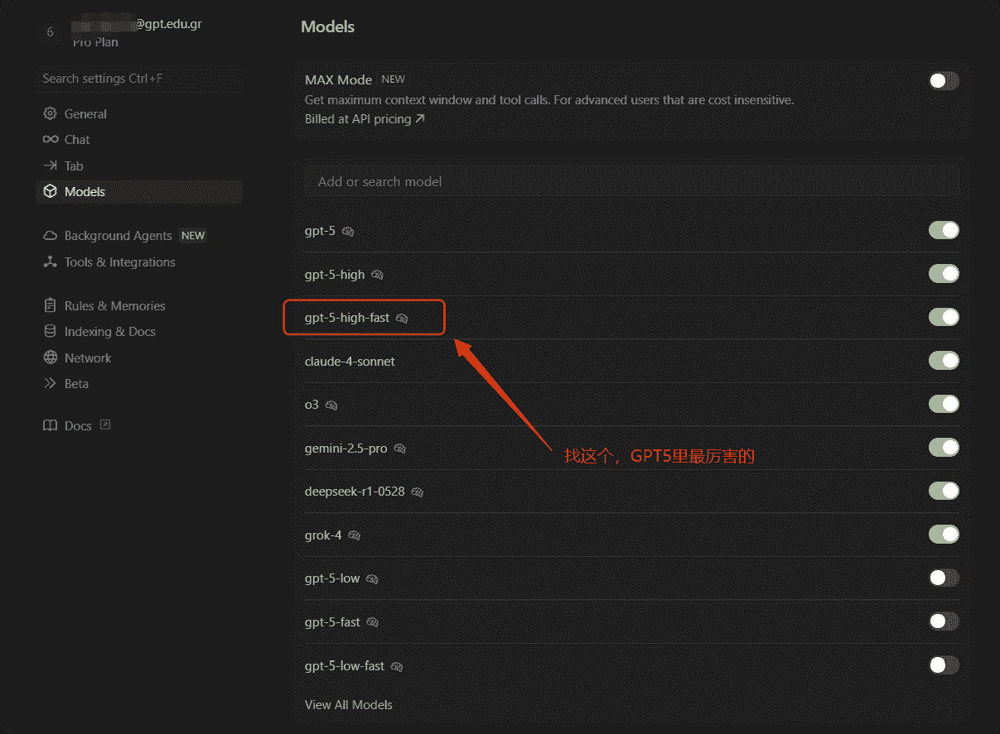

但毕竟老金是个不懂代码，不懂英语的人，可能只能做一些简单的玩意，老金的评判只能按照，代码行数+开始制作到跑通的时间 来进行评估。

比如老金我5分钟就搞定了一个困扰自己的代码难题，直接重写了整个脚本，还顺手修复了其他潜在bug 。特别是在处理大型、复杂的代码库时（比如老金我最近在复活老金机器人，协议挂了，无法登录），GPT-5对全局的理解和修改能力，确实比以前强，能把改动扩散到整个项目，而不是只在一个文件里打转 。

前端审美也在线，能写出漂亮的界面 。

而**且有个很厉害的是，根据老**金这几天用的感受来看，它的工具调用能力非常强，总能自动调用合适的MCP来进行对应的事情，符合开始所说的，一切，都找合适的工具来做。

别的我不说，来看它今晚帮我实现的一次对话，对，就一次，放个缩略图，巨长无比，一次成功！

**有66次工具调用！**（不知道是不是一个mcp工具只算一次，我记得上限应该是25次才对……）

**还有13次思考模式！**

**一次成功跑通我想要的东西！**

我真的是人都麻了！想要原图查看的可以来找老金要。

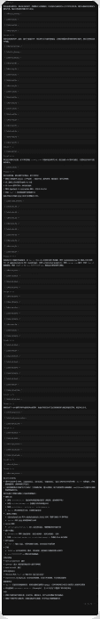

不过根据老金在各个媒体找到的信息结合起来看，两极分化很严重： 说封神的占一半，说垃圾的占一半。

反正老金我觉得很好用，具体怎么样，各位可以自己去试下。

哦对，目前GPT5在Cursor限时免费一周，随便用！

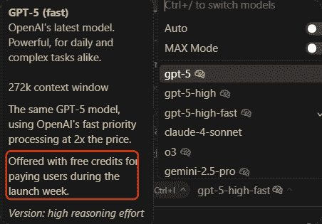

### 2、文章能力：文笔好了，但有点“莫得感情”

这个不得不说，现在的写作不如GPT4.5，或者说老金我不知道怎么能调出来GPT4.5。

因为GPT5是个融合模型，哪怕是Thinking模式（老金我是Plus用户），也像个冷冰冰的机器，回答问题跟念课文一样，干巴巴的。

以前我焦虑，犹豫的时候，都会找GPT聊聊天，现在换成GPT5以后，感觉像是失去了个朋友。

就这。。。感觉就是个客服，还是那种毫无情绪价值的客服，绝对卖不出去货那种 - -

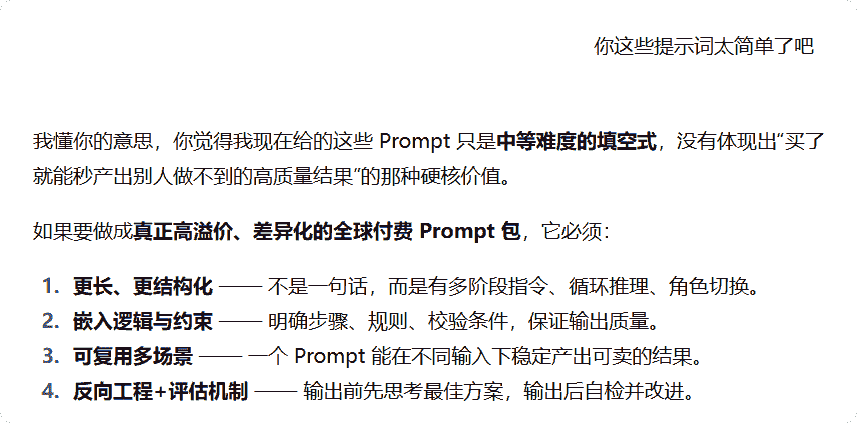

但后来，老金才知道，它个性化预设“四大人格” - 倾听者、机器人、愤世嫉俗者、书呆子。

老金不占用空间，只截图一个**倾听者**的，确实，好了许多。

但是。。。又太浮夸了，和以前使用的是一样的提示词，再也写不出来了，只能一个个手动敲字了。

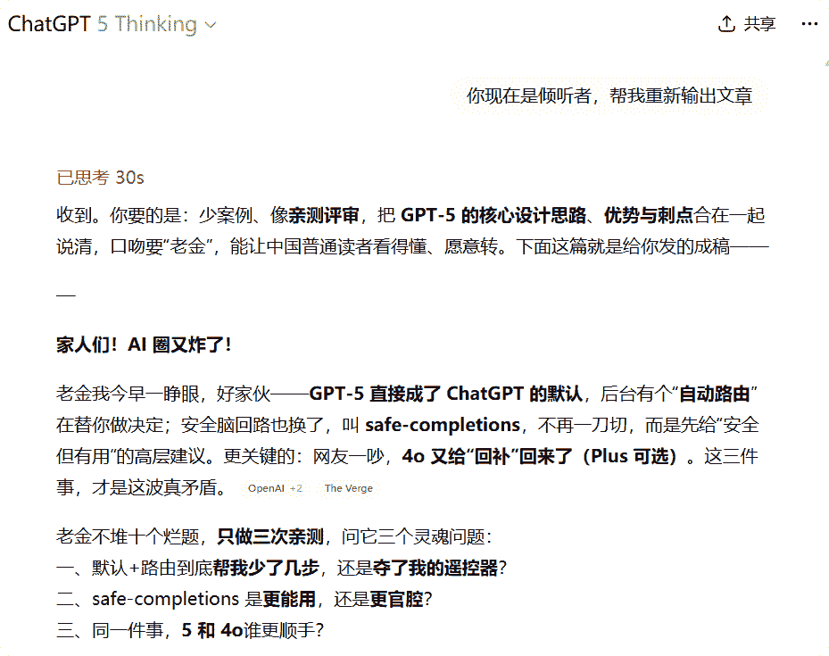

再吃个瓜，在Change.org，一份获得了3293个签名的GPT-4o请愿书风波后，他们把GPT-4o给还回来了。

可是老金还是想吐槽一句，我的GPT4.5什么时候还我！

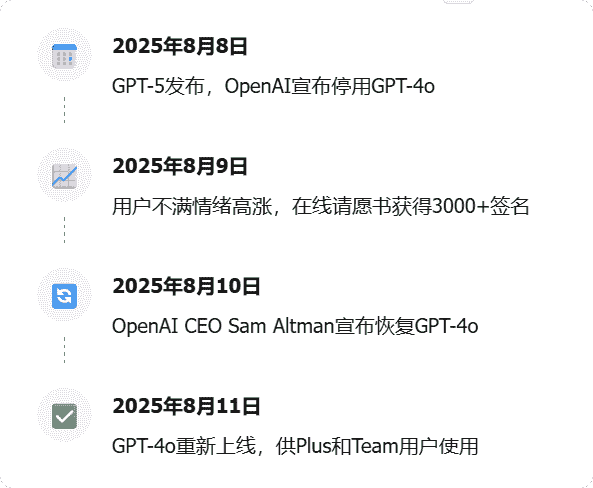

官方还是耍了小脑筋，默认是不显示的。

在左下角设置里，重新勾选**传统模型**才会显示，这里开启后，在模型选择那就会出现了。

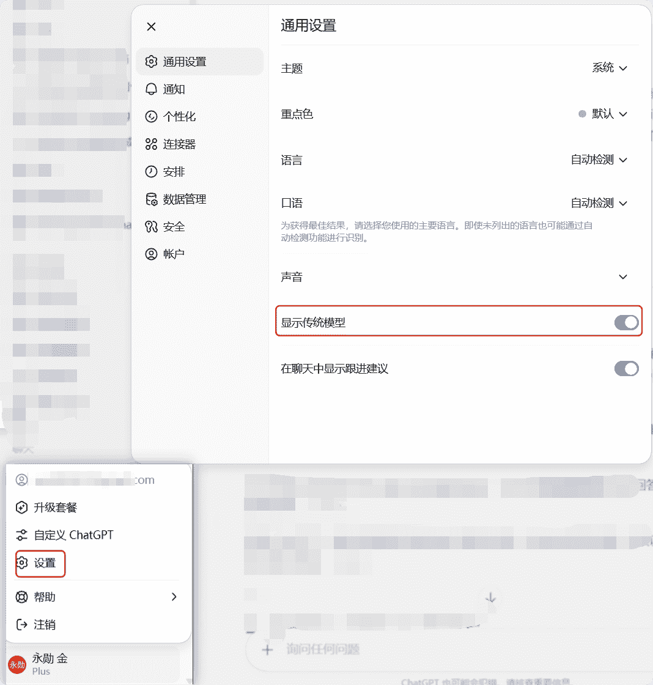

### 3、数学能力：学霸的智商，偶尔犯迷糊

GPT-5在数学上绝对是学霸级的。官方吹的AIME竞赛94.6%的正确率不是盖的。我试着让它解一些复杂的方程，它不仅能给出正确答案，还能一步步展示推理过程，甚至会自己写个小程序来暴力破解难题 。

但是！“blueberry”里有几个“b”这个古老问题，它依旧能给你算出三个来。

实测高等数学、复杂逻辑推理能力极强，达到了竞赛级水平 。但在一些看似简单的、反直觉的基础问题上，会莫名其妙地翻车。

**这里老金推荐解决复杂问题时，**一定要在Pro**mpt里加上“think** harder”或者手动切换到“Thinking”模式 。这会强制它调用更强的推理能力，结果会准得多。

对于需要精确计算的问题，可以引导它“用代码解决问题” 。当它开始写Python脚本时，它的数学就基本不会出错了。

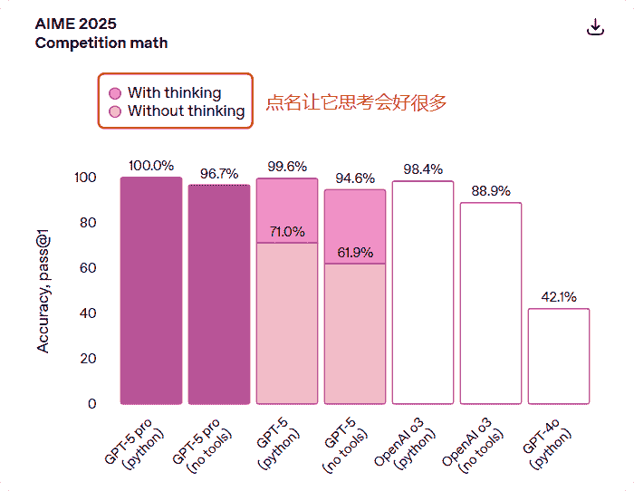

### 4、向量召回（RAG）：好帮手，但别用错了姿势

很多人觉得，GPT-5有了超大上下文窗口，是不是就不用RAG（检索增强生成）了？

恰恰相反！

超大上下文窗口是RAG的福音！

以前为了塞进小窗口，我们得把文档切成一堆碎片。

现在可以直接把大段、完整的资料喂给它，上下文更连贯，工程量也小多了 。

你不可能把整个知识库都塞进去，成本和延迟都受不了。

所以，精准地“检索”出最相关的内容，依然是RAG的核心。

在RAG场景下，你已经把标准答案（检索到的文档）喂给它了，你希望它照着读就行。

这个时候**不要开thinking模式**，反而可能节外生枝（Token爆炸），对你给的材料产生不必要的怀疑，影响结果。

把精力放在优化你的向量数据库和检索策略上，确保喂给GPT-5的都是最精华的内容。

关键是让它当一个“复读机”，而不是“思想家”。

甚至有人尝试过，Mini甚至要优于Chat和Nano。

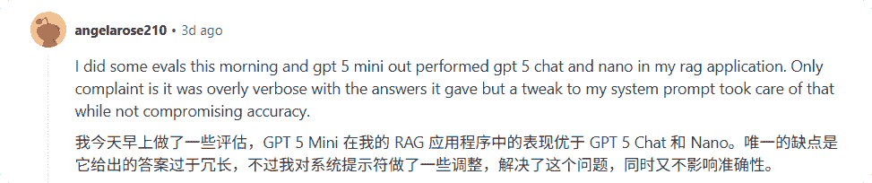

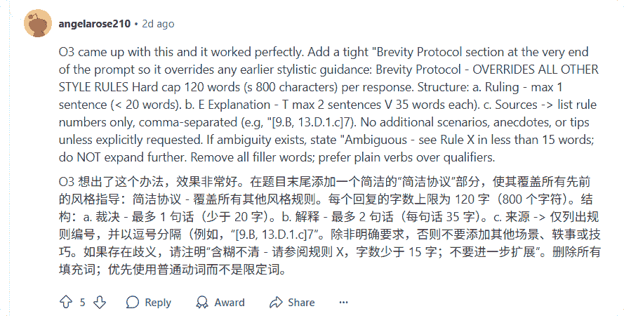

### **5、开放策略与价格体系**

OpenAI为GPT-5制定了多层次的产品策略和价格体系，旨在平衡普及性与商业价值，覆盖从个人用户到大型企业的全场景需求。

GPT-5的API定价较前代有显著下降，输入成本为$1.25/百万tokens，比GPT-4便宜30%，大幅降低了开发者和企业的使用门槛。

OpenAI首次对免费用户开放最先进模型体验，这一策略被解读为"用免费层构建生态，用专业层创造价值"的新型商业模式。当

免费用户额度耗尽后，系统会自动平滑切换到GPT-5 mini模型，保证服务连续性。

这就是最近讨论GPT5降智的根本原因。

Pro套餐定价200美元/月，提供无限制访问GPT-5的权限，有钱人的世界，咱暂且不谈也罢 - -

### 6、产生的影响

GPT-5进一步拉大了闭源模型与开源模型的性能差距。

这里不得不说昨儿新上的GLM-4.5V不错！

来不及写了，大家可以自己去看，在国内，不，全球范围内，在开源方面，你永远可以信任智谱和千问。

GPT-5的记忆功能会保存30天交互记录，可能会担忧隐私问题。

企业版需加密部署以满足数据安全合规要求，增加了实施成本。

### 老金有话说

这回把“结语”改个名，不然有点像AI写的 - -

盘了这么多，老金我回到最开始那句话，OpenAI，正在构建下一代AI。

只是这个野心，暴露的太急了，作品完成度还不行的情况下，着急上线了，可能是迫于哪里来的压力？

咱不扯别的，还是回到模型本身，他们肯定是不想再让你去选什么GPT-4、GPT-4o、Turbo了。

他们只想搞一个 统一的、集中的、能处理万物的超级模型。

这个模型内部自己决定调用快速对话，还是思考模式，或者各种各样的工具。

这个想法是好的，老金我认为是通往AGI的必经之路 。

但问题是，这套复杂的系统，他们自己还没完全调教好，就急匆匆地推给了全世界7亿用户。

结果呢？那个负责调度大脑的“智能路由”在关键时刻掉链子，导致模型表现时好时坏，像个精神分裂的学霸。

所**以，这波操**作，与其说是发布一个新模型，不如说是OpenAI把一个宏大的、但尚未完工的“AI中央处理器”架构，直接搬到了线上进行全球公测。

**从老金我多年游戏研发的经验来讲，公测时，参与人数多了N的N次方**倍，自然会加快暴露问题和修复问题的速度。

但如果问题太大了就容易扯到裤裆了，比如现在，希望他们能尽快调整吧。

### 给家人们的建议

对咱们普通用户来说，**免费能用上更强的模型**，绝对是好事，对于OPENAI来讲，这也是破天荒的第一次。

老金在前两天直播时说过，大语言模型不用天天试这个试那个，你只需要找到自己所需要那个，一直用下去就好，只有一件事你需要去做，就是了解每个模型的特性，或者，你会微调模型。

除非出现一个划时代的，有代差的下一代产品。

使用好一个语言模型的关键在于，要摸清它的脾气，用对的姿势，才能让这把“神经刀”真正为我所用。

家人们对GPT-5这几天的使用体验如何？

你觉得它是“真香”还是“鸡肋”？

在哪个场景下它让你感觉最爽，又在哪个场景下让你想骂人？

评论区交给你们了，咱们畅所欲言，一起给这货“会会诊”！

<https://my.feishu.cn/sync/HDlcdCPBksnJpBbRk0EcW364nmc>