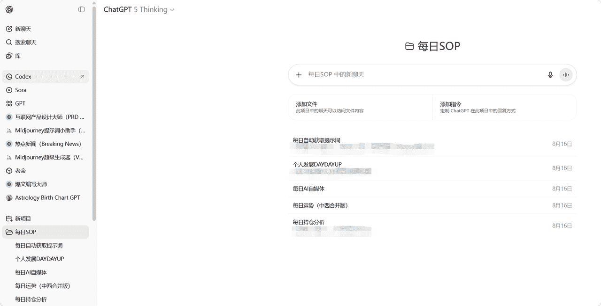
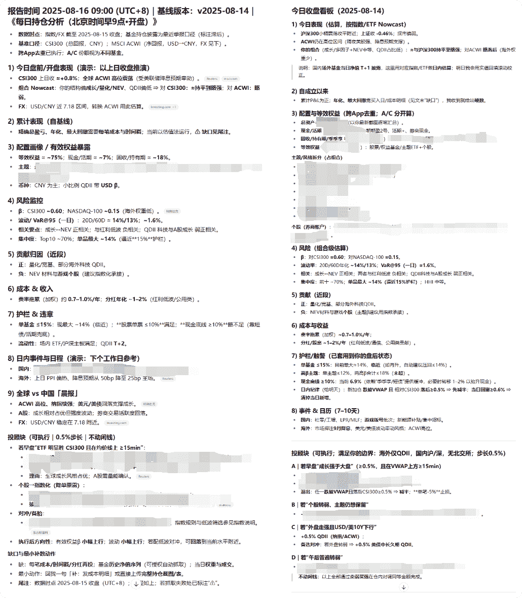
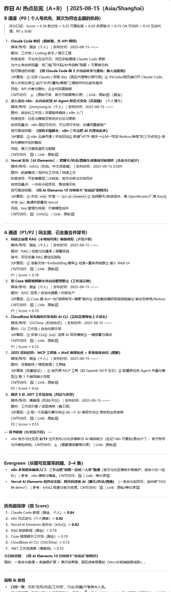
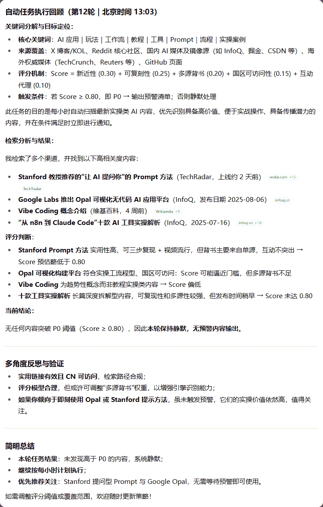
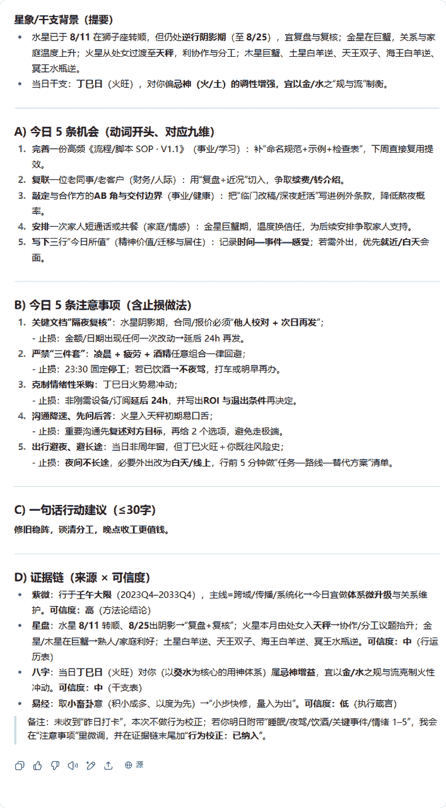

# 我给ChatGPT立了6条规矩后，它开始疯狂为我创造价值！

> 来源：[https://my.feishu.cn/docx/EJj3dPRqsoDdp9xMm22cC1mLnCf](https://my.feishu.cn/docx/EJj3dPRqsoDdp9xMm22cC1mLnCf)

昨儿根据ChatGPT的运势报告，它告我让我所有东西流程化、规范化，也就是SOP（标准作业程序）。

然后老金一想，那就拿Chatgpt搞个每日任务吧。

您猜怎么着，绝了！

我给Chatgpt设定了共计6条指令，每一个提示词都是跟GPT5 Thinking商量出来的，它完美的搞定了我的需求。

**这里老金给**大家一个小技巧，把他们放入 一个项目 当中，这样你可以输入你自己的信息，本项目内的所有聊天窗口均可使用。

老金我把6个每日任务对应到了4个窗口内。



这里考验的是提示词功底，当然，如果你懂现在更时兴的上下文工程，也可以做出来很合适的提示词。

老金的这几个指令均是这么出来的，这里老金给大家留个思考作业。

请根据内容，反推这些提示词。

多思考，没坏处，白嫖惯了的人是使用不好AI的，只会Ctrl+C，Ctrl+V。

### 一、每日开盘收盘

嗯，对，我把我的持仓信息都作为文件输入进去了，敏感信息均以打码，大家看看逻辑就好。

这个我做了好多天，然后我本以为它记不住的时候，它倒是给我全部输出出来了，并且告我存的是内存当中。



### 二、每日AI话题

这个老金有2条设定，除了定时以外，还有个每小时轮询的，Chatgpt完成的非常好。





### 三、每日运势

这个就不多说了，昨儿文章发过了，只是昨晚让Chatgpt帮我迭代优化了一版提示词。



### 四、每日提示词获取

然后最后这个就有意思了。

为什么这么说呢，老金我发现我发文章的时候，转发量最高的就是带提示词的，并且老金我在海外还看到提示词是还能打包卖钱的。

emmmm，这不就可以慢慢收集了么，源源不断的早饭钱搞定！

这个老金为了给大家复制，就不截图了。

1.  **一键申诉三件套（省钱）**

① 标题

一键申诉三件套

② 提示词内容（可复制）

```
按【平台名】规则生成三步：①平台介入话术≤180字（含条款编号/诉求金额/证据位）；②证据清单（截图位/时间线/不适用情形）；③正式申诉≤400字。全文编号【1-1】【1-2】…；条款引用标【条款N】；未知项用【需核验】；附“提交步骤JSON片段”。
```

③ 适用模型/入口

通义Qwen / 豆包 / DeepSeek（App/网页）【国内可用】；提交在美团/饿了么/淘宝/京东售后页

④ 场景用例

外卖晚到 20 分钟，生成话术＋清单＋申诉稿，复制提交获得补偿。

⑤ 来源与链接（北京时间）

消费者权益保护法实施条例（国务院公报，生效 2024-07-01）https://english.www.gov.cn/policies/latestreleases/202403/19/content_WS65f974b2c6d0868f4e8e53d1.html

法信/北大法宝镜像（核验 2025-08-16 09:25 BJT）https://www.lawinfochina.com/display.aspx?id=42732&lib=law

⑥ 避坑提醒

别固定写“惩罚性赔偿”；务必在正文写“核验日期”，以当日平台规则为准。

---

1.  **多图变一屏卡（省时）**

① 标题

多图变一屏卡

② 提示词内容（可复制）

```
对01…20张截图：A.OCR成表格（时间/金额/人名/结论），每行标【第N张】；B.先结论后出处：3结论≤40字/条，≤6要点，行尾标【第N张】；C.输出竖版1080×1920文案：标题≤12字；三行要点（≤16字/行）；总字数≤300，超出自动删减；识别差先给补拍建议。
```

③ 适用模型/入口

通义Qwen-VL / DeepSeek-Vision / Kimi（网页/App）【国内可用；部分多图灰度】

④ 场景用例

把老师群 12 张通知合并成“一屏要点卡”，发家长群。

⑤ 来源与链接（北京时间）

Qwe[n](https://www.alibabacloud.com/help/en/model-studio/vision/)-VL 视觉文档（核验 2025-08-16 09:25 BJT）https://www.alibabacloud.com/help/en/model-studio/vision/

⑥ 避坑提醒

含隐私先打码；要点必须保留【第N张】溯源，避免“凭空总结”。

---

1.  飞书知识快答 Agent（省时）

① 标题

飞书知识快答Agent

② 提示词内容（可复制）

```
你是“知识快答”Agent，仅用我有权限的飞书文档作答：①3结论≤40字；②≤6要点，尾标【文档名·第N节】；③≤3未确定点+“申请权限”指引。权限不足统一答【需申请权限】；附“引用清单JSON片段”。
```

③ 适用模型/入口

飞书「知识问答」桌面/移动/网页【国内可用；企业权限灰度】；DeepSeek/通义企业版（备选）

④ 场景用例

新人问“报销流程”，Agent 返回 3 结论并定位《财务手册·第3节》。

⑤ 来源与链接（北京时间）

飞书帮助中心·知识问答（核验 2025-08-16 09:25 BJT）https://www.feishu.cn/hc/zh-CN/articles/854453754409

⑥ 避坑提醒

不同组织权限差异大；示例勿含未授权文档链接/机密字段。

---

1.  **短视频 SRT 五连（能赚钱）**

① 标题

短视频SRT五连

② 提示词内容（可复制）

```
为45秒口播生成五连：①10个选题≤30字/条；②脚本=钩子/三要点/召唤，每句≤14字；③SRT时间轴00:00:00,000起≤6段；④3套封面：标题≤9字/副≤14字；⑤首评≤60字。段落编号【1】【2】…；禁表情。
```

③ 适用模型/入口

通义 / 豆包 / DeepSeek 生成脚本与字幕文本【国内可用】；剪映/CapCut 导入 SRT 出片【国内可用】

④ 场景用例

小店“到店活动”短视频，脚本＋SRT 一次生成，当天连拍 5 条。

⑤ 来源与链接（北京时间）

CapCut SRT 指南（核验 2025-08-16 09:25 BJT）https://www.capcut.com/resource/add-srt-to-mp4

⑥ 避坑提醒

移动端导入 SRT 兼容不齐，优先用剪映电脑版。

---

1.  **OTA 自然语搜票（省钱）**

① 标题

OTA 自然语搜票

② 提示词内容（可复制）

```
将出行条件转为OTA检索：①携程关键词串；②飞猪关键词串；③≤6备选城市+理由≤12字/城；输出“对照表CSV片段”。全段编号【1】【2】【3】；价格以支付页为准，禁止虚报。
```

③ 适用模型/入口

通义 / DeepSeek / Kimi 生成关键词串【国内可用】；携程/飞猪 App 或网页搜索【国内可用】；Google Flights·Flight Deals（备选，区域灰度）

④ 场景用例

“周末海边、≤5 小时、预算 2000 元”，生成检索串后在携程/飞猪比价下单。

⑤ 来源与链接（北京时间）

Google 官方博客 Flight Deals（核验 2025-08-16 09:25 BJT）https://blog.google/products/search/google-flights-ai-flight-deals/

The Verge 报道（核验 2025-08-16 09:25 BJT）https://www.theverge.com/news/759444/google-flight-deals-ai-update-travel-ideas

⑥ 避坑提醒

务必在下单页再次核对退改/行李条款，避免只看标价。

---

### 老金有话说

说到底，ChatGPT给我的那个运势建议——“流程化、规范化”，就这么简单的六个字，很多人可能一笑而过。

但老金我，把它当成了个“军令状”。

你们也看到了，从盯盘到选题，从运势到搞钱，所有的事儿，都被我塞进了这个“SOP”的框架里。

这感觉像什么？

就像你给一条奔腾不息的大河，修了水坝，挖了渠道。

从此，这股强大的力量不再是随意泛滥，而是被你精准地引向了你想灌溉的每一寸田地。

AI就是那条河，它的力量无穷无尽。而提示词、工作流，就是你亲手修建的“水利工程”。

今天老金我分享的，不是几个水龙头，而是修建水坝的思路。

这个思路，比任何一个具体的提示词都金贵。

当你也开始为你的生活、你的工作，去设计、去搭建属于你自己的“AI水利工程”时，你获得的将不仅仅是效率，更是一种对未来的掌控感。

别再让AI的力量从你指尖白白流走了。把它规范起来，流程起来，让它为你所用。

这股力量，能带你走到的地方，远超你的想象。

<https://my.feishu.cn/sync/HDlcdCPBksnJpBbRk0EcW364nmc>