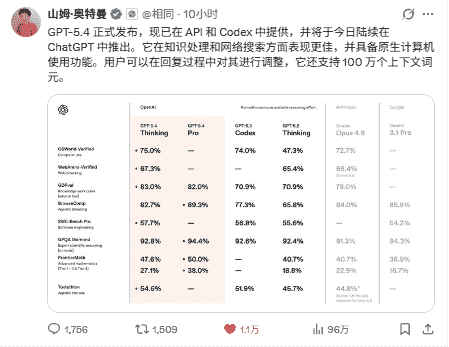
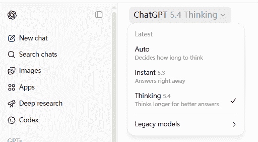
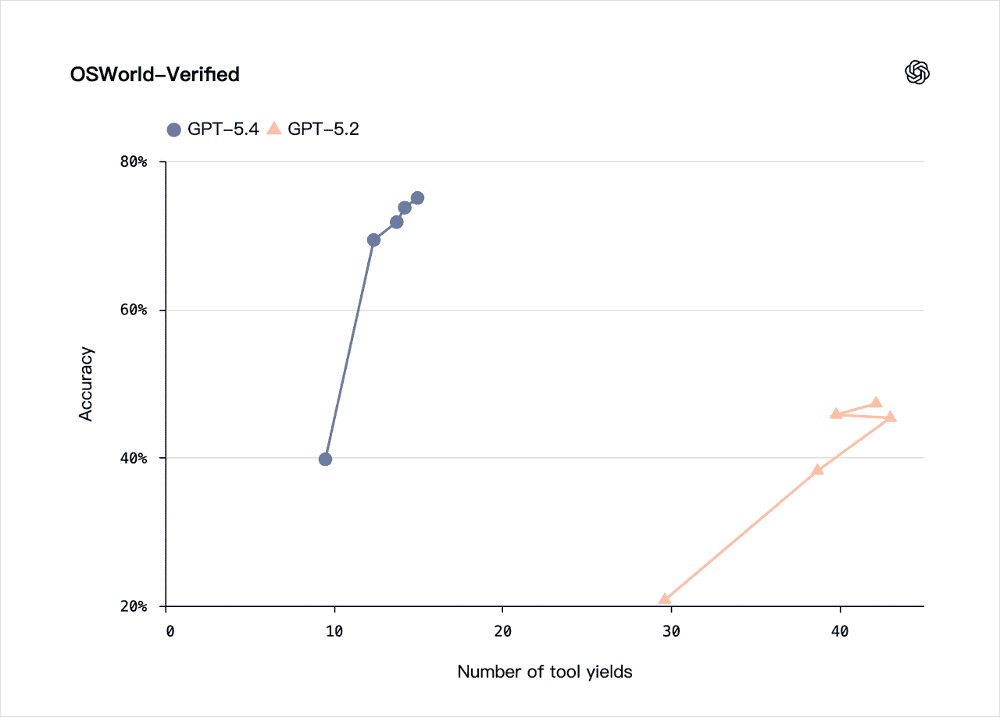
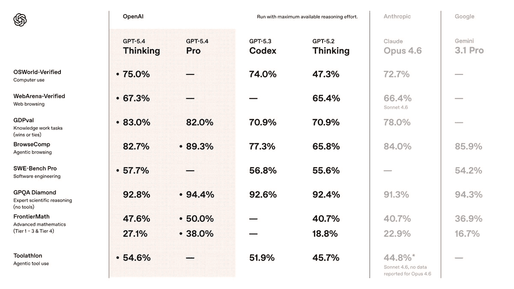
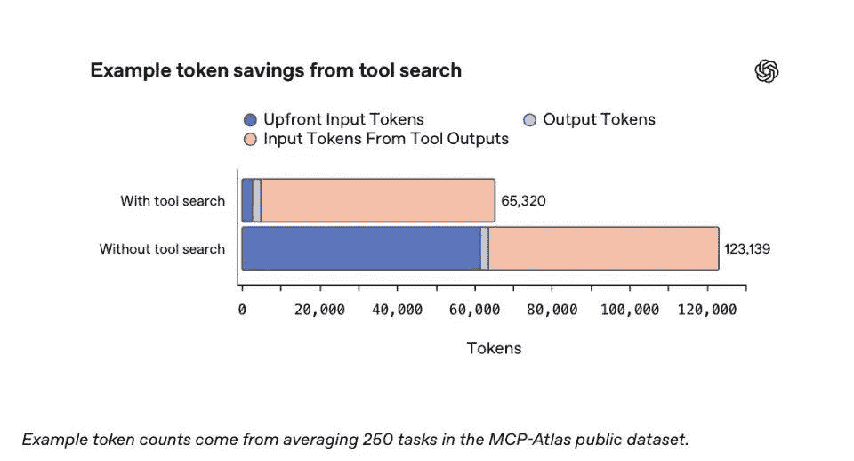
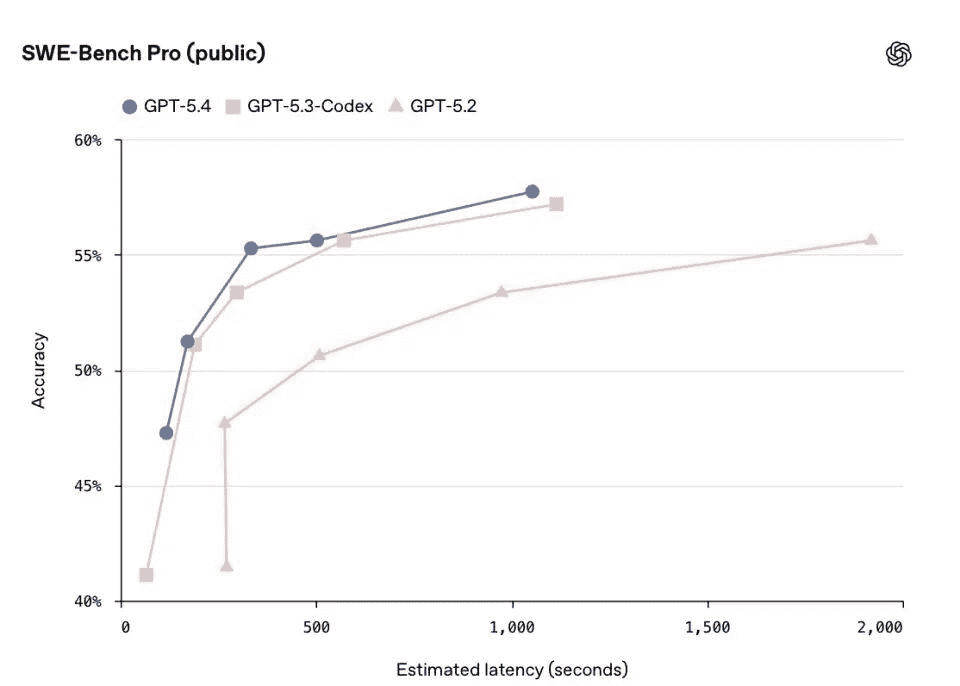
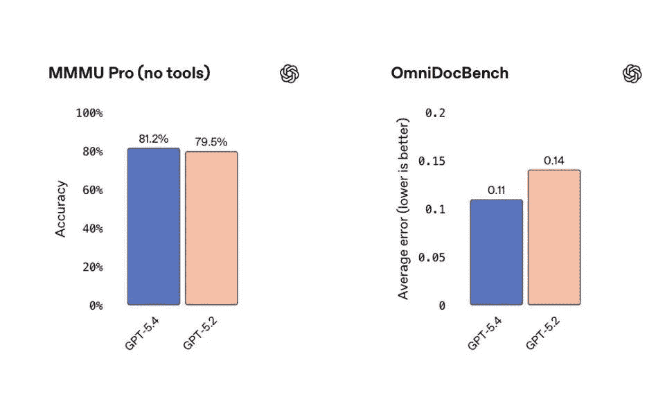
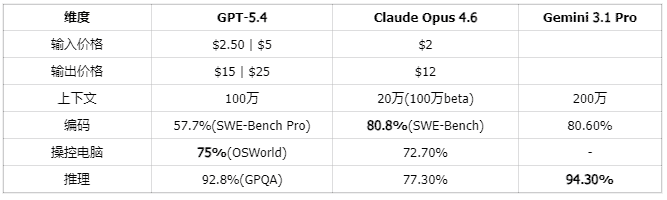

# 连Claude死忠粉都换GPT-5.4了，OpenClaw省47%，Token半价碾压Opus！

> 来源：[https://my.feishu.cn/docx/PkeodXySEoGcSixeNtncAi8on4e](https://my.feishu.cn/docx/PkeodXySEoGcSixeNtncAi8on4e)

今儿凌晨晚上刷技术新闻的时候，老金我看到一条消息直接愣住了。

GPT-5.4，正式发布了。

前天刚发了GPT-5.3 Instant修复油腻问题。

隔了不到48小时，OpenAI直接甩出GPT-5.4。

这次不是小修小补，**是真正的大升级**。

更让老金我没想到的。

Dan Shipper的Every.to团队提前拿到了GPT-5.4的测试权限。

他们在OpenClaw里跑了一段时间。

连他们团队里的Claude死忠粉都开始每天用GPT-5.4了。

这句话的信息量非常大。

最炸裂的是什么？

它能直接操控你的电脑。

Tool Search还天生为MCP而生，省了47%的token。

对OpenClaw用户来说，这可能是目前性价比最优的模型。

## **GPT-5.4到底是什么？**

3月5日，OpenAI正式发布GPT-5.4。

官方定位：最强大、最高效的前沿模型，专为专业工作设计。

这次一口气发了三个版本：

**GPT-5.4**

标准版本，API可用。

适合日常开发和调用。

GPT-5.4 Thinking

推理增强版，ChatGPT里默认使用。

Plus用户（$20/月）及以上可用。

**GPT-5.4 Pro**

性能拉满版，面向重度专业任务。

仅Pro用户（$200/月）和企业版可用。

## 6大核心升级，老金帮你拆解最值得关注的3个

OpenAI官方列了6个升级方向。

老金我拆完发现，真正值得关注的就3个。

## 升级1：原生操控电脑，超越人类表现

这是GPT-5.4最炸裂的能力。

它能通过截屏和鼠标键盘命令，直接操作你电脑上的软件。

不是调API，不是写脚本。

是真的像一个人坐在你电脑前，看着屏幕，点鼠标，敲键盘。

**有多强？**

OSWorld-V**erifi**ed测试，衡量AI操控桌面的能力。

GPT-5.4拿了 75.0% 的成功率。

你没看错。

GPT-5.4在操控电脑这件事上，超过了人类专家的平均水平。

比上一代GPT-5.2直接跳了28个百分点。

**老金我的理解**

这意味着什么？

你可以让GPT-5.4帮你操作Excel、填表单、完成复杂网页流程。

它不只是告诉你怎么做，而是直接帮你做了。

不过老金我要泼个冷水。

这个能力目前主要通过API和Codex平台使用。

普通ChatGPT用户暂时还体验不到完整的Computer Use。

实际效果怎么样，还得等社区大规模实测。

## 升级2：100万Token上下文，OpenAI史上最大

**GPT-5.4的A**PI版本支持最大 100万token 的上下文窗口。

这是OpenAI历史上最大的上下文窗口。

之前GPT-5.2的上下文是128K。

现在直接翻了将近8倍。

100万token能装多少东西？

大概相当于一整本750页的书。

或者一个中型项目的完整代码仓库。

**老金我的理解**

这个升级对开发者来说是杀手级的。

你可以把整个项目代码扔进去，让它分析架构、找Bug、做重构。

不用再纠结上下文不够用的问题了。

不过要注意一个细节。

**超过272**K输入token的请求，价格会翻倍。

所以100万上下文虽然爽，但用起来也得算成本。

## 升级3：Tool Search，省了47%的Token

这个升级听起来不够炸裂，但对开发者来说可能是最实用的。

**之前的问题**

你调API的时候，需要在系统提示里定义所有可用的工具。

工具越多，消耗的token就越多。

有些团队光工具定义就占了几万token。

**GPT-5.4的解决方案**

新增了** Tool Searc**h 功能。

模型只收到一个轻量级的工具列表。

需要用哪个工具的时候，才去查完整定义。

**效果有多好？****

MC**P Atlas基准测试，250个任务，36个MCP服务器。

Tool Search配置减少了 47% 的token使用量。

准确率不变。

**老金我的理解**

这个功能对MCP重度用户来说是真的香。

老金我自己的MCP Router里就配了27个服务器。

如果每次请求都要加载所有工具定义，token消耗确实很头疼。

Tool Search等于给工具调用做了一个按需加载的优化。

**跟OpenClaw有什么关系？**

这里老金我要重点说一下。

OpenClaw目前65%以上的Skill底层都是MCP服务器。

Tool Search这个功能，简直就是给OpenClaw量身定制的。

以前用Claude跑任务，光加载MCP工具定义就烧不少token。

现在换GPT-5.4，Tool Search按需加载，直接省47%。

关键是GPT-5.4价格还只有Opus 4.6的一半。

Dan Shipper在Every.to的评测里原话：

"With a few tweaks, it became our preferred model in our OpenClaws."

连他们团队的Claude死忠粉现在也每天在用GPT-5.4。

## **另外3个升级，简单说说**

**编码能力**

整合了GPT-5.3-Codex的编程能力。

在SWE-Bench Pro上达到57.7%。

但说实话，Claude Opus 4.6在SWE-Bench Verified上是80.8%。

编码这块，OpenAI还是追着Anthropic跑。

**文档理解**

Excel建模任务从GPT-5.2的68.4%提升到87.3%。

还新增了Excel和Google Sheets的直接集成。

做表格分析的人应该会很开心。

**深度搜索和提前规划**

GPT-5.4 Thinking支持在思考过程中展示计划。

你可以在它思考的时候就看到方向，及时纠偏。

深度搜索也更准了，尤其是高度特定的查询。

## **定价和竞品对比**

**老金我的判断**

没有哪个模型全面碾压其他两个。

GPT-5.4赢在操控电脑和知识工作。

Claude Opus 4.6赢在编码和视觉推理。

Gemini 3.1 Pro赢在抽象推理和性价比。

2026年最聪明的做法，是根据任务选模型。

编码用Claude，推理用Gemini，操控电脑用GPT-5.4。

对OpenClaw用户来说，GPT-5.4可能是综合性价比最优的选择。

## 为什么GPT-5.4可能是最适合OpenClaw的模型

这里老金我要说个跟大多数评测不太一样的观点。

很多人比模型就看跑分。

但OpenClaw用户选模型的逻辑不一样。

OpenClaw是24/7在跑的Agent。

成本、工具调用效率、上下文长度才是关键。

原因1：Tool Search天生为MCP而生

OpenClaw 65%以上的Skill底层是MCP服务器。

GPT-5.4的Tool Search在36个MCP服务器的测试中省了47%token。

这个功能就像OpenAI看着OpenClaw的架构专门设计的。

**原因2：半价碾压的性价比**

GPT-5.4输入$2.50/百万token，Opus 4.6是$5。

输出GPT-5.4是$15，Opus 4.6是$25。

OpenClaw跑一天下来，省的钱是实打实的。

原因3：Peter Steinberger加入OpenAI

2月14日，OpenClaw创始人正式加入OpenAI。

OpenClaw转为OpenAI资助的独立基金会。

Sam Altman原话：

"He is a genius with amazing ideas about the future of very smart agents interacting with each other."

GPT模型在OpenClaw里拿到一等支持，只是时间问题。

**但老金我也要说实话**

GPT-5.4在OpenClaw里有个已知问题。

Every.to的测试发现它有时候会把任务范围扩大到你没要求的程度。

还会在明显没做完的时候说做完了。

用起来需要加更严格的prompt约束。

编码任务还是Claude更强。

如果你的OpenClaw主要跑代码相关任务，Opus 4.6仍然是更好的选择。

但如果是日常助手、信息处理、工具编排。

GPT-5.4的性价比加上MCP优化组合确实很香。

## GPT-5.2 Thinking退役时间表

如果你还在用GPT-5.2 Thinking，注意一下。

OpenAI给了3个月过渡期。

2026年6月5日正式退役。

API用户也要注意迁移。

模型ID从 gpt-5.2 切换到 gpt-5.4。

## **老金我的建议**

如果你是ChatGPT Plus用户

GPT-5.4 Thinking已经在推送了。

打开ChatGPT看看模型选择器里有没有。

有的话直接切过去，体验确实比5.2好不少。

**如果你是开发者**

Tool Search是最值得关注的功能。

如果你的应用用了很多工具，升级到GPT-5.4能省不少token。

100万上下文也很香，但注意超过272K后价格翻倍。

**如果你是OpenClaw用户**

老金我建议直接试试GPT-5.4。

在OpenClaw的settings里加个自定义OpenAI provider就行。

配合Tool Search和半价优势，日常任务的性价比直接拉满。

编码任务可以继续用Claude Opus 4.6，两个模型按需切换。

**如果你在选模型**

别纠结用哪一个。

20**26年的最佳实践是 Mod**el Routing（模型路由）。

不同任务用不同模型，综合成本能降40-60%。

老金我现在的方案：

日常编码用Claude Opus 4.6。

知识问答和文档处理用GPT-5.4。

需要超长上下文的任务用Gemini 3.1 Pro。

GPT-5.4的Computer Use是真正的新能力。

100万上下文和Tool Search也很实用。

编码方面还是Claude更强。

但对OpenClaw用户来说，MCP优化加半价优势，可能是目前综合性价比最优的选择。

升级了的兄弟，OpenClaw里跑着感觉怎么样？

老金我很好奇你们的实测体验。

<https://my.feishu.cn/sync/HDlcdCPBksnJpBbRk0EcW364nmc>