# Coze.cn（国内版）

> 来源：[https://my.feishu.cn/docx/BLHNdAOvzoBJuWx1uz8cIsfRnje](https://my.feishu.cn/docx/BLHNdAOvzoBJuWx1uz8cIsfRnje)

## 由于Coze.com已收费（2024/7/3），补充Coze.cn教程。

## 本文在操作代码时，注**意缩**进**和符**号

# **    ****  本教程使用前提   ****   **

本教程是在初级微信机器人教程的基础上，使其拥有目前最强大能[力的升级篇。如果你对基础还不了解，](https://tffyvtlai4.feishu.cn/wiki/AS5pw7JOQi9lHWk56pucqjkinSc)请移步人人都可以拥有的贾维斯，手把手教你怎么拥有一个初级微信机器人！（点击进入）

初级教程关键点总结：

1、申请LLM（语言大模型）的API（接口）

2、注册云服务器（就是让它挂在网络上，不开启随身设备它也能自己运行）

3、配置环境（云服务器的配置）

4、通过COW开源项目，配置微信机器人

请确认以上内容都已经学会并完成。

# **    ****   教程正文详情    ****   **

## 一、替换文件

1、路径/root/chatgpt-on-wechat下，打开config.py 文件

找到class config，在}前面增加Coze配置：

```
    # Coze平台配置
    &quot;model&quot;: &quot;coze&quot;,
    &quot;coze_api_base&quot;: &quot;https://api.coze.cn/open_api/v2&quot;,
    &quot;coze_api_key&quot;: &quot;&quot;,
    &quot;coze_bot_id&quot;: &quot;&quot;,
```

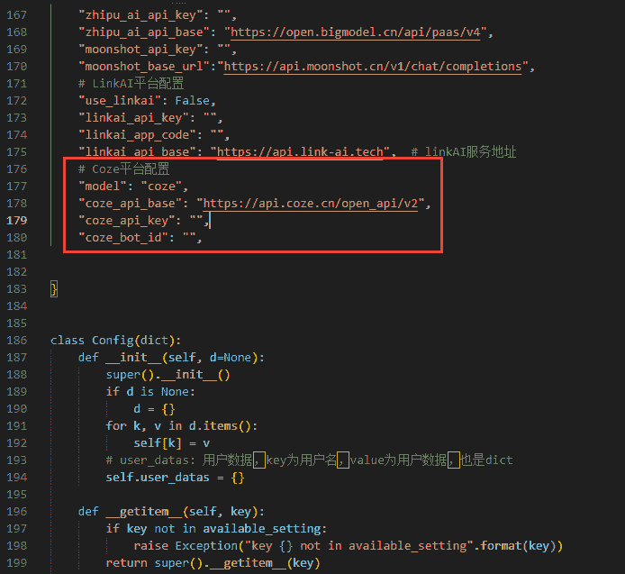

2、路径/root/chatgpt-on-wechat/bot下创建 一个新文件夹，命名为bytedance

路径/root/chatgpt-on-wechat/bot/bytedance下，上传bytedance_coze_bot.py文件


[bytedance_coze_bot.py](https://internal-api-drive-stream.feishu.cn/space/api/box/stream/download/all/FTI1bMS0BoVB1uxyVZTcG8qBnXd)

3、路径/root/chatgpt-on-wechat/bot文件夹下，打开bot_factory.py 文件。

最下方添加Coze配置：

```
    elif bot_type == const.COZE:
        from bot.bytedance.bytedance_coze_bot import ByteDanceCozeBot
        return ByteDanceCozeBot()
```

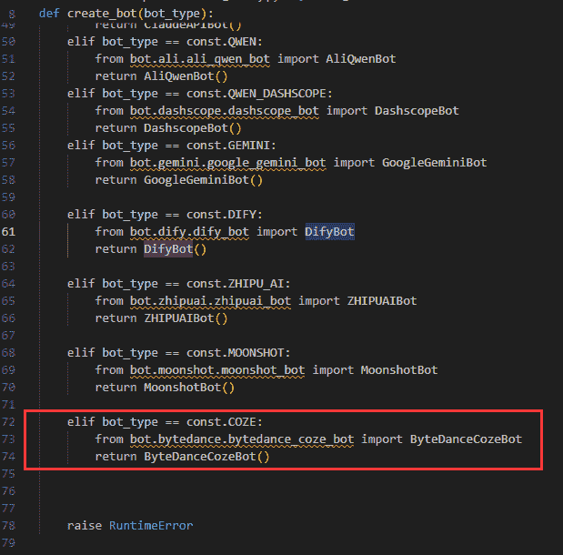

4、路径/root/chatgpt-on-wechat/common文件夹下，打开 const.py 文件

#bot_type中添加coze，COZE = "coze"，

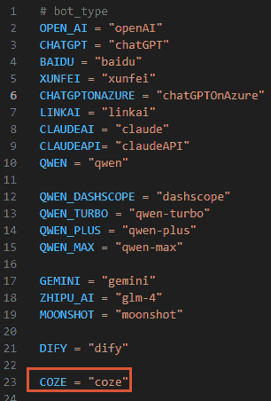

MODEL_LIST中添加coze

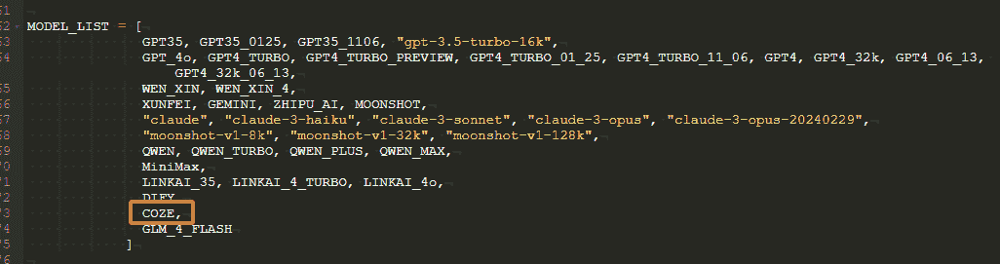

5、/root/chatgpt-on-wechat/bridge下，打开bridge.py文件

插入Coze配置：

```
        if model_type in [const.COZE]:
            self.btype[&quot;chat&quot;] = const.COZE
```

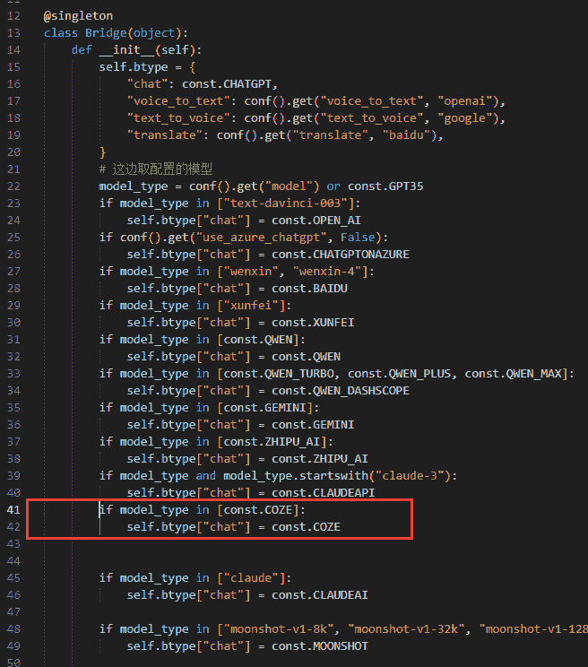

## 二、修改配置

路径/root/chatgpt-on-wechat/下，打开config.json文件进行修改，下面这4行，除了model外，其他3行需要手动补充。

+   [※ COW主目录Config说明](https://tffyvtlai4.feishu.cn/wiki/Ti7uwsKgiiW6bpk2nmQcVhQ8nnb)果有报错，可能是更新导致，请查看   是否缺少配置。

```
{
  &quot;channel_type&quot;: &quot;wx&quot;,   
  &quot;model&quot;: &quot;coze&quot;,
  &quot;coze_api_base&quot;: &quot;https://api.coze.cn/open_api/v2&quot;,
  &quot;coze_api_key&quot;: &quot;这里改成你的coze key&quot;,
  &quot;coze_bot_id&quot;: &quot;这里是你的botid&quot;,
  &quot;text_to_image&quot;: &quot;dall-e-3&quot;,
  &quot;voice_to_text&quot;: &quot;openai&quot;,
  &quot;text_to_voice&quot;: &quot;openai&quot;,
  &quot;proxy&quot;: &quot;&quot;,
  &quot;hot_reload&quot;: false,
  &quot;single_chat_prefix&quot;: [&quot;&quot;],
  &quot;single_chat_reply_prefix&quot;: &quot;&quot;,
  &quot;group_chat_keyword&quot;: [&quot;@机器人大军&quot;], 
  &quot;group_chat_prefix&quot;: [],
  &quot;group_name_white_list&quot;: [&quot;ALL_GROUP&quot;],
  &quot;concurrency_in_session&quot;: 1,
  &quot;group_welcome_msg&quot;: &quot;&quot;,
  &quot;speech_recognition&quot;: true,
  &quot;group_speech_recognition&quot;: false,
  &quot;voice_reply_voice&quot;: false,
  &quot;conversation_max_tokens&quot;: 2000,
  &quot;expires_in_seconds&quot;: 3600,
  &quot;character_desc&quot;: &quot;&quot;,
  &quot;temperature&quot;: 0.5,
  &quot;subscribe_msg&quot;: &quot;&quot;,
  &quot;use_linkai&quot;: false,
  &quot;linkai_api_key&quot;: &quot;&quot;,
  &quot;linkai_app_code&quot;: &quot;&quot;
}

```

## 三、获取key和id

进入官网：https://www.coze.cn/home

### 1、获取Key

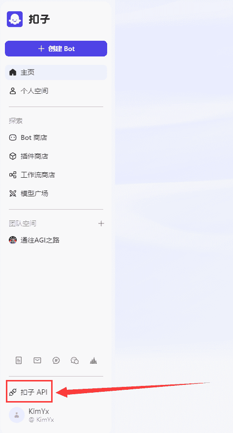

点击API令牌

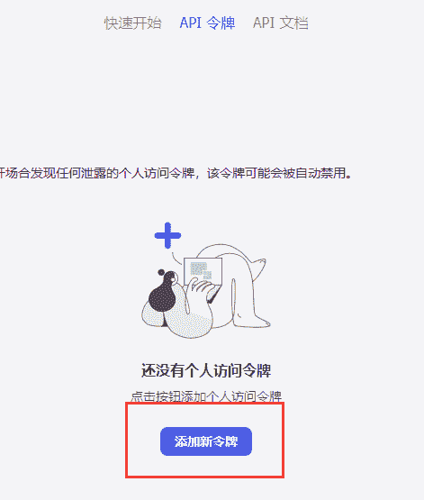

这里权限需要说明一下，如果**未发布**过任何Bot，是不会出现**权限**选项的。发布后，再回来选上。

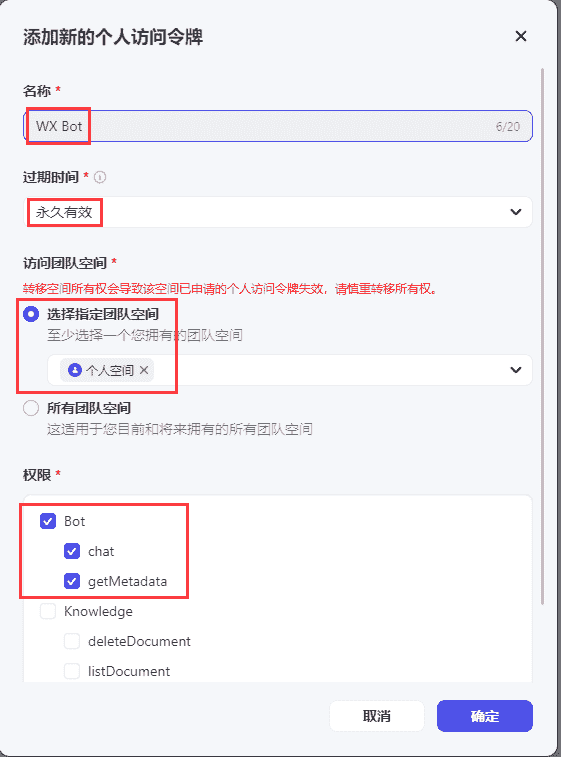

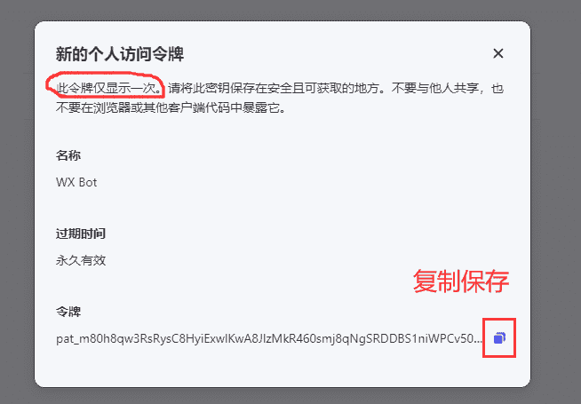

获取到的这个令牌，就是  "coze_api_key"，像下方一样填入即可。

"coze_api_key": "pat_diajdkasjdlksajdlksajdasdjlkasjdlas",

### 2、获取Bot ID

创建Bot，填写名字，点击确认

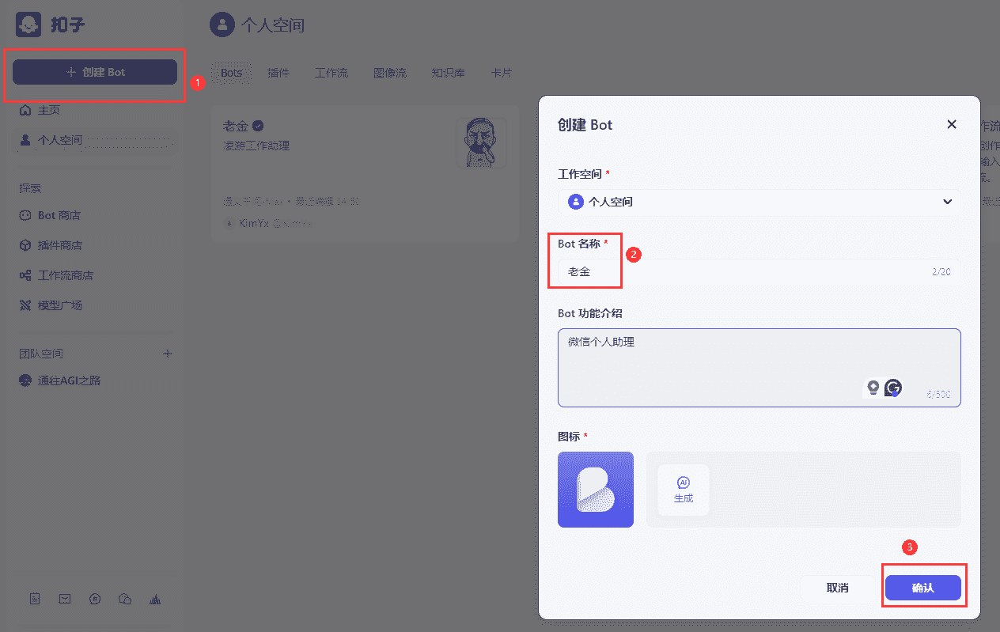

编排后，直接发布。

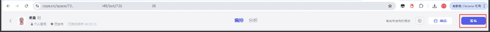

直接点击跳过。

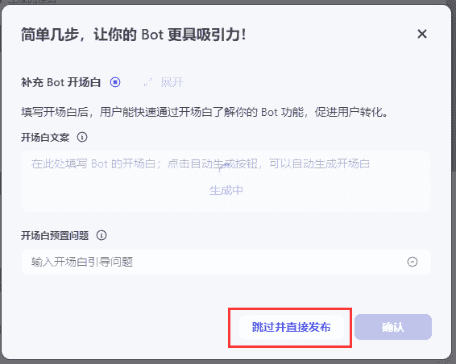

选择Bot商店和API，然后点击右上角的发布。

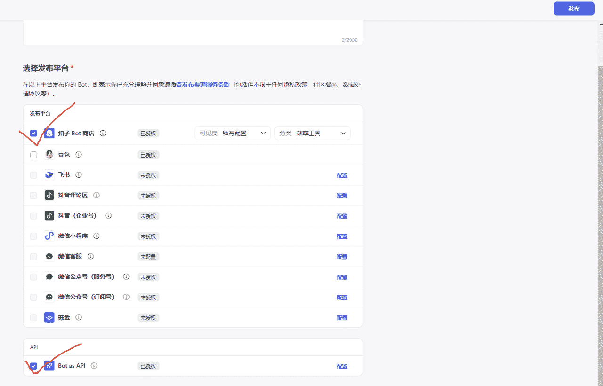

找到BOT ID。

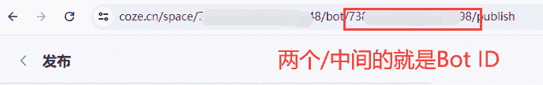

把bot_id填入：

"coze_bot_id": "86787989080",

发布是否成功，在Bot编辑页面查看。

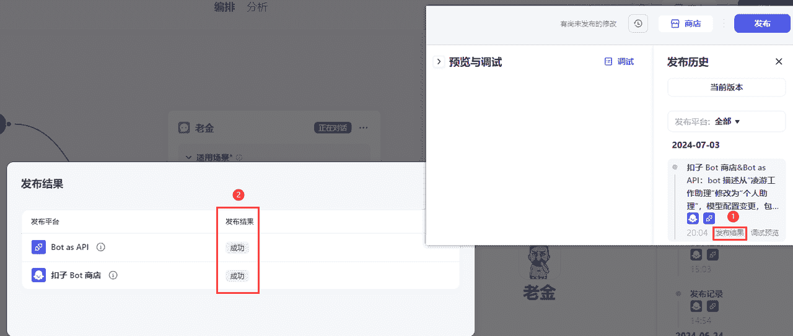

## 四、完成配置并启动

返回[第二步](https://tffyvtlai4.feishu.cn/wiki/LnxAwrDGUi8h6Ykg5L6cY8d2nHh#J2vadFt8go2pazxRUy1c2pahn0f)，配置 coze_api_key和coze_bot_id，然后扫码启动即可。

<https://my.feishu.cn/sync/HDlcdCPBksnJpBbRk0EcW364nmc>