# Coze.cn 切换专业版，同步及余量查询

> 来源：[https://my.feishu.cn/docx/G5QndX63RoYE3zxgYp0cOX4bnRc](https://my.feishu.cn/docx/G5QndX63RoYE3zxgYp0cOX4bnRc)

引  言

2024/08/15起，Coze.cn开始进行收费，拆分为基础版与专业版。

本文内容如下几个部分：

1、基础版与专业版的定义与差别

2、怎么把基础版之前做的复刻到专业版

3、用到🛰️机器人的，怎么生成新的令牌

4、付费是怎么计算的

**                【基础版】与【专业版】的定**义与差别

**基础版：**

面向尝鲜体验的个人和企业开发者，全部功能免费使用，但有一定的限量额度，超过后不可再使用，需切换专业版后继续使用。

**专业版：**

面向对稳定性和用量有更高需求的专业开发者，支持更高团队空间容量和免费知识库容量，付费功能保障专业级 SLA，不限制调用请求频率和总量，费用按实际用量计算。

## 开通扣子专业版

登录后，点击扣子专业版购买，再点击专业版登录。

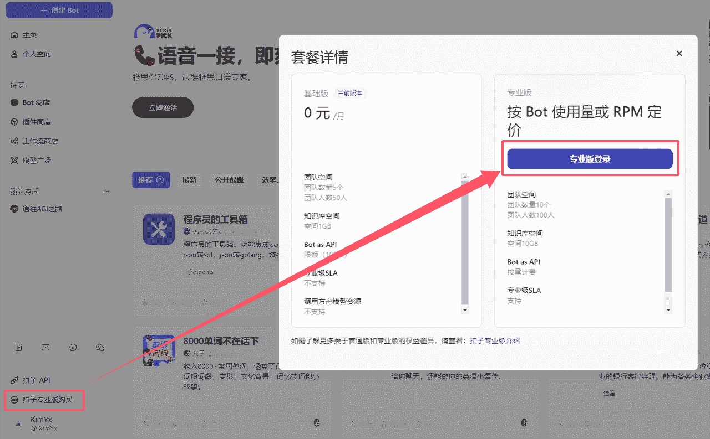

## **                复刻【基础版】**到【专业版】

然后我们进行下一步，复制基础版过来，下面我们需要频繁切换【专业版】与【基础版】。

在【专业版】中，点击扣子专业版，再点击基础版资源复制。

**#**** ****注：只能复制1次！切记注意！**

### 可复制的资源

个人空间和团队空间中本人拥有的 Bot，包括：

+   单 Agent 模式的 Bot

+   多 Agent 模式且不包含 Bot 节点的 Bot

+   工作流模式的 Bot

### 暂不支持复制的资源

+   团队空间中其他人拥有的 Bot、插件、工作流、图像流、知识库或卡片。若有需要，你可以手动复制出一个新的 Bot，这个新 Bot 可以复制到专业版。

+   未绑定 Bot 的插件、工作流、图像流、知识库或卡片。若有需要，可以提前创建一个复制专用的测试 Bot，并绑定这些资源。

+   多 Agent 模式且包含 Bot 节点的 Bot。若有需要，你可以在授权复制前，在基础版中手动复制出一个新的 Bot，并取消其中的 Bot 节点，这个新 Bot 可以复制到专业版中。复制后再参考基础版中的原 Bot，加上 Bot 节点。

+   插件商店中的官方插件、非本人上架的插件。你可以在 Bot 复制完成后，在专业版的插件商店中找到此插件，并手动为 Bot 绑定插件。

+   和专业版空间中已有工作流/图像流同名的工作流/图像流。若有需要，可以提前重命名工作流或图像流。

+   知识库中状态为处理中和处理错误的文档。若有需要，你可以等待知识库中文件处理完成后再启动复制。

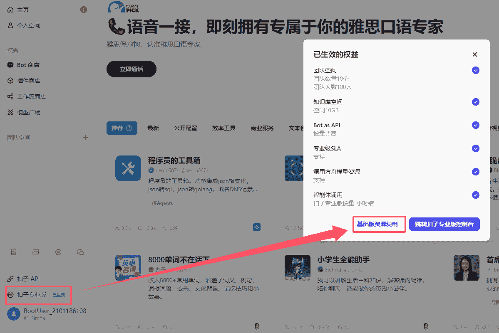

输入【基础版】中的用户名，选择个人空间，用户名如果显示关联了，就是对了。

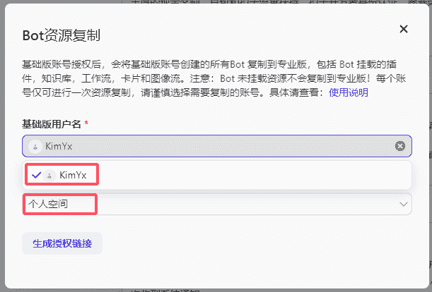

**然后点击授**权链接，会给出一个网址，注意复制此网址。

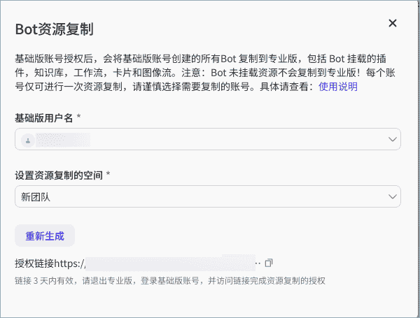

然后退出【专业版】，登录【基础版】

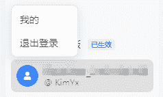

输入刚刚生成的复制网址，点击确认。

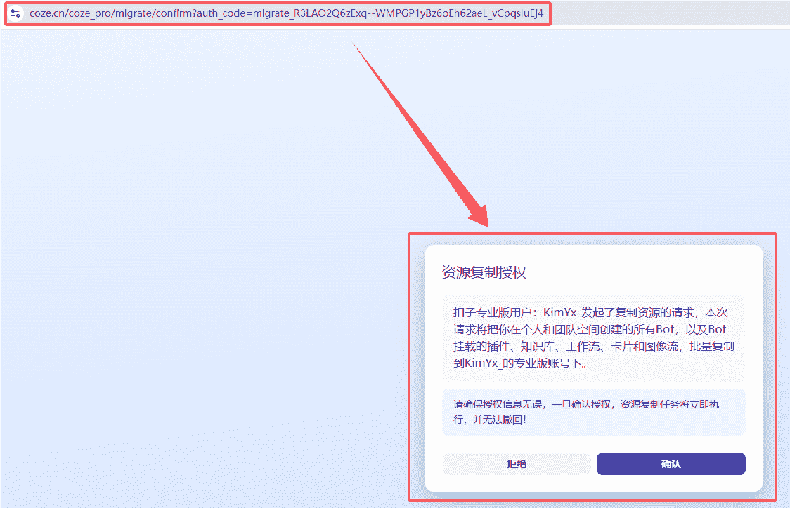

这样就开始复制了，此时我们再登录【专业版】时，可以看到这样的信息，大约需要30分钟同步完成。

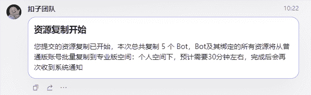

## **                 生**成新的令牌

按照顺序点击。

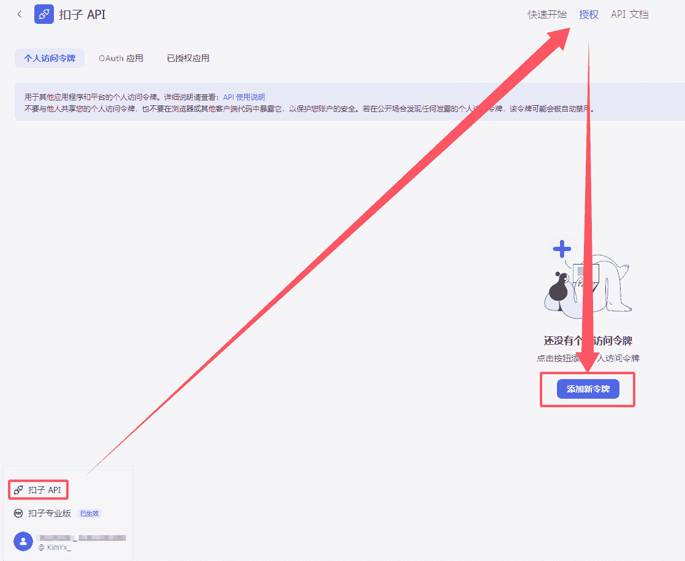

随意输入令牌名称，时效选择永久有效，选择个人空间，下面都打上勾。

**#**注：此处如果下面点不了钩，说明BOT【未发布】或【尚未发布成功】。COW下Config中需要替换BOT新的ID。

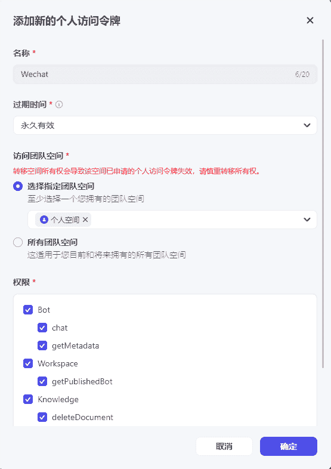

复制新的令牌即可，以及新的BOT ID。

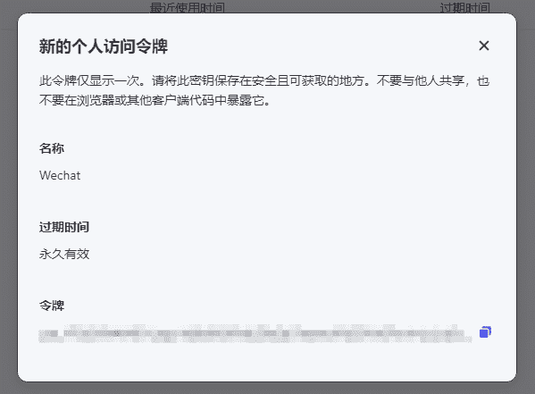

##                计  费

翻了半天我才看明白，原来计费分为两块：

+   **Bot 调用**：包括 Bot 开发者在内的任意用户向 Bot 发送的一次有效对话请求计为一次 Bot 调用。由扣子专业版统计 Bot 调用次数并收费。

+   **方舟模型费用**：根据大语言模型的 Token 使用量计费，由方舟大模型服务平台统计用量并收取费用。

**Bot 调用**

其中Bot调用首次1元折扣礼包，参考之前的教程 - https://mp.weixin.qq.com/s/L0XT7wYvI6aIybWoQ-w2MA

首次需要认证，扫个脸就行。然后付费1元就能解锁50万BOT资源量。

控制台查看地址：https://console.volcengine.com/coze-pro/overview

最下面查看余量和限制时间。

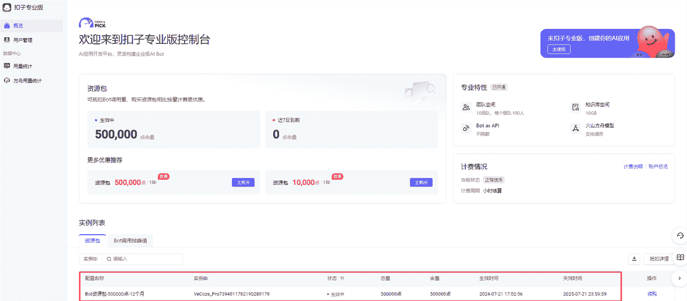

**方舟模型调用**

火山引擎控制台：https://console.volcengine.com/ark/region:ark+cn-beijing/model

它会免费给50万Token，按照下图，查看余量。

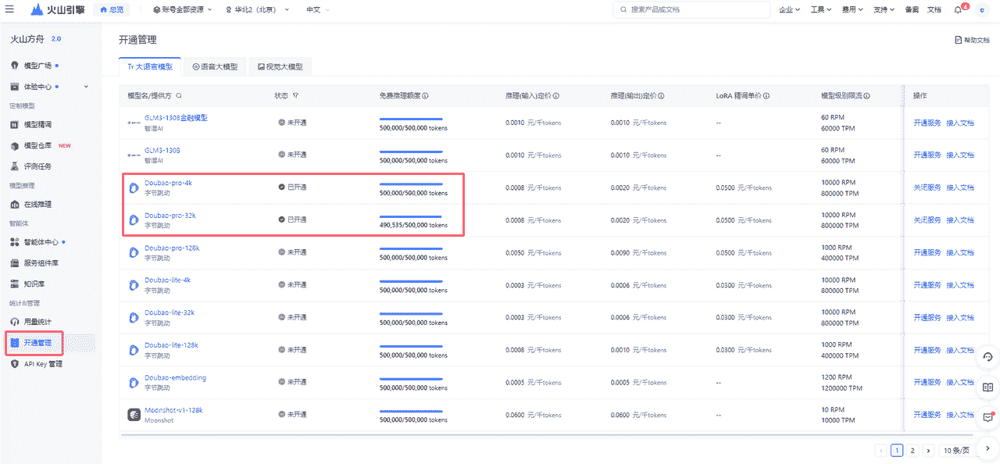

**方舟模型费用说明**

实打实说，算很便宜了，依靠Coze平台的功能，性价比算是非常高的了。

全部计费请查看地址：https://www.volcengine.com/docs/82379/1099320  （知识库等是额外计费项）

<https://my.feishu.cn/sync/HDlcdCPBksnJpBbRk0EcW364nmc>