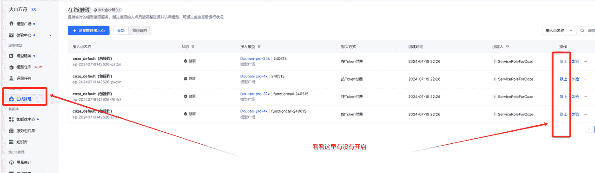
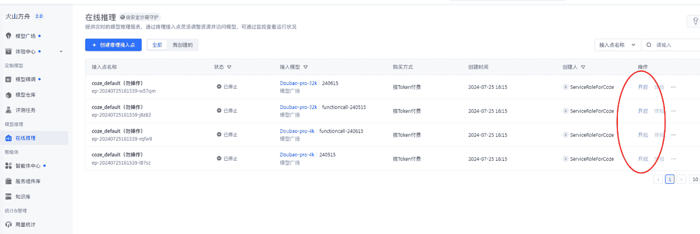

# Coze.cn 欠费后操作步骤详解

> 来源：[https://my.feishu.cn/docx/AEx7dMrDroYa7sx3nLuc9xaInpf](https://my.feishu.cn/docx/AEx7dMrDroYa7sx3nLuc9xaInpf)

打开方舟控制台：https://console.volcengine.com/ark/region:ark+cn-beijing/model

找到【在线推理】

如果后面是【停止】则代表健康状态，欠费后，图上的【停止】会变成【开启】。

需要充值后，点击【开启】。

点击【开启】后，才能正常使用。

<https://my.feishu.cn/sync/HDlcdCPBksnJpBbRk0EcW364nmc>