# Dify

> 来源：[https://my.feishu.cn/docx/UAlEdpqTroLXSZx3O1OcnKfmnqe](https://my.feishu.cn/docx/UAlEdpqTroLXSZx3O1OcnKfmnqe)

## [Dify on WeChat ](https://github.com/hanfangyuan4396/dify-on-wechat)是 ChatGPT on W[eChat](https://github.com/langgenius/dify) [的下游分支，额外实现了对接 D](https://github.com/hanfangyuan4396/dify-on-wechat)ify API，支持 Dify 聊天助手、支持 Agent 调用工具和知识库，支持 Dify 工作流，详情请查看 GitHub 仓库 Dify on WeChat。

## COW当中的内容（[※ Chatgpt-On-Wechat相关说明](https://tffyvtlai4.feishu.cn/wiki/LuAYwFVaFiNL8hkJT8jci8gsnmg)），基本都适用于DOW

## **更新日志**

+   2024/10/01 新增插件CustomDifyApp与GroupAtAutoreply，CustomDi[**fyApp支持根**](https://github.com/blankbro)据群聊名称关键词自动切换不同的Dify应用，GroupAtAutoreply支持群聊艾特自动回复，贡献者blankbro

+   2024/09/18 支持dify voice

+   2024/08/09 dify chatbot类型应用支持解析markdown格式响应，分别发送文本、图片和文件

+   2024/08/04 支持dify图片识别功能

+   2024/08/03 微信支持通过web ui扫码登录或异常重启，已适配docker容器

+   2024/08/01 同步上游chatgpt on wechat最新功能，docker镜像地址支持阿里云容器仓库ACR

+   2024/04/30 支持windows环境下企业微信个人号

+   2024/04/24 集成JinaSum插件，修复总结微信公众号文章，修复dify usage key error, 修复dify私有部署的图片url错误

+   [**2024/04/16**](https://github.com/lei195827) 支[**持基本的企业微**](https://github.com/sisuad)信客服通道，感谢@lei195827, @sisuad 的贡献

+   2024/04/14 Suno音乐插件，Dify on WeChat对接详细教程，config文件bug修复

+   2024/04/08 支持聊天助手类型应用内置的Chatflow，支持dify基础的对话Workflow

+   2024/04/04 支持docker部署

+   2024/03/31 支持coze api(内测版)

+   2024/03/29 支持dify基础的对话工作流，由于dify官网还未上线工作流，需要自行部署测试 0.6.0-preview-workflow.1。

## 1. 概述

微信作为最热门的即时通信软件，拥有巨大的流量。

微信友好的聊天窗口是天然的AI应用LUI(Language User Interface)/CUI(Command User Interface)。

微信不仅有个人微信，同时提供了公众号、企业微信、企业微信应用、企业微信客服等对话渠道，拥有良好的微信生态。

把[Dify应用接入微信生态，就](https://github.com/hanfangyuan4396/dify-on-wechat)能打造一个功能强大的智能客服，大大降低客服成本，同时也能够提升客户体验。本篇教程就是手摸手地教你如何利用Dify on WeChat项目，把Dify应用接入微信生态。

目前[Dify on WeChat](https://github.com/hanfangyuan4396/dify-on-wechat)已经测试过的通道如下：

+    **个人微信**

+    **企业微信应用**

+    **企业服务公众号**

+    企业微信个人号(仅windows系统)

+    **个人订阅公众号** 待测试

+    **企业微信客服** 待测试

+    **钉钉** 待测试

+    **飞书** 待测试

##

## 2. Dify接入个人微信

###

### 2.1. 准备工作

####

#### 2.1.1. 创建聊天助手

**（1）Dify 简介**

Dify 是一个优秀的 LLMOps（大型语言模型运维）平台，Dify 的详细介绍请移步官方文档欢迎使用 Dify | 中文 | Dify。

（2）登录 Dify 官方应用平台

首先，登录[ Dify 官方应用平台](https://cloud.dify.ai/signin)，你可以选择使用 Github 登录或者使用 Google 登录。此外，你也可以参考 Dify 官方教程 Docker Compose 部署 | 中文 | Dify 私有部署，Dify 是开源项目，支持私有部署。

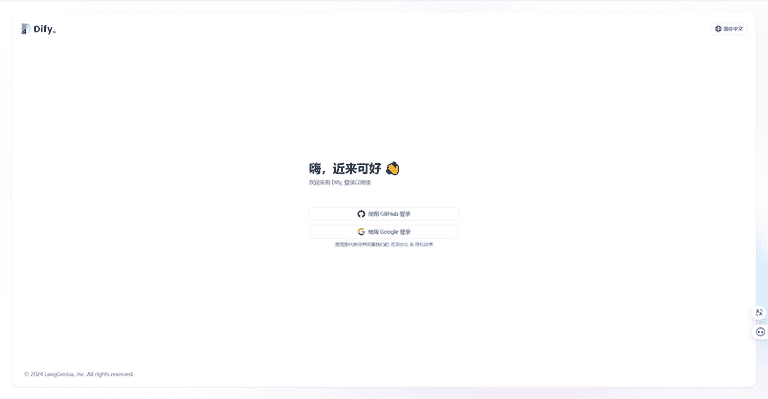

（3）创建 Dify 基础编排聊天助手应用

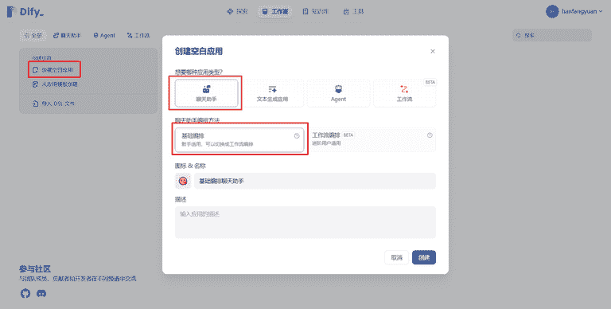

登录成功后，进入 Dify 页面，我们按照下方步骤创建一个基础编排聊天助手应用

1.  点击页面上方的工作室

1.  创建空白应用

1.  应用类型选择聊天助手

1.  聊天助手编排方式选择基础编排

1.  选择应用图标并为应用填写一个名称，比如基础编排聊天助手

1.  点击创建

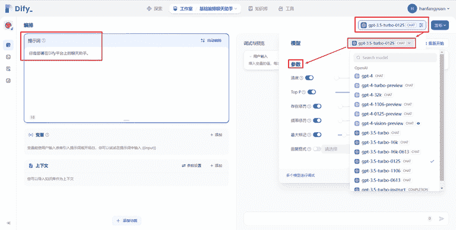

创建成功后我们会跳转到上图所示页面，我们继续配置应用

1.  选择模型，如 gpt-3.5-turbo-0125

1.  设置模型参数

1.  填写应用提示词

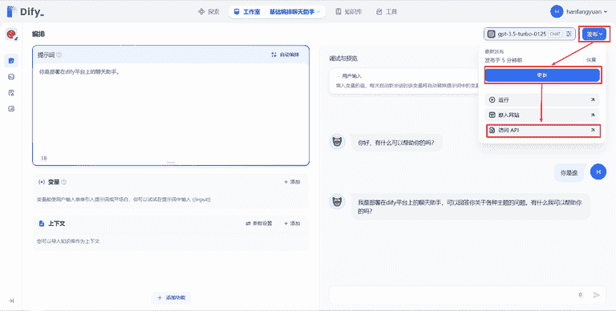

在配置完成后，我们可以在右侧对话框进行测试，在测试完成后，进行如下操作

1.  发布

1.  更新

1.  访问 API

（4）生成基础编排聊天助手 API 密钥

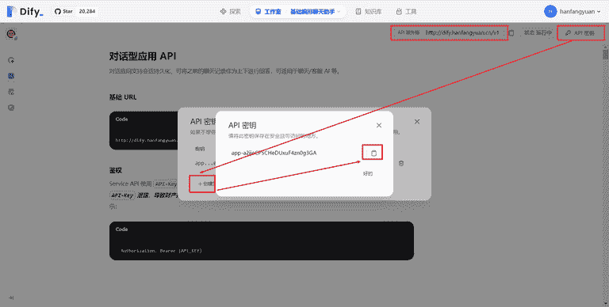

在点击"访问 API"后，我们会跳转到上图的 API 管理页面，在这个页面我们按照如下步骤获取 API 密钥：

1.  点击右上角 API 密钥

1.  点击创建密钥

1.  复制保存密钥

1.  在保存密钥后，还需要查看右上角的 API 服务器，如果是 Dify 官网的应用，API 服务器地址为 "https://api.dify.ai/v1"， 如果是私有部署的，请确认你自己的 API 服务器地址。

**至此，创建聊**天**助手的准备工作结束，**在此小节中我们只需要保存好两个东西：API 密钥与 API 服务器地址

####

#### 2.1.2. 下载 Dify on WeChat 项目

（1）Dify on WeChat 项目简介

[Dify on WeChat ](https://github.com/hanfangyuan4396/dify-on-wechat)是 ChatGPT on W[eChat](https://github.com/langgenius/dify) [的下游分支，额外实现了对接 D](https://github.com/hanfangyuan4396/dify-on-wechat)ify API，支持 Dify 聊天助手、支持 Agent 调用工具和知识库，支持 Dify 工作流，详情请查看 GitHub 仓库 Dify on WeChat。

**（2）下载代码并安装依赖**

1.  下载项目代码

复制

```
git clone https://github.com/hanfangyuan4396/dify-on-wechat
cd dify-on-wechat/
```

1.  安装 python

[Dify on We](https://www.python.org/downloads/)Chat 项目使用 python 语言编写，请在 python 官网下载安装 python，推荐安装 python3.8 以上版本，我在 ubuntu 测试过 3.11.6 版本，可以正常运行。

1.  安装核心依赖（必选）：

复制

```
pip3 install -r requirements.txt  # 国内可以在该命令末尾添加 &quot;-i https://mirrors.aliyun.com/pypi/simple&quot; 参数，使用阿里云镜像源安装依赖
```

1.  拓展依赖 （可选，建议安装）：

复制

```
pip3 install -r requirements-optional.txt # 国内可以在该命令末尾添加 &quot;-i https://mirrors.aliyun.com/pypi/simple&quot; 参数，使用阿里云镜像源安装依赖
```

**（3）填写配置文件**

我们在项目根目录创建名为 config**.json 的文件，文件**内容如下，我**们在 2.1.**1** 小节（4） 最后保**存了 **API 密钥与 API 服务器**地址，**请把 dify_ap**i**_base 配置为 API** 服务**器地址；dif**y_api_key 配置为 API 密钥其他配置保持不变。

**（PS: 很****多朋友可能并不是严格按照我教程**给出的步骤创建聊天助手**类型的 **Dify 应**用，在此特别说明**一下 d**ify_app**_type **配置方法，如**果你创建了**聊天助**手应用请配置**为 chatbot**；创建了 Agent 应用请配置为 agent； 创建了工作流应用请配置为 workflow。)

复制

```
{
&quot;dify_api_base&quot;: &quot;https://api.dify.ai/v1&quot;,  
&quot;dify_api_key&quot;: &quot;app-xxx&quot;,  
&quot;dify_app_type&quot;: &quot;chatbot&quot;,  
&quot;channel_type&quot;: &quot;wx&quot;,  
&quot;model&quot;: &quot;dify&quot;,  
&quot;single_chat_prefix&quot;: [&quot;&quot;],  
&quot;single_chat_reply_prefix&quot;: &quot;&quot;,  
&quot;group_chat_prefix&quot;: [&quot;@bot&quot;],  
&quot;group_name_white_list&quot;: [&quot;ALL_GROUP&quot;]
}
```

###

### 2.2. 把基础编排聊天助手接入微信

####

#### 2.2.1. 快速启动测试

（1）在 Dify on Wechat 项目根目录执行如下命令

复制

```
cd dify-on-wechatpython3 app.py   # windows环境下该命令通常为 python app.py
```

**（2）扫码登录**

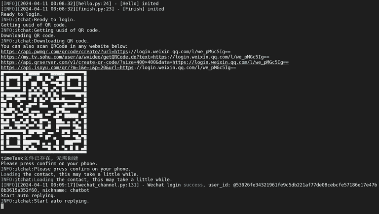

**本项目使**用 **itch**at 实现个人微信登录，有封号风险，建议使用实名认证过的微信小号进行测试，在执行上述命令后，我们可以在控制台看到打印如上图所示二维码，使用微信扫码登录，登录后当看到"itchat:Start auto replying。"字符，表示登录成功，我们可以进行测试。

**（3）对话测试**

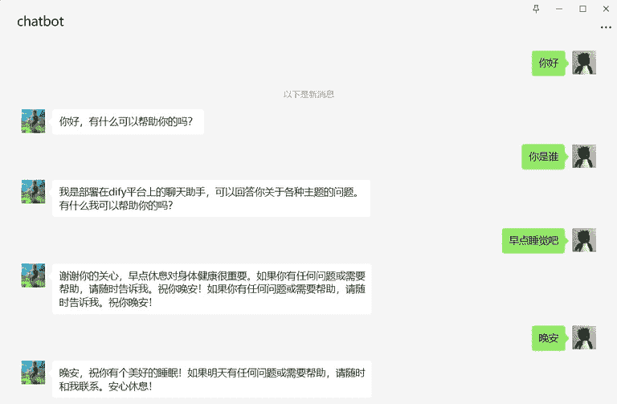

我们看到，微信机器人的回复与在 Dify 测试页面上的回复一致。至此，恭喜你成功把 Dify 接入了个人微信🎉🎉🎉

（PS: 有些朋友到这里可能在日志中看到正**常回复了消息，但是微信中没有**收到消息，请不要用自己的微信给自己发消息）

**（4）服务器部署**

1.  源码部署

复制，在后台运行程序并通过日志输出二维码

```
cd dify-on-wechatnohup python3 app.py &amp; tail -f nohup.out 
```

1.  docker compose 部署

容器的**环境变量**会**覆盖** **config.json **文件的配置，请修改 docker/docker-compose.yml 文件环境变量为你实际的配置，配置方法与 2.1.1 小节（4） 的 config.json 配置一致。

请确保正确配置** DIFY_API_BASE**， **DIFY_API_KEY **与** DIFY_APP_TYPE **环境变量。

复制

```
version: &#x27;2.0&#x27;
services:  dify-on-wechat:    
image: hanfangyuan/dify-on-wechat    
container_name: dify-on-wechat    
security_opt:      - seccomp:unconfined    
environment:      
DIFY_API_BASE: &#x27;https://api.dify.ai/v1&#x27;      
DIFY_API_KEY: &#x27;app-xx&#x27;      
DIFY_APP_TYPE: &#x27;chatbot&#x27;      
MODEL: &#x27;dify&#x27;      
SINGLE_CHAT_PREFIX: &#x27;[&quot;&quot;]&#x27;      
SINGLE_CHAT_REPLY_PREFIX: &#x27;&quot;&quot;&#x27;      
GROUP_CHAT_PREFIX: &#x27;[&quot;@bot&quot;]&#x27;      
GROUP_NAME_WHITE_LIST: &#x27;[&quot;ALL_GROUP&quot;]&#x27;
```

然后执行如下命令启动容器

复制 - 进入 docker 目录 - 启动 docker 容器 -  查看二维码并登录

```
cd dify-on-wechat/docker       
docker compose up -d
docker logs -f dify-on-wechat            
```

### 2.3. 把工作流编排聊天助手接入微信

在把 Dify 基础的聊天助手应用接入微信后，我们接下来增加难度，尝试把工作流编排聊天助手应用接入微信，实现一个具有 Dify 平台知识的微信智能客服，为我们解答 Dify 工作流相关知识。

####

#### 2.3.1. 创建知识库

**（1）下载知识库文件**

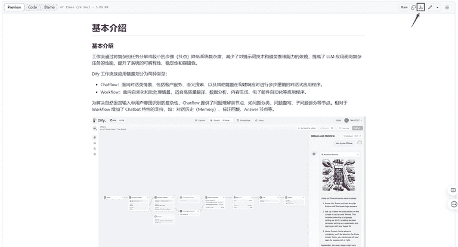

我们到[ dify 文档仓库](https://docs.dify.ai/v/zh-hans/guides/workflow)下载 Dify 工作流介绍的文档。

**（2）Dify 中导入知识库**

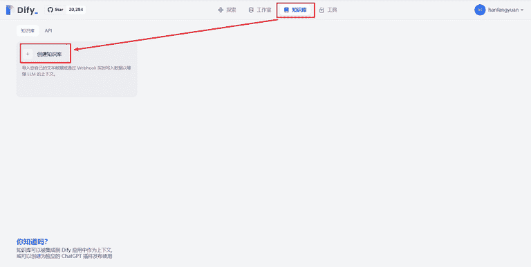

进入知识库页面，创建知识库

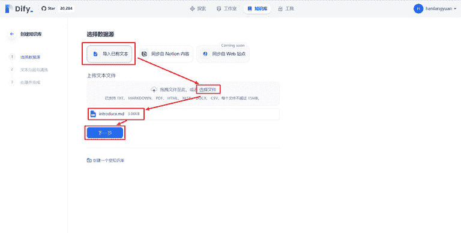

选择导入已有文本，上传刚才下载的 introduce.md 文件，点击下一步

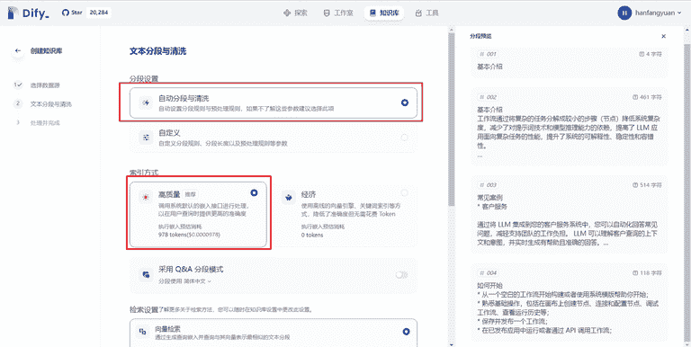

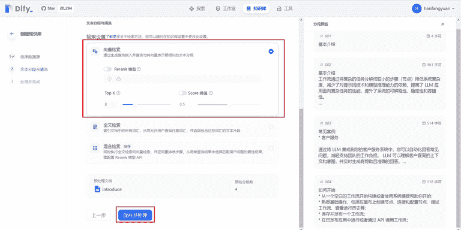

选择如下配置

+   分段设置：自动分段与清洗

+   索引方式：高质量

+   检索设置：向量检索

最后点击保存并处理

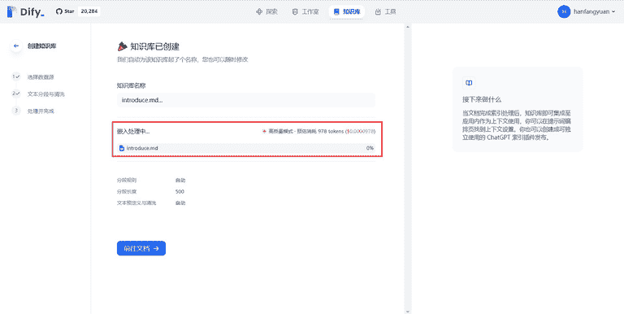

我们看到知识库正在进行嵌入处理，稍等片刻，即可嵌入成功。

####

#### 2.3.2. 创建工作流编排聊天助手

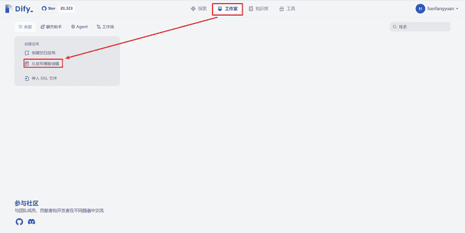

我们进入 Dify 工作室，点击从应用模板创建

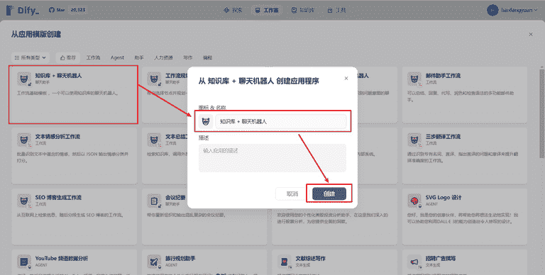

我们使用知识库+聊天机器人类型的模板，设置应用图标与名称，点击创建

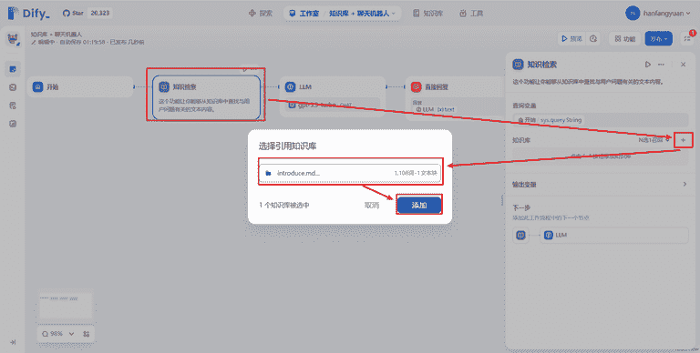

跳转到工作流编排页面后，先点击知识检索节点，点击最右侧"+"添加知识库。我们选择之前上传好的 introduce.md 知识库，该知识库是对 Dify 工作流的基本介绍。最后我们点击添加，知识库节点设置完成。

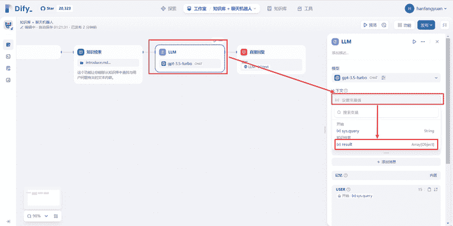

接下来选择 LLM 节点，点击设置上下文，我们选择 result 变量，该变量存有知识检索的结果。

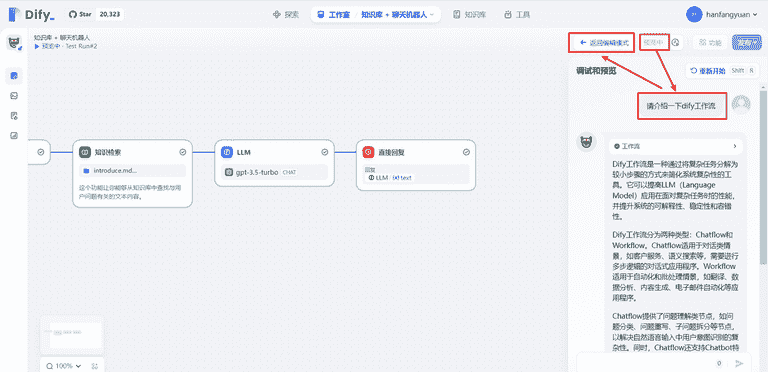

设置完 LLM 节点后，我们点击预览进行测试，输入问题：请介绍一下 dify 工作流。可以看到最终输出了 Dify 工作流的正确介绍。测试正常后，我们返回编辑模式。

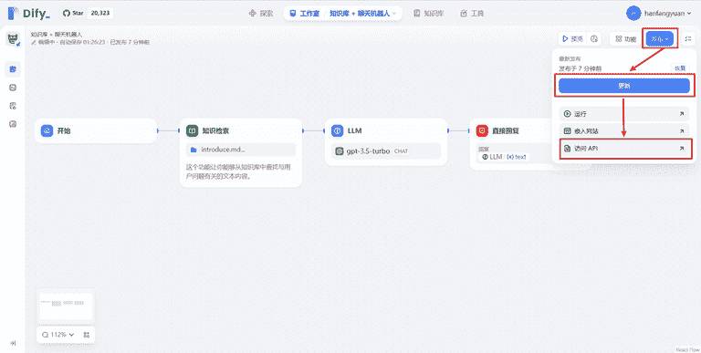

返回编辑模式后，依次点击发布、更新、访问 API

####

#### 2.3.3. 生成工作流编排聊天助手 API 密钥

在**跳转到 API 管理**页面后，我们参照 2.1.1 小节（4）获取"知识库+聊天机器人"应用的 API 密钥与 API 服务器地址

####

#### 2.3.4. 接入微信

与** **2.1**.2 小节（3）类**似，我们在项目根目录创建名为 **config.json 的**文件，**文件内容如下，同样**把 dify_api_base 配置为知识库+聊天机器人应用的 API 服务器地址， dify_api_key 配置为知识库+聊天机器人应用的 API 密钥，其他配置保持不变

复制

```
{   
&quot;dify_api_base&quot;: &quot;https://api.dify.ai/v1&quot;,  
&quot;dify_api_key&quot;: &quot;app-xxx&quot;,  
&quot;dify_app_type&quot;: &quot;chatbot&quot;,  
&quot;channel_type&quot;: &quot;wx&quot;,  
&quot;model&quot;: &quot;dify&quot;,  
&quot;single_chat_prefix&quot;: [&quot;&quot;],  
&quot;single_chat_reply_prefix&quot;: &quot;&quot;,  
&quot;group_chat_prefix&quot;: [&quot;@bot&quot;],  
&quot;group_name_white_list&quot;: [&quot;ALL_GROUP&quot;]
}
```

我们按照** 2.2.1 小节**启动程序并扫码登录，然后给微信机器人发送消息，进行测试

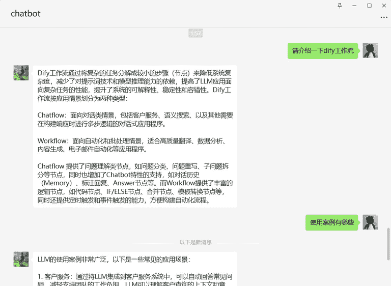

微信机器人的回复与在 Dify 测试页面上的回复一致。恭喜你更进一步，把工作流编排应用接入了个人微信，你可以向知识库中导入更多的 Dify 官方文档，让微信机器人为你解答更多的 Dify 相关问题。

###

### 2.4. 把 Agent 接入微信

####

#### 2.4.1. 创建 Agent 应用

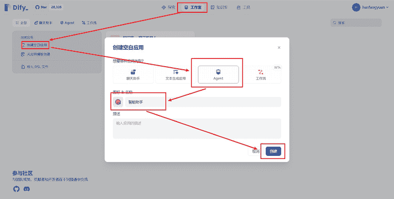

进入工作室页面，点击创建空白应用，选择 Agent，设置图标和应用名称，最后点击创建

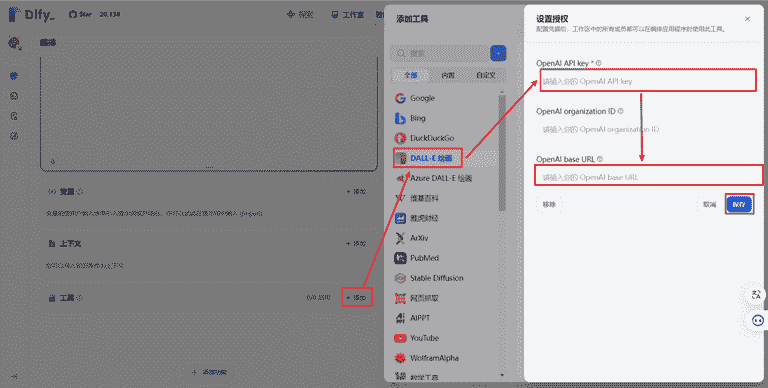

创建成功后，我们会进入 Agent 应用配置页面，在这个页面我们选择好对话模型，然后添加工具。我们首先添加 DALL-E 绘画工具，首次使用该工具需要授权，一般我们设置好 OpenAI API key 和 OpenAI base URL 即可使用该 DALL-E 绘画工具。

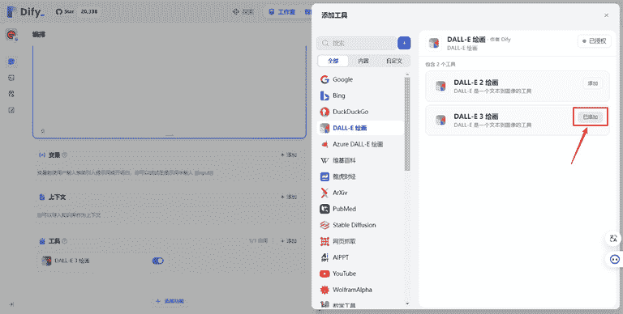

授权成功后，我们添加 DALL-E 3 绘画工具

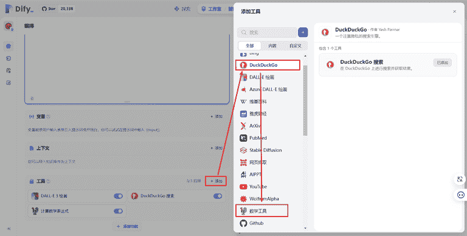

接着，继续添加 DuckDuckGo 搜索引擎和数学工具，进行后续的工具测试

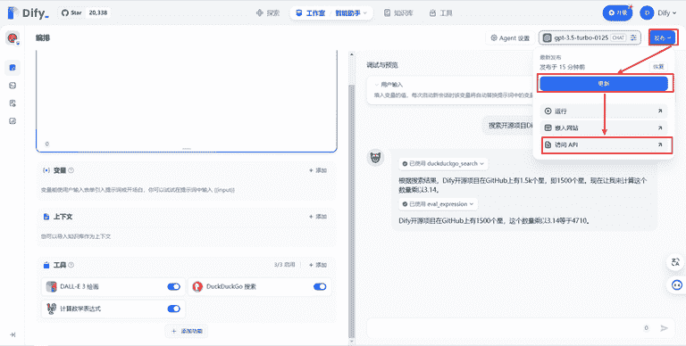

我们输入问题"搜索开源项目 Dify 的 star 数量，这个数量乘以 3.14 是多少"，确认应用能够正常调用工具，我们依次点击发布、更新、访问 API

####

#### 2.4.2. 生成 Agent API 密钥

我们继续参照 2.**1.1 小节（**4**）获取智能助手应用的** API 密钥与 API 服务器地址

####

#### 2.4.3. 接入微信

我们在项目根目录创建名为 config**.json 的文件，文件内容如**下，同**样把 d**ify_api_base 配**置为智能助手应用的 API** 服务**器地址；****dify**_api_key **配置为智能助手应用的 API **密钥，**注意该应用为**智能助手类型应用，还需要把 dify_app_type 设置为 agent，其他配置保持不变

复制

```
  {    
  &quot;dify_api_base&quot;: &quot;https://api.dify.ai/v1&quot;,    
  &quot;dify_api_key&quot;: &quot;app-xxx&quot;,    
  &quot;dify_app_type&quot;: &quot;agent&quot;,    
  &quot;channel_type&quot;: &quot;wx&quot;,    
  &quot;model&quot;: &quot;dify&quot;,    
  &quot;single_chat_prefix&quot;: [&quot;&quot;],    
  &quot;single_chat_reply_prefix&quot;: &quot;&quot;,    
  &quot;group_chat_prefix&quot;: [&quot;@bot&quot;],    
  &quot;group_name_white_list&quot;: [&quot;ALL_GROUP&quot;] 
  }
```

继续参照** 2.2.1 小节**启动程序并扫码登录，然后给微信机器人发送消息，进行测试

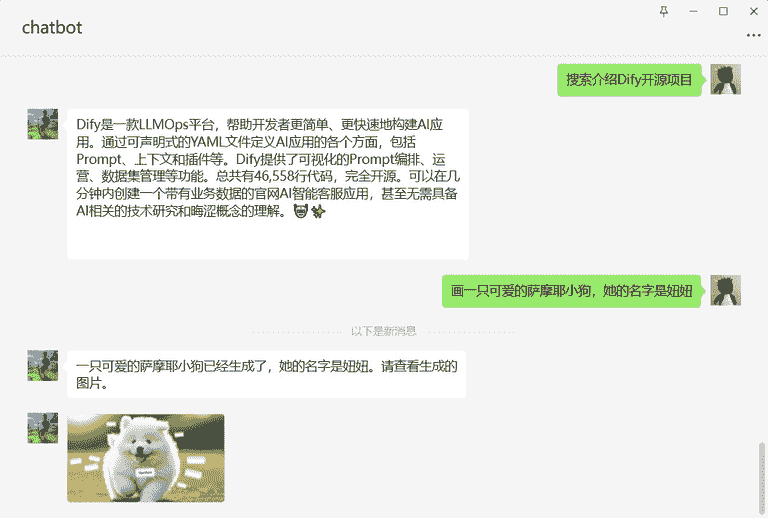

可以看到微信机器人可以正常使用搜索和绘画工具。再一次恭喜你，把 Dify Agent 应用接入微信。也恭喜我，写到这里可以先睡觉了。

###

### 2.5. 把工作流接入微信

####

#### 2.5.1. 创建工作流应用

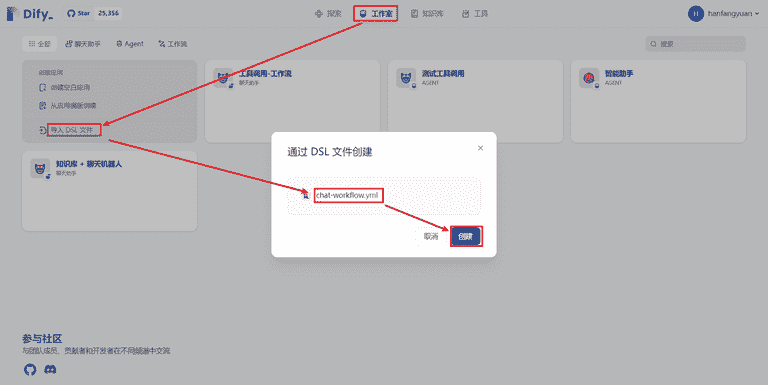

[首先你需要提](https://github.com/hanfangyuan4396/dify-on-wechat/blob/master/dsl/chat-workflow.yml)前下载好我预先创建的 DSL 文件，点击此处下载。下载完成后，进入工作室页面，点击导入 DSL 文件，上传提前下载好的文件，最后点击创建。

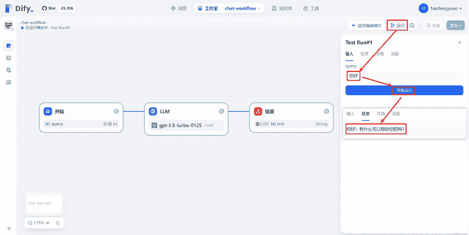

创建完成后，按照上图步骤进行测试。点击运行，输入你好，确保该工作流能正常输出结果。

**你可以在此**[工作流的基础上进行修改，但是对](https://github.com/hanfangyuan4396/dify-on-wechat)于工作流**类型的应用**，它的**输入变量名称十****分灵活，，**为**了更方便地接入****微信机器**人，Dify on WeChat 项目约定工作流类型的应用输入变量命名为query，输出变量命名为text。

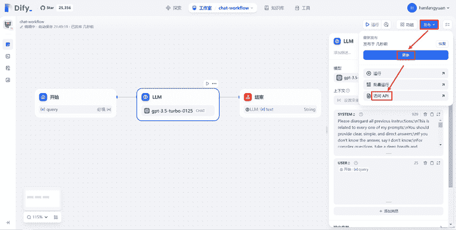

测试没有问题后，按照上图步骤发布应用，依次点击发布、更新、访问 API。

####

#### 2.5.2. 生成工作流 API 密钥

我们同样参照 2.**1.1 小节（**4**）获取工作流应用的 **API 密钥与 API 服务器地址。

####

#### 2.5.3. 接入微信

我们在项目根目录创建名为 config**.json 的文件，文件内容如**下，同**样把 **dify_api_base **配置为工作流应用的 API** 服务**器地址****；di**fy_api_ke**y 配置为工作流应用的 API** 密钥**，注意该应用为工作**流类型应用，还需要把 dify_app_type 设置为 workflow，其他配置保持不变

复制

```
  {    
  &quot;dify_api_base&quot;: &quot;https://api.dify.ai/v1&quot;,    
  &quot;dify_api_key&quot;: &quot;app-xxx&quot;,    
  &quot;dify_app_type&quot;: &quot;workflow&quot;,    
  &quot;channel_type&quot;: &quot;wx&quot;,    
  &quot;model&quot;: &quot;dify&quot;,    
  &quot;single_chat_prefix&quot;: [&quot;&quot;],    
  &quot;single_chat_reply_prefix&quot;: &quot;&quot;,    
  &quot;group_chat_prefix&quot;: [&quot;@bot&quot;],    
  &quot;group_name_white_list&quot;: [&quot;ALL_GROUP&quot;] 
  }
```

同样参照** 2.2.1 小节**启动程序并扫码登录，然后给微信机器人发送消息，进行测试。

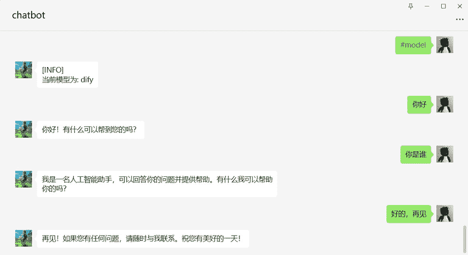

可以看到机器人成功接通了工作流 api 并进行了回复，至此我们已经完全掌握了如何创建 Dify 所有类型的应用：基础聊天助手、工作流聊天助手、智能助手、工作流，我们也学会了如何把上述应用发布为 API，并接入微信。

接下来我将会介绍如何把应用接入到微信的其他通道，如公众号、企业微信应用、企业微信客服等。

##

1.  Dify 接入企业微信个人号（仅限 windows 环境）

1.  有**封号风险**，请使用企业微信**小号**测试

1.  [在登录旧版本的企业微](https://github.com/zhayujie/chatgpt-on-wechat/issues/1525)信时可能会出现企业微信版本过低，无法登录情况，参考 issue1525，请尝试更换其他企业微信号重试

###

### 3.1. 下载安装企业微信

确保你有一台 windows 系统的电脑，[然后在此电脑](https://dldir1.qq.com/wework/work_weixin/WeCom_4.0.8.6027.exe)下[载安装特定版](https://www.alipan.com/s/UxQHrZ5WoxS)本的企业微信，官方下载链接，备用下载链接。

###

### 3.2. 创建 Dify 应用

我们已经在前面的** 2.1.1**、**2.3.2**、**2.4.1 **与** 2.5.1 **小节分别介绍了创建基础聊天助手、工作流聊天助手、智能助手、工作流这 4 种不同的 Dify 应用，你可以根据上面的教程任意创建一种应用。

###

### 3.3. 下载安装 Dify on WeChat

根据 **2.1.2（2）** 步骤，下载代码并安装依赖，为了后续能按照 ntwork 依赖，请确保你安装的 python 版本为 3.8、3.9 或 3.10。

###

### 3.4. 安装 ntwork 依赖

由于 ntwork 的安装源不是很稳定，可以下载对应的 whl 文件，使用 whl 文件离线安装 ntwork

首先需要查看你的 python 版本，在命令行中[输入 python 查看](https://github.com/hanfangyuan4396/ntwork-bin-backup/tree/main/ntwork-whl)**版本信息**，然后在 ntwork-whl 目录下找到对应的 whl 文件，运行pip install xx.whl安装 ntwork 依赖，注意"xx.whl"更换为 whl 文件的实际路径。

例如我的 python 版本信息为

"Python 3.8.5 (default, Sep 3 2020, 21:29:08) [MSC v.1916 64 bit (AMD64)]"

可以看到 python 版本是** 3.8.5**，并且是** AMD64**，所以对应的 whl 文件为** ntwork-0.1.3-cp3**8-cp38-win_amd64.whl，需要执行如下命令安装

复制

```
pip install your-path/ntwork-0.1.3-cp38-cp38-win_amd64.whl
```

###

### 3.5. 填写配置文件

我们**在 Dify** on WeChat 项目根目录创建名为 config.json 的文件，下面是以 Dify 智能助手应用作为示例的配置文件，请正确填写你刚刚创建应用的 dify_api_base、dify_api_key、dify_app_type 信息，请注意 channel_type 填写为 wework

复制

```
{   
&quot;dify_api_base&quot;: &quot;https://api.dify.ai/v1&quot;,  
&quot;dify_api_key&quot;: &quot;app-xxx&quot;,  
&quot;dify_app_type&quot;: &quot;agent&quot;,  
&quot;channel_type&quot;: &quot;wework&quot;,  
&quot;model&quot;: &quot;dify&quot;,  
&quot;single_chat_prefix&quot;: [&quot;&quot;],  
&quot;single_chat_reply_prefix&quot;: &quot;&quot;,  
&quot;group_chat_prefix&quot;: [&quot;@bot&quot;],  
&quot;group_name_white_list&quot;: [&quot;ALL_GROUP&quot;]
}
```

###

### 3.6. 登录企业微信

务必提前在电脑扫码登录企业微信

###

### 3.7. 启动微信个人号机器人

运行如下命令启动机器人

复制

```
cd dify-on-wechatpython app.py
```

我们可以看到终端输出如下信息，等待 wework 程序初始化完成，最后启动成功～

复制

```
[INFO][2024-04-30 21:16:04][wework_channel.py:185] - 等待登录······
[INFO][2024-04-30 21:16:05][wework_channel.py:190] - 登录信息:&gt;&gt;&gt;user_id:xxx&gt;&gt;&gt;&gt;&gt;&gt;&gt;&gt;name:
[INFO][2024-04-30 21:16:05][wework_channel.py:191] - 静默延迟60s，等待客户端刷新数据，请勿进行任何操作······
[INFO][2024-04-30 21:17:05][wework_channel.py:224] - wework程序初始化完成········
```

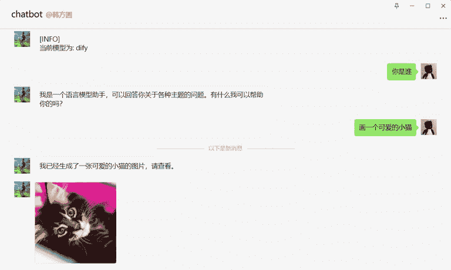

现在我们给机器人发送消息，可以看到接入成功！

<https://my.feishu.cn/sync/HDlcdCPBksnJpBbRk0EcW364nmc>